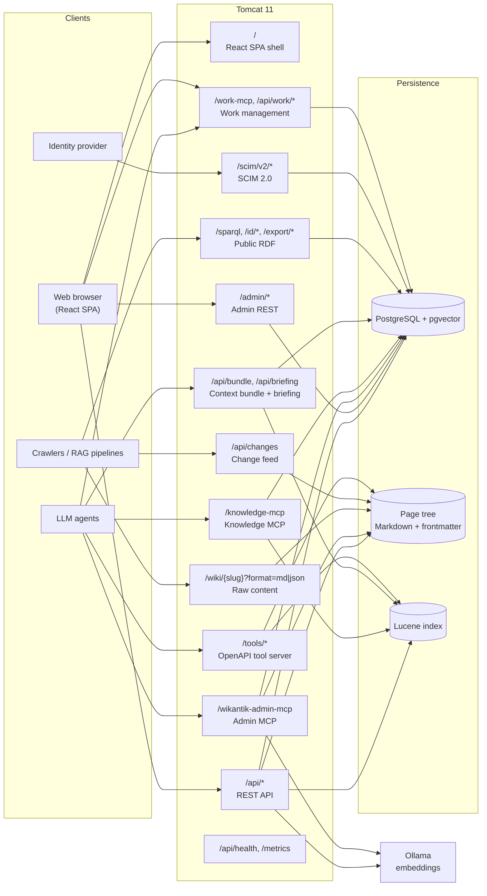

# Wikantik

[](LICENSE)
[](https://openjdk.org/projects/jdk/25/)
[](https://www.postgresql.org/)
[](https://tomcat.apache.org/)
[](https://github.com/jakefearsd/wikantik/actions/workflows/release.yml)
[](https://github.com/jakefearsd/wikantik/commits/main)
[](CODE_OF_CONDUCT.md)

> A Markdown-native knowledge base for people and AI agents: hybrid
> retrieval (BM25 + dense), three MCP servers, a rich editor with diagrams,
> and a work tracker that people and coding agents share. Runs on
> Tomcat 11 and PostgreSQL + pgvector.

**See it running:** [wiki.wikantik.com](https://wiki.wikantik.com/) is a live Wikantik instance, and
[www.wikantik.com](https://www.wikantik.com/) explains the product.

## What is Wikantik?

Wikantik is a Java wiki engine, rebuilt from JSPWiki, that stores pages as Markdown with YAML frontmatter. It serves a React single-page application, a REST API, three Model Context Protocol (MCP) servers (admin, read-only knowledge, and work management) and an OpenAPI tool server for AI agents, and exposes health checks, Prometheus metrics and structured logs. Pages are grouped into clusters declared by hub pages, indexed by Lucene for full-text search, and ranked by a hybrid BM25 + dense-vector pipeline.

For agents, retrieval is delivered as a *context bundle*: the wiki ranks, de-duplicates and cites sections, and returns them without synthesizing an answer ([ADR-0001](docs/adr/0001-rag-returns-context-bundle-not-synthesized-answer.md)). The *Page Graph* is made of real wikilinks (the LLM-extracted Knowledge Graph was removed in 2026-11). Wikantik calls an embedding model and nothing else: it runs no chat model of its own.

## Key capabilities

- **Markdown authoring** with frontmatter, wikilinks, embeds and LaTeX math: [Editing](docs/user/Editing.md), [Linking](docs/user/Linking.md), [Frontmatter](docs/user/Frontmatter.md), [MathematicalNotation](docs/user/MathematicalNotation.md)
- **Rich and Source editing modes** (Mod+E switches), grid table editing, a synchronised preview pane, and **paste as Markdown** from Google Docs, Word, Confluence, GitHub or any web page, with pasted images uploaded as attachments: [Editing](docs/user/Editing.md)
- **Diagrams in fenced blocks**: ` ```mermaid ` is drawn in the browser, ` ```plantuml ` is drawn on the server in PlantUML's sandbox profile, and both are validated against one shared rule set: [Editing](docs/user/Editing.md)
- **Collaborative editing**: one shared draft per page, live presence and cursors, publish with attribution (off by default, `wikantik.collab.enabled`): [CollaborativeEditing](docs/user/CollaborativeEditing.md)
- **Clusters declared by hub pages**, with multiple memberships per page: [ClustersAndHubs](docs/user/ClustersAndHubs.md)
- **Search**, quick switcher and command palette: [Search](docs/user/Search.md)
- **Reader comment threads and @-mentions**, with an opt-in loop where agents answer threads through the admin MCP (an agent may resolve a thread only when it holds a comment from a person who could edit the page), and version-pinned **citations** that flag stale quotes: [CommentsAndMentions](docs/user/CommentsAndMentions.md), [Citations](docs/user/Citations.md)
- **Obsidian dialect and vault import/export**: block references, `==highlights==`, `%%comments%%` hidden from readers who cannot edit, and inline `#tags`: [ObsidianImportExport](docs/user/ObsidianImportExport.md)
- **Work management** at `/work`: projects, boards, sprints, change records with autonomy gates, deployments with a deploy gate, and flow figures. Coding agents work from queues with their own tokens, each capped by a human sponsor, through `/work-mcp` (off by default, `wikantik.work.enabled`): [WorkManagement](docs/user/WorkManagement.md)
- **MCP servers and an OpenAPI tool server** for AI agents (admin, knowledge and work MCP, plus `/tools/*`); tool lists and counts are in [McpAgents](docs/admin/McpAgents.md)
- **RAG context bundle and session briefing** (`/api/bundle`, `/api/briefing`): [RagContextBundle](docs/admin/RagContextBundle.md)
- **Raw content and change feed** for crawlers and RAG pipelines: [IndexingSupport](docs/admin/IndexingSupport.md)
- **External-source connectors** that sync into derived pages, plus document ingest: [Connectors](docs/admin/Connectors.md), [DerivedPagesAndIngest](docs/admin/DerivedPagesAndIngest.md)
- **RDF/OWL ontology** with public SPARQL: [OntologyManagement](docs/admin/OntologyManagement.md)
- **Embedding spend switch** (`wikantik.genai.mode=full|none`): [CostTiers](docs/admin/CostTiers.md)
- **Search that holds under load**: query-embedding concurrency is learned from the embedder, and a search over the limit, or with the embedder down, falls back to BM25 at once: [WikantikOperations](docs/admin/WikantikOperations.md#123-search-under-load-query-embedding-concurrency)
- **Authentication and authorization**: database-backed policy grants and groups, private clusters hidden from everyone but admins and named groups, SSO, SCIM, scoped API keys, and a tamper-evident audit log: [Security](docs/admin/Security.md), [SingleSignOn](docs/admin/SingleSignOn.md), [ScimProvisioning](docs/admin/ScimProvisioning.md), [ApiKeys](docs/admin/ApiKeys.md), [AuditLog](docs/admin/AuditLog.md)
- **Admin panel** at `/admin/`: [AdminPanel](docs/admin/AdminPanel.md)
- **SEO controls**: sitemap dates from real content changes, noindexed clusters (`wikantik.seo.noindexClusters`) and 410 Gone for retired pages (`wikantik.seo.gonePages`): [SeoAndCrawling](docs/admin/SeoAndCrawling.md)
- **Operations**: health, metrics, backups, retrieval-quality and drift dashboards: [WikantikOperations](docs/admin/WikantikOperations.md)

## Why Wikantik?

| Capability | Wikantik | BookStack | Outline | Wiki.js | MediaWiki | Confluence | Notion |
|---|---|---|---|---|---|---|---|
| **License** | Apache 2.0 | MIT | BSL → Apache | AGPL | GPLv2 | Proprietary | Proprietary |
| **Self-host** | ✅ | ✅ | ✅ | ✅ | ✅ | Data Center only, end of life March 2029 | ❌ |
| **MCP server(s) for agents** | Admin, read-only and work endpoints | ❌ | ❌ | ❌ | ❌ | ❌ | ❌ |
| **OpenAPI tool surface** | ✅ (`/tools/*`) | ❌ | ❌ | ❌ | ❌ | ❌ | ❌ |
| **Hybrid retrieval (BM25 + dense)** | ✅ pgvector + Ollama | ❌ | ❌ | ❌ | ❌ | ✅ (recent) | ✅ |
| **Queryable RDF/SPARQL ontology** | ✅ | ❌ | ❌ | ❌ | ❌ | ❌ | ❌ |
| **Page Graph viewer** (real wikilinks) | ✅ Cytoscape, filterable | partial | ❌ | ❌ | ❌ | ❌ | ❌ |
| **Token-budgeted "for-agent" projection** | ✅ `/api/pages/for-agent/{id}` | ❌ | ❌ | ❌ | ❌ | ❌ | ❌ |
| **Shared work tracker for people and agents** | ✅ `/work`, `/work-mcp` | ❌ | ❌ | ❌ | ❌ | separate product (Jira) | partial |
| **Runbook page type + verification metadata** | ✅ | ❌ | ❌ | ❌ | ❌ | ❌ | partial |
| **Markdown-native (file-tree authoring)** | ✅ | partial | ✅ | ✅ | ❌ | ❌ | ❌ |
| **Stack** | Java 25 / Tomcat 11 / PostgreSQL + pgvector / React | PHP / Laravel | Node.js | Node.js | PHP | JVM | proprietary |
| **AGPL-style copyleft** | no (Apache 2.0) | no | no | **yes** | no (GPLv2) | n/a | n/a |

Wikantik may not fit if you need a hosted SaaS (you run it yourself; [CloudDeployment](docs/admin/CloudDeployment.md) provisions a VM on AWS or GCP), or if you need real-time collaborative editing on by default (it exists but ships off behind `wikantik.collab.enabled`, and with it off each edit is single-author: [CollaborativeEditing](docs/user/CollaborativeEditing.md)). Set `wikantik.genai.mode=none` to run without an embedding model, at the cost of hybrid search ([CostTiers](docs/admin/CostTiers.md)).

## Architecture at a glance



The module map and counts are in [Architecture](docs/developer/Architecture.md).

## Quick start

You need Docker and a clone of this repository.

```bash
cp .env.example .env             # set POSTGRES_PASSWORD
bin/container.sh build           # build the wikantik image
bin/container.sh -e base up -d   # start Tomcat + PostgreSQL/pgvector
```

[GettingStartedGuide](docs/admin/GettingStartedGuide.md) covers the first admin login, the bare-metal path and common pitfalls. For Docker detail see [DockerDeployment](docs/admin/DockerDeployment.md).

## See it running

[wiki.wikantik.com](https://wiki.wikantik.com/) runs the current release. Good places to start:

- How Wikantik itself is built: [WikantikPlatformHub](https://wiki.wikantik.com/wiki/WikantikPlatformHub), [GoodMcpDesign](https://wiki.wikantik.com/wiki/GoodMcpDesign) and [AgentCookbook](https://wiki.wikantik.com/wiki/AgentCookbook)
- Technical hubs: [DistributedSystemsHub](https://wiki.wikantik.com/wiki/DistributedSystemsHub), [GenerativeAIHub](https://wiki.wikantik.com/wiki/GenerativeAIHub), [DatabasePerformanceMonitoringHub](https://wiki.wikantik.com/wiki/DatabasePerformanceMonitoringHub), [DataSciencePracticeHub](https://wiki.wikantik.com/wiki/DataSciencePracticeHub), [OperationsResearchHub](https://wiki.wikantik.com/wiki/OperationsResearchHub) and [SoftwareEngineeringPracticesHub](https://wiki.wikantik.com/wiki/SoftwareEngineeringPracticesHub)
- Deep dives: [VectorIndexingInternals](https://wiki.wikantik.com/wiki/VectorIndexingInternals), [IntervalTrees](https://wiki.wikantik.com/wiki/IntervalTrees), [GoogleOrToolsInPractice](https://wiki.wikantik.com/wiki/GoogleOrToolsInPractice), [JavaBuildToolComparison](https://wiki.wikantik.com/wiki/JavaBuildToolComparison) and [BendLanguage](https://wiki.wikantik.com/wiki/BendLanguage)

The product site, [www.wikantik.com](https://www.wikantik.com/), covers the [platform](https://www.wikantik.com/platform/), [MCP for AI agents](https://www.wikantik.com/platform/mcp-for-ai-agents.html), [work management](https://www.wikantik.com/platform/work-management.html), [enterprise](https://www.wikantik.com/enterprise/) features and [comparisons](https://www.wikantik.com/compare/) with other wikis.

## Documentation

The full index is [docs/README.md](docs/README.md):

- **Users**: [reading, editing, linking and searching pages](docs/README.md#users)
- **Admins**: [install, configure, secure, integrate and operate](docs/README.md#admins)
- **Developers**: [building, testing, architecture and quality](docs/README.md#developers)
- **Archive**: [historical documents](docs/README.md#archive)

## Project

- [Roadmap](ROADMAP.md) and [Changelog](CHANGELOG.md)
- [Contributing](CONTRIBUTING.md) and [Code of Conduct](CODE_OF_CONDUCT.md)
- [Security policy](SECURITY.md) and the operator guide [Security](docs/admin/Security.md)
- Licensed under the Apache License 2.0: [LICENSE](LICENSE), [NOTICE](NOTICE)
- Questions and bug reports: [GitHub Issues](https://github.com/jakefearsd/wikantik/issues)
