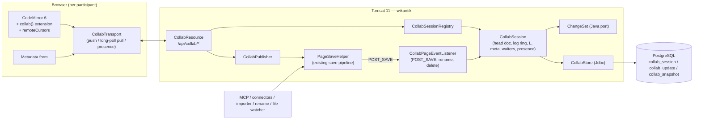
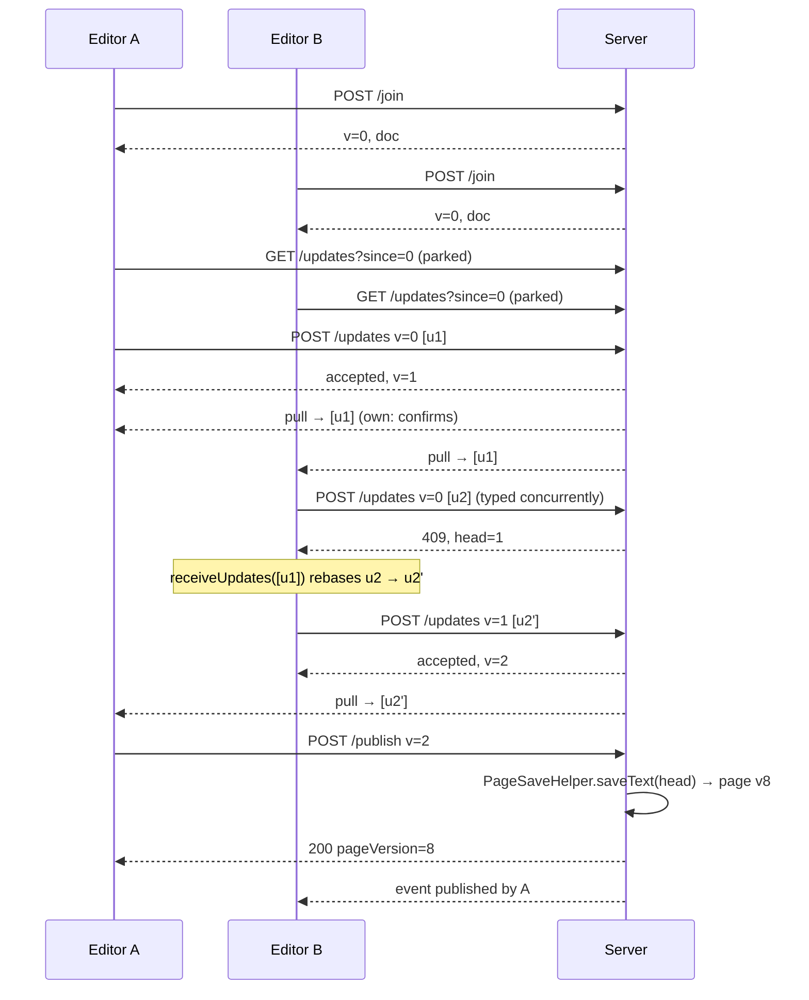

# Multi-Person Editing — Technical Design

| | |
|---|---|
| **Status** | Proposed, revised after a code-verified review (2026-11-06). **§0 Review amendments are authoritative** wherever they conflict with a later section. Nothing implemented. |
| **Date** | 2026-11-06 |
| **Scope** | Real-time concurrent editing of one page by several people in the **existing Markdown (CodeMirror 6) editor**. No WYSIWYG. |
| **Replaces** | "single-author per page" (README) / the "Real-time collaborative editor" item under *Later* in `ROADMAP.md` |

---

## 0. Review amendments (authoritative)

A review of this design against the code (2026-11-06; every claim below was checked at the cited
lines) found gaps. These amendments override the sections they name.

### Critical

**A1 — External writes: the right events, detection by content, rename.** (overrides §3, §7.4)
- No `POST_SAVE` fires in this build: only `PageEventFilter` fires it, and nothing registers one
  (`PageEventFilter.java:104`). Saves end in `POST_SAVE_END` (`DefaultFilterManager.java:291-297`),
  which the existing listeners use (`StructuralIndexEventListener`, `OntologyEventListener`,
  `CitationEventListener`). `CollabPageEventListener` listens for **`POST_SAVE_END`**, for
  **`POST_SAVE_BEGIN`** (the only event `PageDirectoryWatcher` fires, `PageDirectoryWatcher.java:333-347`),
  and for **`WikiPageRenameEvent`**.
- Detect an external change by **content hash** (the session's base hash against the latest
  text's hash), never by version number. `VersioningFileProvider` lets an on-disk edit overwrite
  the current version without adding one.
- Rename writes the renamed page and every referrer's link rewrite with `putPageText`
  (`DefaultPageRenamer.java:129, :208`): no filters, no save events. On `WikiPageRenameEvent`, the
  listener rekeys the renamed page's session and reconciles **every live session among the
  referrers** by content hash.
- Publish always reconciles by content hash **before** it saves. That is the backstop for any
  event that was missed.

**A2 — Publish needs an atomic save; Phase 0 fixes `PageSaveHelper`.** (overrides §7.3)
- Today the optimistic check (`PageSaveHelper.checkOptimisticLocking`, `:89-108`) and the save
  (`:80`) run with no lock between them; `DefaultPageLifecycle.saveText` (`:73-115`) takes none,
  and the provider's lock covers only `putPageText`. A writer with no `expectedVersion` (MCP,
  cluster rename) can save between the check and the write. That is a defect today for every
  strict-mode client, not only for collaboration.
- **Phase 0 (test first):**
  - add a per-page **striped save lock** covering check → filters → put → post-save, taken by every
    `saveText` caller;
  - make `PageSaveHelper` return **the version it wrote** plus a **no-op flag**. It returns
    `pm.getPage(pageName)` (the latest) at `:82`, and `saveText` silently creates no version for
    identical text (`DefaultPageLifecycle.java:76-80`).
- Publish reads back that exact version. Crash recovery (E39) claims version B+1 only when that
  version's text hash and author match the pending-publish marker.
  - *Amended (Phase 3, ruling D, V068):* the version a save wrote is stored on the marker
    (`pending_publish_saved_version`, plus the `canonical_id` it credits under and the content hash
    of the text it stored, `pending_publish_saved_hash`) as soon as the save returns or reports it
    with its failure, and every later claim (the retry, `failed()`, E39) matches **that version, the
    marked author and the saved hash** (ruling D2b), never S_V's hash, which a save filter's rewrite
    breaks. A read-back failure reports only the version, so its claim falls back to version and
    author. S_V's hash rule remains only for a marker with no saved version (the process died inside
    the save). An unclaimed publish (the page moved on) clears every ledger row at its saved version
    number (ruling D2a; all earlier rows for a recreate), so credit never duplicates; a save that
    stored nothing new credits nobody.

**A3 — External saves that arrive during a publish.** (overrides §7.4 while `publishing`)
- While `publishing` is set, external events are **queued**, not merged.
- After the post-publish step, the session merges each version above the published one **in
  order**, each read with `getPureText(page, v)` and diffed against its predecessor, never against
  "latest". Merging against the stale base would re-insert the session's own just-published text.

**A4 — The editor becomes uncontrolled in collab mode.** (overrides §8.2)
- `CodeEditor` is controlled (`value`/`onChange`, `CodeEditor.jsx:506-507`). A `value` that
  differs from the document makes `@uiw/react-codemirror` dispatch a whole-document replacement,
  which `collab()` would broadcast as a local edit, reverting other people's work.
- In collab mode `CodeEditor` is **uncontrolled**. Every write goes through the view as a minimal
  transaction (`replaceBody`, `PageEditor.jsx:396-408`): attachment rename, `updateBody`, restore
  and conversion. A real-CodeMirror test asserts that no full-document replacement ever reaches
  `collab()`.
- Resync **remounts** with a fresh `EditorState`. A reconfigure would keep the collab field's
  stale start version.

### Important

- **A5 — Permissions** (overrides §9):
  - Each participant holds its **wiki `Session`**: `PermissionFilter.canAccess` needs one
    (`RestServletBase.java:437-447`), so `canEdit(authorKey, page)` cannot be implemented.
  - There is no event for policy-grant or page-ACL changes: only `GROUP_ADD`/`GROUP_REMOVE` fire.
    So edit rights are re-checked after every external merge and every publish, and on the 30 s
    cadence. Participants are evicted on `LOGOUT`/`SESSION_EXPIRED`.
  - Publish runs an **uncached** `edit` check: `PageSaveHelper` performs no ACL check of its own
    (`doPut` does, `PageResource.java:434`).
- **A6 — Push is bound to the caller.** The server derives the participant from the requesting
  session's author key. A push naming another participant's `clientID` is refused.
- **A7 — Async filter audit, corrected** (overrides §12.1):
  - The `/api/*` filters lacking `async-supported` are `BasicAuthFilter`, `RememberMeAuthFilter`,
    `MustChangePasswordFilter` and `BuildVersionFilter`. `CsrfProtectionFilter` (web fragment) is
    already async.
  - `RequestMetricsFilter` (records in `finally`, `:73`) and `RequestCorrelationFilter` (clears
    the MDC, `:90-95`) need an `AsyncListener` so long-polls are timed and logged correctly.
  - `BackpressureFilter` releases its permit when the filter returns (`:172-178`), so parked polls
    do not hold permits.
- **A8 — Rate limits** (overrides §12.2):
  - The default limit is 25 requests per second per IP (`RateLimitFilter.java:99`), and one typist
    alone approaches it.
  - Presence is **folded into push and pull** (no separate presence endpoint in v1), and pull
    wake-ups are coalesced (~50 ms).
  - `/api/collab/*` gets a **per-participant** limiter. That needs a code change in
    `RateLimitFilter`, which is configured through environment variables.
- **A9 — Line endings.**
  - The save path stores CRLF with a trailing CRLF (`TextUtil.normalizePostData`, `:541-567`).
  - Every text the session diffs (saved, external, recovered) is **normalised to LF** first, and
    the draft ends in `\n` before publish. Otherwise every publish echoes a whole-document update.
- **A10 — The update log is kept, not deleted on publish** (overrides §7.6 and the §16.4 proposal):
  - Publish writes a snapshot at the publish point in the same transaction.
  - Loading a session rebuilds the in-memory ring from `collab_update`, and catch-up beyond the
    ring is served from the database.
  - The log is truncated only below the lowest confirmed participant version.
  - `410 resync` becomes rare. Where it is unavoidable, the client shows the user's unsynced text
    in a **recovery panel** instead of re-applying it as a diff (re-applying cannot be mapped
    correctly and duplicates text after a lost ack).
- **A11 — New pages, templates and restore** (overrides §6.2 `join`):
  - `join` may carry `initialText` and `initialMeta`, used only when it creates the session. That
    covers a template's content (`PageEditor.jsx:481-486`) and restore of an old version
    (`:461-472`).
  - A new page's session has `base_page_version` **0**, meaning "must not exist". Publish checks
    that under the A2 lock (today `expectedVersion <= 0` disables the check, `PageSaveHelper.java:92`).
  - Uploads on an unsaved page attach once *any* participant's publish creates the page.
- **A12 — Presence coordinates.** A participant sends its local selection with its synced version
  and its count of unconfirmed updates, piggybacked on push and pull. The server, or each
  receiver, maps the selection through the corresponding updates.
- **A13 — Session expiry.**
  - A 25 s long-poll keeps the 60-minute idle timeout (`web.xml:397`) from ever expiring on an open
    tab. That is accepted; the participant timeout governs presence instead.
  - When the HTTP session does expire, the client keeps its unsent edits and prompts the user to
    log in again. Discarding unsent edits applies only to permission revocation.
- **A14 — Metadata operations** (overrides §8.2 and D4):
  - Field widgets emit on every keystroke (`FieldWidget.jsx:41, :158`), so field ops are
    **debounced**.
  - The RawYaml and AdvancedKeyValues tabs return whole objects (`FrontmatterEditor.jsx:39-97`);
    these are **diffed into field ops**.
  - `tags`, `related` and `aliases` use **set add/remove** ops, so concurrent additions survive.
  - Values are normalised through JSON on both sides, so SnakeYAML's `Date` against a JSON string
    is not a phantom conflict.

### Minor

- **Topology and caching:** prod is docker1 behind Cloudflare, not Caddy, with `CF-Connecting-IP`
  handled by `RemoteIpValve` (`docker/config/server.xml:53-56`). A 25 s poll is well inside
  Cloudflare's ~100 s limit. Responses carry `Cache-Control: no-store`; check Cloudflare's bot and
  WAF rate rules before enabling.
- **Config:** types are `int`/`boolean` (the `Type:` vocabulary; the §11 table is corrected).
- **Migration:**
  - `V066` grants on every table to `:app_user`.
  - `page_version_contributor` is keyed by **`canonical_id`**, so it survives renames.
  - Renaming a page onto a name that holds a frozen draft is refused, citing the draft.
- **Deleted users:** `UserDeletionService` tombstones the login rather than pseudonymising it
  (`:36-60`). Collab only evicts that user's participants.
- **Protocol:**
  - `docHash` (§14) is part of the pull response in §6.2.
  - Every 409 carries a `reason`: `stale-base`, `publish-merged-retry`, `oversize`, `frozen`,
    `conflict-meta`.
  - The §7.4 diamond property is stated with `before=true`, matching its pseudo-code.
- **Audit:** the save context carries no user (`EventActors.java:29-35`), so collab audit entries
  name the publisher and the contributors themselves. @mention notifications credit the publisher;
  this is accepted for v1.
- **Tests:**
  - jqwik is not in the build, so property tests are seeded loops.
  - Invariant 3 (full replay) is checked at quiescence and on a sample of steps: checking it after
    every step is quadratic.
  - F3 traces pin protocol messages, not the simulator's random-number draws.
- **Orphans:**
  - A publish that leaves no participant with `edit` freezes the draft for an administrator.
  - Idle eviction deletes drafts with no changes, such as those left by crashed tabs.
  - An admin purge lands before Phase 4.
- **Live preview:** remote updates re-render the preview on a throttle (~250 ms), not per update.
- **Docs:** CLAUDE.md's `/api` servlet count changes when `CollabResource` lands.

### §16 decisions

1. Any editor may publish. Publish runs a fresh, uncached `edit` check, and the publish dialog
   names participants who still have unsynced typing.
2. Agents do not join drafts. The page and for-agent payloads gain a `draft_active` flag, so an
   agent knows a human is mid-edit.
3. No autosave-publish.
4. Keystroke history is not kept as a product feature. The log is truncated per A10, and
   contributors are kept.
5. Strict-mode PUTs succeed against the page version and merge into the draft. That is sound only
   once A2's lock lands.

## 1. Summary

Several authenticated users can open the same page in the editor and see each other's keystrokes,
cursors and selections within ~200 ms. The text converges deterministically. The server is the
single authority for ordering edits. The shared text lives in a **shared draft** (persisted in
Postgres) until someone presses **Save**, which **publishes** the draft as a normal page version
through the unchanged save pipeline (`PageSaveHelper` → filters → validation → providers → events).

The core technique is **CodeMirror 6's own collaboration protocol (`@codemirror/collab`)**: a
central-authority, rebase-on-client scheme. The server keeps an ordered log of `ChangeSet`s, only
accepts a push built on its current head, and otherwise tells the client to pull and rebase. This
means the server needs a **small Java port of CodeMirror's `ChangeSet`** (apply, compose, map, diff)
rather than a CRDT runtime, and fits the existing single-node Tomcat + Postgres deployment.

Writes that do *not* come from the editor — MCP `write_pages`/`update_page`, derived-page reflow,
cluster rename, KG curation, block-id insertion, the Obsidian importer, `PageDirectoryWatcher`
file edits, old SPA tabs doing a plain `PUT` — are **merged live into any open session** as
server-authored changes, so agents and humans can work on the same page at the same time without
409s.

## 2. Goals and non-goals

**Goals**

1. N concurrent editors (target ≤ 20) on one page; convergence guaranteed; no lost keystrokes.
2. Presence: who is editing, their cursor and selection, by **display name** (never login).
3. Unpublished collaborative work survives browser close and server restart (shared draft).
4. Publishing goes through *exactly* the existing save pipeline: same validation (422s), ACLs,
   audit, events, indexing, citations, ontology sync. No second write path to the page store.
5. Non-editor writers (agents especially) keep working unchanged and merge into live sessions.
6. Per-user undo (Ctrl-Z undoes *my* edits, not my colleague's).
7. Ships dark behind a kill switch; the current single-author editor remains the fallback.

**Non-goals (this design)**

- WYSIWYG / rich-text editing.
- Offline editing beyond "a brief network blip" (client buffers unsent changes; long offline
  periods just rebase on reconnect, no offline-first guarantees).
- Multi-node / horizontally scaled Tomcat (designed *for*, see §12.4, not delivered).
- Live "watch-only" mode for readers, comments-in-draft, suggestion/track-changes mode.
- Collaborative editing of derived pages (`derived_from` — machine-owned body, ADR-0004).

## 3. Current state (what this builds on)

| Area | Today | File |
|---|---|---|
| Editor | CodeMirror 6 via `@uiw/react-codemirror`; editor holds the **body only**; frontmatter edited separately in the structured metadata form and sent as `metadata` + `replaceMetadata=true` | `wikantik-frontend/src/components/CodeEditor.jsx`, `PageEditor.jsx` (~1,300 lines) |
| Local drafts | `useDraft` autosaves to `localStorage`, namespaced by login | `wikantik-frontend/src/hooks/useDraft.js` |
| Save API | `PUT /api/pages/{name}` with optional `expectedVersion` / `expectedContentHash` → 409 on conflict; 422 on frontmatter / math / access-rule-shape errors; 413 over `wikantik.api.maxPageBytes` (256 KB) | `wikantik-rest/.../PageResource.java` (`doPut`) |
| Save core | `PageSaveHelper.saveText(name, text, SaveOptions)` — optimistic lock, frontmatter merge, then `PageManager.saveText` | `wikantik-api/.../pages/PageSaveHelper.java` |
| Save events | `WikiPageEvent.POST_SAVE` fired by `PageEventFilter.postSave`; also fired by `PageDirectoryWatcher` for on-disk edits; `WikiPageRenameEvent` on rename | `wikantik-main/.../filters/PageEventFilter.java` |
| Frontmatter split | `FrontmatterParser.parse(text) → ParsedPage` | `wikantik-api/.../frontmatter/FrontmatterParser.java` |
| Diff | jrcs `MyersDiff` already on the classpath | `wikantik-main/.../diff/TraditionalDiffProvider.java` |
| Other writers | MCP tools, derived ingestion, `ClusterRenameService`, `DefaultKgCurationOps`, `BlockIdService`, `EngineImportPageSink`, `HubDiscoveryService` | all call `saveText` |
| Transport stack | Caddy `reverse_proxy` → single Tomcat 11 container; `/api/*` passes `CsrfProtectionFilter` (Origin check), `RateLimitFilter` (per-IP), `BackpressureFilter` | `deploy/config/Caddyfile`, `WEB-INF/web.xml` |
| Comments | Anchored by quoted text (`anchor.exact`) against the **published** page | `CommentsDrawer.jsx` |

Key observation: because the editor already edits the body and metadata as separate channels, the
collaborative design can treat **body text** (sequence CRDT/OT problem) and **frontmatter**
(map of fields) with different, simpler mechanisms.

## 4. Key decisions

### D1 — Concurrency algorithm: `@codemirror/collab` (central authority + client rebase)

| Option | Verdict |
|---|---|
| **A. `@codemirror/collab`** — server keeps ordered `ChangeSet` log; client pushes `(baseVersion, updates)`; server accepts iff `baseVersion == head`, else client pulls and rebases locally | **Chosen.** Purpose-built for CodeMirror 6 (already our editor), maintained by the same author as every other `@codemirror/*` dep, MIT. Server logic is tiny; the only server-side "algorithm" is ChangeSet apply/compose/map, which we need anyway to merge agent writes. Server-authoritative ordering fits validation, ACL re-checks, audit and Postgres durability. |
| B. Yjs CRDT (`y-codemirror.next`) | Rejected for now. The Java side would need either a Node sidecar (Hocuspocus/y-websocket — a second runtime to deploy, secure and back up) or the immature JVM bindings of `yrs`. CRDT's main win — offline-first, peer-to-peer — is a non-goal. Tombstone growth needs GC management. Revisit only if offline editing becomes a requirement; the transport + session + publish layers below would survive the swap. |
| C. Classic server-side OT (transform on server) | Rejected. Same convergence as A but we'd write and prove the transform functions ourselves; A pushes rebasing to the client, which already has CodeMirror's proven implementation. |
| D. Section locking (one editor per heading) | Rejected as the core mechanism: not "multi-person editing" in the sense users expect, and breaks on structural edits. |

### D2 — Transport: HTTP push + long-poll pull (v1); WebSocket later behind the same interface

`POST` for pushes and an **async-servlet long-poll** `GET` for pulls, all under `/api/collab/*`.

Why not WebSocket first:

- `/api/*` already gets session auth, `CsrfProtectionFilter`'s Origin validation (which is exactly
  the cross-site-WebSocket-hijacking defence we would otherwise have to rebuild), request
  correlation, metrics, rate limiting and `RestServletBase.checkPagePermission()`. A WebSocket
  endpoint gets the handshake through filters and then nothing.
- It is the reference transport of `@codemirror/collab` and needs no proxy changes.
- It is testable with the existing REST IT harness.
- Tomcat async requests don't hold a thread while waiting.

Cost: one HTTP request per push batch (client batches at ~100 ms) and per pull. At ≤20 editors per
page that's negligible. The client talks to a `CollabTransport` interface so a WebSocket transport
can replace it without touching session logic.

### D3 — Persistence model: shared draft + explicit publish

- The shared document is a **draft**, not a page version. Keystrokes never create page versions.
- **Save = Publish**: any participant with `edit` publishes the current head as one page version
  through `PageSaveHelper`. (Confluence's model; avoids version-history spam and runs validation
  once per publish, not per keystroke.)
- The draft persists in Postgres until published or explicitly discarded. Closing the tab never
  loses work; re-opening the editor resumes the draft with a banner ("Unpublished changes by
  Ana, Raj — last edit 2 h ago").

### D4 — Frontmatter: field-level last-writer-wins, separate from text

The structured metadata form edits fields, not text. Each change is a `meta` op
`{field, value | null}` applied in server order; last writer wins per top-level field (lists such
as `tags`/`cluster` are replaced whole). Simple, predictable, matches the form UI. Text collisions
inside one field are rare enough not to justify a CRDT per field.

### D5 — Non-editor writes merge live (no 409s for agents)

On `POST_SAVE` for a page with an open session, the server computes the external change as a
ChangeSet against the session's base and **maps it over the session's unpublished changes**, then
appends it to the log as a server-authored update. Editors see it like a colleague's edit, with a
toast naming the source. See §7.4.

### D6 — Collaborative mode is *the* editor mode when enabled

With `wikantik.collab.enabled=true`, every editor open joins a session (a solo editor is a
session with one participant). One code path to test, presence appears automatically, and the
shared draft replaces `localStorage` drafts. If join fails (feature off, 503, derived page,
unauthenticated), the editor falls back to today's single-author flow unchanged.

## 5. Architecture



### 5.1 Module and package placement

| Component | Location | Notes |
|---|---|---|
| `ChangeSet`, `ChangeSetJson`, `TextDiff` | `wikantik-main` `com.wikantik.collab.text` | Pure Java, no engine dependency; candidate to move to `wikantik-util` if another module needs it |
| `CollabSession`, `CollabSessionRegistry`, `CollabPublisher`, `CollabPageEventListener`, `PresenceTracker` | `wikantik-main` `com.wikantik.collab` | Registry is a subsystem service wired like other subsystems; do **not** add it to the `getManager` allow-list (DecompositionArchTest R-2) |
| `CollabStore` | `wikantik-main` `com.wikantik.collab.store` | Holds a `Jdbc`; migration first (ADR-0010) |
| `CollabResource` | `wikantik-rest` `com.wikantik.rest.CollabResource` | Extends `RestServletBase`; `async-supported=true` |
| Frontend | `wikantik-frontend/src/collab/` | `collabTransport.js`, `useCollabSession.js`, `collabPeer.js` (CodeMirror plugin), `remoteCursors.js`, `PresenceBar.jsx` |

### 5.2 Seams (designed in for testability — see §13.0)

`CollabSession` and `CollabSessionRegistry` must not reach the engine, the database, the clock or
the save pipeline directly. They depend only on these ports, so every concurrent and failure case
can be driven deterministically by the fixtures in §13.0:

| Port | Production implementation | Test double |
|---|---|---|
| `CollabPageWriter` — `latest(page) → (version, body, meta)`, `publish(page, body, meta, expectedVersion, author, note) → saved` | Adapter over `PageSaveHelper` + `FrontmatterParser` | `ScriptedPageWriter` (F4) |
| `CollabStore` — append updates/meta ops, snapshots, session rows, pending-publish marker | `JdbcCollabStore` | `InMemoryCollabStore`, held to the same abstract contract test as the JDBC one (F9) |
| `java.time.Clock` | `Clock.systemUTC()` | `MutableClock` (F5) |
| `CollabPermissions` — `canEdit(authorKey, page)`, `canCreate(…)` | Adapter over `checkPagePermission` / `PermissionFilter` | Programmable allow/deny table |
| `CollabIdentity` — `displayName(authorKey)` | `PublicIdentity` | Map |

The rule: no `synchronized`, `Thread.sleep`, `System.currentTimeMillis()` or engine lookup inside
`com.wikantik.collab` outside the adapters. An ArchUnit rule (alongside the existing
`DecompositionArchTest`) enforces it.

## 6. Protocol

All endpoints are under `/api/collab/{pageName}/…`, JSON, session-cookie authenticated, subject to
`CsrfProtectionFilter` Origin validation. Every call except `leave` requires `edit` on the page
(`checkPagePermission(…, "edit")`), re-evaluated per §9.

### 6.1 Wire format

A **text update** is exactly `@codemirror/collab`'s `Update` serialised:

```json
{ "clientID": "p7f3k2", "changes": [12, [0, "hello"], 40, [3]] }
```

`changes` is `ChangeSet.toJSON()`: a number = length of an unchanged span; an array =
`[deletedLength, ...insertedLines]` (lines joined with `\n`). Lengths are **UTF-16 code units**,
which coincide with Java `String` indices — no code-point translation needed. The document is
normalised to `\n` line endings on session open (CodeMirror's internal representation).

> Verify the exact JSON shape against the pinned `@codemirror/state` version when implementing;
> the shared fixture file (§13.1) makes this a test, not a belief.

A **meta op**: `{ "field": "tags", "value": ["a","b"] }` (`value: null` removes the field).

### 6.2 Endpoints

| Method + path | Request | Response |
|---|---|---|
| `POST /join` | `{}` | `200 { sessionId, participantId, clientID, version, doc, metaSeq, metadata, basePageVersion, participants:[{participantId, displayName, color}], draft:{ unpublished:bool, contributors:[displayName], lastEditAt } }` · `409 {reason:"derived-page"}` · `503 {reason:"collab-disabled"}` · `429 {reason:"session-full"}` |
| `POST /updates` | `{ sessionId, version, updates:[Update…], metaOps:[…] }` | `200 { accepted:true, version, metaSeq }` · `409 { accepted:false, version }` (client must pull + rebase, then retry) · `409 {rejoin:true}` participant expired · `409 {reason:"frozen"}` page deleted · `413` doc would exceed `maxPageBytes` (or grow while oversize) · `400` malformed / length mismatch / lone surrogate / clientID not this participant's |
| `GET /updates?sessionId&since=V&metaSince=M&presenceSince=P` | — | Long-poll ≤ `poll.timeoutSeconds`. `200 { updates:[…from V], metaOps:[…from M], presence:{…}, events:[…] }` — empty arrays on timeout. `410 { resync:true }` if `V` is older than the in-memory ring (§7.6) |
| `POST /presence` | `{ sessionId, anchor, head }` (selection in the client's synced-version coordinates + `version`) | `204` |
| `POST /publish` | `{ sessionId, version, changeNote }` | `200 { pageVersion, warnings, mathWarnings }` · `409 {reason:"not-synced"}` if `version != head` at the time the client's own updates are required (§7.3) · `422` exactly the bodies `PageResource.doPut` returns today · `423 {reason:"publish-in-progress"}` |
| `POST /discard` | `{ sessionId }` | `204` — resets the draft to the latest page version; broadcast as a server update + event |
| `POST /leave` | `{ sessionId }` (also sent via `navigator.sendBeacon`) | `204` |

`events` carries non-text notifications: `participant-joined/left`, `external-change {source,
displayName?, ranges}`, `published {by, pageVersion}`, `publish-failed {by}`, `page-renamed {to}`,
`page-deleted`, `evicted {reason}`, `draft-discarded {by}`.

### 6.3 Typical flow



## 7. Server algorithms

### 7.1 Session state

```java
final class CollabSession {
    final UUID id;
    String pageName;                 // updated on rename
    final ReentrantLock lock = new ReentrantLock();

    // Text
    String doc;                      // head document (body only, '\n' line endings)
    int head;                        // collab version = number of text updates ever accepted
    final UpdateRing ring;           // last K updates (version, clientID, ChangeSet) for catch-up

    // Relationship to the published page
    int basePageVersion;             // page version this draft is "on top of"
    String baseBody;                 // body of basePageVersion
    ChangeSet local;                 // invariant: local.apply(baseBody).equals(doc)

    // Frontmatter
    Map<String,Object> baseMeta, meta;
    long metaSeq; final MetaRing metaRing;

    // Liveness
    final Map<String, Participant> participants;  // participantId → (authorKey, displayName, clientID, color, lastSeen, selection)
    final List<Waiter> waiters;                   // parked AsyncContexts
    final AtomicBoolean publishing;
}
```

`local` — the composed ChangeSet of all unpublished changes relative to the page — is the piece
that makes external merges and post-publish normalisation exact (§7.3, §7.4). It is maintained
incrementally; on recovery it is recomputed as `TextDiff.changeSet(baseBody, doc)`.

### 7.2 Push

```text
lock(session):
  if req.version != head            → 409 {version: head}           (client rebases; normal path)
  if session.status == frozen       → 409 {reason:"frozen"}
  for u in req.updates:
     require u.clientID == participant.clientID                      (no spoofing)
     cs = ChangeSet.fromJson(u.changes)
     require cs.lengthBefore == doc.length()                         (else 400 — corrupt client)
     next = cs.apply(doc)
     require no lone UTF-16 surrogate at any edit boundary of next   (else 400 — would corrupt on UTF-8 save)
     require utf8Bytes(next) <= max(maxPageBytes, utf8Bytes(doc))    (else 413 — see oversize rule, §7.4)
  store.appendUpdates(session.id, head+1 …)   ← DB first; on failure nothing mutates, 503
  doc = next; head += n; local = local.compose(cs…); ring.addAll(…)
  apply metaOps in order (meta[field] = value; metaSeq++), store.appendMeta(…)
  collect waiters to complete
unlock
complete waiters outside the lock (each gets its own slice from its `since`)
```

The DB append happens while holding the session lock (one small `INSERT … VALUES (…),(…)` per
push, low milliseconds). This keeps memory and DB in the same order and is what makes the later
multi-node path possible (§12.4).

**Lost acknowledgements are safe by construction.** If a push is applied but its response is lost,
the client retries with its old version and gets 409; its next pull returns its own updates, which
`receiveUpdates` recognises by `clientID` and treats as confirmations, so nothing is applied twice.
A network-duplicated push request is likewise a stale-version 409. The server needs no request-id
deduplication table, but both cases are mandatory test cases (E9, E10).

**Expired participants:** a push or pull from a participant dropped by the presence timeout gets
`409 {rejoin:true}`; the client re-joins (new participantId, same clientID if the server still
knows it, otherwise a new one after its unsent edits are rebased onto the fresh doc) without
losing local edits.

### 7.3 Publish

The publisher's client first waits until `sendableUpdates(state)` is empty and its last push is
confirmed, so the published text includes everything that user typed. It then calls
`/publish` with its synced version; the server publishes **head** (which may additionally
include a colleague's last few keystrokes — those people see a "published by X" event, which is
the same semantics Confluence has).

```text
if !publishing.compareAndSet(false,true) → 423
lock: snapshot V=head, S_V=doc, M_V=meta, B=basePageVersion
      if S_V is empty                    → 400 "page content must not be empty" (PageManager would not persist it)
      if utf8Bytes(S_V) > maxPageBytes   → 413 (oversize rule, §7.4)
      if local.isEmpty() && M_V == baseMeta → 200 {pageVersion: B, unchanged:true}   ← no empty versions
      store.setPendingPublish(V, B)      ← durable BEFORE the save; see crash recovery below
unlock                                    ← editing continues during the save
try:
   saved = PageSaveHelper.saveText(pageName, S_V,
             SaveOptions(expectedVersion=B, metadata=M_V, replaceMetadata=true,
                         author=publisher.authorKey, changeNote=…))
             inside CollabPublishContext.run(session.id, …)              ← so our own POST_SAVE is recognised
   catch 422s / ContentValidation / AccessRuleShape → return same bodies as PageResource; event publish-failed
   catch VersionConflict → (only possible if an external save raced between POST_SAVE merge and now)
                           merge it (§7.4) and return 409 {reason:"merged-external-change, retry"}
   savedBody, savedMeta = FrontmatterParser.parse(read latest version)
lock:
   N  = TextDiff.changeSet(S_V, savedBody)        // save filters may rewrite text (block ids, normalisation…)
   W  = compose(ring[V+1 .. head])                // edits that arrived during the save
   if !N.isEmpty(): append server update N.map(W) (clientID "server") — everyone converges on the filtered text
   baseBody = savedBody; basePageVersion = saved.version
   local = W.map(N)                               // remaining unpublished edits, relative to the new base
   baseMeta = savedMeta; fold any filter-made meta changes as server meta ops
   store.markPublished(…)  (clears the pending-publish marker in the same transaction); emit event published
unlock; publishing=false
```

**Crash between "save persisted" and "session updated".** Without care, recovery would see a page
version newer than `basePageVersion`, treat it as an external write, and merge the session's own
text into itself — duplicating every unpublished edit. The pending-publish marker prevents that.
Because the save uses `expectedVersion = B`, a successful publish is always *the* version
immediately after `B`. On load, if a pending-publish marker `(V, B)` exists and the page has a
version after `B`, that version is treated as this session's publish of `S_V`: rebuild `S_V` from
snapshot + log and run the post-save half above. Any versions after it are genuine external writes
and go through §7.4. If the page has no version after `B`, the save never happened: clear the
marker. (Test E39 drives exactly this via F8.)

Post-publish: re-check every participant's `edit` permission against the newly saved page (the
body may have just changed its `[{ALLOW …}]` rules) and evict those who lost it.

Attribution: the page version's author is the publisher (as today, via `AuthorKeys`). The session
records contributors (author keys of everyone with an accepted text/meta op since the last
publish); Phase 3 persists them per version (§10) and the history UI renders them through
`PublicIdentity`. Until then the publish auto-appends nothing to the change note — display names
in free text would go stale on rename.

### 7.4 External writes (D5)

`CollabPageEventListener` handles `POST_SAVE` for pages with a **live (in-memory)** session,
skipping events raised inside `CollabPublishContext` for the same session. Sessions that exist only
in Postgres (evicted, or the server was down when the write happened — including on-disk edits
picked up by `PageDirectoryWatcher` at startup) reconcile **lazily on load**: if the page's latest
version is newer than `basePageVersion`, each newer version is merged in order with the procedure
below (after the pending-publish check in §7.3). One code path therefore covers live writes,
evicted sessions and crash recovery.

```text
latest = read latest page version; (B2body, B2meta) = FrontmatterParser.parse(latest.text)
lock(session):
   E  = TextDiff.changeSet(baseBody, B2body)     // the external writer's change, on the old base
   E' = E.map(local)                             // rebase it over our unpublished work
   append server update E' (clientID "server")   // doc = E'.apply(doc); head++
   local = local.map(E, /*before*/true)          // unpublished work, now relative to the new base
   baseBody = B2body; basePageVersion = latest.version
   meta: for each field f:
        ext changed (baseMeta[f] != B2meta[f]) and we didn't (meta[f] == baseMeta[f]) → meta op f := B2meta[f]
        both changed → keep ours; event external-change {conflictFields:[f]}
   baseMeta = B2meta
   event external-change {source: author display name or "agent"/"connector", ranges: E'.changedRanges()}
unlock
```

Correctness rests on CodeMirror's OT diamond property: `E.compose(local.map(E)) ≡
local.compose(E.map(local))`, which the Java port must satisfy (property test, §13.1). Overlapping
edits are merged deterministically (both insertions survive; overlapping deletions coalesce), not
flagged as conflicts. Semantic conflicts — an agent rewrote the paragraph a human was editing —
are surfaced by the `external-change` event (client highlights the ranges for ~10 s with a toast:
"Updated by *wiki-agent* via MCP — view diff") and by the diff-vs-current-page view in the publish
dialog.

An external write whose `E` is empty (identical body, e.g. a metadata-only save or a re-save)
appends no text update; only the base version and meta advance.

**Oversize rule.** A merged external change (or post-publish normalisation) can push the draft past
`wikantik.api.maxPageBytes` even though neither side was oversize on its own. The merge is
**always applied** — refusing it would silently drop a write that already exists in the page
history. The session then enters *oversize* state: pushes are accepted only if they do not grow
the document (§7.2's `max(maxPageBytes, current)` bound, which therefore ratchets down as people
trim), publish returns 413, and clients get an `oversize {bytes, limit}` event and a banner until
the draft is back under the limit.

`TextDiff` uses jrcs `MyersDiff` at line granularity, then refines changed hunks to characters, so
a 256 KB page diffs in milliseconds.

Delete / rename:
- `WikiPageRenameEvent`: rekey the registry and the `collab_session.page_name`; emit `page-renamed`
  (clients update the URL without reloading).
- True delete (`PAGE_DELETED`, disambiguated from rename the same way `OntologyEventListener`
  does): session becomes `frozen` (read-only), clients show "This page was deleted — copy your
  text or recreate the page". Publishing a frozen session recreates the page (needs `createPages`).

### 7.5 Pull / long-poll

`GET /updates`: if `since < head` or there are newer meta ops / presence / events, answer
immediately; otherwise `request.startAsync()`, set the timeout, park a `Waiter(since,…)`. Waiters
are completed outside the session lock. On timeout, respond `200` with empty arrays (not 204, so
the client loop is uniform). A participant with no pull/push for `presence.timeoutSeconds` is
dropped from presence (their session survives; they rejoin transparently).

### 7.6 Ring, snapshots, resync

- In memory: the last `history.inMemoryUpdates` updates (default 2,000). A client asking
  for an older `since` gets `410 {resync:true}` and re-joins (fresh `doc` + `version`;
  CodeMirror is re-initialised with `collab({startVersion})`, unsent local edits are re-applied
  as a diff against the new doc — rare: only after very long disconnections).
- In Postgres: every `snapshot.everyUpdates` (default 500) the session writes
  `collab_snapshot(version, body, meta, local_json)`; recovery = latest snapshot + replay later
  updates. On publish older snapshots/updates are deleted.

### 7.7 Lifecycle and memory

- Session created on first `join` (or loaded from `collab_session` if a draft exists).
- Evicted from memory after `memory.idleEvictMinutes` (default 10) with no participants; the
  draft stays in Postgres.
- If a draft has **no unpublished changes** (`local.isEmpty()` and meta == baseMeta) when the last
  participant leaves, its rows are deleted.
- Drafts with unpublished changes persist until published or discarded. `draft.retentionDays`
  (default 0 = forever) lets operators expire them; expiry never auto-publishes.
- Memory bound: ≤ `maxPageBytes` × (doc + baseBody) + ring per active session. 50 active
  sessions on 256 KB pages ≈ 50–80 MB worst case.

## 8. Frontend design

### 8.1 New pieces (`wikantik-frontend/src/collab/`)

| File | Responsibility |
|---|---|
| `collabTransport.js` | `join / push / pull / presence / publish / discard / leave` over the existing `api/client.js` (same-origin credentials, error mapping). Interface designed so a WebSocket implementation can drop in. |
| `collabPeer.js` | CodeMirror `ViewPlugin` implementing the `@codemirror/collab` client loop: single in-flight push of `sendableUpdates` (debounced ~100 ms), long-poll pull loop → `receiveUpdates`, 409 → pull then retry, exponential backoff on network errors, `410` → resync. |
| `remoteCursors.js` | `StateField` of decorations (caret widget + selection mark + name label) fed by presence; positions mapped through every transaction (`changes.mapPos`) so they don't jump while remote updates are pending. Presence sent at most every 150 ms, only on selection change. |
| `useCollabSession.js` | React hook: join on mount, leave on unmount/`pagehide` (`sendBeacon`), exposes `{status, participants, events, publish, discard, metaSet}`. |
| `PresenceBar.jsx` | Avatars/initials by display name + colour, "3 editing", connection state (live / reconnecting / offline). |

New dependency: `@codemirror/collab` (pin to the same release line as the existing
`@codemirror/state` / `@codemirror/view`).

### 8.2 Changes to existing components

| Existing behaviour | In collaborative mode |
|---|---|
| `CodeEditor` builds its own `extensions` | Accepts an optional `collabExtensions` prop (collab + collabPeer + remoteCursors). Editor is initialised from `join().doc` at `startVersion`. |
| `useDraft` localStorage autosave + restore prompt | Disabled — the server holds the draft. Existing local drafts for that page are offered once ("restore my offline draft into the shared draft?" → applied as one ordinary local change). |
| `isDirty` / `useNavigationGuard` | Guard only while `sendableUpdates` is non-empty (unsynced typing). Unpublished-but-synced work is safe on the server; leaving shows a non-blocking note. |
| Save button | Becomes **Publish**: waits for sync, then `/publish`. 422 handling reuses the current violation rendering (frontmatter field mapping, math violation jump). |
| Whole-body replacement (format conversion, draft restore, conflict reload) — already dispatched through the view | Conflict reload is gone (no 409s). Conversion asks for confirmation ("this changes the page for all 3 editors") and goes through as a normal transaction. |
| Block-link insertion (`draftBlocks` / `draftLink`: server answers an edit against the text it was sent) | Capture the synced version + doc at request time; when the answer arrives, map the returned edit through all changes since (`ChangeSet.map`) before dispatching. Same rule for any async "server returns an offset" feature (math violation jump uses current offsets, already fine). |
| Uploads / paste / mention picker / link completion | Unchanged — they produce ordinary local transactions. |
| Metadata form (`replaceMetadata`) | Each field change sends a meta op; remote meta ops update the form. A field another participant changed while I had it focused shows a small "changed by Raj" indicator rather than overwriting my in-progress input; my blur sends my value (LWW). |
| Undo / redo | CodeMirror `history()` with collab: remote changes are not added to the local history and local history is mapped through them, so undo affects only my edits. (Verify with a real-CodeMirror test, §13.3.) |
| Live preview, scroll sync | Unchanged — render from the local doc. |

### 8.3 UX details worth fixing up front

- Colours: assigned from a fixed accessible palette by **join order within the session**, never
  derived from login (would leak/fingerprint identity across sessions).
- External-change highlight + toast (§7.4) with "view diff" opening `DiffViewer` against the
  previous page version.
- Draft banner on open; publish dialog shows diff of the draft vs the latest page version and the
  contributor list.
- Page view (readers): optional small badge "being edited by 2 people" — Phase 4.

## 9. Security and permissions

- **Join** requires an authenticated session (presence and attribution need identity) and `edit`
  on the page. Policies that allow anonymous editing fall back to the single-author editor.
- **Permission freshness:** edit permission is cached per participant for
  `permission.recheckSeconds` (default 30) and re-checked on push after expiry; invalidated
  immediately on `WikiSecurityEvent` (group/ACL/policy-grant changes) and after every publish
  (inline `[{ALLOW …}]` may have changed). Losing `edit` → `evicted` event, further pushes 403.
- **No identity leakage:** presence carries display names via `PublicIdentity`, never login names
  (emails under SSO). Server-side records store author keys (`AuthorKeys`), as page versions do.
- **No spoofing:** `clientID` is server-issued at join and bound to the participant; pushes with
  another clientID are rejected.
- **Origin / CSRF:** all endpoints are state-changing `POST`s under `/api/*`, so
  `CsrfProtectionFilter` Origin validation applies unchanged.
- **Resource limits:** `maxParticipants` per session (429), push body ≤ `maxUpdateBytes`, doc ≤
  `wikantik.api.maxPageBytes` (same limit as `PUT`), per-participant push rate cap. Malformed
  ChangeSets (length mismatch, negative spans) are 400 and logged at WARN with session + participant.
- **Access-rule safety:** publish goes through `PageSaveHelper`, so `AccessRuleShapeException` and
  all existing 422 gates still apply. While a draft is unpublished, ACL rules typed into it have no
  effect (they are just text), exactly like today's unsaved editor buffer.
- **Audit:** `AuditService` entries for session open, join, publish (with contributor author keys),
  discard and eviction. Keystrokes are not audited (the update log is the forensic record until
  publish).
- **Derived pages** (`derived_from` frontmatter): `join` returns 409 `derived-page`.
- **Restricted content in drafts:** a draft is only readable through `join`, which requires `edit`;
  it is never indexed, rendered, cached, exported, or projected into the ontology.

## 10. Data model — migration `V066__collab_sessions.sql`

(Use the next free number at implementation time; idempotent DDL; grants via `:app_user`.)

```sql
CREATE TABLE IF NOT EXISTS collab_session (
    id                 UUID PRIMARY KEY,
    page_name          TEXT NOT NULL UNIQUE,      -- one draft per page
    status             TEXT NOT NULL DEFAULT 'active' CHECK (status IN ('active','frozen')),
    base_page_version  INTEGER NOT NULL,
    base_body          TEXT NOT NULL,
    base_meta          JSONB NOT NULL,
    head_version       INTEGER NOT NULL DEFAULT 0,
    meta_seq           BIGINT  NOT NULL DEFAULT 0,
    has_unpublished    BOOLEAN NOT NULL DEFAULT FALSE,
    pending_publish_version      INTEGER,          -- collab version V being published (§7.3); NULL when idle
    pending_publish_base_version INTEGER,          -- page version B the publish expects to supersede
    -- (V068) pending_publish_saved_version INTEGER, pending_publish_canonical_id TEXT,
    --        pending_publish_saved_hash TEXT: what the save wrote
    created_by         TEXT NOT NULL,              -- author key
    created_at         TIMESTAMPTZ NOT NULL DEFAULT now(),
    last_edit_at       TIMESTAMPTZ
);

CREATE TABLE IF NOT EXISTS collab_update (
    session_id   UUID    NOT NULL REFERENCES collab_session(id) ON DELETE CASCADE,
    version      INTEGER NOT NULL,                 -- 1-based collab version; PK = ordering arbiter
    kind         TEXT    NOT NULL CHECK (kind IN ('text','server')),
    client_id    TEXT    NOT NULL,
    author_key   TEXT,                             -- null for server updates
    changes      JSONB   NOT NULL,
    created_at   TIMESTAMPTZ NOT NULL DEFAULT now(),
    PRIMARY KEY (session_id, version)
);

CREATE TABLE IF NOT EXISTS collab_meta_op (
    session_id   UUID   NOT NULL REFERENCES collab_session(id) ON DELETE CASCADE,
    seq          BIGINT NOT NULL,
    author_key   TEXT,
    field        TEXT   NOT NULL,
    value        JSONB,                            -- null = remove
    created_at   TIMESTAMPTZ NOT NULL DEFAULT now(),
    PRIMARY KEY (session_id, seq)
);

CREATE TABLE IF NOT EXISTS collab_snapshot (
    session_id   UUID    NOT NULL REFERENCES collab_session(id) ON DELETE CASCADE,
    version      INTEGER NOT NULL,
    meta_seq     BIGINT  NOT NULL,
    body         TEXT    NOT NULL,
    meta         JSONB   NOT NULL,
    local_changes JSONB  NOT NULL,                 -- the `local` ChangeSet at this version
    PRIMARY KEY (session_id, version)
);

-- Phase 3: per-version contributors, rendered through PublicIdentity
CREATE TABLE IF NOT EXISTS page_version_contributor (
    page_name    TEXT    NOT NULL,
    page_version INTEGER NOT NULL,
    author_key   TEXT    NOT NULL,
    PRIMARY KEY (page_name, page_version, author_key)
);
```

Multi-statement writes (append updates + bump `head_version`; publish cleanup) run in
`Jdbc.inTransaction` and get a `FaultInjectingDataSource` rollback test. Account deletion
(`V065__deleted_logins` / `UserDeletionService`) must cover `author_key` in these tables — add
them to whatever pseudonymisation that service already performs.

## 11. Configuration

Declare each key in `wikantik-main/src/main/resources/ini/wikantik.properties` (new
`# [Collaborative editing]` section, description + `Type:` + explicit default) **before** reading
it, then regenerate the reference with `bin/config-reference.sh --write`
(`ConfigSurfaceDriftTest` / `ConfigReferenceRegressionTest` enforce this).

| Key | Type | Default | Meaning |
|---|---|---|---|
| `wikantik.collab.enabled` | boolean | `false` | Kill switch; off = today's single-author editor |
| `wikantik.collab.maxParticipants` | int | `20` | Per session |
| `wikantik.collab.maxUpdateBytes` | int | `65536` | Max JSON body of one push |
| `wikantik.collab.poll.timeoutSeconds` | int | `25` | Long-poll park time (keep under Caddy/LB idle timeouts) |
| `wikantik.collab.presence.timeoutSeconds` | int | `45` | Drop silent participants from presence |
| `wikantik.collab.permission.recheckSeconds` | int | `30` | Edit-permission cache per participant |
| `wikantik.collab.history.inMemoryUpdates` | int | `2000` | Ring size before a lagging client must resync |
| `wikantik.collab.snapshot.everyUpdates` | int | `500` | Snapshot cadence |
| `wikantik.collab.memory.idleEvictMinutes` | int | `10` | Evict empty sessions from memory |
| `wikantik.collab.draft.retentionDays` | int | `0` | 0 = keep unpublished drafts forever; never auto-publishes |

The SPA learns `enabled` from the existing capability/config payload it already fetches (or from
`join` returning 503).

## 12. Operations

### 12.1 Filter chain and async (verify first — likely the first real bug)

`request.startAsync()` throws `IllegalStateException` unless **every** filter and the servlet in
the chain for `/api/collab/*` is `<async-supported>true</async-supported>`. Today 17 web.xml
entries have it; filters such as `RememberMeAuthFilter`, `BasicAuthFilter`,
`MustChangePasswordFilter`, `WikiServletFilter`, `ClearSiteDataFilter` and `SpaRoutingFilter`
do not appear in that list. Phase 1 must enumerate the filters mapped to `/api/*`, mark them
async-supported, and check each for request-thread assumptions after `doFilter` returns
(ThreadLocals such as `AuditRequestContext`, `FrontmatterWarningSink`, `ContentWarningSink`;
anything that measures/cleans up in a `finally`).

### 12.2 Rate limiting and backpressure

- `RateLimitFilter` is per-IP on `/api/*`. Corporate NAT puts many editors behind one IP, and
  each editor generates a steady push/pull stream. Exempt `/api/collab/*` from the per-IP default
  bucket (the session layer enforces its own per-participant caps) or give it a dedicated bucket
  keyed by participant.
- `BackpressureFilter` limits in-flight requests: confirm parked long-polls either don't count or
  are released when the filter's `doFilter` returns; otherwise 50 idle editors could exhaust the
  in-flight budget.

### 12.3 Proxy, CSP, observability

- Caddy `reverse_proxy` streams long-polls fine; keep `poll.timeoutSeconds` below any upstream
  idle timeout (the cloud LBs in `deploy/aws` / `deploy/gcp` default to ≥ 60 s).
- CSP `default-src 'self'` already covers same-origin fetches; no change.
- Prometheus (`/metrics`): `wikantik_collab_sessions_active`, `_participants_active`,
  `_push_total{result=accepted|rebase|rejected}`, `_push_latency_seconds`,
  `_external_merges_total`, `_publish_total{result}`, `_resync_total`. Structured logs carry the
  session id alongside `correlation_id` (Simple Agility telemetry contract).

### 12.4 Topology: single node now, multi-node path

v1 assumes one Tomcat (true of every current deployment: Caddy → one `wikantik` container, and the
AWS/GCP single-VM modules). The registry is in-memory and authoritative.

Path to multi-node without redesign: make the `collab_update (session_id, version)` primary key
the ordering arbiter (an `INSERT` that loses the race = 409 rebase, same as today's in-memory
check), fan out new versions with Postgres `LISTEN/NOTIFY` to wake long-polls on other nodes, and
run publish under a per-session advisory lock. Alternatively route `/api/collab/{page}` by page
hash at the proxy. Not built now; §7.2's "DB first, then memory" ordering keeps the door open.

## 13. Testing strategy (TDD — test first per CLAUDE.md)

### 13.0 Test fixtures and harness

Concurrency bugs that only show up under real timing are unfixable in practice. Almost all
collaborative-editing tests therefore run **single-threaded under a seeded, simulated scheduler**,
where every interleaving is chosen by the test and every failure replays exactly from its seed.
Real threads are used only for the narrow job of proving the locking is correct (F7). The
fixtures below are built in Phase 0, before the feature, and depend on the seams in §5.2.

Java fixtures live in `wikantik-main/src/test/java/com/wikantik/collab/testing/`; cross-language
fixtures live under `wikantik-frontend/src/collab/__fixtures__/` and are read from Java via
`Path.of("..", "wikantik-frontend", …)`, exactly as the `renderedFences.json` tests already do.

#### F0 — ChangeSet conformance corpus (`changesets.json`)
Generated by a vitest script using the real `@codemirror/state`; see §13.1. Regenerated only by an
explicit script (`npm run collab:fixtures`), committed, and replayed by both a Java test and a
vitest test so a library upgrade that changes semantics fails loudly.

#### F1 — `SimScheduler` + `SimNetwork` (deterministic simulated network)
- One seeded `SplittableRandom`; **no threads, no sleeps, no wall clock**.
- `SimNetwork` holds in-flight messages: client→server requests (`join`, `push`, `pull`, `presence`,
  `publish`, `leave`) and server→client responses/long-poll completions.
- Each step the scheduler picks one action: a client makes a local edit, a client sends, deliver
  message *i* (any order — reordering is free), **drop** a message, **duplicate** a message,
  advance the `MutableClock`, trigger an external save (via F4), release a paused save (F4), or
  "crash and recover" the server (F8).
- Probabilities come from a `SimProfile` (e.g. `calm`, `lossy`, `agent-heavy`, `publish-storm`) so
  one fuzz loop explores distinct regimes.
- The server under test is the **real** `CollabSession`/`CollabSessionRegistry`, called
  synchronously, wired to F4/F5/F9 doubles. A parked long-poll is modelled as a pending response the
  session completes by enqueuing it.
- After every step, `CollabInvariants.check(…)` (below) runs. At quiescence (all messages delivered,
  no pending edits) every client doc must equal the server doc.
- **On failure:** the test prints the seed and profile, writes the full step trace to
  `target/collab-failures/<seed>.json`, and runs a simple **shrinker** (repeatedly drop single steps
  and keep the shorter trace if it still fails) so the reported case is minimal. A shrunk trace is
  then committed to `src/test/resources/collab/regressions/` and replayed forever by
  `CollabRegressionTracesTest`.
- Budget: ~2,000 seeds × 200 steps in the default unit build (seconds); `-Dcollab.fuzz.seeds=100000`
  for a soak run; CI's weekly job runs the soak.

#### F2 — `SimClient` (Java model of the `@codemirror/collab` client)
A test-only port (~150 lines) of the client half of the protocol: confirmed version, unconfirmed
local updates, `receiveUpdates` (recognising own updates by `clientID`, rebasing the rest),
`sendableUpdates`, ignoring stale or duplicated pull results, 409 → pull → retry, 410 → resync,
`rejoin`. Presence selections are mapped through every change like `remoteCursors.js` does.
Because this is a *second* implementation of client logic, it is only trusted because F3 holds it
to the real library.

#### F3 — Cross-language trace replay (keeps F2 honest)
- The Java simulator can export a trace: initial doc, and for each client the ordered list of local
  edits it made and the server update batches (with versions) it received.
- `collabTraceReplay.test.js` drives the **real** `EditorState` + `collab()` + `receiveUpdates` /
  `sendableUpdates` through the same trace and asserts, at every step, the same document and the
  same sendable updates the Java `SimClient` produced.
- A corpus of ~200 traces from fixed seeds across all `SimProfile`s is committed to
  `__fixtures__/collab-traces/`; every shrunk regression trace from F1 is added too. A
  `CollabTraceCorpusDriftTest` (Java) regenerates the fixed-seed traces and fails if they differ
  from the committed corpus without the corpus being updated in the same change.

#### F4 — `ScriptedPageWriter` (controllable save pipeline)
In-memory, versioned page store implementing `CollabPageWriter`, with knobs:
- `pauseNextPublish()` → a handle with `awaitEntered()` and `release()` / `releaseWith(exception)`,
  so a test (simulated or threaded) can hold a publish *inside* the save while pushes, joins,
  external saves and renames happen.
- `failNextPublish(e)` — `FrontmatterValidationException`, `ContentValidationException`,
  `AccessRuleShapeException`, `VersionConflictException`, `WikiException`.
- `persistThenFail()` — the save is persisted and *then* throws, the shape of a crash after the
  page store committed (drives E39).
- `rewriteOnSave(fn)` — emulates save filters that change the text (block-id insertion,
  frontmatter normalisation, `canonical_id` injection).
- `externalSave(body, meta, authorKey)` — writes a new version and fires the same callback the real
  `CollabPageEventListener` would, or (for evicted sessions) just writes, so lazy reconciliation on
  load is exercised.
- `rename(from, to)`, `delete(page)`.

#### F5 — `MutableClock`
A `java.time.Clock` whose time only moves when the test says so. Drives long-poll timeout, presence
timeout, permission re-check expiry, idle eviction and draft retention without sleeping.

#### F6 — Servlet doubles for `CollabResource`
`CollabResource` unit tests use Mockito (already a `wikantik-rest` test dependency) for
`HttpServletRequest`/`HttpServletResponse` plus a hand-written `FakeAsyncContext` that records
`complete()`, lets the test fire the timeout listener explicitly, and fails the test if `complete()`
is called twice or never. No Tomcat. One REST IT (§13.4) proves the real async path end to end.

#### F7 — `ConcurrencyHarness` (real threads, for locking only)
- N worker threads (8–32) released together by a `CyclicBarrier`, each running a random mix of
  push / pull / publish / join / leave / external save against one registry backed by
  `InMemoryCollabStore` and `ScriptedPageWriter`; repeated R times (default 200, soak 20,000).
- Every run is bounded by a timeout; on timeout the harness dumps all thread stacks (deadlock
  diagnosis) and fails.
- Assertions after each run: accepted versions are contiguous with no gaps or duplicates; memory
  log == store log; every parked waiter completed exactly once; `publishing` flag reset; and
  `CollabInvariants` hold.
- Tagged `@Tag("stress")`: a short run in the default build, the long run in the weekly CI job.

#### F8 — Crash and recovery
No production crash hooks. Crash points are produced by the doubles: `FaultInjectingDataSource`
(throw on the n-th statement — DB append, snapshot write, publish cleanup) for `JdbcCollabStore`,
`InMemoryCollabStore.failOn(op, n)` for the simulator, and `ScriptedPageWriter.persistThenFail()`
for "save committed, process died". "Recovery" = discard the registry and build a fresh one over the
same store and page writer. Assertion: the recovered session equals the last *committed* state, and
clients that kept going (F1) converge after their next pull or resync.

#### F9 — `InMemoryCollabStore` + store contract test
The simulator needs a fast store, but a fake that drifts from Postgres would make every simulated
result suspect. `AbstractCollabStoreContractTest` defines the behaviour once and runs against both
`InMemoryCollabStore` and `JdbcCollabStore` (`@RequiresPostgres`, `PostgresTestDb.truncate(...)` in
`@BeforeEach`).

#### `CollabInvariants` (checked after every simulated step and every harness run)
1. `local.apply(baseBody).equals(doc)`.
2. `head` == number of text updates in the store for this session, and the in-memory ring is a
   contiguous suffix of the store log.
3. Replaying snapshot + log from the store reproduces `doc`, `meta` and `local`.
4. `basePageVersion` == the writer's latest version, unless a pending publish or a not-yet-delivered
   external-save event explains the difference.
5. `utf8Bytes(doc) <= maxPageBytes` unless the session is in oversize state, and in oversize state
   the size never grows.
6. No lone UTF-16 surrogates in `doc`.
7. Every participant in presence has an `edit` grant as of its last permission check.

#### Edge-case checklist

Every row is a named test (`E<n>_…`) in addition to whatever the fuzzer finds. *Level* is where it
is asserted first.

| ID | Case | Expected | Level |
|---|---|---|---|
| E1 | Empty doc: insert into empty; delete everything | Converges; publishing an empty draft → 400 | F0, F1 |
| E2 | Emoji / astral chars (surrogate pairs) edited on both sides of a pair | Positions agree across Java/JS; an update leaving a lone surrogate → 400 | F0, unit |
| E3 | Base page or external save with CRLF line endings | Normalised to `\n` on load; no phantom diffs | unit |
| E4 | Two clients insert at the identical position | Same order on every client | F1, F3 |
| E5 | Insert inside a range another client deletes | Insert survives at the deletion point | F0, F1 |
| E6 | Overlapping concurrent deletes | Coalesce; no double-delete | F0, F1 |
| E7 | Whole-doc replace (format conversion) while others type | Converges; typing preserved per mapping rules | F1 |
| E8 | Stale push | 409 → pull → rebase → accepted | unit, F1 |
| E9 | Push applied, response lost; client retries | 409, own updates confirmed via pull; no duplication | F1, F3 |
| E10 | Push request duplicated by the network | Second copy is 409; applied once | F1 |
| E11 | Pull responses reordered or duplicated | Client ignores updates ≤ its version | F1, F3 |
| E12 | Client falls behind the in-memory ring | 410 → resync; unsent local edits re-applied | F1, F2 |
| E13 | Participant expired by presence timeout, then pushes | `409 {rejoin}` → rejoin; no edits lost | F1, F5 |
| E14 | Push with another participant's `clientID` | 400; session unchanged | unit |
| E15 | Malformed ChangeSet / length mismatch | 400; session unchanged; WARN logged | unit |
| E16 | Pushes accepted while a publish is inside the save | Post-publish mapping keeps them; all converge | F4 + F1, F7 |
| E17 | Save filter rewrites text where someone is typing | Everyone converges on filtered text + later edits | F4 + F1 |
| E18 | Second publish while one is in progress | 423 | F4, F7 |
| E19 | Publish rejected (422 frontmatter / math / access-rule shape) | Draft unchanged; publisher gets today's 422 body; others get `publish-failed` | F4 |
| E20 | External save lands between publish snapshot and save | Merged; publish 409 "retry"; client retry succeeds | F4 + F1 |
| E21 | Publish with no changes | 200 `unchanged`, no new page version | unit |
| E22 | External save identical to base | No text update; base version advances | F4 |
| E23 | External save overlapping unpublished edits | Merged per mapping; `external-change` event with ranges | F4 + F1 |
| E24 | External meta change: same field as session vs a different field | Session wins + conflict event / external taken | unit |
| E25 | External merge pushes draft over `maxPageBytes` | Merge applied; oversize state; growth refused; publish 413 until trimmed | F4 |
| E26 | External save while session is evicted / server down | Lazily merged on next load, in version order | F4, F8 |
| E27 | Rename during publish; rename with parked long-polls | Session rekeyed; publish lands on the new name; waiters complete | F4, F6 |
| E28 | Page deleted mid-session | Frozen; pushes 409 `frozen`; publish recreates only with `createPages` | F4 |
| E29 | Edit permission revoked (`WikiSecurityEvent`) | Evicted at once; next push 403 | unit, F5 |
| E30 | Permission cache expires (clock advance) | Re-checked on next push | F5 |
| E31 | Published body adds an `[{ALLOW …}]` rule excluding a participant | That participant evicted after publish | F4 |
| E32 | Long-poll timeout; wake on push; waiter whose participant left | Empty 200; each waiter completed exactly once | F6, F5 |
| E33 | Idle eviction racing a new join | Join wins or reloads cleanly; no lost draft | F7, F5 |
| E34 | Two clients set the same meta field concurrently; set vs remove | Server order wins; all clients agree | unit, F1 |
| E35 | DB failure on push append | 503; memory unchanged; retry succeeds | F8 |
| E36 | Snapshot write fails | Session continues; recovery uses older snapshot + longer replay | F8 |
| E37 | Restart mid-session | Recovered == committed; clients continue or resync | F8 + F1 |
| E38 | N threads push to the same version simultaneously | Exactly one accepted per version; contiguous log | F7 |
| E39 | Crash after the page save committed, before post-publish | Pending-publish rule treats the version as ours; **no duplicated text** | F4 `persistThenFail` + F8 |
| E40 | Mixed publish / push / external save / join / leave on real threads | No deadlock (bounded); invariants hold | F7 |

### 13.1 ChangeSet port — conformance is the foundation

- **Shared fixture** (same pattern as `renderedFences.json`): a vitest script generates random
  documents and change sets with the real `@codemirror/state` and records
  `{doc, a, b, apply(a), compose(a,b), map(a,b,before), map(b,a,…)}` to
  `wikantik-frontend/src/collab/__fixtures__/changesets.json`; a Java test replays every case and
  must match byte-for-byte. Include astral-plane characters (emoji, CJK ext.) to pin UTF-16
  semantics, CRLF input, empty docs, edits at both ends.
- **Java property tests** (jqwik or a seeded loop): `apply` length invariants; `compose`
  associativity; the diamond property `a.compose(b.map(a)) ≡ b.compose(a.map(b, true))`;
  `TextDiff.changeSet(x, y).apply(x) == y`.

### 13.2 Server

- `CollabSession` unit tests: push accept / stale-version 409 / spoofed clientID / length mismatch
  / size limit; publish with concurrent pushes during the save (normalisation mapping); external
  merge with overlapping edits; meta LWW and external-meta conflict rules.
- **Convergence fuzz test:** F1 + F2 + F4 + F5 across every `SimProfile`; `CollabInvariants`
  after every step; convergence at quiescence; seed, trace and shrunk case on failure (§13.0).
- **Locking:** F7 stress runs (E38, E40).
- `CollabStore`: the F9 contract test against both stores; `FaultInjectingDataSource` rollback
  tests for append and publish-cleanup; crash recovery via F8 (E35–E37, E39).
- `CollabPageEventListener`: each non-editor writer (MCP write, `ClusterRenameService`,
  `BlockIdService`, `PageDirectoryWatcher`) produces a merged server update; own publish does not.
- `CollabResource`: permission (no edit → 403, revoked mid-session → evicted), derived page → 409,
  disabled → 503, async long-poll timeout + wake.

### 13.3 Frontend

- vitest: `collabPeer` loop with a fake transport (409 → pull → rebase → retry; backoff; 410
  resync), `remoteCursors` position mapping, `useCollabSession` lifecycle.
- vitest: F0 corpus replay and F3 trace replay against the real `@codemirror/collab`.
- `*.realCodeMirror.test.jsx` (existing pattern): two real `EditorView`s wired through an
  in-memory server converge; undo only reverts own edits; block-link answer mapped through
  intervening remote edits lands in the right place.

### 13.4 Integration

- REST IT (`wikantik-it-tests`): two HTTP clients + an MCP `write_pages` call on the same page;
  publish; assert page text, version, audit entries.
- Selenide: two browser contexts editing one page; type in both; see each other's text and
  cursor; publish from one; the other gets the event. Add to `bin/run-tests.sh` default IT set.
- Load: extend `loadtest/` with N simulated editors × M pages to size `maxParticipants` and
  measure push latency p95 (target < 150 ms server-side at 20 editors).

## 14. Failure modes

| Failure | Behaviour |
|---|---|
| Client network blip | Unsent changes stay in `sendableUpdates`; status "reconnecting"; on reconnect push → 409 → pull → rebase → push. No loss. |
| Client offline beyond the ring | `410 resync`; client re-joins and re-applies its unsent local text as a diff over the new doc; user gets a notice. |
| Server restart | Sessions reload lazily from Postgres on the next join/pull; clients see one failed pull, then resync or continue (version still valid if no updates were lost — all accepted updates were committed before ack). |
| DB unavailable during push | Push 503, nothing applied; client retries with backoff; editor shows "can't save edits right now". |
| Publish fails validation (422) | Draft untouched; publisher sees the same inline errors as today; others see `publish-failed`. |
| External save races a publish | `VersionConflictException` → external change merged into the session → publish returns 409 "merged, retry"; the client retries automatically once. |
| Page deleted mid-session | Session frozen; text preserved; can recreate. |
| Page renamed mid-session | Session rekeyed; clients update URL. |
| Push applied but its response lost | Client retry is a stale 409; its own updates come back on the next pull and are recognised by `clientID`. Nothing applied twice. |
| External merge makes the draft exceed `maxPageBytes` | Merge applied anyway; oversize state (growth refused, publish 413) until trimmed. |
| Crash after a publish's page save committed | Pending-publish marker identifies that version as the session's own; recovery finishes the post-publish step instead of re-merging (no duplicated text). |
| Participant loses edit permission | Evicted; their unsent changes are discarded client-side with a message. |
| Bug produces divergent client doc | Every pull response includes `docHash` every N versions; client compares and forces resync on mismatch (log at WARN with session id — diagnostics for the fuzz suite). |

## 15. Phased delivery

| Phase | Content | Ships |
|---|---|---|
| **0 — Foundations** | Java `ChangeSet` + `TextDiff` port with shared fixtures (F0) and seeded property tests. Test harness F1–F9 + `CollabInvariants` against a stub session, so Phase 1 is written test-first into it. **A2: atomic per-page save lock + `PageSaveHelper` returns the written version and a no-op flag** (fixes today's strict-mode race). **A7: async-supported filter fixes + `AsyncListener` timing/MDC.** A8 limiter decision. | Nothing user-visible (A2 is a bug fix). **Done 2026-11-07** — plan `docs/superpowers/plans/2026-11-06-multiedit-phase0-foundations.md`, commits `51418c774a..f2eda61eeb` on main |
| **1 — Core text collaboration** | Migration, `CollabStore`, `CollabSession` (push/pull/ring/snapshot), `CollabResource` (join/updates/leave), publish via `PageSaveHelper` with normalisation mapping, frontend `collabPeer` + Publish button, kill switch default **off**, convergence fuzz test, REST IT | Dark; enable on a staging instance. **Done 2026-11-07** (merged with Phase 2 for the gate and the final review, ruling P13) |
| **2 — Presence + metadata + external merges** | Presence + remote cursors + `PresenceBar`; meta ops + form integration; `CollabPageEventListener` (external merges, rename, delete); external-change toast/highlight; Selenide two-browser test | Enable in prod for the admin group first (optional `wikantik.collab.enabled` per-group follow-up if wanted). **Done 2026-11-07, dark** (kill switch still default off) |
| **3 — Draft UX + attribution** | Draft banner, discard, publish dialog diff, offline-draft import from `useDraft`, `page_version_contributor` + history UI, audit entries, metrics | Default **on** |
| **4 — Polish / later** | Reader "being edited" badge, WebSocket transport, draft expiry admin view at `/admin/collab`, multi-node (§12.4), watch-only participants | As needed |

**Phase 0 outcome (2026-11-07).** What now exists: the Java `ChangeSet`/`TextDiff` port, held to `@codemirror/state`
by a 1,200-case shared corpus (about 52,000 individual checks); the collaboration ports, an in-memory store and the
contract tests both stores must pass; a deterministic simulator with LEAVE, crash, reorder, drop and duplicate faults
(about 8,000 seeds in roughly 10 s, 20k-seed soaks green, mutants killed and shrunk); cross-language trace replay of
215 traces (about 11,000 snapshots) through the real `@codemirror/collab`; a concurrency harness; and the atomic guarded
save (A2, `PageManager.saveText` with a `SaveGuard` under a per-page lock) plus the async-capable `/api/*` filters (A7)
and the dedicated `/api/collab/*` rate-limit bucket (A8). The full gate (`bin/run-tests.sh --parallel 4`) passed.
Phase 1 obligations carried forward are recorded in the SDD ledger's deferred-minor lines.

**Phase 2 outcome (2026-11-07).** Presence and remote carets (`PresenceBar`, `remoteCursors.js`; selections ride on
`POST /updates`, A8/A12), metadata co-editing (A14: tags, related and aliases as idempotent ADD/REMOVE ops; scalar
fields last-writer-wins; the frontmatter form shows "changed by" and conflict notes), and external writers merged into
the live draft by `CollabPageEventListener` (REST/MCP saves, cluster renames, block-id assignment, directory-watcher
writes, ACL rewrites; the draft follows the page by content hash, A1). Page renames move the session to the new name
(`page-renamed`; the editor follows on the same session); a page delete freezes the draft (`page-deleted`, then `409
frozen`), and a user with `createPages` recreates the page by publishing; a page recreated under a draft merges as one
external change with `recreated: true`. Page reads fail loudly (`PageReadException`), never as "missing" or an empty
body, so a transient provider error cannot empty a draft's base. Tests: the Phase 2 fuzz covers presence, meta ops,
rename and delete; `CollabRestIT` (tags, selection, agent write, rename, delete and recreate) and the two-browser
`CollabTwoBrowserIT` (carets and names, a tag across browsers, rename while both edit, delete then Recreate) run in
`wikantik-it-test-rest`, the only IT module with collaboration on (`it.extra.jvmargs`).

**Enabling it for the admin group first (operator).** The kill switch stays **off** by default and this phase does not
flip it. To pilot: (1) make sure the pilot users are in the `Admin` group (`/admin/security`), since join requires
`edit` on the page and an authenticated session; (2) set `wikantik.collab.enabled=true` in
`wikantik-custom.properties` (or `-Dwikantik.collab.enabled=true`) on one instance and restart; (3) watch the server log
for `collab` WARN lines and `/api/capabilities` (`collab.enabled`). Turning it off again leaves live sessions able to
publish and discard but refuses new joins (503), and pages edit as before. A per-group switch is not built.

Rough size: Phase 0 ≈ 2 weeks (the port is ~600 lines; the harness roughly as much again),
Phase 1 ≈ 2 weeks, Phase 2 ≈ 1.5 weeks, Phase 3 ≈ 1 week, for one developer working TDD. The
harness is the part not to cut: it is what makes Phases 1–2 debuggable.

## 16. Open questions

1. **Publish permission** — should publishing require anything beyond `edit` (e.g. only the session
   creator, or a "ready to publish" consensus)? Proposed: any editor may publish (Confluence
   behaviour).
2. **Agent-visible drafts** — should `/knowledge-mcp` / admin MCP be able to *read* or *join* a
   draft (e.g. an agent co-authoring live)? Proposed: no in this design; agents write pages and
   their writes merge in (D5). An agent participant would be a natural Phase 4+ extension using the
   same protocol.
3. **Autosave-publish** — some teams will want "publish automatically after N minutes idle".
   Proposed: not by default; possibly a per-page or per-cluster setting later.
4. **History granularity** — keep the update log after publish for "replay"/blame-by-keystroke?
   Proposed: no; delete on publish to bound storage and avoid retaining keystroke-level personal
   data.
5. **Interaction with `wikantik.api.write.requireExpectedVersion`** — strict-mode PUTs from old
   clients against a page with a live draft still succeed against the page version (and merge into
   the draft). Confirm that is the desired behaviour for agent harnesses.
