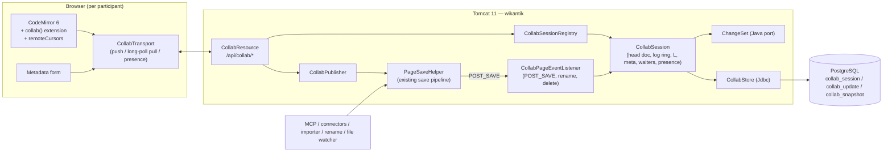
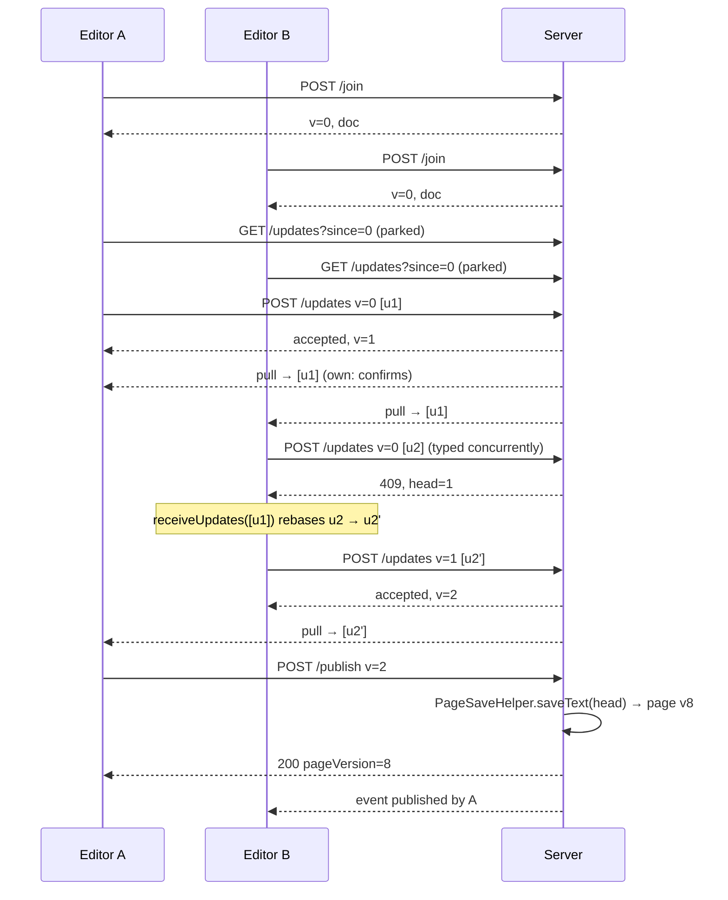

# Multi-Person Editing — Technical Design

| | |
|---|---|
| **Status** | Proposed (design only — nothing implemented) |
| **Date** | 2026-11-06 |
| **Scope** | Real-time concurrent editing of one page by several people in the **existing Markdown (CodeMirror 6) editor**. No WYSIWYG. |
| **Replaces** | "single-author per page" (README) / the "Real-time collaborative editor" item under *Later* in `ROADMAP.md` |

---

## 1. Summary

Several authenticated users can open the same page in the editor and see each other's keystrokes,
cursors and selections within ~200 ms. The text converges deterministically. The server is the
single authority for ordering edits. The shared text lives in a **shared draft** (persisted in
Postgres) until someone presses **Save**, which **publishes** the draft as a normal page version
through the unchanged save pipeline (`PageSaveHelper` → filters → validation → providers → events).

The core technique is **CodeMirror 6's own collaboration protocol (`@codemirror/collab`)**: a
central-authority, rebase-on-client scheme. The server keeps an ordered log of `ChangeSet`s, only
accepts a push built on its current head, and otherwise tells the client to pull and rebase. This
means the server needs a **small Java port of CodeMirror's `ChangeSet`** (apply, compose, map, diff)
rather than a CRDT runtime, and fits the existing single-node Tomcat + Postgres deployment.

Writes that do *not* come from the editor — MCP `write_pages`/`update_page`, derived-page reflow,
cluster rename, KG curation, block-id insertion, the Obsidian importer, `PageDirectoryWatcher`
file edits, old SPA tabs doing a plain `PUT` — are **merged live into any open session** as
server-authored changes, so agents and humans can work on the same page at the same time without
409s.

## 2. Goals and non-goals

**Goals**

1. N concurrent editors (target ≤ 20) on one page; convergence guaranteed; no lost keystrokes.
2. Presence: who is editing, their cursor and selection, by **display name** (never login).
3. Unpublished collaborative work survives browser close and server restart (shared draft).
4. Publishing goes through *exactly* the existing save pipeline: same validation (422s), ACLs,
   audit, events, indexing, citations, ontology sync. No second write path to the page store.
5. Non-editor writers (agents especially) keep working unchanged and merge into live sessions.
6. Per-user undo (Ctrl-Z undoes *my* edits, not my colleague's).
7. Ships dark behind a kill switch; the current single-author editor remains the fallback.

**Non-goals (this design)**

- WYSIWYG / rich-text editing.
- Offline editing beyond "a brief network blip" (client buffers unsent changes; long offline
  periods just rebase on reconnect, no offline-first guarantees).
- Multi-node / horizontally scaled Tomcat (designed *for*, see §12.4, not delivered).
- Live "watch-only" mode for readers, comments-in-draft, suggestion/track-changes mode.
- Collaborative editing of derived pages (`derived_from` — machine-owned body, ADR-0004).

## 3. Current state (what this builds on)

| Area | Today | File |
|---|---|---|
| Editor | CodeMirror 6 via `@uiw/react-codemirror`; editor holds the **body only**; frontmatter edited separately in the structured metadata form and sent as `metadata` + `replaceMetadata=true` | `wikantik-frontend/src/components/CodeEditor.jsx`, `PageEditor.jsx` (~1,300 lines) |
| Local drafts | `useDraft` autosaves to `localStorage`, namespaced by login | `wikantik-frontend/src/hooks/useDraft.js` |
| Save API | `PUT /api/pages/{name}` with optional `expectedVersion` / `expectedContentHash` → 409 on conflict; 422 on frontmatter / math / access-rule-shape errors; 413 over `wikantik.api.maxPageBytes` (256 KB) | `wikantik-rest/.../PageResource.java` (`doPut`) |
| Save core | `PageSaveHelper.saveText(name, text, SaveOptions)` — optimistic lock, frontmatter merge, then `PageManager.saveText` | `wikantik-api/.../pages/PageSaveHelper.java` |
| Save events | `WikiPageEvent.POST_SAVE` fired by `PageEventFilter.postSave`; also fired by `PageDirectoryWatcher` for on-disk edits; `WikiPageRenameEvent` on rename | `wikantik-main/.../filters/PageEventFilter.java` |
| Frontmatter split | `FrontmatterParser.parse(text) → ParsedPage` | `wikantik-api/.../frontmatter/FrontmatterParser.java` |
| Diff | jrcs `MyersDiff` already on the classpath | `wikantik-main/.../diff/TraditionalDiffProvider.java` |
| Other writers | MCP tools, derived ingestion, `ClusterRenameService`, `DefaultKgCurationOps`, `BlockIdService`, `EngineImportPageSink`, `HubDiscoveryService` | all call `saveText` |
| Transport stack | Caddy `reverse_proxy` → single Tomcat 11 container; `/api/*` passes `CsrfProtectionFilter` (Origin check), `RateLimitFilter` (per-IP), `BackpressureFilter` | `deploy/config/Caddyfile`, `WEB-INF/web.xml` |
| Comments | Anchored by quoted text (`anchor.exact`) against the **published** page | `CommentsDrawer.jsx` |

Key observation: because the editor already edits the body and metadata as separate channels, the
collaborative design can treat **body text** (sequence CRDT/OT problem) and **frontmatter**
(map of fields) with different, simpler mechanisms.

## 4. Key decisions

### D1 — Concurrency algorithm: `@codemirror/collab` (central authority + client rebase)

| Option | Verdict |
|---|---|
| **A. `@codemirror/collab`** — server keeps ordered `ChangeSet` log; client pushes `(baseVersion, updates)`; server accepts iff `baseVersion == head`, else client pulls and rebases locally | **Chosen.** Purpose-built for CodeMirror 6 (already our editor), maintained by the same author as every other `@codemirror/*` dep, MIT. Server logic is tiny; the only server-side "algorithm" is ChangeSet apply/compose/map, which we need anyway to merge agent writes. Server-authoritative ordering fits validation, ACL re-checks, audit and Postgres durability. |
| B. Yjs CRDT (`y-codemirror.next`) | Rejected for now. The Java side would need either a Node sidecar (Hocuspocus/y-websocket — a second runtime to deploy, secure and back up) or the immature JVM bindings of `yrs`. CRDT's main win — offline-first, peer-to-peer — is a non-goal. Tombstone growth needs GC management. Revisit only if offline editing becomes a requirement; the transport + session + publish layers below would survive the swap. |
| C. Classic server-side OT (transform on server) | Rejected. Same convergence as A but we'd write and prove the transform functions ourselves; A pushes rebasing to the client, which already has CodeMirror's proven implementation. |
| D. Section locking (one editor per heading) | Rejected as the core mechanism: not "multi-person editing" in the sense users expect, and breaks on structural edits. |

### D2 — Transport: HTTP push + long-poll pull (v1); WebSocket later behind the same interface

`POST` for pushes and an **async-servlet long-poll** `GET` for pulls, all under `/api/collab/*`.

Why not WebSocket first:

- `/api/*` already gets session auth, `CsrfProtectionFilter`'s Origin validation (which is exactly
  the cross-site-WebSocket-hijacking defence we would otherwise have to rebuild), request
  correlation, metrics, rate limiting and `RestServletBase.checkPagePermission()`. A WebSocket
  endpoint gets the handshake through filters and then nothing.
- It is the reference transport of `@codemirror/collab` and needs no proxy changes.
- It is testable with the existing REST IT harness.
- Tomcat async requests don't hold a thread while waiting.

Cost: one HTTP request per push batch (client batches at ~100 ms) and per pull. At ≤20 editors per
page that's negligible. The client talks to a `CollabTransport` interface so a WebSocket transport
can replace it without touching session logic.

### D3 — Persistence model: shared draft + explicit publish

- The shared document is a **draft**, not a page version. Keystrokes never create page versions.
- **Save = Publish**: any participant with `edit` publishes the current head as one page version
  through `PageSaveHelper`. (Confluence's model; avoids version-history spam and runs validation
  once per publish, not per keystroke.)
- The draft persists in Postgres until published or explicitly discarded. Closing the tab never
  loses work; re-opening the editor resumes the draft with a banner ("Unpublished changes by
  Ana, Raj — last edit 2 h ago").

### D4 — Frontmatter: field-level last-writer-wins, separate from text

The structured metadata form edits fields, not text. Each change is a `meta` op
`{field, value | null}` applied in server order; last writer wins per top-level field (lists such
as `tags`/`cluster` are replaced whole). Simple, predictable, matches the form UI. Text collisions
inside one field are rare enough not to justify a CRDT per field.

### D5 — Non-editor writes merge live (no 409s for agents)

On `POST_SAVE` for a page with an open session, the server computes the external change as a
ChangeSet against the session's base and **maps it over the session's unpublished changes**, then
appends it to the log as a server-authored update. Editors see it like a colleague's edit, with a
toast naming the source. See §7.4.

### D6 — Collaborative mode is *the* editor mode when enabled

With `wikantik.collab.enabled=true`, every editor open joins a session (a solo editor is a
session with one participant). One code path to test, presence appears automatically, and the
shared draft replaces `localStorage` drafts. If join fails (feature off, 503, derived page,
unauthenticated), the editor falls back to today's single-author flow unchanged.

## 5. Architecture



### 5.1 Module and package placement

| Component | Location | Notes |
|---|---|---|
| `ChangeSet`, `ChangeSetJson`, `TextDiff` | `wikantik-main` `com.wikantik.collab.text` | Pure Java, no engine dependency; candidate to move to `wikantik-util` if another module needs it |
| `CollabSession`, `CollabSessionRegistry`, `CollabPublisher`, `CollabPageEventListener`, `PresenceTracker` | `wikantik-main` `com.wikantik.collab` | Registry is a subsystem service wired like other subsystems; do **not** add it to the `getManager` allow-list (DecompositionArchTest R-2) |
| `CollabStore` | `wikantik-main` `com.wikantik.collab.store` | Holds a `Jdbc`; migration first (ADR-0010) |
| `CollabResource` | `wikantik-rest` `com.wikantik.rest.CollabResource` | Extends `RestServletBase`; `async-supported=true` |
| Frontend | `wikantik-frontend/src/collab/` | `collabTransport.js`, `useCollabSession.js`, `collabPeer.js` (CodeMirror plugin), `remoteCursors.js`, `PresenceBar.jsx` |

## 6. Protocol

All endpoints are under `/api/collab/{pageName}/…`, JSON, session-cookie authenticated, subject to
`CsrfProtectionFilter` Origin validation. Every call except `leave` requires `edit` on the page
(`checkPagePermission(…, "edit")`), re-evaluated per §9.

### 6.1 Wire format

A **text update** is exactly `@codemirror/collab`'s `Update` serialised:

```json
{ "clientID": "p7f3k2", "changes": [12, [0, "hello"], 40, [3]] }
```

`changes` is `ChangeSet.toJSON()`: a number = length of an unchanged span; an array =
`[deletedLength, ...insertedLines]` (lines joined with `\n`). Lengths are **UTF-16 code units**,
which coincide with Java `String` indices — no code-point translation needed. The document is
normalised to `\n` line endings on session open (CodeMirror's internal representation).

> Verify the exact JSON shape against the pinned `@codemirror/state` version when implementing;
> the shared fixture file (§13.1) makes this a test, not a belief.

A **meta op**: `{ "field": "tags", "value": ["a","b"] }` (`value: null` removes the field).

### 6.2 Endpoints

| Method + path | Request | Response |
|---|---|---|
| `POST /join` | `{}` | `200 { sessionId, participantId, clientID, version, doc, metaSeq, metadata, basePageVersion, participants:[{participantId, displayName, color}], draft:{ unpublished:bool, contributors:[displayName], lastEditAt } }` · `409 {reason:"derived-page"}` · `503 {reason:"collab-disabled"}` · `429 {reason:"session-full"}` |
| `POST /updates` | `{ sessionId, version, updates:[Update…], metaOps:[…] }` | `200 { accepted:true, version, metaSeq }` · `409 { accepted:false, version }` (client must pull + rebase, then retry) · `413` doc would exceed `maxPageBytes` · `400` malformed / length mismatch / clientID not this participant's |
| `GET /updates?sessionId&since=V&metaSince=M&presenceSince=P` | — | Long-poll ≤ `poll.timeoutSeconds`. `200 { updates:[…from V], metaOps:[…from M], presence:{…}, events:[…] }` — empty arrays on timeout. `410 { resync:true }` if `V` is older than the in-memory ring (§7.6) |
| `POST /presence` | `{ sessionId, anchor, head }` (selection in the client's synced-version coordinates + `version`) | `204` |
| `POST /publish` | `{ sessionId, version, changeNote }` | `200 { pageVersion, warnings, mathWarnings }` · `409 {reason:"not-synced"}` if `version != head` at the time the client's own updates are required (§7.3) · `422` exactly the bodies `PageResource.doPut` returns today · `423 {reason:"publish-in-progress"}` |
| `POST /discard` | `{ sessionId }` | `204` — resets the draft to the latest page version; broadcast as a server update + event |
| `POST /leave` | `{ sessionId }` (also sent via `navigator.sendBeacon`) | `204` |

`events` carries non-text notifications: `participant-joined/left`, `external-change {source,
displayName?, ranges}`, `published {by, pageVersion}`, `publish-failed {by}`, `page-renamed {to}`,
`page-deleted`, `evicted {reason}`, `draft-discarded {by}`.

### 6.3 Typical flow



## 7. Server algorithms

### 7.1 Session state

```java
final class CollabSession {
    final UUID id;
    String pageName;                 // updated on rename
    final ReentrantLock lock = new ReentrantLock();

    // Text
    String doc;                      // head document (body only, '\n' line endings)
    int head;                        // collab version = number of text updates ever accepted
    final UpdateRing ring;           // last K updates (version, clientID, ChangeSet) for catch-up

    // Relationship to the published page
    int basePageVersion;             // page version this draft is "on top of"
    String baseBody;                 // body of basePageVersion
    ChangeSet local;                 // invariant: local.apply(baseBody).equals(doc)

    // Frontmatter
    Map<String,Object> baseMeta, meta;
    long metaSeq; final MetaRing metaRing;

    // Liveness
    final Map<String, Participant> participants;  // participantId → (authorKey, displayName, clientID, color, lastSeen, selection)
    final List<Waiter> waiters;                   // parked AsyncContexts
    final AtomicBoolean publishing;
}
```

`local` — the composed ChangeSet of all unpublished changes relative to the page — is the piece
that makes external merges and post-publish normalisation exact (§7.3, §7.4). It is maintained
incrementally; on recovery it is recomputed as `TextDiff.changeSet(baseBody, doc)`.

### 7.2 Push

```text
lock(session):
  if req.version != head            → 409 {version: head}           (client rebases; normal path)
  for u in req.updates:
     require u.clientID == participant.clientID                      (no spoofing)
     cs = ChangeSet.fromJson(u.changes)
     require cs.lengthBefore == doc.length()                         (else 400 — corrupt client)
     next = cs.apply(doc); require utf8Bytes(next) <= maxPageBytes   (else 413)
  store.appendUpdates(session.id, head+1 …)   ← DB first; on failure nothing mutates, 503
  doc = next; head += n; local = local.compose(cs…); ring.addAll(…)
  apply metaOps in order (meta[field] = value; metaSeq++), store.appendMeta(…)
  collect waiters to complete
unlock
complete waiters outside the lock (each gets its own slice from its `since`)
```

The DB append happens while holding the session lock (one small `INSERT … VALUES (…),(…)` per
push, low milliseconds). This keeps memory and DB in the same order and is what makes the later
multi-node path possible (§12.4).

### 7.3 Publish

The publisher's client first waits until `sendableUpdates(state)` is empty and its last push is
confirmed, so the published text includes everything that user typed. It then calls
`/publish` with its synced version; the server publishes **head** (which may additionally
include a colleague's last few keystrokes — those people see a "published by X" event, which is
the same semantics Confluence has).

```text
if !publishing.compareAndSet(false,true) → 423
lock: snapshot V=head, S_V=doc, M_V=meta, B=basePageVersion; unlock     ← editing continues during the save
try:
   saved = PageSaveHelper.saveText(pageName, S_V,
             SaveOptions(expectedVersion=B, metadata=M_V, replaceMetadata=true,
                         author=publisher.authorKey, changeNote=…))
             inside CollabPublishContext.run(session.id, …)              ← so our own POST_SAVE is recognised
   catch 422s / ContentValidation / AccessRuleShape → return same bodies as PageResource; event publish-failed
   catch VersionConflict → (only possible if an external save raced between POST_SAVE merge and now)
                           merge it (§7.4) and return 409 {reason:"merged-external-change, retry"}
   savedBody, savedMeta = FrontmatterParser.parse(read latest version)
lock:
   N  = TextDiff.changeSet(S_V, savedBody)        // save filters may rewrite text (block ids, normalisation…)
   W  = compose(ring[V+1 .. head])                // edits that arrived during the save
   if !N.isEmpty(): append server update N.map(W) (clientID "server") — everyone converges on the filtered text
   baseBody = savedBody; basePageVersion = saved.version
   local = W.map(N)                               // remaining unpublished edits, relative to the new base
   baseMeta = savedMeta; fold any filter-made meta changes as server meta ops
   store.markPublished(…); emit event published
unlock; publishing=false
```

Post-publish: re-check every participant's `edit` permission against the newly saved page (the
body may have just changed its `[{ALLOW …}]` rules) and evict those who lost it.

Attribution: the page version's author is the publisher (as today, via `AuthorKeys`). The session
records contributors (author keys of everyone with an accepted text/meta op since the last
publish); Phase 3 persists them per version (§10) and the history UI renders them through
`PublicIdentity`. Until then the publish auto-appends nothing to the change note — display names
in free text would go stale on rename.

### 7.4 External writes (D5)

`CollabPageEventListener` handles `POST_SAVE` for pages with a live or persisted session, skipping
events raised inside `CollabPublishContext` for the same session.

```text
latest = read latest page version; (B2body, B2meta) = FrontmatterParser.parse(latest.text)
lock(session):
   E  = TextDiff.changeSet(baseBody, B2body)     // the external writer's change, on the old base
   E' = E.map(local)                             // rebase it over our unpublished work
   append server update E' (clientID "server")   // doc = E'.apply(doc); head++
   local = local.map(E, /*before*/true)          // unpublished work, now relative to the new base
   baseBody = B2body; basePageVersion = latest.version
   meta: for each field f:
        ext changed (baseMeta[f] != B2meta[f]) and we didn't (meta[f] == baseMeta[f]) → meta op f := B2meta[f]
        both changed → keep ours; event external-change {conflictFields:[f]}
   baseMeta = B2meta
   event external-change {source: author display name or "agent"/"connector", ranges: E'.changedRanges()}
unlock
```

Correctness rests on CodeMirror's OT diamond property: `E.compose(local.map(E)) ≡
local.compose(E.map(local))`, which the Java port must satisfy (property test, §13.1). Overlapping
edits are merged deterministically (both insertions survive; overlapping deletions coalesce), not
flagged as conflicts. Semantic conflicts — an agent rewrote the paragraph a human was editing —
are surfaced by the `external-change` event (client highlights the ranges for ~10 s with a toast:
"Updated by *wiki-agent* via MCP — view diff") and by the diff-vs-current-page view in the publish
dialog.

`TextDiff` uses jrcs `MyersDiff` at line granularity, then refines changed hunks to characters, so
a 256 KB page diffs in milliseconds.

Delete / rename:
- `WikiPageRenameEvent`: rekey the registry and the `collab_session.page_name`; emit `page-renamed`
  (clients update the URL without reloading).
- True delete (`PAGE_DELETED`, disambiguated from rename the same way `OntologyEventListener`
  does): session becomes `frozen` (read-only), clients show "This page was deleted — copy your
  text or recreate the page". Publishing a frozen session recreates the page (needs `createPages`).

### 7.5 Pull / long-poll

`GET /updates`: if `since < head` or there are newer meta ops / presence / events, answer
immediately; otherwise `request.startAsync()`, set the timeout, park a `Waiter(since,…)`. Waiters
are completed outside the session lock. On timeout, respond `200` with empty arrays (not 204, so
the client loop is uniform). A participant with no pull/push for `presence.timeoutSeconds` is
dropped from presence (their session survives; they rejoin transparently).

### 7.6 Ring, snapshots, resync

- In memory: the last `history.inMemoryUpdates` updates (default 2,000). A client asking
  for an older `since` gets `410 {resync:true}` and re-joins (fresh `doc` + `version`;
  CodeMirror is re-initialised with `collab({startVersion})`, unsent local edits are re-applied
  as a diff against the new doc — rare: only after very long disconnections).
- In Postgres: every `snapshot.everyUpdates` (default 500) the session writes
  `collab_snapshot(version, body, meta, local_json)`; recovery = latest snapshot + replay later
  updates. On publish older snapshots/updates are deleted.

### 7.7 Lifecycle and memory

- Session created on first `join` (or loaded from `collab_session` if a draft exists).
- Evicted from memory after `memory.idleEvictMinutes` (default 10) with no participants; the
  draft stays in Postgres.
- If a draft has **no unpublished changes** (`local.isEmpty()` and meta == baseMeta) when the last
  participant leaves, its rows are deleted.
- Drafts with unpublished changes persist until published or discarded. `draft.retentionDays`
  (default 0 = forever) lets operators expire them; expiry never auto-publishes.
- Memory bound: ≤ `maxPageBytes` × (doc + baseBody) + ring per active session. 50 active
  sessions on 256 KB pages ≈ 50–80 MB worst case.

## 8. Frontend design

### 8.1 New pieces (`wikantik-frontend/src/collab/`)

| File | Responsibility |
|---|---|
| `collabTransport.js` | `join / push / pull / presence / publish / discard / leave` over the existing `api/client.js` (same-origin credentials, error mapping). Interface designed so a WebSocket implementation can drop in. |
| `collabPeer.js` | CodeMirror `ViewPlugin` implementing the `@codemirror/collab` client loop: single in-flight push of `sendableUpdates` (debounced ~100 ms), long-poll pull loop → `receiveUpdates`, 409 → pull then retry, exponential backoff on network errors, `410` → resync. |
| `remoteCursors.js` | `StateField` of decorations (caret widget + selection mark + name label) fed by presence; positions mapped through every transaction (`changes.mapPos`) so they don't jump while remote updates are pending. Presence sent at most every 150 ms, only on selection change. |
| `useCollabSession.js` | React hook: join on mount, leave on unmount/`pagehide` (`sendBeacon`), exposes `{status, participants, events, publish, discard, metaSet}`. |
| `PresenceBar.jsx` | Avatars/initials by display name + colour, "3 editing", connection state (live / reconnecting / offline). |

New dependency: `@codemirror/collab` (pin to the same release line as the existing
`@codemirror/state` / `@codemirror/view`).

### 8.2 Changes to existing components

| Existing behaviour | In collaborative mode |
|---|---|
| `CodeEditor` builds its own `extensions` | Accepts an optional `collabExtensions` prop (collab + collabPeer + remoteCursors). Editor is initialised from `join().doc` at `startVersion`. |
| `useDraft` localStorage autosave + restore prompt | Disabled — the server holds the draft. Existing local drafts for that page are offered once ("restore my offline draft into the shared draft?" → applied as one ordinary local change). |
| `isDirty` / `useNavigationGuard` | Guard only while `sendableUpdates` is non-empty (unsynced typing). Unpublished-but-synced work is safe on the server; leaving shows a non-blocking note. |
| Save button | Becomes **Publish**: waits for sync, then `/publish`. 422 handling reuses the current violation rendering (frontmatter field mapping, math violation jump). |
| Whole-body replacement (format conversion, draft restore, conflict reload) — already dispatched through the view | Conflict reload is gone (no 409s). Conversion asks for confirmation ("this changes the page for all 3 editors") and goes through as a normal transaction. |
| Block-link insertion (`draftBlocks` / `draftLink`: server answers an edit against the text it was sent) | Capture the synced version + doc at request time; when the answer arrives, map the returned edit through all changes since (`ChangeSet.map`) before dispatching. Same rule for any async "server returns an offset" feature (math violation jump uses current offsets, already fine). |
| Uploads / paste / mention picker / link completion | Unchanged — they produce ordinary local transactions. |
| Metadata form (`replaceMetadata`) | Each field change sends a meta op; remote meta ops update the form. A field another participant changed while I had it focused shows a small "changed by Raj" indicator rather than overwriting my in-progress input; my blur sends my value (LWW). |
| Undo / redo | CodeMirror `history()` with collab: remote changes are not added to the local history and local history is mapped through them, so undo affects only my edits. (Verify with a real-CodeMirror test, §13.3.) |
| Live preview, scroll sync | Unchanged — render from the local doc. |

### 8.3 UX details worth fixing up front

- Colours: assigned from a fixed accessible palette by **join order within the session**, never
  derived from login (would leak/fingerprint identity across sessions).
- External-change highlight + toast (§7.4) with "view diff" opening `DiffViewer` against the
  previous page version.
- Draft banner on open; publish dialog shows diff of the draft vs the latest page version and the
  contributor list.
- Page view (readers): optional small badge "being edited by 2 people" — Phase 4.

## 9. Security and permissions

- **Join** requires an authenticated session (presence and attribution need identity) and `edit`
  on the page. Policies that allow anonymous editing fall back to the single-author editor.
- **Permission freshness:** edit permission is cached per participant for
  `permission.recheckSeconds` (default 30) and re-checked on push after expiry; invalidated
  immediately on `WikiSecurityEvent` (group/ACL/policy-grant changes) and after every publish
  (inline `[{ALLOW …}]` may have changed). Losing `edit` → `evicted` event, further pushes 403.
- **No identity leakage:** presence carries display names via `PublicIdentity`, never login names
  (emails under SSO). Server-side records store author keys (`AuthorKeys`), as page versions do.
- **No spoofing:** `clientID` is server-issued at join and bound to the participant; pushes with
  another clientID are rejected.
- **Origin / CSRF:** all endpoints are state-changing `POST`s under `/api/*`, so
  `CsrfProtectionFilter` Origin validation applies unchanged.
- **Resource limits:** `maxParticipants` per session (429), push body ≤ `maxUpdateBytes`, doc ≤
  `wikantik.api.maxPageBytes` (same limit as `PUT`), per-participant push rate cap. Malformed
  ChangeSets (length mismatch, negative spans) are 400 and logged at WARN with session + participant.
- **Access-rule safety:** publish goes through `PageSaveHelper`, so `AccessRuleShapeException` and
  all existing 422 gates still apply. While a draft is unpublished, ACL rules typed into it have no
  effect (they are just text), exactly like today's unsaved editor buffer.
- **Audit:** `AuditService` entries for session open, join, publish (with contributor author keys),
  discard and eviction. Keystrokes are not audited (the update log is the forensic record until
  publish).
- **Derived pages** (`derived_from` frontmatter): `join` returns 409 `derived-page`.
- **Restricted content in drafts:** a draft is only readable through `join`, which requires `edit`;
  it is never indexed, rendered, cached, exported, or projected into the ontology.

## 10. Data model — migration `V066__collab_sessions.sql`

(Use the next free number at implementation time; idempotent DDL; grants via `:app_user`.)

```sql
CREATE TABLE IF NOT EXISTS collab_session (
    id                 UUID PRIMARY KEY,
    page_name          TEXT NOT NULL UNIQUE,      -- one draft per page
    status             TEXT NOT NULL DEFAULT 'active' CHECK (status IN ('active','frozen')),
    base_page_version  INTEGER NOT NULL,
    base_body          TEXT NOT NULL,
    base_meta          JSONB NOT NULL,
    head_version       INTEGER NOT NULL DEFAULT 0,
    meta_seq           BIGINT  NOT NULL DEFAULT 0,
    has_unpublished    BOOLEAN NOT NULL DEFAULT FALSE,
    created_by         TEXT NOT NULL,              -- author key
    created_at         TIMESTAMPTZ NOT NULL DEFAULT now(),
    last_edit_at       TIMESTAMPTZ
);

CREATE TABLE IF NOT EXISTS collab_update (
    session_id   UUID    NOT NULL REFERENCES collab_session(id) ON DELETE CASCADE,
    version      INTEGER NOT NULL,                 -- 1-based collab version; PK = ordering arbiter
    kind         TEXT    NOT NULL CHECK (kind IN ('text','server')),
    client_id    TEXT    NOT NULL,
    author_key   TEXT,                             -- null for server updates
    changes      JSONB   NOT NULL,
    created_at   TIMESTAMPTZ NOT NULL DEFAULT now(),
    PRIMARY KEY (session_id, version)
);

CREATE TABLE IF NOT EXISTS collab_meta_op (
    session_id   UUID   NOT NULL REFERENCES collab_session(id) ON DELETE CASCADE,
    seq          BIGINT NOT NULL,
    author_key   TEXT,
    field        TEXT   NOT NULL,
    value        JSONB,                            -- null = remove
    created_at   TIMESTAMPTZ NOT NULL DEFAULT now(),
    PRIMARY KEY (session_id, seq)
);

CREATE TABLE IF NOT EXISTS collab_snapshot (
    session_id   UUID    NOT NULL REFERENCES collab_session(id) ON DELETE CASCADE,
    version      INTEGER NOT NULL,
    meta_seq     BIGINT  NOT NULL,
    body         TEXT    NOT NULL,
    meta         JSONB   NOT NULL,
    local_changes JSONB  NOT NULL,                 -- the `local` ChangeSet at this version
    PRIMARY KEY (session_id, version)
);

-- Phase 3: per-version contributors, rendered through PublicIdentity
CREATE TABLE IF NOT EXISTS page_version_contributor (
    page_name    TEXT    NOT NULL,
    page_version INTEGER NOT NULL,
    author_key   TEXT    NOT NULL,
    PRIMARY KEY (page_name, page_version, author_key)
);
```

Multi-statement writes (append updates + bump `head_version`; publish cleanup) run in
`Jdbc.inTransaction` and get a `FaultInjectingDataSource` rollback test. Account deletion
(`V065__deleted_logins` / `UserDeletionService`) must cover `author_key` in these tables — add
them to whatever pseudonymisation that service already performs.

## 11. Configuration

Declare each key in `wikantik-main/src/main/resources/ini/wikantik.properties` (new
`# [Collaborative editing]` section, description + `Type:` + explicit default) **before** reading
it, then regenerate the reference with `bin/config-reference.sh --write`
(`ConfigSurfaceDriftTest` / `ConfigReferenceRegressionTest` enforce this).

| Key | Type | Default | Meaning |
|---|---|---|---|
| `wikantik.collab.enabled` | Boolean | `false` | Kill switch; off = today's single-author editor |
| `wikantik.collab.maxParticipants` | Integer | `20` | Per session |
| `wikantik.collab.maxUpdateBytes` | Integer | `65536` | Max JSON body of one push |
| `wikantik.collab.poll.timeoutSeconds` | Integer | `25` | Long-poll park time (keep under Caddy/LB idle timeouts) |
| `wikantik.collab.presence.timeoutSeconds` | Integer | `45` | Drop silent participants from presence |
| `wikantik.collab.permission.recheckSeconds` | Integer | `30` | Edit-permission cache per participant |
| `wikantik.collab.history.inMemoryUpdates` | Integer | `2000` | Ring size before a lagging client must resync |
| `wikantik.collab.snapshot.everyUpdates` | Integer | `500` | Snapshot cadence |
| `wikantik.collab.memory.idleEvictMinutes` | Integer | `10` | Evict empty sessions from memory |
| `wikantik.collab.draft.retentionDays` | Integer | `0` | 0 = keep unpublished drafts forever; never auto-publishes |

The SPA learns `enabled` from the existing capability/config payload it already fetches (or from
`join` returning 503).

## 12. Operations

### 12.1 Filter chain and async (verify first — likely the first real bug)

`request.startAsync()` throws `IllegalStateException` unless **every** filter and the servlet in
the chain for `/api/collab/*` is `<async-supported>true</async-supported>`. Today 17 web.xml
entries have it; filters such as `RememberMeAuthFilter`, `BasicAuthFilter`,
`MustChangePasswordFilter`, `WikiServletFilter`, `ClearSiteDataFilter` and `SpaRoutingFilter`
do not appear in that list. Phase 1 must enumerate the filters mapped to `/api/*`, mark them
async-supported, and check each for request-thread assumptions after `doFilter` returns
(ThreadLocals such as `AuditRequestContext`, `FrontmatterWarningSink`, `ContentWarningSink`;
anything that measures/cleans up in a `finally`).

### 12.2 Rate limiting and backpressure

- `RateLimitFilter` is per-IP on `/api/*`. Corporate NAT puts many editors behind one IP, and
  each editor generates a steady push/pull stream. Exempt `/api/collab/*` from the per-IP default
  bucket (the session layer enforces its own per-participant caps) or give it a dedicated bucket
  keyed by participant.
- `BackpressureFilter` limits in-flight requests: confirm parked long-polls either don't count or
  are released when the filter's `doFilter` returns; otherwise 50 idle editors could exhaust the
  in-flight budget.

### 12.3 Proxy, CSP, observability

- Caddy `reverse_proxy` streams long-polls fine; keep `poll.timeoutSeconds` below any upstream
  idle timeout (the cloud LBs in `deploy/aws` / `deploy/gcp` default to ≥ 60 s).
- CSP `default-src 'self'` already covers same-origin fetches; no change.
- Prometheus (`/metrics`): `wikantik_collab_sessions_active`, `_participants_active`,
  `_push_total{result=accepted|rebase|rejected}`, `_push_latency_seconds`,
  `_external_merges_total`, `_publish_total{result}`, `_resync_total`. Structured logs carry the
  session id alongside `correlation_id` (Simple Agility telemetry contract).

### 12.4 Topology: single node now, multi-node path

v1 assumes one Tomcat (true of every current deployment: Caddy → one `wikantik` container, and the
AWS/GCP single-VM modules). The registry is in-memory and authoritative.

Path to multi-node without redesign: make the `collab_update (session_id, version)` primary key
the ordering arbiter (an `INSERT` that loses the race = 409 rebase, same as today's in-memory
check), fan out new versions with Postgres `LISTEN/NOTIFY` to wake long-polls on other nodes, and
run publish under a per-session advisory lock. Alternatively route `/api/collab/{page}` by page
hash at the proxy. Not built now; §7.2's "DB first, then memory" ordering keeps the door open.

## 13. Testing strategy (TDD — test first per CLAUDE.md)

### 13.1 ChangeSet port — conformance is the foundation

- **Shared fixture** (same pattern as `renderedFences.json`): a vitest script generates random
  documents and change sets with the real `@codemirror/state` and records
  `{doc, a, b, apply(a), compose(a,b), map(a,b,before), map(b,a,…)}` to
  `wikantik-frontend/src/collab/__fixtures__/changesets.json`; a Java test replays every case and
  must match byte-for-byte. Include astral-plane characters (emoji, CJK ext.) to pin UTF-16
  semantics, CRLF input, empty docs, edits at both ends.
- **Java property tests** (jqwik or a seeded loop): `apply` length invariants; `compose`
  associativity; the diamond property `a.compose(b.map(a)) ≡ b.compose(a.map(b, true))`;
  `TextDiff.changeSet(x, y).apply(x) == y`.

### 13.2 Server

- `CollabSession` unit tests: push accept / stale-version 409 / spoofed clientID / length mismatch
  / size limit; publish with concurrent pushes during the save (normalisation mapping); external
  merge with overlapping edits; meta LWW and external-meta conflict rules.
- **Convergence fuzz test:** K simulated clients (pure Java, using the port's rebase) issue
  random edits with random delivery delays, random external saves and publishes interleaved;
  assert every client's doc == server doc == `local.apply(baseBody)` at quiescence. Run with
  thousands of seeds; print the seed on failure.
- `CollabStore` against `PostgresTestDb` (`@RequiresPostgres`), `FaultInjectingDataSource`
  rollback tests for append and publish-cleanup; crash recovery (snapshot + replay ==
  pre-crash state).
- `CollabPageEventListener`: each non-editor writer (MCP write, `ClusterRenameService`,
  `BlockIdService`, `PageDirectoryWatcher`) produces a merged server update; own publish does not.
- `CollabResource`: permission (no edit → 403, revoked mid-session → evicted), derived page → 409,
  disabled → 503, async long-poll timeout + wake.

### 13.3 Frontend

- vitest: `collabPeer` loop with a fake transport (409 → pull → rebase → retry; backoff; 410
  resync), `remoteCursors` position mapping, `useCollabSession` lifecycle.
- `*.realCodeMirror.test.jsx` (existing pattern): two real `EditorView`s wired through an
  in-memory server converge; undo only reverts own edits; block-link answer mapped through
  intervening remote edits lands in the right place.

### 13.4 Integration

- REST IT (`wikantik-it-tests`): two HTTP clients + an MCP `write_pages` call on the same page;
  publish; assert page text, version, audit entries.
- Selenide: two browser contexts editing one page; type in both; see each other's text and
  cursor; publish from one; the other gets the event. Add to `bin/run-tests.sh` default IT set.
- Load: extend `loadtest/` with N simulated editors × M pages to size `maxParticipants` and
  measure push latency p95 (target < 150 ms server-side at 20 editors).

## 14. Failure modes

| Failure | Behaviour |
|---|---|
| Client network blip | Unsent changes stay in `sendableUpdates`; status "reconnecting"; on reconnect push → 409 → pull → rebase → push. No loss. |
| Client offline beyond the ring | `410 resync`; client re-joins and re-applies its unsent local text as a diff over the new doc; user gets a notice. |
| Server restart | Sessions reload lazily from Postgres on the next join/pull; clients see one failed pull, then resync or continue (version still valid if no updates were lost — all accepted updates were committed before ack). |
| DB unavailable during push | Push 503, nothing applied; client retries with backoff; editor shows "can't save edits right now". |
| Publish fails validation (422) | Draft untouched; publisher sees the same inline errors as today; others see `publish-failed`. |
| External save races a publish | `VersionConflictException` → external change merged into the session → publish returns 409 "merged, retry"; the client retries automatically once. |
| Page deleted mid-session | Session frozen; text preserved; can recreate. |
| Page renamed mid-session | Session rekeyed; clients update URL. |
| Participant loses edit permission | Evicted; their unsent changes are discarded client-side with a message. |
| Bug produces divergent client doc | Every pull response includes `docHash` every N versions; client compares and forces resync on mismatch (log at WARN with session id — diagnostics for the fuzz suite). |

## 15. Phased delivery

| Phase | Content | Ships |
|---|---|---|
| **0 — Foundations** | Java `ChangeSet` + `TextDiff` port with shared fixtures and property tests. Async-supported filter audit (§12.1) + rate-limit/backpressure decisions (§12.2). | Nothing user-visible |
| **1 — Core text collaboration** | Migration, `CollabStore`, `CollabSession` (push/pull/ring/snapshot), `CollabResource` (join/updates/leave), publish via `PageSaveHelper` with normalisation mapping, frontend `collabPeer` + Publish button, kill switch default **off**, convergence fuzz test, REST IT | Dark; enable on a staging instance |
| **2 — Presence + metadata + external merges** | Presence + remote cursors + `PresenceBar`; meta ops + form integration; `CollabPageEventListener` (external merges, rename, delete); external-change toast/highlight; Selenide two-browser test | Enable in prod for the admin group first (optional `wikantik.collab.enabled` per-group follow-up if wanted) |
| **3 — Draft UX + attribution** | Draft banner, discard, publish dialog diff, offline-draft import from `useDraft`, `page_version_contributor` + history UI, audit entries, metrics | Default **on** |
| **4 — Polish / later** | Reader "being edited" badge, WebSocket transport, draft expiry admin view at `/admin/collab`, multi-node (§12.4), watch-only participants | As needed |

Rough size: Phase 0 ≈ 1 week (the port is ~600 lines + tests), Phase 1 ≈ 2 weeks, Phase 2 ≈ 1.5
weeks, Phase 3 ≈ 1 week, for one developer working TDD.

## 16. Open questions

1. **Publish permission** — should publishing require anything beyond `edit` (e.g. only the session
   creator, or a "ready to publish" consensus)? Proposed: any editor may publish (Confluence
   behaviour).
2. **Agent-visible drafts** — should `/knowledge-mcp` / admin MCP be able to *read* or *join* a
   draft (e.g. an agent co-authoring live)? Proposed: no in this design; agents write pages and
   their writes merge in (D5). An agent participant would be a natural Phase 4+ extension using the
   same protocol.
3. **Autosave-publish** — some teams will want "publish automatically after N minutes idle".
   Proposed: not by default; possibly a per-page or per-cluster setting later.
4. **History granularity** — keep the update log after publish for "replay"/blame-by-keystroke?
   Proposed: no; delete on publish to bound storage and avoid retaining keystroke-level personal
   data.
5. **Interaction with `wikantik.api.write.requireExpectedVersion`** — strict-mode PUTs from old
   clients against a page with a live draft still succeed against the page version (and merge into
   the draft). Confirm that is the desired behaviour for agent harnesses.
