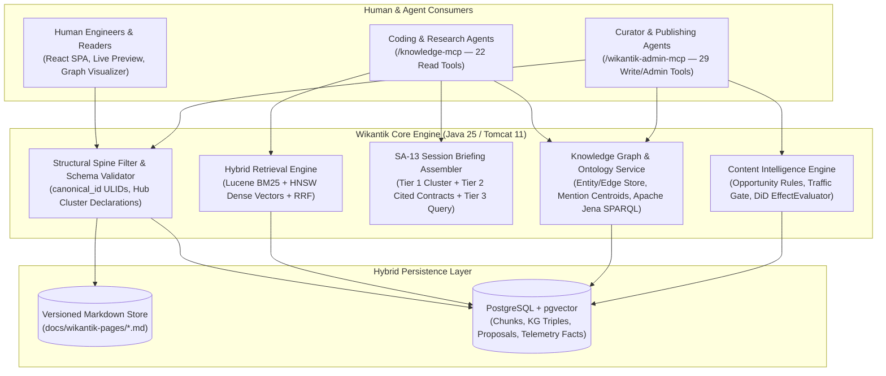
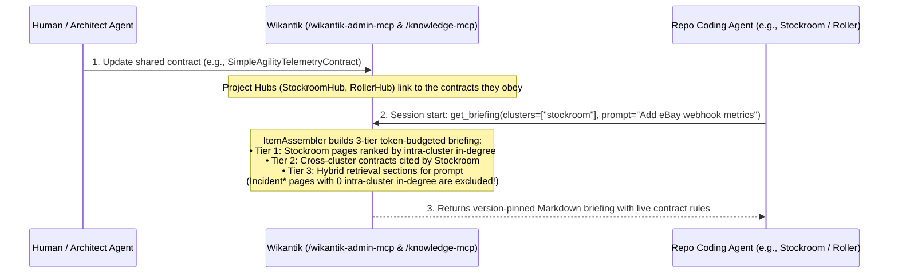
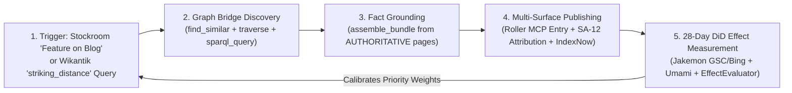
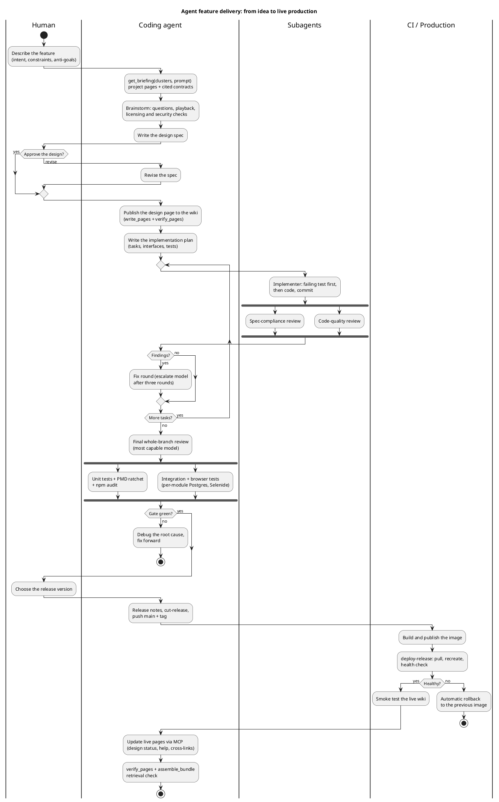

# About Wikantik: Manifesto & Architecture of the Agent-Grade Knowledge Platform

**Wikantik is an agent-grade semantic knowledge engine — built from the ground up so human engineers and autonomous AI agents can read, reason over, verify, and evolve a single source of truth.**

Most wikis were built for a world where only humans read and only humans write. Most "AI knowledge bases" bolt a naive vector database onto unstructured prose, losing document hierarchy, link topology, provenance, and editorial trust. **Wikantik bridges both worlds:** a rigorous, human-readable Markdown wiki backed by a machine-queryable **Structural Spine**, a dual **Page Graph + Knowledge Graph** architecture, **51 Model Context Protocol (MCP) tools**, and a **closed-loop Content Intelligence engine** that measures whether knowledge changes actually work.

---

## 1. The Manifesto: Why Traditional Wikis and Naive RAG Fail

Modern software teams and research-driven organizations face two compounding failure modes:

1. **Context Rot in Software Engineering:** Static repository prompt files (`CLAUDE.md`, `AGENTS.md`, scattered ADRs) silently drift out of sync with production reality. When cross-cutting architectural contracts change—telemetry schemas, deployment gates, security boundaries—downstream repositories keep operating on stale instructions because nothing binds their session context to a living specification.
2. **Unverified "LLM Slop" & Flat-Chunk Amnesia:** Dumping raw documents into a vector store strips away structural context. Chunks under generic headings lose their domain identity, machine-inferred claims mix indistinguishably with human-vetted invariants, and nobody measures whether a newly written article answers real queries or sits unread.

### The Five Design Commitments of Wikantik

| Commitment | How Wikantik Enforces It in Production |
| :--- | :--- |
| **1. One Corpus, Two First-Class Readers** | Every page is clean CommonMark + YAML frontmatter stored on disk with full revision history (`VersioningFileProvider`), while simultaneously indexed into PostgreSQL/`pgvector`, Lucene BM25, Lucene HNSW, and an RDF/SPARQL ontology. |
| **2. Structure Before Embeddings** | Save-time validation ([[FrontmatterConventions]]) enforces canonical types (`hub`, `article`, `design`, `runbook`, `reference`), Hub-declared clusters ([[ClusterDeclarationDesign]]), and rename-safe 26-character ULIDs (`canonical_id` via [[StructuralSpineDesign]]). |
| **3. Explicit Separation of Page Graph and Knowledge Graph** | Editorial document links (`[[WikiName]]`) live in the **Page Graph**; domain entities, typed relationships, and OWL/SKOS classes live in the **Knowledge Graph** ([[PageGraphVsKnowledgeGraph]]). Neither pollutes the other. |
| **4. Provenance & Web of Trust (`AUTHORITATIVE` $\to$ `STALE`)** | Agents never guess whether a page is trustworthy. `get_page_for_agent` computes explicit confidence tiers (`AUTHORITATIVE`, `PROVISIONAL`, `UNVERIFIED`, `STALE`) from `verified_at`, `verified_by`, and post-verification edit history ([[AgentGradeContentDesign]]). |
| **5. Closed-Loop Measurement Over Blind Authoring** | Every content opportunity is gated by statistical support, every agent action records a predicted effect, and a nightly Difference-in-Differences evaluator (`EffectEvaluator`) measures 28-day realized impact against site trend ([[ContentIntelligenceDesign]], [[SimpleAgilityFeedbackLoopPattern]]). |

---

## 2. Platform Architecture: Under the Hood

Wikantik is a modern **Java 25 LTS / Jakarta Servlet 6.1** platform running on **Apache Tomcat 11**, paired with a **Vite + React** single-page application (reader, live-preview CodeMirror 6 editor, and admin control plane) and **PostgreSQL + `pgvector`**.



### Multi-Module Reactor Architecture

Following [[WikantikArchitecture|Wikantik System Architecture]] and [[WikantikDevelopmentHub|Wikantik Development]], the codebase is partitioned into focused Maven modules:

| Module | Architectural Responsibility |
| :--- | :--- |
| **`wikantik-api`** | Core domain contracts, `FrontmatterParser`, `ClusterPath`, and service interfaces. |
| **`wikantik-main`** | Central engine: JAAS security, `VersioningFileProvider`, `ReferenceManager` (Page Graph), `StructuralIndexService`, and `AgentHintsDeriver`. |
| **`wikantik-knowledge`** | Contextual chunking, `HybridRetrieval` (BM25 + dense vector RRF), `ItemAssembler` (`get_briefing`), `KnowledgeGraphService`, SPARQL ontology materialization, and the `/knowledge-mcp` server. |
| **`wikantik-admin-mcp`** | Optimistic-locking authoring (`update_page`, `write_pages`, `rename_page`, `rename_cluster`), 7-check `verify_pages`, KG proposal/curation tools, and `mark_page_verified`. |
| **`wikantik-insights`** | Closed-loop Content Intelligence: search-visibility snapshot ingest, `agent_gap` / `striking_distance` / `decay` rules, traffic gating, `EffectEvaluator`, and `WeightCalibrator`. |
| **`wikantik-rest`** | JSON REST APIs (`/api/structure/*`, `/api/pages/*`, `/admin/insights/*`, `/admin/agent-grade-audit`) backing the React SPA and structured frontmatter/KG curation panels. |
| **`wikantik-observability`** | Prometheus metrics (`/api/health/*`), OpenTelemetry correlation (`SA-2`), sliding-window per-client MCP rate limiting (`~50 req/s`), and JFR profiling. |
| **`wikantik-extract-cli`** | Offline CLI utilities: deterministic `Main.md` generation from `Main.pins.yaml` (`GenerateMainPageCli`), ULID backfill, and corpus-divergence validation. |

---

## 3. Why Retrieval & Graph Traversal Work Better Here

### 3.1 Contextual Chunk Headers & Reciprocal Rank Fusion (`HybridRetrieval`)

Standard chunkers split a Markdown file on `##` headings and embed the raw paragraph text in isolation—so a section titled `## 3. Failure Modes` in a Raft article embeds identically to `## 3. Failure Modes` in a Kafka article.

In Wikantik ([[HybridRetrieval]]), every chunk's embedding input is prefixed with its **full structural disambiguation header**:

$$
\text{EmbeddingInput}(c_i) = \text{Cluster}(P) \;\oplus\; \text{Title}(P) \;\oplus\; \text{Summary}(P) \;\oplus\; \text{HeadingPath}(c_i) \;\oplus\; \text{Body}(c_i)
$$

At query time, lexical BM25 rankings $r_{\text{BM25}}(d)$ and dense HNSW cosine rankings $r_{\text{dense}}(d)$ are combined via **Reciprocal Rank Fusion (RRF)**:

$$
\text{RRF}(d) = \frac{w_{\text{BM25}}}{k + r_{\text{BM25}}(d)} + \frac{w_{\text{dense}}}{k + r_{\text{dense}}(d)}, \qquad k = 60
$$

The server's `verify_pages(checks=["retrieval_readiness"])` linter actively rejects vague headings (`Overview`, `Summary`, `Notes`), missing cluster declarations, or slug-only titles before they can degrade chunk recall.

### 3.2 Mention-Centroid Embeddings & Formal SPARQL Ontology

When a page sets `kg_include: true` ([[KgInclusionPolicy]]), extracted and human-curated entities populate the Knowledge Graph ([[WikantikKnowledgeGraph]]). Every entity node receives a **mention-centroid vector**—the normalized mean of the contextual chunk embeddings in which that entity appears:

$$
\mathbf{v}_{\text{entity}} = \frac{\sum_{c \in \mathcal{M}(e)} \mathbf{e}(c)}{\left\| \sum_{c \in \mathcal{M}(e)} \mathbf{e}(c) \right\|_2}
$$

This allows `find_similar` to discover semantically isomorphic concepts across completely different clusters even before explicit graph edges are drawn, while `get_ontology` and `sparql_query` expose the entire corpus as a materialized RDF graph (`skos:broader` sub-cluster chains, `schema:TechArticle`, `schema:CollectionPage`, and typed domain predicates; see [[Ontology]] and [[SPARQL]]).

---

## 4. Four High-Leverage Workflows Enabled by Wikantik

Below are four concrete workflows—**three for software engineering** and **one for automated cross-platform publishing**—that demonstrate what becomes possible when your wiki is an active, programmable subsystem rather than passive documentation.

---

### Workflow 1 (Software Engineering): Zero-Drift Cross-Repository Architecture & Session Briefings (`SA-13`)

**The Problem:** In a multi-repository architecture (like the [[SimpleAgilityStackHub|Simple Agility Stack]]: `wikantik`, `jakemon`, `roller`, `stockroom`, `wealthview`), keeping per-repo `AGENTS.md` files synchronized with evolving cross-cutting contracts (logging formats, OpenTelemetry attributes, attribution parameters, port allocations) is impossible by hand. Worse, if a repo's cluster also contains 40 operational `Incident*` runbooks, naive cluster retrieval floods coding agents with alert triage steps when they are trying to write application code.

**How Wikantik Solves It ([[ProjectContextSeparationDesign]]):**



1. **Contract Binding via Wikilinks:** A project's Hub page (`StockroomHub`, `JakemonHub`, `RollerHub`) simply includes a standard wikilink to each normative contract in `cluster: simple-agility` that binds it (e.g., [[SimpleAgilityTelemetryContract]], [[SimpleAgilityAttributionRFC]], [[SimpleAgilityAgentCoordination]]).
2. **Dynamic 3-Tier Assembly (`get_briefing`):** When a coding agent starts a session in any repository, its single bootstrap instruction is `get_briefing(clusters=["<project-cluster>"], prompt="<task>")`. `ItemAssembler` automatically populates:
   - **Tier 1 (`## Standing project context`):** The project's own design and architecture pages ranked by **intra-cluster `in-degree`**. Because operational `Incident*` runbooks are linked from `home-lab-infrastructure` host pages rather than intra-cluster `jakemon` pages, their intra-cluster `in-degree` is `0`—so they never pollute coding briefings!
   - **Tier 2 (`## Contracts this project cites`):** Every cross-cluster specification linked by Tier 1 pages. The moment an architect updates a contract once on the wiki, every citing repository inherits the change on its very next session start.
   - **Tier 3 (`## Task-relevant sections`):** Prompt-specific chunk retrieval via `assemble_bundle`.
3. **Automated Drift Auditing:** Running `./bin/wikantik briefing-audit` verifies in 3 seconds that every bound project cluster surfaces 100% of its required ecosystem contracts in Tier 2.

---

### Workflow 2 (Software Engineering): Self-Healing Runbooks & Closed-Loop Incident Triage

**The Problem:** Runbooks in traditional wikis rot because the engineer fixing a 2 AM outage rarely goes back to rewrite the documentation, and nobody knows which queries agents failed to find answers for during an incident.

**How Wikantik Solves It ([[AgentCookbook]], [[SimpleAgilityOnCallAutomation]], [[ContentIntelligenceDesign]]):**

1. **Structured, Machine-Executable Runbooks (`type: runbook`):** Every operational and engineering playbook in [[AgentCookbook]] (20 coding/MCP runbooks) and [[HomeLabInfrastructureHub]] (40+ `Incident*` runbooks) carries a schema-validated `runbook:` frontmatter block (`when_to_use`, `steps`, `pitfalls`).
2. **Demand-Gap Detection (`retrieval_query_log` $\to$ `agent_gap`):** Whenever an on-call or coding agent calls `retrieve_context` or `assemble_bundle` for a failure symptom and receives zero or low-scoring chunks, Wikantik logs the miss in `retrieval_query_log`. The Content Intelligence engine surfaces repeated misses as `agent_gap` opportunities via `list_content_opportunities(type="agent_gap")`.
3. **Optimistic-Locking Repair & Retrieval Gate:** In the same session where the agent diagnoses the root cause, it updates the runbook via `update_page` (using `expectedContentHash`), runs `verify_pages(checks=["retrieval_readiness", "seo_readiness"])` to confirm headings and metadata are clean, tests live recall with `assemble_bundle`, and stamps `mark_page_verified`—turning a one-off debugging session into a permanent, verified upgrade for every future agent.

---

### Workflow 3 (Automated Publishing): Ontology-Driven Cross-Cluster Synthesis & Commercial Attribution Flywheel

> **Why this workflow is a hidden superpower:** Most automated blogging pipelines take a single topic or product SKU and ask an LLM to write 800 words—producing generic, repetitive articles. Because Wikantik combines a **multi-domain Knowledge Graph**, **mention-centroid similarity (`find_similar`)**, **SPARQL 1.1 (`sparql_query`)**, **SERP striking-distance telemetry (`list_content_opportunities`)**, and a companion publishing platform (**[[RollerHub|Roller]]** with its own MCP server), you can run an **automated cross-domain synthesis & attribution pipeline** that no standalone CMS can match.



Here is how the 5-stage publishing pipeline works end-to-end across the stack:

1. **Stage 1 — Telemetry or Inventory Trigger (`Stockroom` / `wikantik-insights`):**
   - **Commercial Trigger:** During inventory intake in [[StockroomHub|Stockroom]], an operator flags a notable item—for example, an *1890s Carson City Morgan Silver Dollar* or a *vintage Japanese mortise chisel*—with `Feature on Blog`.
   - **Search-Demand Trigger:** Alternatively, the publishing agent calls `list_content_opportunities` on `/wikantik-admin-mcp` and spots a `striking_distance` query on Bing (where `wiki.wikantik.com` converts at **$1.85\%$ CTR / avg position $4.7$**—roughly **$6\times$ higher conversion per impression than Google**, and the primary index feeding downstream AI search engines!).
2. **Stage 2 — Non-Obvious Cross-Cluster Bridge Discovery (`find_similar` + `traverse` + `sparql_query`):**
   - Instead of writing a generic coin or tool description, the agent queries `/knowledge-mcp` using `search_knowledge`, `find_similar` (over mention-centroid vectors), and `sparql_query` across Wikantik's 91 clusters.
   - For the silver dollar, the Knowledge Graph immediately bridges four distinct clusters that a single-prompt writer would never connect:
     - `numismatics/american-coinage` ([[AmericanCoinHistory]], [[CoinGradingAndAuthentication]])
     - `physics-engineering` ([[CounterfeitDetectionPhysics]]: acoustic eigenfrequency & XRF assaying)
     - `materials-science` ([[Metallurgy]]: 90% Ag / 10% Cu work-hardening and lustre flow lines)
     - `geopolitics-and-finance` ([[EconomicHistoryOfMetallurgicalCycles]], [[SovereignGoldVolatility]])
3. **Stage 3 — Hallucination-Free Evidence Assembly (`assemble_bundle`):**
   - The agent calls `assemble_bundle` across those bridged clusters to pull version-pinned, verified excerpts, LaTeX equations, and historical tables—ensuring every technical claim in the narrative is grounded in vetted wiki pages.
4. **Stage 4 — Sovereign Publishing, Deep-Linking & `IndexNow` Push (`Roller MCP` + `ping_search_engines`):**
   - The agent publishes a rich, narrative spotlight article to [[RollerHub|Roller]] via Roller's MCP `entries` tool, complete with:
     - **SA-12 Attribution Links ([[SimpleAgilityAttributionRFC]]):** Tracked eBay Partner Network (EPN) / Stockroom campaign parameters (`utm_source=roller&utm_campaign=<item_slug>`) so Umami and Stockroom attribute downstream sales directly back to the article.
     - **Bidirectional Knowledge Deep-Links:** Inline links from the blog post to the canonical Wikantik reference articles (and, if the research uncovered a new historical or metallurgical fact, an `update_page` + `propose_knowledge` call back into Wikantik!).
     - **Instant Search Notification:** Calling `ping_search_engines` on `/wikantik-admin-mcp` pushes updated URLs immediately via **IndexNow** to Bing and Yandex.
5. **Stage 5 — Closed-Loop Difference-in-Differences Verification (`EffectEvaluator`):**
   - Over the 28-day settle window, `jakemon` ships daily GSC/Bing search-visibility snapshots and Umami conversion events. Wikantik's nightly `EffectEvaluator` compares the updated pages' impression and click trajectory against the site-wide control trend, feeding realized accuracy back into `WeightCalibrator`.

---

### Workflow 4 (Software Engineering): Agent Feature Delivery — From Idea to Live Production

**The Problem:** A coding agent that can write code is not the same as one that can ship it. Without a fixed path, agents skip the design conversation, review their own work, push on a red build, or "finish" a feature that never reaches users — and the wiki that documents the system quietly falls behind it.

**How Wikantik Supports It ([[RenderedFencesDesign]], [[PlantUmlFencesDesign]]):** Wikantik itself is built this way. The agent starts from a briefing, keeps the human on the decisions that are theirs (the design and the release version), delegates each planned task to fresh subagents with independent review, gates on the full test suite, and closes the loop by updating the live wiki through MCP. The diagram below is a ` ```plantuml ` fence, drawn server-side in a sandbox:



1. **Briefing first:** `get_briefing` puts the project's standing pages and the contracts they cite in front of the agent before it writes a line.
2. **The human owns two decisions:** approving the design spec and choosing the release version. Everything else the agent decides and records, so each ruling can be checked later.
3. **Fresh context per task:** each plan task goes to an implementer subagent (test first), then to independent spec-compliance and code-quality reviewers; a whole-branch review on the most capable model follows the last task.
4. **One gate, then ship:** unit tests, the PMD complexity ratchet, `npm audit` and every integration and browser suite must be green before the release is cut; the deploy health-checks and rolls back on its own.
5. **Close the loop in the wiki:** design pages move from `draft` to shipped, help pages are pushed, and `verify_pages` plus a live `assemble_bundle` check confirm the new knowledge is findable.

---

## 5. Complete MCP Tool Surface Reference (51 Tools)

Wikantik exposes two purpose-built Model Context Protocol endpoints:

### 5.1 `/knowledge-mcp` — Read-Only Retrieval, Graph & Ontology Surface (22 Tools)

| Category | Tools | Primary Agent Use Case |
| :--- | :--- | :--- |
| **Bundle & Briefing Assembly** | `assemble_bundle`, `get_briefing`, `retrieve_context` | Token-budgeted, de-duplicated context bundles with citations and SA-13 3-tier project briefings. |
| **Page & Structural Inspection** | `get_page`, `get_page_for_agent`, `get_page_by_id`, `read_pages`, `get_page_neighbors`, `list_stale_citations` | Provenance-scored agent projections (`AUTHORITATIVE` / `PROVISIONAL` / `STALE`), batched reads, and 1-hop Page Graph neighborhoods. |
| **Taxonomy & Facet Discovery** | `list_clusters`, `list_pages`, `list_pages_by_filter`, `list_tags`, `list_metadata_values` | Zero-search discovery of all 91 clusters, hubs, tag distributions, and frontmatter facets. |
| **Knowledge Graph & SPARQL Ontology** | `discover_schema`, `query_nodes`, `get_node`, `search_knowledge`, `traverse`, `find_similar`, `get_ontology`, `sparql_query` | Entity/edge traversal, mention-centroid vector similarity, formal OWL/SKOS T-Box inspection, and read-only SPARQL 1.1 queries. |

### 5.2 `/wikantik-admin-mcp` — Authoring, Verification, KG Curation & Insights Surface (29 Tools)

| Category | Tools | Primary Curator / Agent Use Case |
| :--- | :--- | :--- |
| **Optimistic-Locking Authoring** | `read_page`, `write_pages`, `update_page`, `rename_page`, `rename_cluster`, `delete_pages` | Concurrency-safe creation, editing (`expectedContentHash`), bulk link-updating renames, and cluster reorganization. |
| **Verification & Web of Trust** | `verify_pages`, `mark_page_verified`, `preview_structured_data`, `ping_search_engines` | 7-dimension lint (links, metadata, SEO, retrieval), human/agent verification stamps, JSON-LD/OpenGraph preview, and IndexNow pings. |
| **Page Graph & Revision Diagnostics** | `get_backlinks`, `get_outbound_links`, `get_broken_links`, `get_orphaned_pages`, `get_wiki_stats`, `get_page_history`, `diff_page` | Corpus-wide graph hygiene, orphan/broken-link sweeps, and version diff inspection. |
| **Knowledge Graph Governance** | `propose_knowledge`, `list_proposals`, `inspect_proposals`, `review_proposals`, `curate_nodes`, `curate_edges`, `list_orphaned_kg_nodes`, `query_nodes`, `search_knowledge` | Proposing, reviewing, merging, and curating human-verified and AI-inferred Knowledge Graph nodes and edges. |
| **Content Intelligence & Demand Loops** | `list_content_opportunities`, `snooze_opportunity`, `list_retrieval_queries` | Querying the ranked, traffic-gated opportunity backlog (`striking_distance`, `decay`, `agent_gap`) and recording act-time predictions. |

---

## 6. Heritage & Open-Source Foundation

While Wikantik is an agent-first knowledge platform, it honors its engineering lineage as a modernized descendant of **Apache JSPWiki**—retaining battle-tested enterprise security and extensibility patterns while replacing legacy JSP rendering and flat-file assumptions with a modern cloud-native stack:

- **JAAS Policy-Based Security & Database-Backed ACLs:** Fine-grained permissions across human accounts, roles, and scoped MCP API keys ([[DatabaseBackedPermissions]], [[AdminSecurityUi]]).
- **File + Database Hybrid Durability:** Human-inspectable Markdown files on disk (`VersioningFileProvider`) paired with transactional PostgreSQL indexes that rebuild cleanly in seconds (`StructuralIndexService`).
- **Apache License, Version 2.0:** Open, extensible, and built on open standards (CommonMark, YAML, JSON-LD, Schema.org, OWL/SKOS, SPARQL 1.1, OpenTelemetry, and the Model Context Protocol).

---

## Where to Go Next

- **[[Main|Wiki Front Page]]** — Browse the 91 topic clusters across Platform Architecture, Agentic AI, Distributed Systems, Cloud/SRE, Mathematics, and Finance.
- **[[WikantikPlatformHub|Wikantik Platform Hub]]** & **[[WikantikArchitecture|Wikantik System Architecture]]** — Deep dive into the module reactor, storage providers, and retrieval pipelines.
- **[[WikantikDevelopmentHub|Wikantik Development Hub]]** & **[[AgentCookbook|Agent Cookbook]]** — Active RFCs, design specifications, and scenario-keyed runbooks for coding and content agents.
- **[[SimpleAgilityStackHub|Simple Agility Stack Hub]]** — How Wikantik coordinates with JakeMon observability, Roller publishing, and Stockroom operations.

---

**Cluster Hub:** [[WikantikDevelopmentHub|Wikantik Platform Development Hub: Architecture, MCP Protocols, and Agent Briefings]] (`wikantik-development`)
