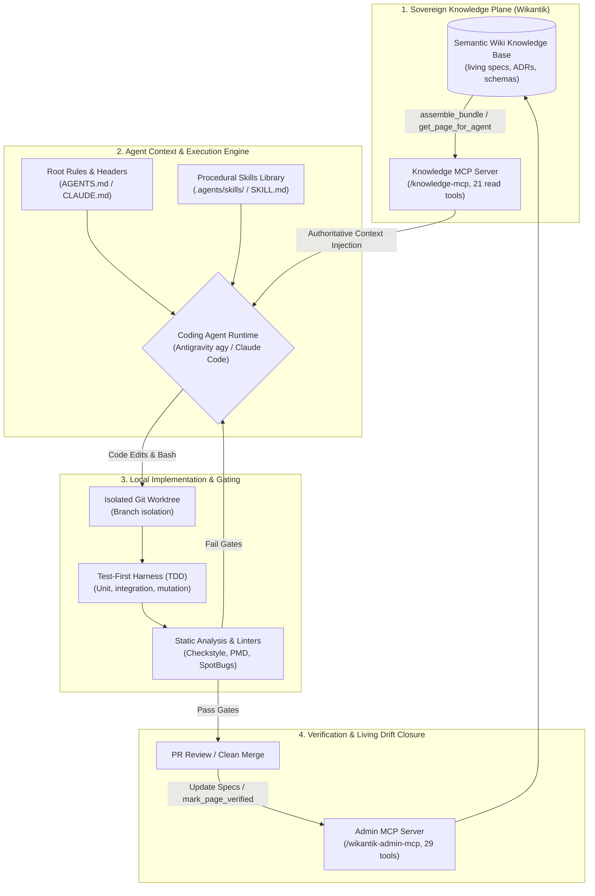

# Agentic Coding Hub: Workflows, Context Anchoring, and Autonomous Fleets

This cluster covers the **practice of building software with AI coding agents** (Antigravity `agy`, Claude Code, Cursor, Codex, Devin) — the architectural workflows, context engineering disciplines, and deterministic verification loops that separate rigorous agentic software engineering from brittle autocomplete.

The governing invariant of modern agentic engineering: **frontier models have largely converged in raw code generation capabilities; sustainable leverage is determined entirely by the context architecture and verification harness surrounding the agent.** Two engineers deploying the same frontier reasoning model achieve an order-of-magnitude difference in velocity and defect escape rates depending on how they anchor intent, assemble context, gate execution, and parallelize across worktrees.

---

## 1. The Three Eras of AI-Assisted Coding

Engineering organizations advance through three distinct architectural paradigms:

| Dimension | Era 1: Vibe Coding (Ad-Hoc Prompting) | Era 2: In-Repo Spec-Driven Development | Era 3: Semantic Wiki-Anchored Engineering (Level 5) |
| :--- | :--- | :--- | :--- |
| **Source of Truth** | Ephemeral chat scrollback and human memory | Markdown files in repository (`specs/plan.md`) | Centralized semantic wiki with bidirectional MCP |
| **Context Assembly** | Manual copy-pasting of files and logs | Static `CLAUDE.md` / `AGENTS.md` instruction bloat | Token-budgeted semantic bundle retrieval via `/knowledge-mcp` |
| **Cross-Repo Scope** | Non-existent; single-file focus | Siloed within individual git repositories | Uniform ecosystem contracts and living decision logs ([SimpleAgilityDecisionLog](SimpleAgilityDecisionLog)) |
| **Verification Loop** | "Looks good to me" visual scan | Human-gated unit test suites | Automated TDD, mutation testing, and machine-readable linter gates |
| **Defect Escape Rate** | Extreme; frequent regressions and silent drift | Moderate; bounded by repo-local context | Minimal; deterministic schemas and automated conformance scripts |

---

## 2. Navigating the Core Disciplines

### Core Workflow Disciplines
* **[ClaudeCodeWorkflows](ClaudeCodeWorkflows)** — Practical session workflows, slash commands, worktree isolation, and MCP grounding patterns in Claude Code.
* **[ContextEngineeringForCodingAgents](ContextEngineeringForCodingAgents)** — Structuring multi-tiered context: root rules (`AGENTS.md`, `CLAUDE.md`), progressive procedural skills (`SKILL.md`), and token-budgeted external retrieval using Wikantik's Knowledge MCP (`assemble_bundle`, `get_page_for_agent`) to eliminate context window rot.
* **[SpecDrivenDevelopment](SpecDrivenDevelopment)** — Transforming informal intent into immutable, machine-verifiable requirements before generating implementation code. Covers EARS requirements, dual-agent handoffs, and living wiki RFCs ([SimpleAgilityCommerceDataFlow](SimpleAgilityCommerceDataFlow), [SimpleAgilityAttributionRFC](SimpleAgilityAttributionRFC)).
* **[VerificationLoopsForAgenticCoding](VerificationLoopsForAgenticCoding)** — Building test-first gating harnesses, mutation testing, and AST assertions that prevent test-gaming, hallucinated passes, and reward hacking.
* **[StaticAnalysisTools](StaticAnalysisTools)** — Equipping agents with machine-readable diagnostics (SARIF, Checkstyle, PMD, SpotBugs, Semgrep) for automated error self-healing.

### Scaling & Fleets
* **[SubagentOrchestrationPatterns](SubagentOrchestrationPatterns)** — Decomposing complex tasks across specialized subagents: planner, implementer, reviewer, and verifier roles with strict tool and model tiering (`flash` vs `pro`).
* **[ParallelAgentsAndWorktrees](ParallelAgentsAndWorktrees)** — Mechanics of executing multiple concurrent coding agents on isolated git worktrees without branch collisions or disk contention.
* **[BackgroundAgentsAndAsyncDelegation](BackgroundAgentsAndAsyncDelegation)** — Long-running background daemon execution, issue-to-PR pipelines, and asynchronous reactive wakeups.

### Extension & Failure Defenses
* **[SkillsVsMcp](SkillsVsMcp)** — The definitive boundary between procedural skills (how to reason and execute steps) and Model Context Protocol (dynamic data plane connectivity to tools and databases).
* **[AgenticCodingFailureModes](AgenticCodingFailureModes)** — The 7 critical failure modes: silent hallucination, reward hacking, context eviction, code bloat, scope creep, prompt injection, and credential leakage — with concrete guardrails.
* **[AgenticCodingMaturityModel](AgenticCodingMaturityModel)** — The 5-level operational framework measuring organizational agent maturity.

---

## 3. Operational Integration with Wikantik

Wikantik serves as the authoritative, sovereign knowledge backbone for agentic software development across the Simple Agility ecosystem:
- **Zero-Crosstalk Context:** Agents working across separate repositories ([`stockroom`](file:///home/jakefear/source/stockroom), [`roller`](file:///home/jakefear/source/roller), [`jakemon`](file:///home/jakefear/source/jakemon)) share identical architectural ground truth via `/knowledge-mcp` without duplicate documentation commits.
- **Living Architectural Contracts:** Normative engineering standards and cross-repo interfaces are maintained as living wiki documents ([SimpleAgilityAgentCoordination](SimpleAgilityAgentCoordination), [SimpleAgilityTelemetryContract](SimpleAgilityTelemetryContract)).
- **Actionable Tool Recipes:** Consult the **[AgentCookbook](AgentCookbook)** for operational recipes on tool selection ([FindingTheRightMcpTool](FindingTheRightMcpTool)), page verification ([VerifyingAnAgentGeneratedPage](VerifyingAnAgentGeneratedPage)), and environment setup ([ConnectingClaudeCodeToWikantikMcp](ConnectingClaudeCodeToWikantikMcp)).

---

## See Also

- **[AgentCookbook](AgentCookbook)** — Scenario-keyed recipes for agents interacting with Wikantik and core services.
- **[SimpleAgilityStackHub](SimpleAgilityStackHub)** — Enterprise architecture, product boundaries, and shared data backbone.
- **[SimpleAgilityAgentCoordination](SimpleAgilityAgentCoordination)** — Normative multi-agent coordination protocol and active initiatives ledger.
- **[SimpleAgilityDecisionLog](SimpleAgilityDecisionLog)** — Authoritative ledger of dated architectural decisions.
- **[AgenticAiHub](AgenticAiHub)** — Theoretical foundations of autonomous agents and cognitive architectures.
