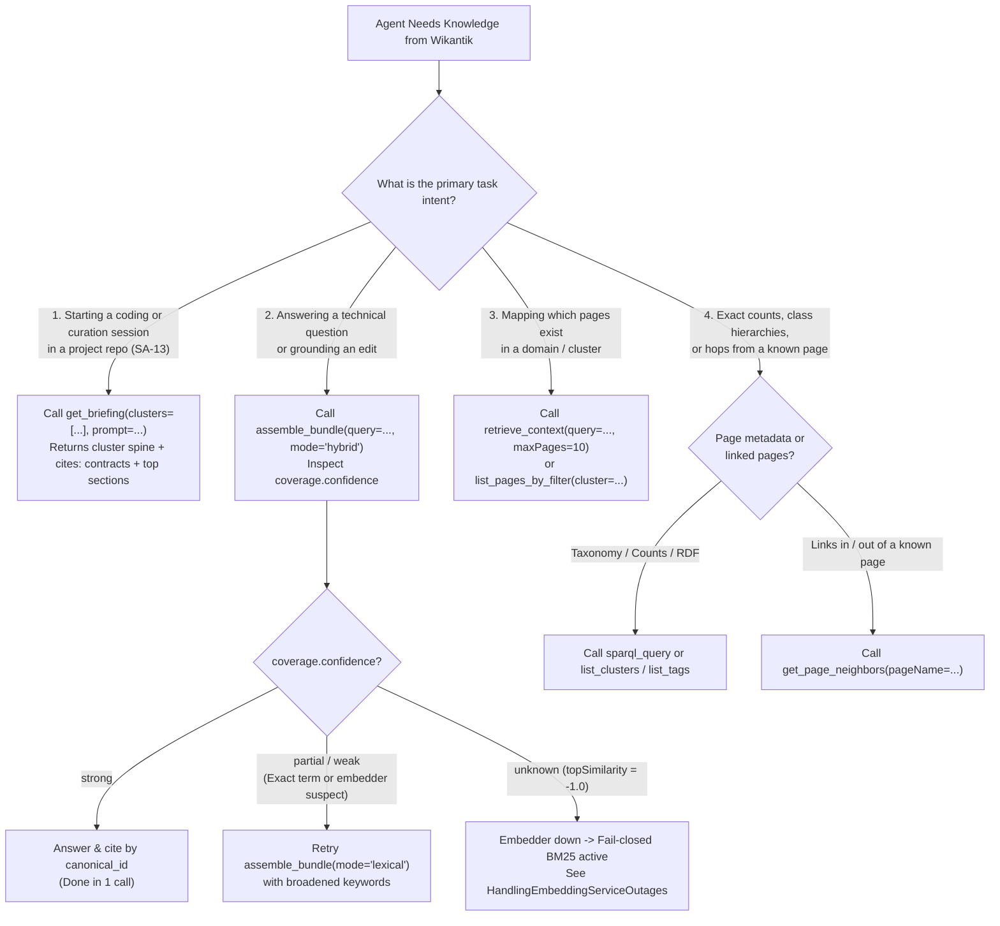

# Choosing a Retrieval Mode: Decision Tree for `get_briefing`, `assemble_bundle`, `retrieve_context`, and Page Graph Tools

Wikantik exposes **multiple specialized retrieval surfaces** on `/knowledge-mcp`, and its primary answer-grounding tool (`assemble_bundle`) accepts an explicit `mode` parameter (`hybrid`, `lexical`, or `dense`). Each entry point has a distinct token cost, ranking granularity, and failure mode. Calling the wrong tool wastes context window budget and degrades answer quality; following a deterministic decision tree lands the agent on authoritative, version-pinned evidence in **1 to 2 tool calls**.

---

## 1. Agent Retrieval Decision Flowchart

Before issuing a search call, classify your task intent along four axes: **Session Initialization**, **Question Answering / Fact Grounding**, **Exploratory Topic Mapping**, or **Formal Enumeration / Link Traversal**.



---

## 2. Comparative Matrix of `/knowledge-mcp` Retrieval Tools

| Tool Name | Indexing Unit | Ranking / Execution Engine | Token Efficiency & Output Shape | When to Choose (and When to Avoid) |
| :--- | :--- | :--- | :--- | :--- |
| **`get_briefing`** | Cluster spine + `cites:` contracts + section chunks | Structural Index + `cites:` graph + Hybrid RRF | High density: hub summary, member list, cited cross-repo contracts (`SA-13`), and prompt-matched sections. | **Mandatory first call at session start (`SA-13`).** Do not call repeatedly mid-session for narrow code questions. |
| **`assemble_bundle`** | Section chunks (`kg_content_chunks`) | Global chunk-level BM25 + `pgvector` HNSW RRF (`mode="hybrid"`, `"lexical"`, or `"dense"`) | Token-budgeted (`maxTokens`), de-duplicated, version-pinned sections + `coverage` telemetry block. | **Default tool for answering questions.** Avoid for "list every page in cluster X" enumerations (use `list_pages_by_filter` instead). |
| **`retrieve_context`** | Full pages + top chunks per page | Page-level BM25 + dense RRF + optional 1-hop `expandNeighbors` | Returns page summaries, metadata, and top $k$ excerpts per page. | **Best for topic discovery** when deciding which pages to read or edit. Raise `maxPages` / `chunksPerPage` rather than rewording queries. |
| **`list_pages_by_filter`** | Page metadata (`page_canonical_ids`) | Deterministic SQL/Spine filter (`cluster`, `tag`, `type`, `status`, `updated_since`) | Zero embedding overhead; exact completeness. | **Best for breadth and recency filtering** (e.g., when top-5 hybrid hits cluster too tightly in one domain). |
| **`get_page_neighbors`** | Page Graph (real wikilinks, cluster siblings, hub) | Structural index lookup, no ranking | Compact 1-hop lists of `{slug, title, type, summary}`; no page bodies. | **Use when you already know a page** and want what it links to, what links to it, or its siblings. Never use as a substitute for prose search. |
| **`sparql_query`** | Jena TDB2 RDF A-Box (`wikantik.ttl`) | W3C SPARQL 1.1 query engine | Exact tabular bindings (`SELECT`) or triples. | **Best for formal aggregations, `skos:broader` chains, and cross-type joins** that vector search cannot count reliably. |

---

## 3. Interpreting `assemble_bundle` Coverage Signals & Switching Modes

Every `assemble_bundle` response includes a `coverage` diagnostic object computed from the top dense similarity score $s_{\max} = \max_i \text{sim}(\vec{u}_i, \vec{v}_q)$ and the number of distinct qualifying sections $N_{\text{sec}}$:

$$
\text{confidence} = \begin{cases}
\text{unknown} & \text{if } s_{\max} = -1.0 \text{ (dense embedder offline; BM25 fallback)} \\
\text{strong} & \text{if } s_{\max} \ge \tau_{\text{strong}} \text{ and } N_{\text{sec}} \ge 3 \\
\text{partial} & \text{if } \tau_{\text{weak}} \le s_{\max} < \tau_{\text{strong}} \\
\text{weak} & \text{if } s_{\max} < \tau_{\text{weak}}
\end{cases}
$$

### Actionable Rules by `coverage.confidence`:
1. **`strong`:** Stop retrieving. Ground your answer directly in the returned sections and cite each source by its 26-character ULID (`canonical_id`, see [[CitingAWikiPage|Citing a Wiki Page]]).
2. **`partial` or `weak` on an exact technical identifier:** Retry **once** with `assemble_bundle(query="...", mode="lexical")` using 2–4 core identifier tokens (e.g., `"OntologyShaclValidator write chokepoint"`). General-purpose embedding models occasionally compress rare Java class names or config flags poorly, whereas Lucene BM25 hits them at rank #1.
3. **`partial` or `weak` on an enumeration or count question:** Do not re-run vector search. Switch immediately to `list_clusters`, `list_pages_by_filter`, or `sparql_query`.
4. **`unknown` (`topSimilarity: -1.0`):** The Ollama embedding service is unreachable and hybrid retrieval has failed closed to BM25 lexical ranking. Proceed with lexical keyword queries and follow [[HandlingEmbeddingServiceOutages|Handling Embedding Service Outages]] if you are an ops agent.

---

## 4. Worked JSON-RPC Examples

### Step 1: Default Hybrid Bundle Call
```json
{
  "name": "assemble_bundle",
  "arguments": {
    "query": "How doesConfidenceComputer calculate authoritative vs provisional page confidence?",
    "mode": "hybrid",
    "maxTokens": 3000
  }
}
```

### Step 2: Deliberate Switch to `mode="lexical"` for Exact Config/Symbol Lookup
```json
{
  "name": "assemble_bundle",
  "arguments": {
    "query": "wikantik.verification.stale_days trusted_authors ConfidenceComputer",
    "mode": "lexical",
    "maxTokens": 3000
  }
}
```

### Step 3: Broadening When Hybrid Results Over-Concentrate in One Cluster
```json
{
  "name": "list_pages_by_filter",
  "arguments": {
    "cluster": "agent-cookbook",
    "type": "runbook",
    "limit": 25
  }
}
```

---

## 5. Critical Pitfalls to Avoid

1. **Violating the 3-Call Retrieval Ceiling:** Never chain 5–15 paraphrased `retrieve_context` or `assemble_bundle` calls hoping new synonyms will surface a missing page. If `hybrid` $\to$ `lexical` $\to$ `list_pages_by_filter` returns nothing, the topic is an unindexed content gap—report that gap cleanly rather than burning context tokens.
2. **Treating `get_page_neighbors` as Semantic Search:** It follows real wikilinks and cluster membership only. It tells you what a page is connected to, not what is similar in meaning; for similar pages read the related-pages block of `get_page_for_agent` (derived from page embeddings), and use `assemble_bundle` or `retrieve_context` for document sections.
3. **Looking for Removed Knowledge Graph Tools:** The entity-level Knowledge Graph tools were removed in release 2.5.13 (November 2026). Old prompts or scripts that call them fail with an unknown-tool error; route text retrieval to `retrieve_context` / `assemble_bundle` and link questions to `get_page_neighbors`.
4. **Encoding Recency in the Query String:** Passing `"recent pages updated in October 2026"` into a vector query matches pages that literally contain the word `"October"`. Always use structural date filters (`updated_since` on `list_pages_by_filter` or `filters.modifiedAfter` on `retrieve_context`).

5. **Ignoring Retrieval Health Signals in Telemetry:** Agents diagnosing content discoverability should correlate low retrieval confidence with live search telemetry. When `assemble_bundle` returns sparse results or low score margins ($\Delta S < 0.05$), inspect Google Search Console index status via `./bin/wikantik gsc inspect <slug>` to determine whether unretrieved sections reflect embedding rank dilution or actual crawler omission.

---

## References & Related Documentation

- [[AgentCookbook|Agent Cookbook]] — Central index of engineering patterns, retrieval recipes, and operational runbooks for AI agents.
- [[SearchConsoleContentOptimizationWorkflow|Search Console Content Optimization Workflow]] — Closed-loop search console inspection, query alignment, and recrawl dispatch.
- [[ContentPipelineHub|Content Pipeline Hub]] — Architecture and operational lifecycle of Wikantik content ingestion and curation.

---

**Cluster Hub:** [[AgentCookbook|Agent Cookbook]] (`agent-cookbook`)
