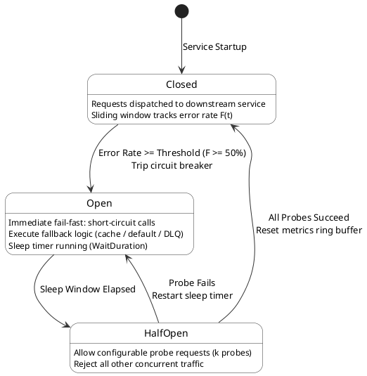

# Circuit Breaker Pattern: Deep Dive into Distributed Resilience

In the realm of distributed systems and microservices architecture, the assumption that the network is reliable is one of the most dangerous fallacies a software engineer can adopt. In modern cloud-native environments, latency spikes, intermittent packet loss, and full-scale service outages are not anomalies—they are inevitable operational realities. Building systems that can withstand and elegantly recover from these realities is the core objective of **Resilience Engineering**.

When dependencies fail, they often do not fail cleanly. A slow database query or a degraded third-party API can hang open connections, exhausting thread pools, memory, and database connection pools in the calling service. If a high-volume e-commerce platform experiences a checkout service slowdown, the cost of the ensuing downtime can easily exceed \$50K per minute during peak shopping events, not to mention the long-term damage to customer trust and brand reputation.

To mitigate these risks, engineers rely on a suite of stability patterns, chief among them being the **Circuit Breaker Pattern**. This pattern acts as a stateful proxy, standing between a service and its remote dependencies, explicitly designed to prevent catastrophic cascading failures.

## Cascading Failures and the Threat to System Stability

A **cascading failure** occurs when a localized fault triggers a sequence of subsequent failures across different parts of a system, ultimately leading to a massive outage. Consider a web application that depends on a recommendation service, which in turn depends on a database. 

If the database slows down, the recommendation service's response time increases. The web application, waiting for the recommendation service, begins to queue up incoming requests. The threads handling these requests are blocked. As the thread pool becomes exhausted, the web application can no longer serve *any* requests—even those that do not require the recommendation service (e.g., loading a static product page). The initial minor slowdown in a backend database has now completely taken down the entire frontend application.

The Circuit Breaker pattern prevents this by short-circuiting calls to a failing dependency. Once a certain threshold of failures is reached, the circuit breaker "trips" and immediately returns an error (or a fallback response) to the caller, rather than forcing the caller to wait for a network timeout. This fail-fast mechanism protects local resources and provides the struggling dependency with the breathing room it needs to recover, rather than pummeling it with an endless stream of retries that will only exacerbate the outage.

## The Finite State Machine (FSM)

At its mathematical and structural core, a Circuit Breaker is implemented as a **Finite State Machine (FSM)**. It monitors the results of all outbound requests and transitions between three primary states based on the observed success or failure rates over a defined sliding window.



### 1. The CLOSED State (Normal Operation)

In the **Closed** state, the circuit breaker allows all requests to pass through to the downstream dependency. The breaker operates as a silent observer, meticulously recording the outcome of each call (success, failure, or timeout). 

To avoid reacting to singular, anomalous spikes, the circuit breaker evaluates the failure rate over a specific time window or request volume. This is calculated using a sliding window:

1. **Count-Based Sliding Window:** Tracks the last $N$ calls (e.g., 100 calls) in a circular ring buffer.
2. **Time-Based Sliding Window:** Tracks calls over the last $T$ seconds (e.g., 60 seconds) segmented into $M$ discrete epoch buckets.

We can model the failure rate $F(t)$ over a window $W$ using the following equation:

$$
F(t) = \frac{\sum_{i=1}^{N_W} \mathbb{I}(\text{request}_i \text{ failed})}{N_W} \times 100
$$

Where $N_W$ is the total number of requests in the window, and $\mathbb{I}$ is the indicator function that equals 1 if the request failed and 0 otherwise. When $F(t)$ exceeds the configured threshold limit (typically $50\%$), the FSM transitions to the Open state.

### 2. The OPEN State (Failing Fast)

When the failure rate breaches the predefined threshold, the circuit breaker trips, transitioning into the **Open** state. While in the Open state, all attempts to call the dependency are immediately rejected. No network call is made. Instead, the circuit breaker instantly throws a `CallNotPermittedException` (or equivalent), or returns a pre-configured fallback response.

This state serves two critical purposes:
1. **Resource Conservation:** The calling service immediately frees up its thread and does not waste time waiting for a doomed request to timeout.
2. **Dependency Recovery:** The downstream service, which is likely struggling under load or experiencing internal faults, is shielded from further incoming traffic, allowing its internal recovery mechanisms (like auto-scaling or garbage collection) to operate without interference.

The circuit breaker does not stay Open indefinitely. It enters a "Wait Duration" (or sleep window, typically 10 to 60 seconds). Once this duration expires, it transitions into the Half-Open state to test the waters.

### 3. The HALF-OPEN State (Probing for Recovery)

The **Half-Open** state is an exploratory phase. The circuit breaker allows a strictly limited number of "probe" requests (e.g., 3 to 10 requests) to pass through to the dependency, while continuing to reject all other traffic.

The outcomes of these probe requests determine the next state transition:
- If the probe requests are **successful**, it indicates that the downstream service has recovered. The circuit breaker resets its failure metrics ring buffer and transitions back to the **Closed** state.
- If any of the probe requests **fail**, it indicates that the dependency is still degraded. The circuit breaker immediately transitions back to the **Open** state, restarting the wait duration clock.

This cautious probing prevents a recovering service from being instantly overwhelmed by a flood of backed-up traffic the moment the circuit breaker closes.

## Comparative Architecture: In-Process vs. Service Mesh Breakers

Depending on the operational scale and deployment topology, circuit breaking can be implemented directly within application runtime libraries or offloaded to infrastructure sidecars:

| Architecture Layer | Reference Implementation | Metric Tracking Mechanism | Concurrency Isolation | Polyglot Support | Operational Trade-off |
| :--- | :--- | :--- | :--- | :--- | :--- |
| **JVM In-Process** | Resilience4j | In-memory atomic bit-sets / ring buffers | Semaphore or Bounded ThreadPool | JVM only (Java, Kotlin, Scala) | Zero network hop overhead; requires library dependency and code instrumentation |
| **Service Mesh Sidecar** | Envoy Proxy (Outlier Detection) | Consecutive 5xx counters & local outlier statistics | Connection pool max pending requests | Native polyglot (language-agnostic) | Adds ~0.5ms sidecar hop; decouples resilience policies from application release cycles |
| **.NET In-Process** | Polly | Sliding window health state machine | ThreadPool execution isolation | .NET ecosystem | Rich asynchronous pipeline integration; client-bound state |
| **Mesh Ingress Gateway** | Istio / Envoy Gateway | Upstream cluster health checker | Bounded active connections ($max\_connections$) | Complete fleet-wide enforcement | Centralized traffic policy; coarse-grained across service instances |

### Concrete Resilience4j Configuration Example

In high-throughput microservices, configuring a sliding window requires balancing statistical sensitivity against memory consumption. The following Spring/Java configuration demonstrates a production-grade count-based circuit breaker:

```yaml
resilience4j.circuitbreaker:
  instances:
    orderPaymentService:
      slidingWindowType: COUNT_BASED
      slidingWindowSize: 100
      minimumNumberOfCalls: 20
      failureRateThreshold: 50.0
      slowCallRateThreshold: 75.0
      slowCallDurationThreshold: 2000ms
      waitDurationInOpenState: 30000ms
      permittedNumberOfCallsInHalfOpenState: 10
      automaticTransitionFromOpenToHalfOpenEnabled: true
      recordExceptions:
        - java.io.IOException
        - java.util.concurrent.TimeoutException
        - org.springframework.web.client.ResourceAccessException
      ignoreExceptions:
        - com.example.exceptions.InvalidPaymentRequestException
```

In this configuration:
- The breaker requires at least 20 calls before calculating error percentages, preventing false trips during cold starts.
- It trips not only on hard exceptions but also if $>75\%$ of calls take longer than 2,000ms (**Slow Call Detection**), preventing thread saturation before actual failures manifest.
- Business validation errors (`InvalidPaymentRequestException`) are explicitly ignored so user errors do not trip the infrastructure breaker.

## Resilience Engineering: Beyond the Breaker

While the Circuit Breaker is a powerful defensive mechanism, it is only one piece of a comprehensive resilience engineering strategy. When a service call fails, the client must decide how to proceed. Simply failing fast is not always the best user experience. This brings us to complementary patterns: **Retries with Exponential Backoff** and **Jitter**.

### Retries and the Thundering Herd Problem

Transient network glitches—a dropped packet or a momentary router hiccup—are common. In these cases, immediately failing the operation is suboptimal. Instead, the client should attempt a **Retry**. 

However, naive retries are extremely dangerous. If a downstream service is slightly overloaded and begins to drop 10% of requests, and hundreds of clients immediately and aggressively retry those failed requests, the overall traffic volume spikes. This sudden influx of retry traffic can push the struggling service over the edge into a total collapse. This phenomenon is known as the **Thundering Herd problem** or a retry storm.

To safely implement retries, engineers must use **Exponential Backoff**.

### Exponential Backoff

Exponential backoff dictates that the wait time between successive retry attempts increases exponentially. Rather than retrying immediately, the client waits for a short delay, then a longer delay, and so on. This gives the overloaded service time to recover.

A standard exponential backoff algorithm calculates the wait time $T_w$ for the $n$-th retry attempt as follows:

$$
T_w(n) = \min(T_{max}, T_{base} \times 2^n)
$$

Where:
- $T_{base}$ is the initial base delay (e.g., 100 milliseconds).
- $n$ is the retry attempt number (0, 1, 2, ...).
- $T_{max}$ is a hard cap on the maximum wait time to ensure the user isn't waiting indefinitely.

While exponential backoff spreads out the retry traffic, it has a hidden flaw when applied across a large fleet of synchronized clients. If a server goes down for 5 seconds and drops thousands of connections simultaneously, all those clients will begin their exponential backoff loops at the exact same time. They will all retry after 100ms, then all retry after 200ms, creating massive, synchronized spikes in traffic that can still overwhelm the recovering server.

### Introducing Jitter

To break up these synchronized retry spikes, we must introduce randomness into the wait calculation. This randomness is called **Jitter**. By adding jitter, we spread the retries out evenly across a continuum of time, smoothing the traffic curve and preventing resonant frequency spikes.

A common and highly effective approach is **Full Jitter**, which picks a random value uniformly distributed between 0 and the exponential backoff maximum:

$$
T_{jittered}(n) = \text{random\_uniform}(0, \min(T_{max}, T_{base} \times 2^n))
$$

By combining Circuit Breakers with Jittered Exponential Backoff, you create a robust, multi-layered defense. The retries handle transient faults gracefully without causing retry storms, and the Circuit Breaker steps in to halt traffic entirely when a severe, systemic outage is detected, protecting the \$50K per minute revenue stream from collapsing under the weight of cascading failures.

## Architectural Sizing and Queuing Dynamics (Little's Law)

The success of a Circuit Breaker heavily depends on tuning its parameters: the failure threshold, the sliding window size, and the wait duration.

Engineers must leverage **Little's Law** from queuing theory to size concurrency limits and timeouts:

$$
L = \lambda \cdot W
$$

Where:
- $L$ is the average number of concurrent requests in the system.
- $\lambda$ is the arrival rate of incoming requests (requests per second).
- $W$ is the average latency (response time) per request.

If a downstream service degrades such that latency $W$ increases from $50\text{ms}$ to $5,000\text{ms}$ ($100\times$ increase) while arrival rate $\lambda$ remains constant at $1,000\text{ req/sec}$, the required concurrency $L$ jumps from $50$ to $5,000$ active threads. Because server thread pools typically hold between $200$ and $500$ threads, the calling service exhausts all worker threads in seconds.

The Circuit Breaker enforces an immediate clamp on $W$ by failing fast in $<1\text{ms}$ during the Open state, forcing $L$ back down to nominal levels and preventing upstream thread pool exhaustion.

## Operational Implementation Checklist & Failure Mode Matrix

When operating circuit breakers in mission-critical distributed production architectures, verify the following engineering guidelines:

1. **Differentiate Infrastructure vs. Business Errors:** Configure circuit breakers to record only network timeouts, HTTP 502/503/504 errors, and connection pool exhaustions. Never record HTTP 400 Bad Request, 401 Unauthorized, or 422 Unprocessable Entity, as client-side errors do not reflect upstream degradation.
2. **Implement Meaningful Fallbacks:** Ensure fallback methods are lightweight and locally deterministic. A fallback that itself calls another remote database or secondary service risks generating a secondary cascading failure.
3. **Isolate Thread Pools (Bulkheading):** Combine Circuit Breakers with the **Bulkhead Pattern** (`ThreadPoolBulkhead` or `SemaphoreBulkhead`). Allocating dedicated, isolated thread pools per downstream dependency guarantees that an un-tripped dependency cannot consume threads allocated to critical business paths.
4. **Export Prometheus Telemetry Gauges:** Monitor circuit breaker transitions via real-time alerts. Critical alert thresholds include:
   - `resilience4j_circuitbreaker_state{state="open"} == 1` persisting for $> 2\text{ minutes}$.
   - Spike in `resilience4j_circuitbreaker_failure_rate > 35%`.
5. **Simulate Outages via Chaos Engineering:** Regularly inject synthetic latency and connection timeouts using chaos engineering tools (such as Chaos Mesh or Gremlin) to verify that circuit breakers trip within expected time windows and fallbacks execute cleanly without throwing unhandled exceptions.

---

## References & Related Documentation

- [[DesignPatternsHub|Design Patterns Hub]] — Architectural reference for creational, structural, and behavioral software patterns.
- [[DistributedSystemsHub|Distributed Systems Hub]] — Core principles of consensus, replication, partition tolerance, and fault recovery.
- [[RateLimitingAndThrottling|Rate Limiting and Throttling]] — Token bucket and sliding log algorithms for protecting API capacity.
- [[SagaPattern|Saga Pattern]] — Compensating transactions and distributed workflow coordination without distributed locks.
- [[EventDrivenArchitecture|Event-Driven Architecture]] — Asynchronous decoupling and event streaming to prevent synchronous request coupling.

---

**Cluster Hub:** [[DesignPatternsHub|Design Patterns Hub]] (`design-patterns`)
