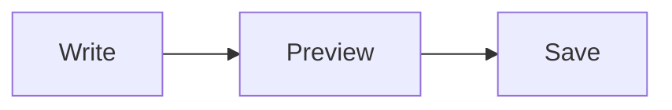
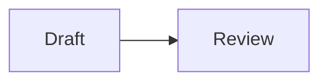
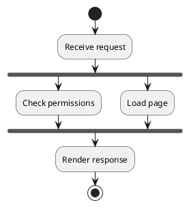
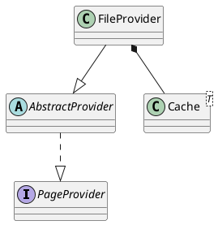

# Edit Page Help

A short reminder of what the page editor offers. In shortcuts, **Mod** means Ctrl on Windows and Linux and Cmd on a Mac. For the full guide, see [Editing](https://github.com/jakefearsd/wikantik/blob/main/docs/user/Editing.md).

## Start and save

* Choose **Edit** on a page to open the editor. You only see it if you have permission to edit.
* To make a page, use **+ New Article** in the sidebar (shown when you are signed in), or link to a page that does not exist yet.
* Add a **Change note** to say what you did, then press **Mod+S** or choose **Save**. **Cancel** leaves without saving.
* The editor keeps a draft in your browser while you type, and offers to restore it if you come back.

## Rich and Source

The editor has two modes. **Rich** shows the page much as it will read and lets you build it from the toolbar, without typing Markdown. **Source** shows the Markdown itself. The page text is plain Markdown in both, and switching modes never changes it.

* Choose **Rich** or **Source** at the right-hand end of the toolbar, or press Mod+E. Nothing else switches the mode.
* Your choice is saved to your account when you are signed in (otherwise in this browser). To change the default, open **Preferences**, go to **Editor** and set **Default editing mode**. New users start in Rich mode.
* A page written in the older wiki syntax opens in Source only.

## Toolbar and keys

| Action | Key |
|--------|-----|
| Bold | Mod+B |
| Italic | Mod+I |
| Strikethrough | Mod+Shift+X |
| Highlight the selection | Mod+Shift+H |
| Insert or edit a link | Mod+K |
| Switch between Rich and Source | Mod+E |
| Reach the table controls | Alt+T |
| Save | Mod+S |
| Paste as plain text | Mod+Shift+V |
| Comment the selection | Mod+/ |

The toolbar works the same way in both modes: in Source it writes the same Markdown you would type.

* The buttons are bold, italic, strikethrough, bulleted list, numbered list, task list, quote, inline code, table and link. A button is lit when the cursor is in text of that kind, and pressing it again takes the formatting off.
* The **Heading** menu shows the level of the line the cursor is on. Pick **Heading 1** to **Heading 4** to make the line a heading, or **Paragraph** to turn a heading back into ordinary text.
* The **Insert** menu holds the rest: code block, Mermaid diagram, PlantUML diagram, math block, the five callouts (note, tip, info, warning, danger), image, page embed, footnote, highlight, comment, horizontal rule and access rule. **Access rule** asks for a permission and the names allowed to use it, then writes the rule on its own line above the cursor. On a narrow screen, buttons that do not fit move into this menu.
* Type `/` at the start of a line, or after a space, for the same blocks as a menu at the cursor. Keep typing to narrow the list.
* With the toolbar focused, the Left and Right arrow keys move along it and Tab leaves it.

## What Rich mode shows

Rich mode keeps most markup out of sight, including on the line you are typing on.

* **Headings, lists, task boxes and quotes** show without their markers. Backspace at the start of such a line removes the marker and leaves the text.
* **Links, page embeds and images** show as a link or a picture. Click one to change it (see *Links, embeds and images* below).
* **Tables** are edited cell by cell (see *Tables* below).
* **Code blocks, diagrams and math blocks** show without their fence lines. A code block has a small header with a language list.
* **Callouts** show their title, with a list to change the type.

Some markup still appears when the cursor comes to it:

* **Bold, italic, strikethrough, highlight and inline code** show their marks on the line the cursor is on, and hide them again when the cursor leaves. Use the toolbar buttons if you would rather not type them.
* **A diagram or a math block** is drawn until the cursor moves into it; then you see and edit its source. Move the cursor out and it is drawn again.
* **A link you are typing** shows its source until the cursor leaves it.
* **Formulas inside a line, footnotes, comments, access rules, block ids and raw HTML** show their source on the cursor's line.

Two things to know about the keys:

* Backspace just after a link, or Delete just before one, first selects the whole link. Press the key again to remove it.
* When a code block or a table is the first or last thing on the page, the Up or Down arrow key adds an empty line outside it, so you can always get out.

## Tables

In Rich mode a table is a grid. Use the table button, or **Insert table** in the `/` menu, to start one.

* Click a cell and type. What you type is saved as part of the page straight away, so in a shared session others see it as you write.
* **Tab** goes to the next cell and **Shift+Tab** to the previous one. **Enter** goes down to the same column of the next row. Tab or Enter at the end of the table adds a row.
* While the cursor is in a table, **+ row**, **+ col** and a **⋮** menu appear beside it. The menu adds a row above or a column to the left, moves the column left or right, sets its alignment, and deletes the row or column. Press **Alt+T** to reach these controls from the keyboard, and **Escape** to return to the cell.
* A cell holds one line of text. Bold, links and the rest work in a cell as they do in a paragraph. A vertical bar typed in a cell is kept as text. Spaces typed in front of a cell's text are not kept.
* With text selected across several cells, typing or deleting changes one cell only, and Cut removes nothing. To change several cells at once, switch to Source.

Some tables are shown as a table but are not editable as a grid; click one to edit its Markdown rows instead. These are tables whose rows do not all start and end with a vertical bar, tables whose rows have different numbers of cells, tables with more than one header row, and tables inside a list or a quote. Giving every row the same number of cells and a bar at each end makes the table a grid again:

```
| Step   | Owner |
| ------ | ----- |
| Deploy | Ops   |
```

## Links, embeds and images

* Click a link, a page embed or an image in Rich mode to open a small card with its details: the page, heading and text of a wiki link; the address and text of a web link; the source and alt text of an image.
* Change a field and press **Enter**, or click away, to apply it. **Escape** closes the card and changes nothing. **Remove** takes the link off and keeps its text. **Open** follows the link.
* Select some text on one line and press **Mod+K** (or the link button) to make it a web link: the card opens for the address, and the page is not changed until you confirm it. With the cursor on a link, Mod+K opens that link's card. With nothing selected, it starts a wiki link and lists pages to pick from.
* Mod+K does nothing when the selection runs across table cells, or already holds a link or a web address. Select only the text you want linked.
* **Mod+S** while a card is open applies the card's change first and then saves. If the card cannot accept what you typed, it stays open and nothing is saved.

## Code blocks and callouts

* A code block's header has a list of languages; pick one to set how the block is highlighted. A new code block from the toolbar starts empty, with the cursor inside it.
* A callout's title has a list of types (note, tip, info, warning, danger). Pick one to change the callout; edit the title text in place.
* Both lists change only that one word of the page.
* From the keyboard, put the cursor in the code block or callout, open the command palette and run **Change code language / callout type**. The list takes the focus; press Enter or Space to open it.

## When the page is read-only

The editor is read-only when you may not edit the page, and for a moment when a shared draft is catching up with the server. While it is read-only the toolbar, the `/` menu, the shortcuts and **Copy block link** (for a block that has no id yet) change nothing. Try again once you can type.

## The Markdown source pane

In Rich mode, the pane beside the editor can show the page's Markdown instead of the preview: choose **Source** at the top of the pane (or run **Show Markdown source beside the editor** from the command palette), and **Preview** to go back.

* The pane is read-only. It follows the cursor, with the current line highlighted, so you can watch the Markdown your clicks produce. You can select and copy from it.
* It shows the body of the page. The metadata is edited on the **Frontmatter** tab and is not shown here.
* It is not a way to switch mode. To edit the Markdown, switch the editor to Source.

## Writing

* The editor takes Markdown. See [TextFormattingRules](TextFormattingRules) for the syntax.
* Type `[[` to search for a page to link, and `[[Page#` to link to one of its headings.
* Paste from Google Docs, Word, Confluence or a web page and the formatting arrives as Markdown. Mod+Shift+V pastes plain text instead. Pasting a URL over selected text makes it a link.
* Paste or drag an image into the editor to attach it, or use **Attach**.
* The side rail lists the page outline, backlinks and **Unlinked mentions**, with one-click linking.

## Block references

Any paragraph, list item, table, quote or callout can carry a short id, so another page can link to or embed exactly that block.

* Add the id at the end of the block's last line, after a space: `The launch date is fixed. ^launch`. For a table, list, quote, callout, code or math block, put `^launch` on its own line after a blank line following the block.
* An id is `^` followed by letters, digits and hyphens. Ids are case-sensitive, so `^Launch` and `^launch` are different blocks.
* Heading lines don't take ids; link to a heading with `[[Page#Heading]]`.
* If an id appears twice on a page, the first one wins and the later markers are ignored.
* Link to a block with `[[Page#^launch]]`, or `[[#^launch]]` from the same page. Embed it with `![[Page#^launch]]`.
* In the reader, hover a block and use the paragraph-mark button to copy its `[[Page#^id]]` link; the arrow button copies the web address instead. A block without an id gets one added when you copy.
* In the editor, type `[[Page#^` and pick a block from the list; a block without an id gets one. The **Copy block link** command copies the link for the block under the cursor.

## Highlight and comments

* Write `==text==` to highlight it; the reader shows it marked, like a highlighter pen. Mod+Shift+H wraps or unwraps the selection. The marker pair must hug the text, so `== x ==` and `a == b` stay as they are.
* Write `%%a note%%` for a comment that readers do not see. A comment can run over several lines. Mod+/ wraps or unwraps the selection in `%%`. The editor shows comments dimmed, with their `%%` marks visible.
* The rendered page hides comments from everyone, editors included, and so do search, excerpts, links and backlinks, and AI agents that read the page. People who cannot edit the page also do not see them in diffs, vault exports or the page source. They are not private, though: anyone who can edit the page sees them in the editor and in the source from `/api/pages`, so never put a secret in one.
* A `%%` inside a code span, a code block, a diagram or a formula is ordinary text, and a `%%` with no closing partner is left alone.
* **Warning:** an access rule such as `[{ALLOW view Admin}]` inside a comment still counts as a rule. The page locks to administrators, and a save that adds such a rule is refused. Commenting a rule out does not disable it: delete it, or put it in a code span.

## Inline tags

* Write `#topic` in your text to tag the page. The reader shows it as a link to the list of pages with that tag, and the tag counts everywhere tags are listed or searched, alongside the tags in the front matter.
* `#Topic`, `#topic` and a front matter tag `topic` are one tag. A nested tag such as `#team/core` is the tag `team-core`, and the page keeps what you wrote.
* A tag needs a space or the start of the line before the `#`, and at least one letter, dash or underscore: `#2024` and `issue #123` are plain text, `#2024q1` and `#fff` are tags. A `#` on a heading line, in code, in a formula, in a link or inside a `%%` comment is never a tag.
* In the editor, type `#` and a letter to pick from the tags already in use. Tags written in your text do not appear in search engine keywords or feeds; only front matter tags do.

## Diagrams

A fenced code block whose language is `mermaid` renders as a diagram when the page is viewed. A `plantuml` block works the same way and suits deep class and activity diagrams; see *Class and activity diagrams with PlantUML* below. This Mermaid diagram is live:



To show diagram syntax as text instead of drawing it, add the word `example` after the language. The block below is written that way, so it appears as code:



* To make a node open a wiki page, add a line `click NodeId "/wiki/PageName"`. These links count as real page links, so they show up in backlinks, the Page Graph and broken-link reports.
* If a diagram has a syntax error, or is refused, the page shows its source together with the reason instead of a picture.
* The wiki refuses diagrams that contain `%%{ ... }%%` directives, a `---` front matter block, `click` lines that call a function, links that are not `http(s)` or relative, or `javascript:` anywhere. Tooltips in `click` lines cannot contain a colon.
* Renaming a page does not yet update `click` links to it in diagrams, so check those after a rename.

### Class and activity diagrams with PlantUML

Use a `plantuml` fence for class diagrams with deep structure, and for activity diagrams that need fork/join bars or swimlanes. Use Mermaid for everything else. This activity diagram is live:



So is this class hierarchy, with an interface, an abstract class, a generic type and composition:



The `example` word works here too, so you can show the source as text:

```plantuml example
@startuml
class Page [[/wiki/EditPageHelp]]
@enduml
```



* To link a shape to a wiki page, add `[[/wiki/PageName]]` after it, as above. These links count as real page links, so they appear in backlinks.
* `@startuml` diagrams are accepted, plus `@startsalt` wireframes and `@startnwdiag` network diagrams (which need their own start line). `!include` is refused except for `<C4/...>` libraries, images and `{{ ... }}` embedded sub-diagrams are refused, and a diagram can be at most 64 KB.
* A diagram that fails shows its source together with the reason, as Mermaid does.

## Metadata

The **Frontmatter** tab edits the page's metadata (type, tags, cluster, summary and more) and checks it as you type. Save is disabled while an error is showing. See [Frontmatter](https://github.com/jakefearsd/wikantik/blob/main/docs/user/Frontmatter.md).

## Conflicts

If someone saved the page after you opened it, you can overwrite their version, discard yours, or copy your text and reload.

## Editing together

When the wiki has collaborative editing turned on, several people can edit a page at once in one shared draft, and **Save** becomes **Publish**. See [Collaborative Editing](CollaborativeEditing).
