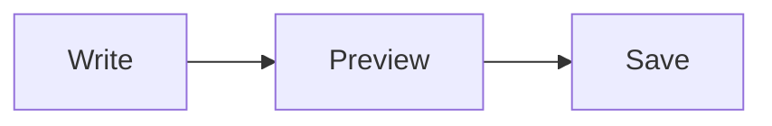
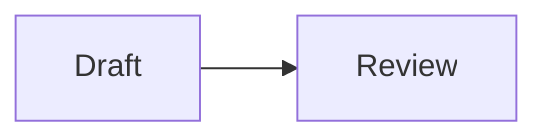

# Edit Page Help

A short reminder of what the page editor offers. In shortcuts, **Mod** means Ctrl on Windows and Linux and Cmd on a Mac. For the full guide, see [Editing](https://github.com/jakefearsd/wikantik/blob/main/docs/user/Editing.md).

## Start and save

* Choose **Edit** on a page to open the editor. You only see it if you have permission to edit.
* To make a page, use **+ New Article** in the sidebar (shown when you are signed in), or link to a page that does not exist yet.
* Add a **Change note** to say what you did, then press **Mod+S** or choose **Save**. **Cancel** leaves without saving.
* The editor keeps a draft in your browser while you type, and offers to restore it if you come back.

## Toolbar and keys

| Action | Key |
|--------|-----|
| Bold | Mod+B |
| Italic | Mod+I |
| Insert link | Mod+K |
| Toggle live preview | Mod+E |
| Save | Mod+S |

The toolbar also has heading, list, inline code, code block and table buttons. Type `/` at the start of a line for a menu of blocks such as tables, callouts and math.

## Writing

* The editor takes Markdown. See [TextFormattingRules](TextFormattingRules) for the syntax.
* Type `[[` to search for a page to link, and `[[Page#` to link to one of its headings.
* Paste or drag an image into the editor to attach it, or use **Attach**.
* The side rail lists the page outline, backlinks and **Unlinked mentions**, with one-click linking.

## Diagrams

A fenced code block whose language is `mermaid` renders as a diagram when the page is viewed. This one is live:

To show diagram syntax as text instead of drawing it, add the word `example` after the language. The block below is written that way, so it appears as code:

* To make a node open a wiki page, add a line `click NodeId "/wiki/PageName"`. These links count as real page links, so they show up in backlinks, the Page Graph and broken-link reports.
* If a diagram has a syntax error, or is refused, the page shows its source together with the reason instead of a picture.
* The wiki refuses diagrams that contain `%%{ ... }%%` directives, a `---` front matter block, `click` lines that call a function, links that are not `http(s)` or relative, or `javascript:` anywhere. Tooltips in `click` lines cannot contain a colon.
* Renaming a page does not yet update `click` links to it in diagrams, so check those after a rename.

## Metadata

The **Frontmatter** tab edits the page's metadata (type, tags, cluster, summary and more) and checks it as you type. Save is disabled while an error is showing. See [Frontmatter](https://github.com/jakefearsd/wikantik/blob/main/docs/user/Frontmatter.md).

## Conflicts

If someone saved the page after you opened it, you can overwrite their version, discard yours, or copy your text and reload.
