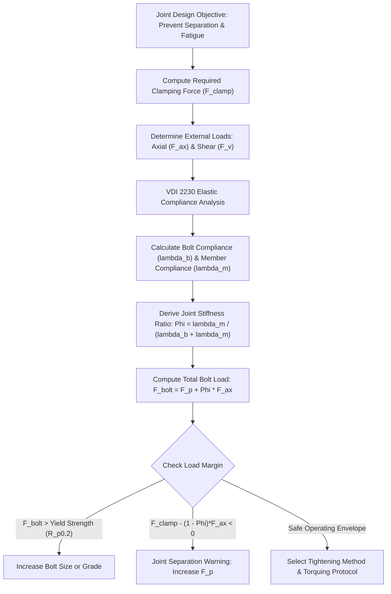
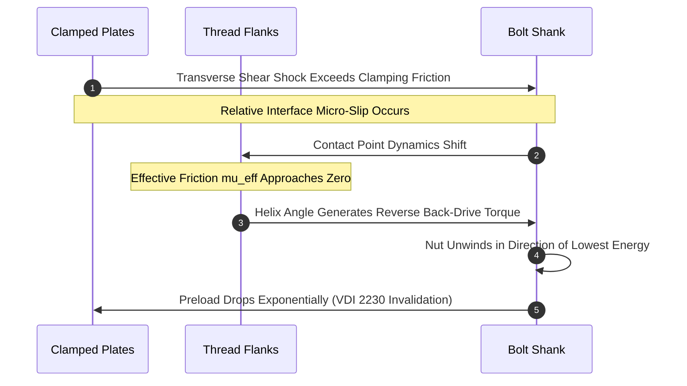

# Fastener Engineering: The Physics of Preload, Joint Mechanics, and Structural Integrity

In structural and mechanical engineering, a threaded fastener is not merely a static hardware component; it is an active mechanical spring operating in tension to compress clamped structural members. The structural integrity of pressurized pipelines, aerospace airframes, automotive suspensions, and heavy industrial machinery depends critically on maintaining clamping force throughout dynamic service lifecycles.

When bolted joints fail, they rarely do so from insufficient ultimate tensile strength of the fastener. Instead, failures stem almost exclusively from loss of clamp force: transverse vibration-induced self-loosening, fatigue fractures initiated at stress concentrations in thread roots, stress relaxation, or hydrogen embrittlement. This treatise examines the mechanical physics, elastoplastic deformation, tightening analytics, and metallurgical failure modes governing high-reliability bolted connections.

## 1. Physics of Preload and the VDI 2230 Joint Diagram

The primary design objective in any structural joint is establishing and maintaining an optimal **Preload ($F_p$)**—the axial tension induced in the bolt during tightening that imposes an equal and opposite compressive clamping load on the joint components ($F_c = F_p$).

### 1.1 The Elastic Joint Diagram (Fritsche's Triangle)

A bolted assembly functions as two elastic springs in parallel: the bolt acts in tension (positive strain), while the clamped members act in compression (negative strain). When an external dynamic tensile load ($F_{ext}$) is applied across the clamped assembly:

1. The external force relieves compressive strain in the clamped members while adding tensile strain to the bolt.
2. The proportion of external load absorbed by the bolt depends strictly on the relative elastic compliances ($\lambda = \Delta L / F$).

The **Joint Stiffness Factor ($\Phi$)** (also designated the load factor) is defined as:

$$
\Phi = \frac{\lambda_m}{\lambda_b + \lambda_m} = \frac{k_b}{k_b + k_m}
$$

Where:
- $\lambda_b$ is the elastic compliance of the bolt ($k_b = 1/\lambda_b$ is bolt stiffness).
- $\lambda_m$ is the elastic compliance of the clamped members ($k_m = 1/\lambda_m$ is member stiffness).

The resulting operating loads experienced by the components are:

$$
F_{bolt} = F_p + \Phi \cdot F_{ext}
$$

$$
F_{clamp} = F_p - (1 - \Phi) \cdot F_{ext}
$$

Because structural members typically have a substantially larger cross-sectional area and higher compressive modulus than the slender bolt shank, member compliance is much lower than bolt compliance ($\lambda_m \ll \lambda_b$). Consequently, $\Phi$ typically falls between $0.10$ and $0.30$. 

This mathematical relationship provides the foundation for bolted joint reliability: **the bolt experiences only 10% to 30% of any dynamic external tensile load**, shielding the fastener from severe cyclic stress amplitude, provided the joint remains clamped.

### 1.2 The Joint Separation Boundary Condition

If the external tensile load exceeds the clamping capacity, the clamped interfaces separate ($F_{clamp} \le 0$). At the instant of separation:

$$
F_{ext, crit} = \frac{F_p}{1 - \Phi}
$$

Once separation occurs, member stiffness vanishes ($k_m = 0$), driving $\Phi = 1.0$. Beyond $F_{ext, crit}$, 100% of any additional external load is transferred directly into the bolt shank. This causes rapid cyclic stress amplification, leading to catastrophic high-cycle fatigue failure within thousands of operational cycles.

## 2. Torque-Tension Mechanics: The Motosh Equation

Achieving the required preload in production settings is predominantly conducted by applying a tightening torque ($T$). The relationship between applied torque and developed axial tension ($F_p$) is governed by the classical **Motosh Equation**, derived from the equilibrium of forces on an inclined helical thread:

$$
T = F_p \left[ \frac{P}{2\pi} + \frac{\mu_t \cdot r_t}{\cos \beta} + \mu_h \cdot r_h \right]
$$

Where:
- $P$ is the thread lead/pitch (axial advance per radian).
- $\mu_t$ is the friction coefficient between internal and external thread flanks.
- $r_t$ is the effective contact radius of the thread ($r_t \approx d_2 / 2$, where $d_2$ is the pitch diameter).
- $\beta$ is the half-flank angle of the thread profile ($30^\circ$ for standard ISO metric and UN threads; $\cos 30^\circ = 0.866$).
- $\mu_h$ is the friction coefficient under the turning bolt head or nut face.
- $r_h$ is the effective friction radius of the bolt head or nut bearing surface ($r_h = \frac{d_{head, outer} + d_{hole}}{4}$).

### 2.1 The Energy Dissipation Breakdown

In typical industrial assemblies lacking specialized low-friction coatings ($\mu_t \approx \mu_h \approx 0.12\text{--}0.15$), torque is dissipated through three distinct energy sinks:

$$
T_p = F_p \frac{P}{2\pi} \quad (\approx 10\% \text{ useful pitch torque})
$$

$$
T_t = F_p \frac{\mu_t r_t}{\cos \beta} \quad (\approx 40\% \text{ thread friction torque})
$$

$$
T_h = F_p \mu_h r_h \quad (\approx 50\% \text{ under-head bearing torque})
$$

Roughly **90% of the input mechanical energy is consumed by parasitic friction**, with only 10% converted into elastic strain energy (preload). Because the relationship is heavily friction-dominated, minor fluctuations in lubrication, surface roughness, plating thickness, or thread cleanliness create dramatic variance in realized clamp force.

For rapid approximations in the field, engineers use the empirical **Nut Factor ($K$)**:

$$
T = K \cdot D \cdot F_p
$$

Where $D$ is the nominal bolt diameter and $K$ is a dimensionless factor ranging from $0.10$ (cadmium or PTFE plated with anti-seize paste) to $0.20$ (as-received dry zinc-plated steel) and up to $0.35$ (degreased stainless steel prone to galling).

## 3. Comparative Evaluation of Tightening Methodologies

The dispersion between target preload and actual achieved preload directly influences the safety margins required during mechanical sizing. Sizing an assembly with torque-controlled tightening requires over-dimensioning components to prevent yielding during high-friction over-torquing or joint separation during low-preload excursions.

| Tightening Technique | Physical Control Parameter | Typical Preload Scatter ($\pm\%$) | Capital Equipment & Complexity | Primary Failure Vulnerabilities |
| :--- | :--- | :--- | :--- | :--- |
| **Manual / Pneumatic Torque Wrench** | Input Torque ($T$) | $\pm 25\%\text{ to }35\%$ | Low (calibrated clicker wrench) | Uncontrolled friction variations; operator speed variations |
| **Torque-Angle / Turn-of-Nut** | Snug Torque + Angle ($\theta$) | $\pm 10\%\text{ to }15\%$ | Moderate (electronic angle-sensing tools) | Grip length measurement error; compression of gaskets or soft coatings |
| **Yield-Controlled (Tensile Yield)** | Gradient Detection ($dT/d\theta$) | $\pm 5\%\text{ to }8\%$ | High (computer-controlled servo nutrunners) | Re-use of fasteners limited; localized plastic deformation |
| **Ultrasonic Elongation Measurement** | Acoustic Transit Time ($\Delta t$) | $\pm 3\%\text{ to }5\%$ | High (ultrasonic transducer & pulser-receiver) | Temperature calibration drift; non-parallel transducer coupling |
| **Direct Hydraulic Tensioning** | Axial Piston Pressure ($P_{hyd}$) | $\pm 5\%\text{ to }10\%$ | Very High (hydraulic pump + bridge cell) | Thread transfer / seating loss when nut is snugged under load |
| **Direct Tension Indicators (DTIs)** | Bump Compression Protrusion | $\pm 10\%\text{ to }15\%$ | Low (specialized single-use compressible washers) | Incorrect feeler gauge reading; non-uniform washer seating |

## 4. Metallurgical Science: Strength Classes and Environmental Degradation

Fasteners for demanding engineering applications are classified under international standards such as ISO 898-1. The numerical designation encodes tensile and yield properties:

- **Property Class 8.8:** Nominal Ultimate Tensile Strength $R_m = 800\text{ MPa}$; Yield Strength Ratio $R_{p0.2} / R_m = 0.8$ (Yield strength $R_{p0.2} = 640\text{ MPa}$).
- **Property Class 10.9:** Nominal $R_m = 1000\text{ MPa}$; Yield strength $R_{p0.2} = 900\text{ MPa}$.
- **Property Class 12.9:** Nominal $R_m = 1200\text{ MPa}$; Yield strength $R_{p0.2} = 1080\text{ MPa}$.

### 4.1 Hydrogen Embrittlement Mechanics

For high-strength alloy steels with tensile strengths exceeding $1000\text{ MPa}$ (including Property Class 10.9 and 12.9, as well as aerospace grade fasteners), **Hydrogen Embrittlement (HE)** represents one of the most insidious structural hazards.

Atomic hydrogen ($H^+$) can enter the metal matrix during acid pickling, electroplating (zinc, cadmium, or nickel deposition), or through in-service galvanic corrosion. Because hydrogen atoms possess an extraordinarily small ionic radius, they diffuse readily through the body-centered cubic (BCC) ferrite or martensite crystal lattice. Under the sustained tensile stress fields generated by joint preload:

1. Hydrogen atoms migrate along stress gradients toward regions of triaxial stress concentration (such as thread roots or the fillet beneath the bolt head).
2. The localized concentration of hydrogen lowers the cohesive energy of the atomic lattice (Hydrogen-Enhanced Decohesion, HEDE) or accelerates localized dislocation plasticity (HELP).
3. Micro-cracks initiate and propagate sub-critically until the remaining ligament reaches critical fracture toughness ($K_{Ic}$), culminating in sudden catastrophic brittle fracture without macroscopic plastic deformation.

**Mitigation Protocol:** Fasteners with hardness $> 31\text{ HRC}$ subjected to electroplating must undergo a mandatory thermal de-embrittlement baking process (per ASTM F1941 / ISO 9588) at $190^\circ\text{C}\text{ to }220^\circ\text{C}$ for a minimum of 4 to 24 hours immediately (within 1 hour) following electroplating, prior to any passivation or chromate treatment.

### 4.2 Galling in Austenitic Stainless Steels

Austenitic stainless steels (such as AISI 304 / A2-70 and AISI 316 / A4-80) are frequently specified in corrosive environments. However, these alloys exhibit high ductility and poor thermal conductivity, rendering them susceptible to **adhesive wear (galling)**.

When mating stainless threads engage under contact pressure, the ultra-thin protective chromium oxide passivation layer ($\text{Cr}_2\text{O}_3$) shears off at microscopic asperities. Direct metal-to-metal contact causes localized micro-welding. As tightening continues, the welds tear, creating severe surface tearing that seizes the fastener before achieving the intended preload.

Effective prevention mandates:
- Limiting rotational speed during automated run-down ($< 100\text{ RPM}$).
- Applying anti-seize lubricants formulated with molybdenum disulfide ($\text{MoS}_2$), nickel flakes, or ceramic pastes.
- Selecting dissimilar alloy hardness pairings (e.g., Nitronic 60 male fasteners mating into 316 stainless nuts).

## 5. Dynamic Fatigue Life and Transverse Vibration Loosening

### 5.1 Cyclic Fatigue Life Prediction (Goodman Diagram)

Threaded fasteners in service rarely experience purely static loads. In rotating machinery and structural joints, cyclic stress fluctuations lead to progressive fatigue damage. The primary stress concentration occurs at the first engaged thread root adjacent to the nut or tapped hole, where notch stress concentration factors ($K_t$) often exceed $3.0\text{--}4.5$.

To determine allowable dynamic stress amplitudes ($\sigma_a$) under high static mean stress ($\sigma_m = F_p / A_s$, where $A_s$ is the tensile stress area), engineers apply the **Modified Goodman Relationship**:

$$
\frac{\sigma_a}{\sigma_e} + \frac{\sigma_m}{\sigma_u} \le \frac{1}{n_{safety}}
$$

Where:
- $\sigma_e$ is the endurance limit of the notched, preloaded fastener under reversed bending/axial fatigue.
- $\sigma_u$ is the ultimate tensile strength.
- $n_{safety}$ is the structural design safety factor.

Because $\sigma_a = \Phi \cdot (\Delta F_{ext} / 2 A_s)$, maximizing preload $F_p$ to maintain compressive clamp across the joint keeps the cyclic stress amplitude $\sigma_a$ exceptionally small, prolonging fatigue life into the infinite-life domain ($> 10^7$ cycles).

### 5.2 Transverse Vibration and the Junker Effect

While cyclic axial loading alters stress amplitude, it rarely causes a properly preloaded fastener to unthread spontaneously. In contrast, **transverse (perpendicular) cyclic shear loads** induce rotational self-loosening rapidly, as first demonstrated systematically by Gerhard Junker in 1969.

Under transverse vibration:
1. When external shear force exceeds joint friction, clamped plates slip relative to each other by microscopic distances.
2. This relative motion eliminates directional friction on the thread flanks ($\mu_{effective} \to 0$ in the circumferential direction).
3. The internal elastic torque generated by the helix angle of the thread ($T_{helix} = F_p \cdot \frac{P}{2\pi}$) acts unhindered, causing the bolt or nut to rotate backwards.
4. Preload decays exponentially, progressing from nominal clamp to complete joint separation within hundreds of vibration cycles.

**Anti-Loosening Countermeasures:**
- **Helical Spring Washers (Split Washers):** Proven ineffective under severe transverse vibration (ASME B18.21.1 withdrawn as locking devices); when fully flattened, they function merely as soft flat washers with elevated risk of cracking.
- **Prevailing Torque Locknuts:** Deformed-thread nuts or nylon-insert (Nyloc) nuts maintain residual torque after clamp loss, preventing total disassembly but failing to prevent initial preload loss.
- **Wedge-Locking Washers (Nord-Lock):** Paired washers with radial teeth on outside faces and interlocking cams on inside faces with cam angles ($\alpha$) greater than the thread lead angle ($\beta$). Loosening requires the bolt to climb the steeper cam ramp, forcing an increase in clamping tension that mechanically resists back-off.
- **Anaerobic Threadlocking Adhesives (Dimethacrylate resins):** Polymerize in the absence of air and presence of active metal ions, filling 100% of the thread clearance space to eliminate internal microscopic slip.

## 6. Structural Engineering Best Practices & Inspection Checklist

When designing and maintaining mission-critical mechanical connections, adherence to the following verified engineering protocol ensures long-term operational integrity:

1. **Calculate Joint Stiffness ($\Phi$) Formally:** Never assume a generic torque table applies to stiff structural connections. Calculate $\lambda_b$ and $\lambda_m$ using VDI 2230 guidelines.
2. **Account for Embedment and Creep Relaxation:** Freshly assembled joints experience microscopic plastic flattening of surface asperities (embedment). Expect a $5\%\text{ to }15\%$ preload loss within the first 24 hours of assembly, and incorporate this loss into tightening torque specifications.
3. **Control Grip Length to Diameter Ratio ($L/D$):** Ensure the clamped grip length is at least $4\times$ to $5\times$ the nominal bolt diameter ($L/D \ge 4$). Slender, elastic bolts absorb thermal expansion and dynamic vibration with far less percentage loss of preload than short, stubby fasteners ($L/D < 2$).
4. **Specify Calibrated Tightening Controls:** For Property Classes $\ge 10.9$, replace uncalibrated impact wrenches with verified torque-angle nutrunners or hydraulic tensioners.
5. **Verify Environmental Compatibility:** In outdoor marine or chemical environments, prevent galvanic couples between fasteners and clamped plates (e.g., avoid zinc-plated carbon steel bolts in large stainless steel plate assemblies).

---

## References & Related Documentation

- [[MechanicalEngineeringHub|Mechanical Engineering Hub]] — Central architectural index for structural mechanics, rotating machinery, and machine design.
- [[MathematicsHub|Mathematics Hub]] — Foundations of stress tensors, partial differential equations, and dynamic equilibrium.
- [[AppliedMathSurvey|Applied Math Survey]] — Numerical methods, finite element analysis, and optimization algorithms in mechanical engineering.
- [[OperationsResearchHub|Operations Research Hub]] — Probabilistic reliability modeling, mean-time-between-failure (MTBF), and structural risk analysis.

---

**Cluster Hub:** [[MechanicalEngineeringHub|Mechanical Engineering Hub]] (`mechanical-engineering`)
