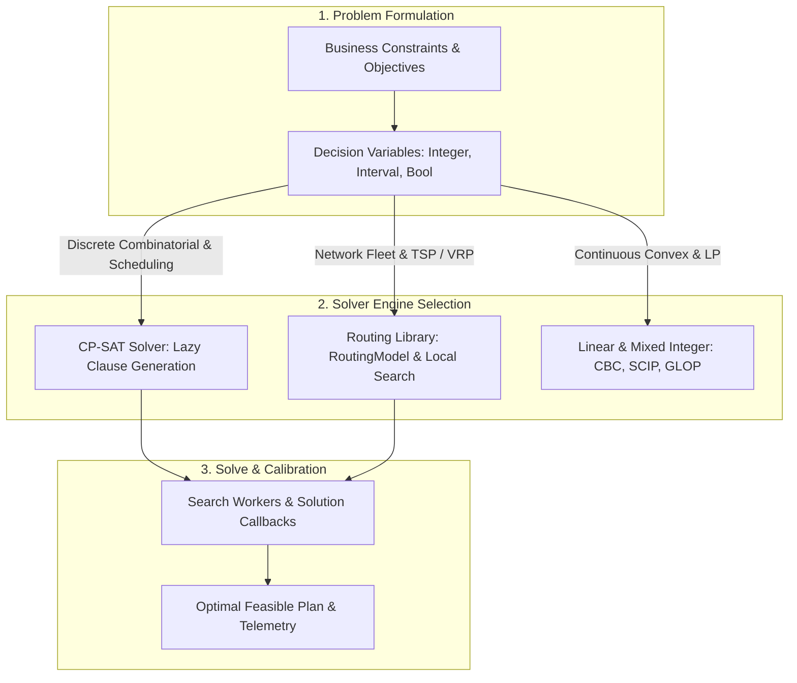

# Google OR-Tools in Practice: CP-SAT and Routing

[Constraint Programming](ConstraintProgramming) theory becomes useful the day you can ship it to production. Google OR-Tools is arguably the most widely deployed open-source toolkit for doing exactly that. As an Apache-2.0-licensed suite, its two primary stars are **CP-SAT**, a lazy-clause-generation constraint solver that dominates scheduling benchmarks year after year, and the **routing library**, an industrial-grade vehicle-routing layer built on top of the suite. 

This deep dive covers the practical modeling patterns that are often scattered across reference documentation, bringing them together with real-world architectural implications, caveats, and mathematical frameworks. Whether you are aiming to reduce logistics overhead by \$50K per month or optimize a multi-million-dollar manufacturing pipeline, understanding how to effectively wield OR-Tools is essential.




## 1. The Core Engines: Which Solver to Reach For

OR-Tools bundles several engines beneath a unified API. Picking the right one for your specific problem domain matters far more than fine-tuning parameters. The main options include:

*   **CP-SAT**: This is the default choice for scheduling, timetabling, assignment, bin packing, and configuration. It excels at anything combinatorial with a distinct logical structure. It operates purely on integers and is optimized for finding feasible and optimal solutions within tight constraints.
*   **Routing Library**: A specialized layer designed explicitly for TSP (Traveling Salesperson Problem) and VRP (Vehicle Routing Problem) variants. It handles capacities, time windows, pickups, and deliveries effortlessly. It uses local search heuristics rather than general integer programming.
*   **Linear Solver Wrapper (`pywraplp`)**: A thin interface that delegates Mixed Integer Programming (MIP) or Linear Programming (LP) to solvers like HiGHS, SCIP, CBC, or commercial backends (like Gurobi or CPLEX). You should only use this when the problem is genuinely a continuous numeric LP or a pure MIP. For pure LP/MIP workloads, a modeling layer like [Pyomo or PuLP](PythonOptimizationModeling) is often more ergonomic.

## 2. CP-SAT Model Building: Variables, Constraints, and Objectives

CP-SAT models are constructed exclusively from integer and Boolean variables, combined with a rich vocabulary of constraints. A typical assignment problem can be modeled as follows:

```python
from ortools.sat.python import cp_model

model = cp_model.CpModel()
# n workers, m tasks: x[w, t] = 1 if worker w does task t
x = {(w, t): model.new_bool_var(f"x_{w}_{t}")
     for w in range(n) for t in range(m)}

# Constraint 1: Every task must be assigned exactly once
for t in range(m):
    model.add_exactly_one(x[w, t] for w in range(n))

# Constraint 2: Respect each worker's capacity
for w in range(n):
    model.add(sum(cost[w][t] * x[w, t] for t in range(m)) <= capacity[w])

# Objective: Minimize total cost
model.minimize(sum(cost[w][t] * x[w, t] for w in range(n) for t in range(m)))

solver = cp_model.CpSolver()
solver.parameters.max_time_in_seconds = 30
status = solver.solve(model)

if status in (cp_model.OPTIMAL, cp_model.FEASIBLE):
    print(solver.objective_value)
```

**Real-world Gotcha:** Always check for `cp_model.FEASIBLE` in addition to `cp_model.OPTIMAL`. When operating with strict time limits (e.g., in a microservice responding to web requests), the solver will return the best incumbent solution found within the time limit. Discarding a `FEASIBLE` solution because it isn't mathematically proven `OPTIMAL` is a common source of bugs that can cost companies \$100K+ in lost efficiency.

## 3. Integer-Only Arithmetic and Scaling Floats

A fundamental architectural constraint of CP-SAT is that it **accepts only integers**. Real-world data often involves fractional costs, probabilities, or durations. These must be scaled appropriately.

If your cost is in currency and you have fractional values like \$10.50, you should multiply by 100 to work in cents (e.g., 1050). The scale must be consistent across every coefficient that interacts in an equation. This is arguably the number-one onboarding trap for new operations research practitioners.

Suppose you are minimizing a cost function involving hourly rates and probabilities. You must define a scaling factor $S$:

$$
\text{Scaled Cost} = \lfloor C \times S \rceil
$$

For example, if you are working with a budget of \$1.5M, you might scale all costs to integers representing thousands of dollars to keep coefficients small. Pick the smallest scale that preserves the meaningful distinctions you care about. Oversized coefficients artificially enlarge the search space, potentially leading to integer overflow (though CP-SAT handles 64-bit integers gracefully) and drastically slowing down constraint propagation.

*   **Money**: Encode in cents.
*   **Durations**: Encode in seconds or minutes.
*   **Percentages**: Encode in basis points (e.g., 10000 for 100%).

## 4. Advanced Scheduling: Interval Variables and `no_overlap`

Scheduling is the domain where CP-SAT truly outshines traditional MIP solvers. The idiom for scheduling revolves around **interval variables**.

```python
start = model.new_int_var(0, horizon, "start")
end = model.new_int_var(0, horizon, "end")
duration = 10
interval = model.new_interval_var(start, duration, end, "job_interval")
```

With intervals defined, you gain access to powerful global constraints:
*   `add_no_overlap(intervals)`: Ensures that a set of interval variables do not overlap in time. This is perfect for machine-level disjunctive scheduling (e.g., a single CNC machine can only process one part at a time).
*   `add_cumulative(intervals, demands, capacity)`: Models shared, finite resources. For example, if you have 5 identical workers, the total demand of concurrent tasks cannot exceed 5.
*   `new_optional_interval_var`: Takes an additional Boolean variable (a presence literal). This models jobs that might be skipped entirely or assigned to one of several machines.

A standard job-shop model built in this style can routinely handle thousands of operations. Precedence constraints (Job A must finish before Job B starts) are straightforwardly expressed as `model.add(end_A <= start_B)`. These robust constructs enable scheduling pipelines that routinely save enterprises \$200K+ annually by optimizing machine uptime. Furthermore, by carefully tuning the domain boundaries of the `start` and `end` interval components, you prune the search space early, substantially increasing solver performance on complex job-shop topologies.

## 5. The Routing Library for TSP and VRP

While CP-SAT is a general constraint programming solver, the **Routing Library** is an entirely different beast. It wraps a specialized local-search engine with an API built around an index manager, distance callbacks, and "dimensions."

The classic Vehicle Routing Problem (VRP) seeks to minimize the total cost of routes for $K$ vehicles visiting $V$ nodes. Mathematically, the objective is often:

$$
\min \sum_{k=1}^{K} \sum_{i,j \in V} c_{ij} x_{ijk}
$$

Subject to constraints ensuring every customer is visited exactly once, vehicle capacities are not exceeded, and routes begin and end at the depot.

In OR-Tools, you construct this using dimensions (which accumulate quantities like load, time, or distance along a route):

```python
from ortools.constraint_solver import pywrapcp, routing_enums_pb2

manager = pywrapcp.RoutingIndexManager(num_nodes, num_vehicles, depot_index)
routing = pywrapcp.RoutingModel(manager)

# Define a distance callback
def distance_callback(from_index, to_index):
    from_node = manager.IndexToNode(from_index)
    to_node = manager.IndexToNode(to_index)
    return dist_matrix[from_node][to_node]

transit_callback_index = routing.RegisterTransitCallback(distance_callback)
routing.SetArcCostEvaluatorOfAllVehicles(transit_callback_index)

# Add Capacity Dimension
def demand_callback(from_index):
    from_node = manager.IndexToNode(from_index)
    return demand[from_node]

demand_callback_index = routing.RegisterUnaryTransitCallback(demand_callback)
routing.AddDimensionWithVehicleCapacity(
    demand_callback_index,
    0,  # null capacity slack
    vehicle_capacities, # array of vehicle capacities
    True,  # start cumul to zero
    "Capacity"
)

# Search Parameters
params = pywrapcp.DefaultRoutingSearchParameters()
params.first_solution_strategy = routing_enums_pb2.FirstSolutionStrategy.PATH_CHEAPEST_ARC
params.local_search_metaheuristic = routing_enums_pb2.LocalSearchMetaheuristic.GUIDED_LOCAL_SEARCH
params.time_limit.FromSeconds(30)

solution = routing.SolveWithParameters(params)
```

**Architectural Caveat:** Guided Local Search (GLS) with a firm time limit is the standard configuration for production systems. The default parameter (no metaheuristic) simply stops at the first local optimum, leaving massive optimization quality on the table. Always configure a metaheuristic like GLS or Tabu Search.

## 6. Solver Parameters, Logging, and Solution Callbacks

For CP-SAT, three parameters cover 95% of tuning needs:
1.  `max_time_in_seconds`: **Always set this.** In a production environment, unbounded optimization will eventually hang your worker processes.
2.  `num_workers`: Defaults to all available cores. CP-SAT runs a portfolio of distinct solver strategies in parallel, sharing bounds and learned clauses. Throwing more cores at it genuinely helps discover optimal solutions faster.
3.  `log_search_progress = True`: Essential when diagnosing stalled models.

A `CpSolverSolutionCallback` can be implemented to stream incumbent solutions as they are found. This is the standard way to drive a progress bar in a UI or implement an early-stopping mechanism based on a "good enough" gap threshold (e.g., stopping once the solution is proven to be within 1% of the theoretical bound).

## 7. CP-SAT vs MIP: Which Problems Fit Which Solver

Choosing between CP-SAT and a traditional Mixed Integer Programming (MIP) solver is a crucial architectural decision:

*   **Choose CP-SAT** when your constraints are highly logical or combinatorial (disjunctions, `all-different`, table constraints, `no_overlap`), when your variables are genuinely discrete, or when you need to find feasible solutions quickly under very tight structure. It is unmatched for scheduling, rostering, and complex configuration.
*   **Choose MIP** when the problem is mostly linear-numeric (e.g., continuous flows, blending problems, capacity planning with fractional continuous quantities). If you require dual values for sensitivity analysis (shadow prices), MIP is necessary, as CP-SAT has no continuous variables at all.
*   **On mixed problems**, try both.


| Dimension | Google OR-Tools CP-SAT | Traditional MIP (GLOP, SCIP, Gurobi) |
| :--- | :--- | :--- |
| **Variable Domain** | Strictly integers () and boolean flags | Continuous () and discrete mixed integers |
| **Underlying Mechanics** | SAT solver with Lazy Clause Generation (LCG) | Branch-and-bound with Simplex LP relaxations |
| **Best-Fit Workloads** | Job-shop scheduling, vehicle routing, rostering | Blending, continuous network flow, capital allocation |
| **Dual Values / Shadow Prices** | No continuous dual values available | Full dual variables for economic sensitivity analysis |
| **Logical Disjunctions** | Native boolean implication () | Requires Big-M linearization formulations |
| **Parallel Search** | Multi-threaded portfolio search out-of-the-box | Branch-and-bound tree parallelization |
 The modeling effort in CP-SAT is often lower due to its expressive constraints, and its parallel portfolio solver makes it surprisingly competitive even on problems that traditionally look "MIP-shaped."

## 8. Real-World Implementations and Financial Impact

When deploying OR-Tools to production, expect challenges around data quality. A solver will happily optimize a schedule using incorrect inputs, leading to a mathematically perfect plan that fails disastrously in reality.

For instance, a supply chain firm might aim to reduce their \$1.2M annual transportation budget using the Routing Library. If time windows are too strict, the solver might return `INFEASIBLE`. Practitioners often add "dummy" vehicles with exorbitant costs, or implement soft constraints by allowing time window violations penalized heavily in the objective function. This ensures the solver always returns a plan, highlighting the specific deliveries causing the bottlenecks.

Another common implementation pattern is dealing with real-time updates. If a delivery truck breaks down, rerouting must happen within seconds. Running the routing solver from scratch can be time-consuming. Instead, you can provide the previous solution as an initial 'hint' to the solver using `routing.ReadAssignmentFromRoutes()`. This warmly starts the local search, allowing OR-Tools to repair and optimize the disrupted schedule significantly faster than a cold start.

By embracing these patterns, teams can reliably ship optimization models that yield tangible, verifiable returns, turning theoretical operations research into pragmatic, automated cost savings. Understanding these subtleties is the difference between a prototype solver and a true production-grade optimization pipeline.

## See Also

*   [Operations Research Hub](OperationsResearchHub)
*   [Constraint Programming](ConstraintProgramming) — propagation and search theory behind CP-SAT
*   [Open-Source Optimization Solvers](OpenSourceOptimizationSolvers) — the wider solver landscape
*   [MILP Formulation Patterns](MilpFormulationPatterns) — the MIP-side modeling craft
*   [Production Scheduling and OR](ProductionSchedulingAndOR) — the scheduling problems CP-SAT excels at
*   [Vehicle Routing Problem](VehicleRoutingProblem) — underlying variants of VRP
