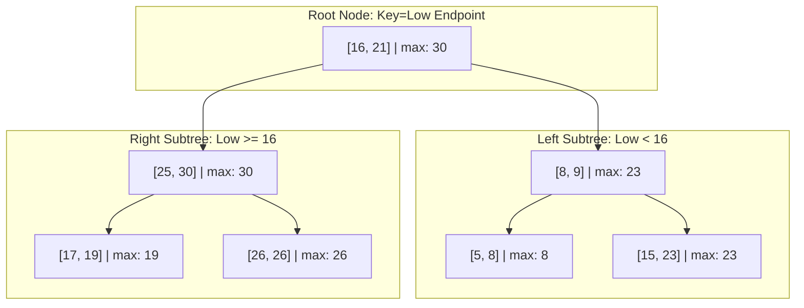

---
tags:
- data-structures
- interval-trees
- algorithms
- range-queries
- computational-geometry
cluster: computer-science-foundations
title: 'Interval Tree Data Structure: Range Searching, Overlap Queries, and Augmented
  Trees'
related:
- DataStructuresHub
- FoundationalAlgorithmsForComputerScientists
- BalancedSearchTrees
summary: 'Interval Tree data structure guide: augmented Red-Black trees, max_high
  subtrees, O(log N + k) overlap searching, and Linux kernel VM mapping.'
type: article
audience:
- humans
- agents
status: active
canonical_id: 01J7KQTCCQ3H9K0M9E95ZCK3KL
date: '2026-05-15'
---

# Interval Tree Data Structure: Range Searching, Overlap Queries, and Augmented Trees

An **Interval Tree** is an augmented balanced binary search tree designed for efficiently storing dynamic sets of continuous intervals—such as time slots $[t_{	ext{start}}, t_{	ext{end}}]$, virtual memory segments $[v_{	ext{start}}, v_{	ext{end}}]$, or spatial spans $[x_{	ext{low}}, x_{	ext{high}}]$—and executing rapid overlap queries. While a naive scan across $N$ intervals requires $O(N)$ operations per query, an augmented Interval Tree answers point-stabbing and range-overlap queries in **$O(\log N + k)$** worst-case time, where $k$ is the number of overlapping intervals returned.

This guide details the structural invariants of interval trees, Red-Black tree augmentation mechanics via subtree `max_high` propagation, search correctness proofs, multi-interval query algorithms, and production applications across operating system virtual memory systems and computational geometry engines.



---

## 1. Comparative Evaluation of Range Query Data Structures

Different algorithmic problems require different tree invariants. The following table contrasts the Interval Tree against other prominent range and spatial structures:

| Data Structure | Primary Workload | Point Stabbing | Range Overlap Search | Mutation Cost | Memory Complexity |
| :--- | :--- | :--- | :--- | :--- | :--- |
| **Interval Tree** | Dynamic sets of continuous intervals | $O(\log N + k)$ | $O(\log N + k)$ | $O(\log N)$ insert / delete | $O(N)$ tree nodes |
| **Segment Tree** | Static or semi-dynamic array range aggregations | $O(\log N)$ | $O(\log N)$ | $O(\log N)$ point update | $O(N)$ contiguous array |
| **Range Tree (2D)** | Orthogonal range searching over multidimensional points | $O(\log^2 N + k)$ | $O(\log^2 N + k)$ | $O(\log^2 N)$ fractional cascading | $O(N \log N)$ nested trees |
| **R-Tree / R* Tree** | Spatial bounding boxes (GIS, polygons) | $O(\log N)$ average | $O(N)$ worst-case | $O(\log N)$ heuristic split | $O(N)$ spatial nodes |
| **Fenwick (BIT)** | Cumulative frequency and prefix-sum updates | $O(\log N)$ prefix | Not natively supported | $O(\log N)$ in-place update | $O(N)$ flat array |

---

## 2. Augmented Red-Black Tree Architecture

An Interval Tree is built by augmenting a self-balancing binary search tree—typically a **Red-Black Tree**—with an additional scalar attribute stored at every node.

### 2.1 The Two Invariants
Every node $x$ in the tree stores an interval $[x.	ext{low}, x.	ext{high}]$:
1. **Binary Search Tree Invariant (Low-Key Ordering)**:
   The tree is ordered strictly by the **low endpoint** ($x.	ext{low}$). For any node $x$:
   - All intervals in the left subtree have $	ext{low} < x.	ext{low}$ (or $\le$).
   - All intervals in the right subtree have $	ext{low} \ge x.	ext{low}$.
2. **Augmentation Invariant (`max` Attribute)**:
   Each node $x$ maintains an augmented scalar field $x.	ext{max}$, representing the maximum high endpoint stored anywhere in the subtree rooted at $x$:
   $$
   x.	ext{max} = \max\Big(x.	ext{high}, \; x.	ext{left}.	ext{max}, \; x.	ext{right}.	ext{max}\Big)
   $$
   (defining $	ext{nil}.	ext{max} = -\infty$).

Because $x.	ext{max}$ depends solely on the node itself and its immediate children, this augmentation satisfies the **Augmenting Theorem for Balanced Trees**: insertion, deletion, and tree rotations preserve and update $x.	ext{max}$ with zero asymptotic penalty ($O(1)$ per rotation, $O(\log N)$ per operation).

### 2.2 Rotation Maintenance
During tree balancing, left and right rotations rearrange node relationships. When a left rotation occurs around node $x$ with right child $y$:
1. $x$'s right pointer becomes $y$'s left child.
2. $y$'s left pointer becomes $x$.
3. Node $x$ is now below $y$. Therefore, we recompute $x.	ext{max}$ first using $x$'s new children, and subsequently recompute $y.	ext{max}$ using $x$ and $y$'s right child.

Both updates execute in $O(1)$ operations, ensuring tree rotations retain the standard $O(1)$ rebalancing guarantee.

---

## 3. The Overlap Search Algorithm

Two closed intervals $i = [i.	ext{low}, i.	ext{high}]$ and $j = [j.	ext{low}, j.	ext{high}]$ overlap if and only if:
$$
i.	ext{low} \le j.	ext{high} \quad 	ext{and} \quad j.	ext{low} \le i.	ext{high}
$$

### 3.1 Single-Overlap Search
To find any arbitrary interval that overlaps with a query window $i$:

```python
class IntervalNode:
    def __init__(self, low: int, high: int):
        self.low = low
        self.high = high
        self.max = high
        self.left = None
        self.right = None

def overlaps(a_low: int, a_high: int, b_low: int, b_high: int) -> bool:
    return a_low <= b_high and b_low <= a_high

def search_overlap(root: IntervalNode, q_low: int, q_high: int) -> IntervalNode:
    curr = root
    while curr is not None and not overlaps(curr.low, curr.high, q_low, q_high):
        # If left subtree exists and its max >= query low, left subtree might have overlap
        if curr.left is not None and curr.left.max >= q_low:
            curr = curr.left
        else:
            curr = curr.right
    return curr
```

### 3.2 Correctness Proof
The algorithmic branch condition is:
- **Case 1 (Traverse Left)**: If $curr.	ext{left} 
eq 	ext{nil}$ and $curr.	ext{left}.	ext{max} \ge q.	ext{low}$.
  Suppose there is no overlap in the left subtree. By definition of $curr.	ext{left}.	ext{max} \ge q.	ext{low}$, there exists some interval $m$ in the left subtree with $m.	ext{high} \ge q.	ext{low}$. Since $m$ does not overlap $q$, and $m.	ext{high} \ge q.	ext{low}$, it must be that $m.	ext{low} > q.	ext{high}$.
  However, because the tree is ordered by low endpoints, every interval $r$ in the right subtree or at $curr$ has $r.	ext{low} \ge curr.	ext{low} \ge m.	ext{low} > q.	ext{high}$. Therefore, no interval in the right subtree can possibly overlap $q$. Hence, if no overlap exists in the left subtree, **no overlap exists anywhere in the tree**. It is always safe to turn left.
- **Case 2 (Traverse Right)**: If $curr.	ext{left} = 	ext{nil}$ or $curr.	ext{left}.	ext{max} < q.	ext{low}$.
  If $curr.	ext{left}.	ext{max} < q.	ext{low}$, every interval $l$ in the left subtree has $l.	ext{high} \le curr.	ext{left}.	ext{max} < q.	ext{low}$. Consequently, no interval in the left subtree can satisfy $l.	ext{high} \ge q.	ext{low}$, making overlap impossible on the left. It is guaranteed safe to turn right.

---

## 4. Multi-Interval All-Overlaps Query ($O(\log N + k)$)

In real applications, systems need all $k$ overlapping intervals, not merely the first one encountered. A recursive traversal achieves optimal $O(\log N + k)$ complexity:

```python
def find_all_overlapping(node: IntervalNode, q_low: int, q_high: int, results: list):
    if node is None:
        return

    # Check current node
    if overlaps(node.low, node.high, q_low, q_high):
        results.append((node.low, node.high))

    # Pruning condition for left subtree:
    # Only descend left if the maximum high value in the left branch reaches the query
    if node.left is not None and node.left.max >= q_low:
        find_all_overlapping(node.left, q_low, q_high, results)

    # Pruning condition for right subtree:
    # If the current node's low endpoint already exceeds query high,
    # all nodes in the right subtree also exceed query high (cannot overlap)
    if node.right is not None and node.low <= q_high:
        find_all_overlapping(node.right, q_low, q_high, results)
```

The right-branch pruning condition (`node.low <= q_high`) is critical: because the tree is low-endpoint ordered, if $node.	ext{low} > q.	ext{high}$, every interval in the right subtree has $	ext{low} \ge node.	ext{low} > q.	ext{high}$, allowing entire subtrees to be pruned in $O(1)$ checks.

---

## 5. Production Systems Architecture & Applications

### 5.1 Linux Kernel Virtual Memory Management (`vm_area_struct`)
In the Linux kernel, every process possesses a virtual address space segmented into memory areas: executable code, heap, memory-mapped files, and stack allocations. These regions are represented by `struct vm_area_struct` instances.
- **The Problem**: When a process invokes `mmap(addr, len, ...)` or `brk()`, the kernel must verify that the requested virtual range $[addr, addr + len)$ does not collide with any existing mapped segment.
- **Implementation**: The kernel organizes VM areas into an **augmented Red-Black Interval Tree** (`mm/interval_tree.c`). The tree enables the kernel's memory allocator to perform collision detection and unmapped-area search in $O(\log N)$ time, avoiding performance degradation as memory-mapping counts climb into tens of thousands of areas per process.

### 5.2 Computational Geometry & Windowing Queries
In Computer-Aided Design (CAD), Geographic Information Systems (GIS), and vector layout engines, the **Windowing Problem** requires identifying all geometric segments that intersect a rectangular viewport $[x_{	ext{min}}, x_{	ext{max}}] 	imes [y_{	ext{min}}, y_{	ext{max}}]$. 
By projecting segments onto the x-axis as intervals and maintaining an Interval Tree along a vertical sweep-line, intersection queries are answered in $O(\log N + k)$ time instead of testing all $N$ polygons.

### 5.3 Bioinformatics & Genomic Annotations
Genomic sequencing databases store billions of feature intervals (exons, introns, transcription binding sites, gene mutations) mapped to genomic chromosome coordinate spaces. Interval Trees (and specialized variants such as **NCBI GenBank Nested Interval Trees**) allow bioinformaticians to intersect newly sequenced read alignments against reference genomes instantaneously.

---

## 6. Summary and Engineering Checklist

When implementing or deploying an Interval Tree in production:
- [x] **Ensure Low-Endpoint Sorting**: Key the binary search tree strictly by the starting coordinate ($x.	ext{low}$) to preserve pruning guarantees.
- [x] **Propagate `max` Bottom-Up**: During node insertion, update ancestor `max` values while unwinding the recursive call stack or traversing parent pointers.
- [x] **Update `max` on Rotations**: Recompute child node `max` before parent node `max` during tree rebalancing rotations.
- [x] **Prune Right Subtrees on $x.	ext{low} > q.	ext{high}$**: Never search the right branch if the current node's start key is strictly greater than the query's end boundary.

---

## References

1. Cormen, T. H., Leiserson, C. E., Rivest, R. L., & Stein, C. (2009). *Introduction to Algorithms (3rd ed.)*. MIT Press (Chapter 14: Augmenting Data Structures).
2. de Berg, M., Cheong, O., van Kreveld, M., & Overmars, M. (2008). *Computational Geometry: Algorithms and Applications (3rd ed.)*. Springer.
3. Linux Kernel Organization. (2024). *Interval Trees in the Linux Kernel*. Linux Kernel Documentation (`Documentation/core-api/rbtree.rst`).

---

**Cluster Hub:** [[ComputerScienceFoundationsHub|Computer Science Foundations Hub]] (`computer-science-foundations`)
