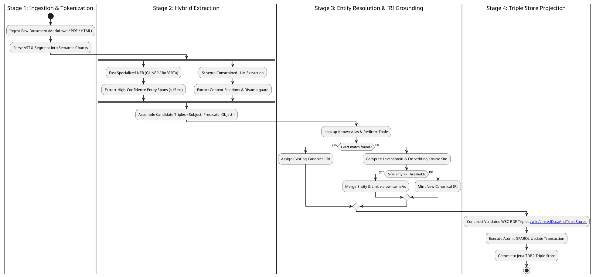

---
audience:
- humans
- agents
canonical_id: 01KQ0P44RHP0WX33T65KCB5HX4
status: active
date: '2026-08-16'
summary: 'Knowledge graph engineering: Named Entity Recognition (NER), Open Information
  Extraction (OpenIE), entity resolution, and RDF triple curation.'
type: article
title: 'Knowledge Graph Construction Pipeline: Entity Extraction and Ontology Linking'
cluster:
- agentic-ai
- databases
auto-generated: false
tags:
- knowledge-graph
- ontology
- entity-resolution
- ner
- rdf
- triples
- sparql
- agentic-ai
---
# Knowledge Graph Construction Pipeline: Entity Extraction, Relation Resolution, and Ontology Linking

Unstructured text documents contain rich semantic relationships, but search engines and LLM agents struggle to navigate complex dependency graphs without structured entity modeling.

A **Knowledge Graph Construction Pipeline** converts raw prose, technical documentation, and tabular corpora into machine-actionable **RDF Triples** $\langle \text{Subject}, \text{Predicate}, \text{Object} \rangle$ bound to a formal ontology (W3C OWL / SKOS). This guide details the 5 stages of the graph construction lifecycle: Document Chunking, Named Entity Recognition (NER), Relation Extraction, Entity Resolution (Deduplication), and Graph Store Projection.

---

## 1. Quick-Reference: The Graph Construction Lifecycle

```
+-----------------------------------------------------------------------------------------------------------------------+
|                                           KNOWLEDGE GRAPH PIPELINE STAGES                                             |
+-----------------------------------------------------------------------------------------------------------------------+
| Stage                  | Input Payload                          | Primary Technique          | Target Output Format   |
+------------------------+----------------------------------------+----------------------------+------------------------+
| 1. Document Ingestion  | Raw Markdown / PDFs / HTML             | Structural AST Tokenization| Clean Section Segments |
| 2. Entity Extraction   | Text Segments                          | Few-shot LLM / GLiNER      | Entity Mentions & Types|
| 3. Relation Extraction | Entities + Context                     | OpenIE / Schema Constrained| Directed Triples       |
| 4. Entity Resolution   | Raw Entity Nodes                       | String Distance + Cosine   | Canonical URI / IRI    |
| 5. Knowledge Store Sync| Validated Triples                      | SPARQL Updates / Jena TDB2 | Persistent Jena Graph  |
+-----------------------------------------------------------------------------------------------------------------------+
```

---

## 2. Entity & Relation Extraction (LLM vs. Small Specialized Models)



### Structured Extraction Schema (Pydantic / OpenAI Function Calling)

```python
from pydantic import BaseModel, Field
from typing import List, Literal

class ExtractedEntity(BaseModel):
    name: str = Field(description="Canonical entity name")
    entity_type: Literal["Architecture", "Protocol", "Algorithm", "Framework", "Organization"]
    description: str = Field(description="One-sentence technical definition")

class ExtractedRelation(BaseModel):
    subject_entity: str
    predicate: Literal["implements", "extends", "depends_on", "mitigates", "replaces"]
    object_entity: str
    evidence: str = Field(description="Verbatim sentence proving the relation")

class GraphExtractionPayload(BaseModel):
    entities: List[ExtractedEntity]
    relations: List[ExtractedRelation]
```

---

## 3. Entity Resolution & Canonical IRI Grounding

Raw text frequently refers to the same underlying entity using varying lexical forms: `"PostgreSQL"`, `"Postgres"`, `"pg"`, and `"Postgres DB"`. Inserting all 4 as distinct nodes fractures the Knowledge Graph.

### Resolution Protocol
1. **Exact & Alias Table Lookup**: Fast $O(1)$ mapping against known redirects (`Postgres -> PostgreSQL`).
2. **Jaro-Winkler & Levenshtein Distance**: Flags slight spelling variations.
3. **Embedding Cosine Clustering**: For ambiguous abbreviations, compare the candidate mention vector with existing entity description embeddings.
4. **W3C `owl:sameAs` Projection**: For cross-ontology mapping, link entities via canonical IRIs (`https://wiki.wikantik.com/id/page/01KQ0P...`).

---

## References

1. Hogan, A., et al. (2021). *Knowledge Graphs*. ACM Computing Surveys (CSUR), 54(4), 1-37.
2. Zaratiana, U., et al. (2024). *GLiNER: Generalist Model for Named Entity Recognition using Bidirectional Transformer*. NAACL 2024.
3. Brickley, D., & Guha, R. V. (2014). *RDF Schema 1.1*. W3C Recommendation.

---

**Cluster Hub:** [[AgenticAiHub|Agentic AI Hub: Cognitive Architectures, Orchestration, and Autonomous Systems]] (`agentic-ai`)
