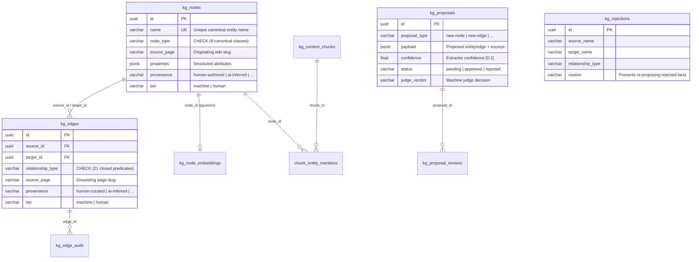

# Knowledge Graph Core: PostgreSQL Schema, Mention-Centroids, and Curation Pipeline

**Knowledge Graph Core** (`com.wikantik.knowledge` in module `wikantik-knowledge`, backed by `wikantik-jdbc`) is the relational and vector storage engine underlying the [[WikantikKnowledgeGraph|Wikantik Knowledge Graph]]. It stores LLM-extracted and human-curated domain entities, closed-vocabulary semantic predicates, proposal/judge queues, negative-knowledge rejection blocklists, and `pgvector` mention-centroid embeddings inside PostgreSQL 18.

> **Architectural Boundary:** The Knowledge Graph (`kg_*` tables) models domain entities and typed semantic predicates. It is completely separate from the **Page Graph** (`page_links`), which tracks real wikilinks between Markdown pages. See [[PageGraphVsKnowledgeGraph|Page Graph vs. Knowledge Graph]].

---

## 1. Relational & Vector Schema Architecture (`bin/db/migrations/V*.sql`)

Every Knowledge Graph table is defined strictly by numbered idempotent Flyway-style SQL migrations under `bin/db/migrations/` and accessed exclusively through the `com.wikantik.jdbc.Jdbc` data-access primitive (`ADR-0010`).



---

## 2. Complete Table Inventory & Invariants

| Table Group | Table Name(s) | Core Invariants & Operational Role |
| :--- | :--- | :--- |
| **Core Property Graph** | `kg_nodes` | Unique `name`; `node_type` constrained to the **9 entity classes** (`person`, `organization`, `place`, `event`, `product`, `technology`, `concept`, `project`, `version`); records `source_page`, `properties` (`JSONB`), `provenance`, and `tier`. |
| **Typed Relationships** | `kg_edges` | Connects `source_id` $\to$ `target_id`; `relationship_type` constrained by a PostgreSQL `CHECK` constraint to the **21 closed predicates** (`uses`, `depends_on`, `implements`, `part_of`, `enables`, `causes`, `mitigates`, etc.). |
| **Proposal & Judge Pipeline** | `kg_proposals`, `kg_proposal_reviews`, `kg_judge_timeouts` | Holds pending extractions below the auto-promotion threshold, stores per-reviewer machine/human verdicts (`kg_proposal_reviews`), and tracks LLM judge timeouts (`kg_judge_timeouts`). |
| **Negative Knowledge & Audit** | `kg_rejections`, `kg_edge_audit` | `kg_rejections` records rejected `(source_name, relationship_type, target_name)` tuples so future LLM extraction runs never re-propose rejected hallucinations. `kg_edge_audit` logs every admin edge mutation. |
| **Chunks & Mention-Centroids** | `kg_content_chunks`, `chunk_entity_mentions`, `kg_node_embeddings` | Maps which context-prefixed page chunk (`kg_content_chunks`) mentions which entity (`chunk_entity_mentions`) and caches the resulting normalized mention-centroid vector in `kg_node_embeddings` (`pgvector`). |
| **Inclusion Governance** | `kg_cluster_policy`, `kg_excluded_pages`, `kg_policy_audit` | Persists cluster-level `INCLUDE`/`EXCLUDE` rules (inherited across `parent/sub` clusters) and audit logs ([[KgInclusionPolicy|KG Inclusion Policy]]). |

---

## 3. Mention-Centroid Vector Computation (`kg_node_embeddings`)

Rather than embedding entity names as isolated 2-word strings (which carry almost no domain context), `KnowledgeGraphCore` computes each node's dense vector $\vec{e}_v \in \mathbb{R}^d$ in `kg_node_embeddings` as the unit-normalized centroid of all context-prefixed section chunks $M(v)$ recorded in `chunk_entity_mentions`:

$$
\vec{e}_v = \frac{\sum_{c \in M(v)} \vec{u}_c}{\left\|\sum_{c \in M(v)} \vec{u}_c\right\|_2}
$$

When an agent calls `find_similar(node="pgvector", topK=10)` on `/knowledge-mcp`, PostgreSQL executes an HNSW cosine-similarity scan over `kg_node_embeddings`, returning entities that play analogous architectural roles across the corpus.

---

## 4. Write Chokepoints & The SHACL Validation Gate

Entities and edges enter `kg_nodes` and `kg_edges` through two strictly gated routes:
1. **Asynchronous Extraction $\to$ Proposal $\to$ Review (`KnowledgeProposals`):** Chunk-level and page-level extractors (in-app or via `wikantik-extract-cli`) check `kg_rejections`, file candidate rows in `kg_proposals`, and pass them to the asynchronous LLM judge (`tier = 'machine'`) and human reviewers (`tier = 'human'`).
2. **Direct Admin & Agent Curation (`curate_nodes`, `curate_edges`):** Administrators (via `/admin/knowledge-graph` or the page editor's Knowledge panel) and trusted curation agents (via `/wikantik-admin-mcp`) upsert or confirm nodes and edges directly at `tier = 'human'`.

At **both** write chokepoints (proposal materialization and direct curation), `OntologyShaclValidator` (from `wikantik-ontology`) validates the candidate edge against the SHACL shapes in `wikantik.ttl`. Any edge that violates domain/range shape constraints is rejected before commit.

> **Retired Mechanism (`GraphProjector`):** Prior to `2026-04-24`, a `PageFilter` projected custom frontmatter keys (`depends-on`, `enables`) into `kg_edges`. That filter is retired; page frontmatter never populates `kg_*` tables. See [[GraphProjector|Graph Projector (Retired)]].

---

## 5. MCP Tool Surface Mapping (`wikantik-mcp-core`, `wikantik-knowledge`, `wikantik-admin-mcp`)

To avoid circular module dependencies between `wikantik-knowledge` and `wikantik-admin-mcp`, shared tool implementations (`QueryNodesTool` and `SearchKnowledgeTool`) live in `wikantik-mcp-core` and are registered on both servers with different inclusion-policy flags:

| MCP Server | Registered KG & Ontology Tools | Inclusion Policy & ACL Behavior |
| :--- | :--- | :--- |
| **`/knowledge-mcp`** (22 read-only tools overall) | `get_schema_summary` (`discover_schema`), `query_nodes`, `search_knowledge`, `get_node`, `traverse`, `find_similar`, `get_ontology`, `sparql_query` | **Enforces `KgInclusionPolicy` and Guest `PageViewGate`:** hides entities from excluded clusters/pages or ACL-restricted pages. |
| **`/wikantik-admin-mcp`** (29 read/write tools overall) | `propose_knowledge`, `list_proposals`, `inspect_proposals`, `review_proposals`, `curate_nodes`, `curate_edges`, `list_orphaned_kg_nodes`, plus admin-bypass `query_nodes` and `search_knowledge` | **Admin-bypass enabled:** curators see all entities immediately (including newly created nodes and entities on excluded pages). |


---

## 6. Indexing Strategy, Orphan Hygiene, and End-to-End Rebuild Mechanics

### 6.1 PostgreSQL B-Tree, GIN, and HNSW Indexing
To sustain sub-20ms graph traversals (`traverse`) and vector similarity lookups (`find_similar`) across thousands of entities and tens of thousands of edges, `bin/db/migrations/V*.sql` maintains four classes of indexes over the `kg_*` schema:
1. **Unique & Prefix Entity Lookup (`kg_nodes`):** Case-normalized unique index on `name` plus a B-tree index on `(node_type, tier, provenance)` and `source_page` so page renames (`rename_page`) and deletions (`delete_pages`) update or cascade-prune associated entities without sequential table scans.
2. **Bidirectional Adjacency Indexes (`kg_edges`):** Composite indexes on `(source_id, relationship_type, tier)` and `(target_id, relationship_type, tier)` so multi-hop BFS traversal (`traverse` with `direction = 'OUTBOUND' | 'INBOUND' | 'BOTH'`) executes via index-only adjacency scans.
3. **JSONB Property Index (`kg_nodes.properties`):** GIN index supporting structured attribute filtering in `query_nodes` and `search_knowledge`.
4. **HNSW Dense Centroid Index (`kg_node_embeddings`):** `pgvector` HNSW cosine distance index (`vector_cosine_ops`) over the normalized mention-centroid vectors $\vec{e}_v$, refreshed incrementally whenever `chunk_entity_mentions` changes for a page.

### 6.2 Orphaned Node Detection and Graph Hygiene (`list_orphaned_kg_nodes` & `curate_nodes`)
Over time, editing or deleting sections of a page can leave degree-0 entity nodes in `kg_nodes` that have neither inbound nor outbound `kg_edges` (or artifacts from early LLM extractions such as single-character punctuation tokens). Curators maintain graph hygiene using a two-step MCP workflow on `/wikantik-admin-mcp`:

```json
// Step 1: List degree-0 orphaned nodes in the Knowledge Graph
{
  "name": "list_orphaned_kg_nodes",
  "arguments": {
    "limit": 100
  }
}

// Step 2: Prune confirmed junk or obsolete degree-0 nodes via curate_nodes
{
  "name": "curate_nodes",
  "arguments": {
    "op": "delete",
    "names": ["ObsoleteEntityName"]
  }
}
```

For full-corpus re-indexing—such as when switching embedding models (`wikantik.search.embedding.model`) or re-running extraction across a newly included cluster—operators follow the four-phase rebuild runbook in [[SearchIndexAndKnowledgeGraphRebuild|Search Index and Knowledge Graph Rebuild]].

[{Relationships}]

---

**Cluster Hub:** [[WikantikDevelopmentHub|Wikantik Platform Development Hub: Architecture, MCP Protocols, and Agent Briefings]] (`wikantik-development`)
