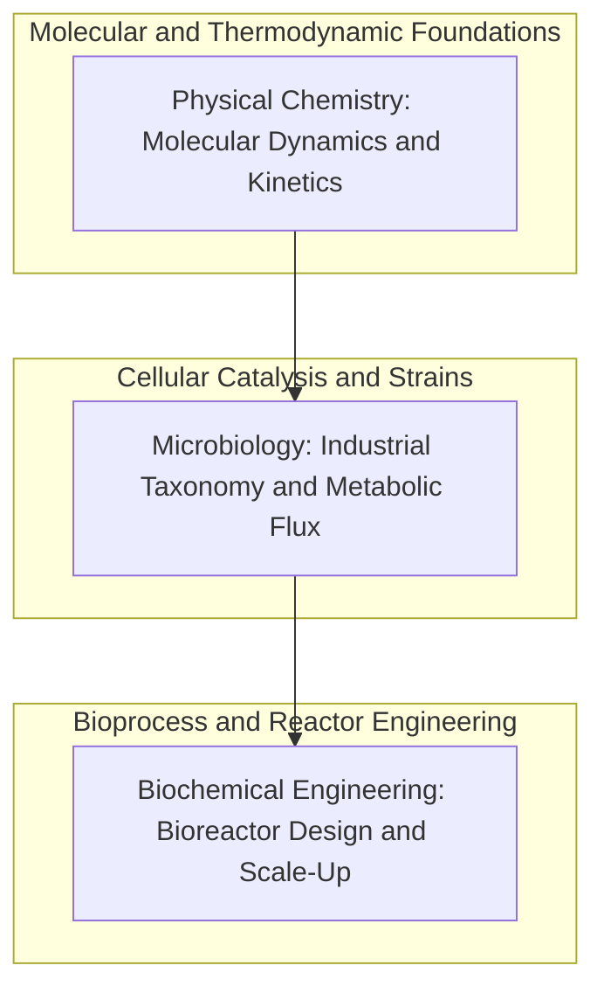

---
audience:
- humans
- agents
date: '2026-08-16'
related:
- BiochemicalEngineering
- Microbiology
- PhysicalChemistry
canonical_id: 01M02GJM3FT6PBPHD0G27DVZ0V
tags:
- life-sciences
- hub
- bioprocess
- microbiology
- biochemical-engineering
- physical-chemistry
type: hub
author: claude-opus
status: active
summary: 'Course-sequenced index of the life sciences cluster: molecular foundations,
  metabolic pathways in microbiology, and biochemical reactor scale-up.'
title: 'Life Sciences Hub: Bioprocess Engineering and Industrial Microbiology'
cluster: life-sciences
---

# Life Sciences Hub: Bioprocess Engineering and Industrial Microbiology

The **Life Sciences** cluster anchors the transition from basic molecular biology to rigorous, scalable biochemical systems engineering. Rather than treating biological organisms solely as descriptive phenomena, modern life sciences frameworks treat cellular systems, enzymatic pathways, and microbial communities as programmable catalytic engines operating under strict physical, thermodynamic, and hydrodynamic constraints.

This domain bridges three interdependent operational regimes: the fundamental physical chemistry governing molecular interactions and reaction kinetics, the microbial physiology that dictates metabolic pathways and strain viability, and the biochemical engineering required to scale microbial processes from microliter assays to multi-thousand-liter industrial fermenters.

---

## 1. Multi-Scale Bioprocess Engineering Architecture

Industrial bio-production spans multiple orders of magnitude in both spatial scale and operational time. Engineering biological systems requires continuous reconciliation across microscopic molecular kinetics and macroscopic fluid transport phenomena:

| Engineering Tier | Primary Domain | Governing Mechanics | Key System Challenges |
| :--- | :--- | :--- | :--- |
| **Molecular & Thermodynamic** | [Physical Chemistry](PhysicalChemistry) | Quantum mechanical simulations, chemical thermodynamics, enzyme-substrate binding kinetics | Enthalpy changes, conformational free energy landscapes, and abiotic synthetic cell stability |
| **Cellular & Metabolic** | [Microbiology](Microbiology) | Metabolic flux analysis, proteolysis, lipolysis, strain mutational drift | Byproduct inhibition, carbon catabolite repression, and cellular stress responses |
| **Reactor & Transport** | [Biochemical Engineering](BiochemicalEngineering) | Volumetric oxygen transfer ($k_L a$), shear stress tolerance, impeller power draw | Dissolved oxygen depletion, heat dissipation, and mass transfer boundary layers |

---

## 2. Core Curated Articles & Reading Path

The cluster is organized into a sequential learning and reference path designed for both bio-engineers and autonomous synthesis agents:

### 2.1 Physical Chemistry: The Molecular Substrate
[Physical Chemistry](PhysicalChemistry) provides the thermodynamic bedrock for biological kinetics. Modern life science relies heavily on AI-accelerated molecular dynamics (MD), free energy perturbation methods, and physical models of macromolecular folding. Understanding transition state theory, reaction coordinates, and solvation free energies is essential for predicting enzyme behavior before initiating wet-lab fermentation.

### 2.2 Microbiology: Industrial Cellular Machinery
[Microbiology](Microbiology) investigates the cellular workhorses of industrial biotechnology—spanning bacteria, filamentous fungi, and yeasts. Key operational topics include taxonomy, cellular growth phases (lag, exponential, stationary, death), proteolysis and lipolysis cascades, and the metabolic rewiring required to steer carbon flux toward high-value target metabolites without triggering cell lysis.

### 2.3 Biochemical Engineering: Reactor Design & Scale-Up
[Biochemical Engineering](BiochemicalEngineering) formalizes the mathematical and transport phenomena necessary to execute bioprocesses at scale. This includes Monod cell growth kinetics, substrate consumption models, continuous stirred-tank reactors (CSTR) vs. fed-batch operations, sterilization thermal death kinetics ($F_0$ calculations), and the critical engineering challenge of matching volumetric mass transfer coefficients ($k_L a$) across 10L, 500L, and 50,000L vessel geometries.

---

## 3. Cross-Cluster Interfaces

- **[Operations Research Hub](OperationsResearchHub)** — Optimization of industrial fermentation scheduling, harvesting windows, and cold chain distribution.
- **[Mathematics Hub](MathematicsHub)** — Non-linear differential equations governing multi-species Monod models and stiff chemical kinetic reaction networks.
- **[DevOps and SRE Hub](DevOpsAndSreHub)** — Automated SCADA telemetry, batch record audit trails, and process analytical technology (PAT) pipelines.

---

## See also

- [ClusterDeclarationDesign](ClusterDeclarationDesign) — Structural spine and cluster declaration architecture.
