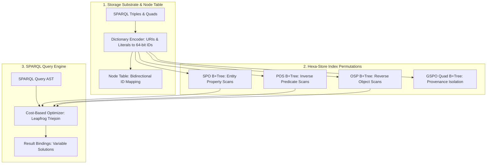

# Linked Data and Triple Stores: Storage Mechanics and Query Architecture

If you are building an enterprise knowledge graph or engineering an agentic retrieval pipeline over structured ontologies, choosing between an **RDF database (Triple Store)**, a **Labeled Property Graph (LPG)**, and a **Relational Schema** is your most consequential architectural decision. While property graphs optimize for local path-traversal hops over ad-hoc entity properties, RDF Triple Stores are specifically engineered for global schema interoperability, formal ontologies, mathematical inference, and massive join densities across disparate semantic domains.

This deep dive covers the internal storage substrate of production triple stores, dictionary encoding mechanics, prefix-index permutation theory (Hexa-Store architecture), SPARQL query execution pipelines, and the engineering trade-offs governing native stores versus relational tables.



---

## 1. Storage Mechanics: The Quad and Dictionary Encoding

At the mathematical abstraction level, the [Resource Description Framework](ResourceDescriptionFramework) models knowledge as atomic 3-tuples:
$$
\langle 	ext{Subject}, \; 	ext{Predicate}, \; 	ext{Object} 
angle \in (U \cup B) 	imes U 	imes (U \cup B \cup L)
$$
where $U$ is the set of Internationalized Resource Identifiers (IRIs), $B$ represents blank nodes, and $L$ denotes literal values (strings, integers, timestamps, geometric coordinates).

### 1.1 The Quad: Adding Graph Context
In production systems, virtually all modern engines implement a **Quad Store** model by attaching a fourth coordinate—the **Named Graph** $G$:
$$
\langle 	ext{Subject}, \; 	ext{Predicate}, \; 	ext{Object}, \; 	ext{Graph} 
angle
$$
The Named Graph coordinate enables two critical production capabilities:
1. **Provenance and Invalidation**: Triples ingested from a specific crawl, document, or tenant are partitioned into distinct named graphs ($G_{	ext{tenant\_A}}$). If the upstream source is retracted, the entire subgraph is purged in $O(1)$ batch operations without scanning the broader database.
2. **Fine-Grained Security and Multitenancy**: Graph patterns can restrict evaluation scopes using `GRAPH <uri> { ... }` blocks, allowing access control lists (ACLs) to be enforced at index boundaries.

### 1.2 Two-Tier Storage and Dictionary Encoding
Storing full URI strings (often 60–120 bytes each) directly inside B+ Tree index keys would result in massive memory bloat and terrible CPU cache locality. Production engines—such as Apache Jena TDB2, Oxigraph, and Ontotext GraphDB—utilize a two-tier storage architecture:

1. **The Node Table (Dictionary)**: A hash table or persistent string-index mapping every unique IRI and literal to a compact, fixed-size **64-bit NodeID**. Strings are stored exactly once in an append-only blob store.
2. **The Index Layer**: All B+ Trees or LSM-Trees store only 64-bit integer IDs. An individual triple $\langle S, P, O 
angle$ is stored in the index as a compact 24-byte payload (or 32 bytes for quads $\langle S, P, O, G 
angle$).

When a SPARQL query executes, the query engine converts input string literals and IRIs to NodeIDs via the dictionary, executes all index scans and multi-way joins purely on 64-bit integers, and only resolves NodeIDs back to text strings at the final result projection stage.

---

## 2. Indexing: The SPO Permutations (Hexa-Store Architecture)

A fundamental challenge of graph querying is that queries can bind any combination of coordinates. Across three variables ($S$, $P$, $O$), there are exactly $2^3 = 8$ potential query patterns:

| Query Pattern | Bound Variables | Example Search Intent | Optimal Index | Scan Complexity |
| :--- | :--- | :--- | :--- | :--- |
| **`???`** | None | Full graph dump | Any index (`SPO`) | $O(N)$ |
| **`S??`** | Subject | All outgoing attributes of an entity | `SPO` | $O(\log N + k)$ prefix |
| **`?P?`** | Predicate | All occurrences of a relationship | `POS` | $O(\log N + k)$ prefix |
| **`??O`** | Object | All entities pointing to a target object | `OSP` | $O(\log N + k)$ prefix |
| **`SP?`** | Subject, Predicate | Specific property value of an entity | `SPO` | $O(\log N + k)$ prefix |
| **`?PO`** | Predicate, Object | All entities matching a type/value | `POS` | $O(\log N + k)$ prefix |
| **`S?O`** | Subject, Object | Relationships connecting two nodes | `OSP` | $O(\log N + k)$ prefix |
| **`SPO`** | All bound | Existence check / boolean ask | `SPO` | $O(\log N)$ exact lookup |

To answer any of the 8 query patterns using a contiguous B+ Tree prefix scan, an engine must maintain three permutations: **`SPO`**, **`POS`**, and **`OSP`**. 

Full enterprise systems (Hexa-Stores) maintain all six permutations: `SPO`, `SOP`, `POS`, `PSO`, `OSP`, and `OPS`. For quad stores, engines often maintain 4 to 6 permutations (`GSPO`, `GPOS`, `GOSP`, `SPOG`, `POSG`, `OSPG`).

### The Storage Overhead Trade-Off
Because every triple is written to 3 to 6 separate B+ Trees, writes incur significant write amplification. Index storage typically expands to 4 to 8 times the size of the raw compressed source data. However, in return, every basic graph pattern (BGP) resolves to an optimal contiguous range scan.

---

## 3. Storage Models: Native Triple Stores vs. Relational Triples

When implementing linked data capabilities, organizations frequently evaluate whether to deploy a native graph engine or store triples in a relational database:

| Architectural Dimension | Native Triple Store (Jena, Oxigraph, GraphDB) | Relational Schema (PostgreSQL `triples` table) | Labeled Property Graph (Neo4j) |
| :--- | :--- | :--- | :--- |
| **Storage Layout** | Dedicated B+ Trees over dictionary-encoded 64-bit integer IDs | Single wide relational table `(s text, p text, o text, g text)` | Pointer-based adjacency lists (record pointers) |
| **Multi-Hop Join Scaling** | Merge joins & Leapfrog Triejoin over pre-sorted indices | Cascading SQL self-joins; memory & query plan collapse | Native index-free adjacency traversal ($O(1)$ per hop) |
| **Formal Reasoning** | Native forward/backward chaining for RDFS / OWL | Requires external rules engines or recursive CTEs | Manual Cypher queries or procedural plugins |
| **Global Schema Interoperability** | Built-in via W3C IRIs and standard namespaces | Application-level foreign keys and schema contracts | Local database schema; property keys are internal strings |
| **Write Throughput** | Moderate (3–6 index tree writes per assertion) | High (single table append, standard B-Trees) | High (direct record appends) |

### The Relational "Self-Join Explosion" Failure Mode
In a relational database, storing triples in an `EAV` (Entity-Attribute-Value) or `triples` table works adequately for simple key-value lookups. However, a SPARQL query matching a pattern with 6 joined clauses:
```sparql
SELECT ?person ?company ?city WHERE {
    ?person :worksFor ?company .
    ?company :headquarteredIn ?city .
    ?city :locatedIn ?country .
    ?country :region "Europe" .
}
```
requires **four self-joins on a multi-billion-row relational table**. Without dedicated index permutations and variable intersection algorithms, relational cost-based optimizers frequently select disastrous nested-loop join plans that time out.

---

## 4. Modern Query Optimizers: Worst-Case Optimal Joins (Leapfrog Triejoin)

Traditional relational query engines execute queries via binary joins (joining table A to table B, then joining the intermediate result to table C). In cyclic graph queries (such as triangle queries or clique detection), binary joins can produce intermediate relations that are orders of magnitude larger than either the input or the final output.

Modern triple stores increasingly integrate **Worst-Case Optimal Join (WCOJ)** algorithms, specifically **Leapfrog Triejoin**. 
- Instead of joining relations two at a time, Leapfrog Triejoin intersects multiple sorted iterators simultaneously over a shared variable.
- It guarantees that the algorithmic runtime is strictly bounded by the **AGM Bound** (the maximum possible output size given the graph's hypergraph structure), completely preventing the intermediate memory explosion that plagues standard SQL optimizers.

---

## 5. Performance Pitfalls and the Reification Problem

Because standard RDF triples are strictly binary relations $\langle S, P, O 
angle$, attaching metadata to an *edge*—such as stating that a connection was valid between two dates or assigning a confidence score—historically required **reification**:

```turtle
# Classical Reification (Requires 4 additional triples)
:statement1 rdf:type rdf:Statement ;
            rdf:subject :Alice ;
            rdf:predicate :worksFor ;
            rdf:object :AcmeCorp ;
            :startDate "2024-01-01"^^xsd:date ;
            :confidence 0.95 .
```

Classical reification caused severe index bloating, quadrupled triple counts, and crippled query latency.

### The Modern Solution: RDF-Star (RDF*)
The ratified **RDF-Star (RDF\*)** standard eliminates the reification penalty by allowing an entire triple to serve as the subject or object of another assertion:

```turtle
# RDF-Star Syntax
<< :Alice :worksFor :AcmeCorp >> :startDate "2024-01-01"^^xsd:date ;
                                :confidence 0.95 .
```

Engines supporting RDF-Star store these nested triples transparently as composite IDs, bridging the ergonomics of Labeled Property Graphs with the formal semantics of Linked Data.

---

## 6. Summary and Architectural Decision Matrix

- **Choose a Triple Store** when:
  - Your problem demands enterprise data integration across open, evolving schemas from multiple disparate sources.
  - You require automated semantic inference (subclass hierarchies, transitive relations, inverse functional properties).
  - You are integrating with standard W3C ontologies and Linked Open Data endpoints.
- **Choose a Labeled Property Graph** when:
  - Your queries consist predominantly of multi-hop variable-length pathfinding (e.g., shortest paths, network community detection).
  - Schema consistency is managed entirely within application code.
- **Choose a Relational Schema** when:
  - Data is structured and tabular, transactional volume is high, and cross-entity join depths are fixed and shallow.

---

## References

1. Weiss, C., Karras, P., & Bernstein, A. (2008). *Hexastore: Sextuple Indexing for Semantic Web Data Management*. Proceedings of the VLDB Endowment.
2. Veldman, T. (2014). *Leapfrog Triejoin: A Simple, Worst-Case Optimal Join Algorithm*. LogicBlox Technical Report.
3. W3C Working Group. (2024). *RDF 1.2 Concepts and Abstract Syntax*. W3C Recommendation.

---

**Cluster Hub:** [[AgenticAiHub|Agentic AI Hub: Cognitive Architectures, Orchestration, and Autonomous Systems]] (`agentic-ai`)
