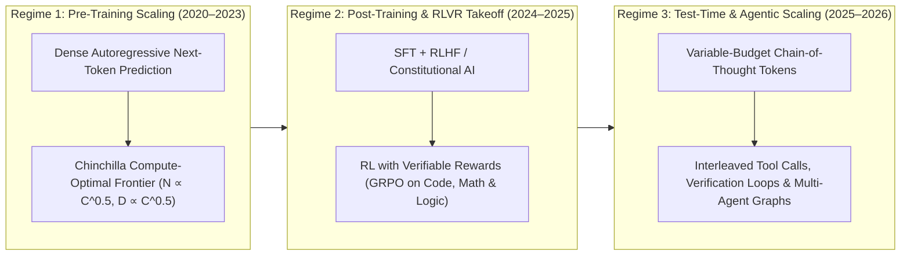
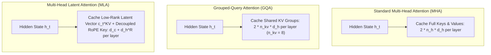

---
tags:
- llm
- scaling-laws
- rlhf
- rlvr
- grpo
- mixture-of-experts
- multi-head-latent-attention
- test-time-compute
- generative-ai
status: active
type: article
summary: 'Technical evolution of LLMs (2020–2026): Chinchilla scaling, RLHF, MoE/MLA
  architectures, RLVR reasoning (o1/o3, DeepSeek-R1), and agentic systems.'
title: 'Large Language Models Since 2020: Scaling Laws, RLVR Reasoning, MLA, and Frontier
  Agents'
cluster: generative-ai
verified_at: '2026-10-24T18:20:41.108726282Z'
kg_include: true
date: '2026-10-24'
related:
- GenerativeAIHub
- AgenticAiHub
- AgenticCodingHub
- TransformerArchitecture
- FineTuningLargeLanguageModels
- ReinforcementLearningFundamentals
- InferenceServing
- ModelQuantization
- RunningLocalLlms
- GenerativeAiAdoptionGuide
canonical_id: 01KQ0P44RZGC2N51EXZYR2WDT0
verified_by: wikantik-cli
---
# Large Language Models Since 2020: Scaling Laws, RLVR Reasoning, MLA, and Frontier Agents

Between June 2020 and 2026, Large Language Models (LLMs) underwent two distinct phase transitions. The **first phase (2020–2023)** scaled dense autoregressive [[TransformerArchitecture|Transformers]] across internet corpora and aligned them for conversational instruction-following via Reinforcement Learning from Human Feedback (RLHF). The **second phase—the 2024–2026 takeoff point**—shifted the scaling frontier from raw pre-training parameter counts to **sparse Mixture-of-Experts (MoE)** with **Multi-Head Latent Attention (MLA)**, **Reinforcement Learning with Verifiable Rewards (RLVR)**, **inference-time compute scaling (extended thinking)**, and **interleaved multi-step tool execution** over protocols like the [[McpIntegration|Model Context Protocol (MCP)]].

For broader foundations, see the [[GenerativeAIHub|Generative AI Hub]], [[AgenticAiHub|Agentic AI Hub]], and [[MachineLearning|Machine Learning]].

---

## 1. The Three Scaling Regimes: Pre-Training, Post-Training RLVR, and Test-Time Compute

The trajectory of frontier models since 2020 is governed by how engineering labs allocate floating-point operations (FLOPs) across three orthogonal scaling axes:



| Scaling Regime | Dominant Era | Governing Compute Budget | Primary Failure Mode Addressed | Representative Milestone Models |
| :--- | :--- | :--- | :--- | :--- |
| **1. Pre-Training Compute ($C_{\text{train}}$)** | 2020–2023 | $C_{\text{train}} \approx 6 N D$ FLOPs across $N$ active parameters and $D$ tokens | World knowledge coverage, syntax, and zero/few-shot representation | GPT-3 (175B), Chinchilla (70B), LLaMA-1/2, GPT-4 (Base) |
| **2. Post-Training Alignment (RLHF / DPO)** | 2022–2024 | $10^{-3} \times$ to $10^{-2} \times C_{\text{train}}$ on preference pairs | Instruction-following, tone, refusal boundaries, and format compliance | InstructGPT, ChatGPT (GPT-3.5), Claude 2 / 3, Llama 3 Instruct |
| **3. RL with Verifiable Rewards (RLVR)** | 2024–2026 | $10^{-1} \times$ to $0.3 \times C_{\text{train}}$ rolling out long reasoning trajectories against deterministic verifiers | Multi-hop mathematical deduction, backtracking, self-correction, and algorithmic synthesis | OpenAI o1 / o3 / o4-mini, DeepSeek-R1, Qwen3, Claude 3.7 / 4+ |
| **4. Test-Time & Agentic Compute ($C_{\text{test}}$)** | 2025–2026 | $C_{\text{test}} \approx 2 N_{\text{active}} (T_{\text{think}} + T_{\text{out}})$ plus external compiler/test execution | Repository-scale software engineering, hypothesis testing, and long-horizon state management | Claude 4 / 4.5 / 4.6 (Sonnet & Opus), Gemini 2.5 / 3 Pro, GPT-5 Series |

---

## 2. Pre-Training Scaling Laws and the Chinchilla Rebalancing (2020–2022)

### The GPT-3 Inflection (June 2020)

OpenAI's **GPT-3** (175B dense parameters trained on 300B tokens) demonstrated that scaling an autoregressive decoder-only Transformer produced **in-context learning**: without gradient updates, conditioning on $k$ input-output demonstrations in the prompt steered the model across translation, arithmetic, and code synthesis.

Earlier in January 2020, Kaplan et al. formulated empirical power-law scaling relations for cross-entropy test loss $L(N, D)$, suggesting that model size $N$ should scale faster than dataset token count $D$ ($N \propto C^{0.73}, D \propto C^{0.27}$). That bias drove first-generation megamodels such as Gopher (280B), Jurassic-1 (178B), and MT-NLG (530B), all trained on roughly 300B tokens.

### Hoffmann et al. (Chinchilla) Parametric Loss Formulation (2022)

In March 2022, Hoffmann et al. (DeepMind) proved that first-generation megamodels were severely under-trained. They modeled pre-training cross-entropy loss $L(N, D)$ as the sum of irreducible data entropy $E$, parameter approximation error, and finite-sample estimation error:

$$
L(N, D) = E + \frac{A}{N^\alpha} + \frac{B}{D^\beta}
$$

Minimizing $L(N, D)$ subject to the dense Transformer training FLOP constraint $C \approx 6 N D$ yields compute-optimal allocations where parameters and training tokens scale at nearly equal rates ($\alpha \approx 0.34, \beta \approx 0.28$):

$$
N_{\text{opt}}(C) \propto C^{\frac{\beta}{\alpha + \beta}} \approx C^{0.45}, \qquad D_{\text{opt}}(C) \propto C^{\frac{\alpha}{\alpha + \beta}} \approx C^{0.55}
$$

**Chinchilla** (70B parameters trained on $1.4\text{T}$ tokens—$20\text{ tokens per parameter}$) outperformed the $4\times$ larger Gopher (280B) under an identical compute budget.

### Inference-Adjusted Over-Training (2023–2026)

Because Chinchilla optimized solely for *training* FLOPs ($C_{\text{train}}$) while ignoring production *inference* cost over billions of user queries, **Meta's LLaMA (Feb 2023)** and **Llama 3 (Apr 2024)** pushed far past the $20\text{ tokens/parameter}$ ratio. **Llama 3 8B** was trained on **$15\text{ trillion}$ tokens** ($\sim 1,875\text{ tokens per parameter}$,nearly $100\times$ the Chinchilla ratio), proving that log-linear quality gains continue at extreme over-training budgets while keeping inference memory footprints small enough for consumer GPUs ([[RunningLocalLlms]]).

---

## 3. Architectural Innovations: From Dense MHA to Fine-Grained MoE and MLA

Scaling dense models beyond 70B–405B parameters hits two physical bottlenecks on GPU clusters: **inter-node memory bandwidth during autoregressive decoding** and **Key-Value (KV) cache capacity across long context windows** ([[InferenceServing]]). Three structural innovations solved these bottlenecks between 2023 and 2026.

### 3.1 Rotary Position Embeddings (RoPE) and Context Extension (4K $\to$ 2M+ Tokens)

Early models like GPT-3 used learned absolute positional embeddings capped at $2,048$ tokens. Modern LLMs universally adopt **Rotary Position Embeddings (RoPE)** (Su et al.), which encode relative token distance $m - n$ by rotating query and key representations in complex 2D subspaces:

$$
\langle f_q(x_m, m), f_k(x_n, n) \rangle = \text{Re}\left(\sum_{j=0}^{d/2 - 1} q_{[2j:2j+1]} k_{[2j:2j+1]}^* e^{i(m-n)\theta_j}\right), \qquad \theta_j = b^{-2j/d}
$$

By combining **NTK-aware base-frequency scaling** (increasing base $b$ from $10,000$ to $500,000$–$10,000,000$ via YaRN), **FlashAttention-2/3** (IO-aware SRAM tiling eliminating $O(T^2)$ HBM materialization), and **Ring Attention** across NVLink/InfiniBand hosts, frontier context windows expanded from **4K tokens (2022)** to **128K–200K tokens (GPT-4o, Claude 3/4)**, **1M–2M tokens (Gemini 1.5 / 2.5 / 3 Pro)**, and **10M tokens (Llama 4 Scout)**.

### 3.2 Multi-Head Latent Attention (MLA) vs. Grouped-Query Attention (GQA)

During autoregressive generation, storing keys and values for all $L$ layers and $n_h$ attention heads consumes massive HBM capacity. **Grouped-Query Attention (GQA)** (used in Llama 2 70B, Llama 3, and Mistral) shares $n_{kv} \ll n_h$ key/value heads across query groups.

In May–December 2024, **DeepSeek-V2** and **DeepSeek-V3** introduced **Multi-Head Latent Attention (MLA)**, which projects keys and values jointly into a compressed low-rank latent vector $c_t^{KV} \in \mathbb{R}^{d_c}$ ($d_c \ll d_h n_h$) before caching:

$$
c_t^{KV} = W^{DKV} h_t, \qquad k_t^C = W^{UK} c_t^{KV}, \qquad v_t^C = W^{UV} c_t^{KV}
$$

Because $W^{UK}$ can be absorbed into the query projection $W^Q$ during inference, **only the compressed latent vector $c_t^{KV}$ (plus a tiny decoupled RoPE key $k_t^R \in \mathbb{R}^{d_h^R}$) is stored in the KV cache**.



#### Worked KV-Cache Memory Comparison (128K Context Window in BF16)

For a 60-layer model ($L=60$, $n_h=128$, $d_h=128$) serving a single $T = 131,072$ token sequence in BF16 ($2\text{ bytes}$ per element):

| Attention Mechanism | Cached Elements per Token per Layer | Per-Token KV Footprint ($L=60$) | Total KV Cache for $T=128\text{K}$ |
| :--- | :--- | :---: | :---: |
| **Standard MHA ($n_h = 128$)** | $2 \times n_h \times d_h = 32,768$ | $3.93\text{ MB}$ | **$515.4\text{ GB}$** (Exceeds $6\times$ H100 80GB) |
| **GQA ($n_{kv} = 8$, Llama-3 style)** | $2 \times n_{kv} \times d_h = 2,048$ | $245.8\text{ KB}$ | **$32.2\text{ GB}$** |
| **MLA ($d_c = 512, d_h^R = 64$, DeepSeek-V3/R1)** | $d_c + d_h^R = 576$ | $69.1\text{ KB}$ | **$9.06\text{ GB}$** (**$98.2\%$ reduction vs. MHA; $71.9\%$ vs. GQA**) |

### 3.3 Fine-Grained Mixture-of-Experts (MoE) and FP8 Training

While **Mixtral 8x7B (Dec 2023)** popularized coarse top-2 routing over 8 monolithic experts, **DeepSeek-V3 (Dec 2024)**, **Qwen 2.5/3 MoE**, and **Llama 4 (Apr 2025)** transitioned to **fine-grained shared + routed MoE architectures**:

- **Shared + Fine-Grained Experts:** DeepSeek-V3 contains **671B total parameters** but activates only **37B parameters per token** ($1$ shared expert + $8$ routed out of $256$ fine-grained experts per MoE layer).
- **Auxiliary-Loss-Free Load Balancing:** Instead of adding a routing penalty to the training loss that degrades token perplexity, modern MoE routers dynamically adjust per-expert bias terms $b_i$ outside the gradient graph to maintain uniform GPU utilization.
- **Native FP8 Mixed-Precision Pre-Training:** By executing GEMM operations in 8-bit floating point (`E4M3`) with tile-wise($1 \times 128$) activation scaling and block-wise ($128 \times 128$) weight quantization, DeepSeek-V3 completed pre-training on $14.8\text{T}$ tokens in just $2.788\text{M}$ H800 GPU hours ($\sim\$5.58\text{M}$ compute cost).

---

## 4. The Take-Off Point (2024–2026): RLVR, Reasoning Models, and Test-Time Compute

Through early 2024, LLMs generated answers in a single forward-pass stream with fixed compute per output token. On complex algorithmic, mathematical, or multi-file software engineering problems, standard RLHF models failed whenever an early token committed to an invalid proof branch.

The **takeoff point began in September 2024 with OpenAI's o1** and became an industry-wide paradigm shift in **January 2025 with DeepSeek-R1**, followed rapidly by **OpenAI o3 / o4-mini**, **Claude 3.7 / 4 / 4.5 / 4.6**, **Gemini 2.5 / 3 Pro**, and **Qwen 3**.

### 4.1 Reinforcement Learning with Verifiable Rewards (RLVR)

Unlike RLHF—which trains a neural reward model $r_\phi(x, y)$ on subjective human preferences and suffers from **reward hacking** over long rollouts—**RLVR** trains the policy $\pi_\theta$ directly against **deterministic, programmatic verifiers**:

- **Mathematics & Logic:** Symbolic equivalence checkers, SMT/Lean 4 proof assistants, and exact numerical answer extractors.
- **Software Engineering:** Containerized unit-test suites, compilers, static analyzers, and sandbox execution harnesses ([[AgenticCodingHub]]).

### 4.2 Group Relative Policy Optimization (GRPO)

Standard PPO requires keeping a critic (value) network $V_\psi$ in GPU memory equal in size to the policy model $\pi_\theta$, doubling memory overhead during long Chain-of-Thought rollouts. **Group Relative Policy Optimization (GRPO)** (Shao et al. / DeepSeek-R1) eliminates the critic network entirely by sampling a group of $G$ reasoning trajectories $\{o_1, o_2, \dots, o_G\}$ from the old policy $\pi_{\theta_{\text{old}}}(\cdot \mid q)$ for each prompt $q$ and computing the baseline advantage from the group's normalized verifiable rewards $\{r_1, \dots, r_G\}$:

$$
\mathcal{J}_{\text{GRPO}}(\theta) = \mathbb{E}_{q, \{o_i\}_{i=1}^G \sim \pi_{\theta_{\text{old}}}} \left[ \frac{1}{G} \sum_{i=1}^G \frac{1}{|o_i|} \sum_{t=1}^{|o_i|} \left( \min\left( \rho_{i,t}(\theta) \hat{A}_i, \; \text{clip}(\rho_{i,t}(\theta), 1-\epsilon, 1+\epsilon)\hat{A}_i \right) - \beta D_{\text{KL}}(\pi_\theta \| \pi_{\text{ref}}) \right) \right]
$$

where the token probability ratio $\rho_{i,t}(\theta)$ and group-normalized advantage $\hat{A}_i$ are defined as:

$$
\rho_{i,t}(\theta) = \frac{\pi_\theta(o_{i,t} \mid q, o_{i,<t})}{\pi_{\theta_{\text{old}}}(o_{i,t} \mid q, o_{i,<t})}, \qquad \hat{A}_i = \frac{r_i - \text{mean}(\{r_1, \dots, r_G\})}{\text{std}(\{r_1, \dots, r_G\}) + \varepsilon}
$$

### 4.3 Emergent Behaviors in RLVR ("Aha Moments")

When trained via large-scale RLVR (`DeepSeek-R1-Zero`, `o1`, `o3`), models autonomously discover cognitive strategies never hardcoded in supervised data:

1. **Dynamic Thinking Budgets:** Scaling internal reasoning chains from $100$ tokens on trivial queries to $32,000+$ tokens on Olympiad mathematics or subtle concurrency bugs.
2. **In-Trace Verification and Backtracking:** Generating candidate solutions, writing internal test cases to falsify them (*"Wait, let's check the boundary condition $n=0$..."*), abandoning dead ends, and deriving an alternative approach before emitting the final response.
3. **Distillation into Small Models:** Distilling RLVR reasoning traces into compact $7\text{B}$–$32\text{B}$ dense models ([[FineTuningLargeLanguageModels]]) lifted their AIME and LiveCodeBench accuracy above first-generation 400B+ non-reasoning models.

---

## 5. Hybrid Reasoning, Native Multimodality, and Autonomous Agents (2025–2026)

By mid-2025, separating "fast chat models" (like GPT-4o) from "slow reasoning models" (like o1) proved suboptimal for real-world software engineering and enterprise workflows. Three convergent breakthroughs defined the **2025–2026 frontier**:

### 5.1 Unified Hybrid Reasoning & Interleaved Tool Thinking

- **Claude 3.7 Sonnet (Feb 2025) $\to$ Claude 4 / 4.5 / 4.6 Sonnet & Opus (2025–2026):** Anthropic unified fast non-thinking responses and variable-budget extended thinking inside a single set of weights, introducing **interleaved thinking**. Instead of thinking only *once* before answering, the model alternates between internal reasoning blocks and external tool calls (`think` $\to$ `run bash / search code` $\to$ `think about test failure` $\to$ `edit file` $\to$ `verify`), enabling continuous multi-hour agentic coding sessions.
- **OpenAI o3 / o4-mini (Apr 2025) & GPT-5 Series (2025–2026):** Combined RLVR reasoning directly with multimodal tool invocation—allowing the model to crop/zoom images, execute Python in a sandbox, and search the web *inside* its private chain-of-thought before producing an answer.
- **Google Gemini 2.5 Pro / Flash & Gemini 3 Series (2025–2026):** Paired native audio/video/code multimodality over a $1\text{M}$–$2\text{M}$ token context window with controllable thinking budgets and high-speed speculative decoding.

### 5.2 The Open-Weight Convergence

The latency gap between closed frontier APIs and open-weight models collapsed from $>18$ months in 2022 to $<3$ months by 2025–2026:

- **DeepSeek (V3, R1, V3-0324, R1-0528):** MIT-licensed MoE models matching frontier reasoning and coding benchmarks while enabling self-hosted deployment and distillation.
- **Alibaba Qwen (Qwen 2.5, QwQ, Qwen 3):** Dense ($0.6\text{B}$–$32\text{B}$) and MoE ($30\text{B-A3B}$, $235\text{B-A22B}$) models with native hybrid `/think` and `/no_think` mode switching under Apache 2.0.
- **Meta Llama (Llama 3.1 405B, Llama 3.3 70B, Llama 4 Scout & Maverick):** Native multimodal MoE weights with up to $10\text{M}$ token context length.
- **Google Gemma 3 & Gemma 4:** High-efficiency $1\text{B}$–$31\text{B}$ open-weight models engineered for single-GPU and workstation inference (`HostInference`).

### 5.3 Agentic Coding & Standardized Tool Protocols (MCP)

On **SWE-bench Verified** (resolving real-world GitHub issues across production Python repositories with full unit-test verification), frontier model accuracy jumped from **$4.4\%$ (GPT-4, 2023)** to **$49\%$ (Claude 3.5 Sonnet, Oct 2024)**, **$65\%$–$72\%$ (Claude 3.7 / 4, o3, 2025)**, and **$75\%+$ in 2026**.

Simultaneously, Anthropic's open-source **[[McpIntegration|Model Context Protocol (MCP)]]** (launched Nov 2024 and adopted across IDEs, CLI coding agents, OpenAI, and Google in 2025–2026) replaced bespoke per-application tool glue with a standardized JSON-RPC 2.0 client-server protocol for resources, tools, and context briefings.

```python
# Reference pattern: Interleaved Reasoning + MCP Tool Verification Loop (2025-2026)
def run_verified_agent_loop(client, mcp_session, task_prompt: str, max_steps: int = 25):
    messages = [{"role": "user", "content": task_prompt}]
    tools = mcp_session.list_tools()

    for step in range(max_steps):
        # Model allocates adaptive thinking budget before each tool/action decision
        response = client.messages.create(
            model="claude-opus-4-6",
            max_tokens=16000,
            thinking={"type": "enabled", "budget_tokens": 8000},
            tools=tools,
            messages=messages,
        )
        messages.append({"role": "assistant", "content": response.content})

        tool_Uses = [b for b in response.content if b.type == "tool_use"]
        if not tool_Uses:
            return response  # Model verified goal completion and emitted final synthesis

        tool_results = []
        for call in tool_Uses:
            result = mcp_session.call_tool(call.name, call.input)
            tool_results.append({
                "type": "tool_result",
                "tool_use_id": call.id,
                "content": result.text,
            })
        messages.append({"role": "user", "content": tool_results})

    raise RuntimeError(f"Agent exceeded bounded step budget ({max_steps} steps)")
```

---

## 6. Chronological Milestone Reference (2020–2026)

| Date | Model / Breakthrough | Organization | Key Architectural & Capability Contribution |
| :--- | :--- | :--- | :--- |
| **Jun 2020** | **GPT-3 (175B)** | OpenAI | Proves few-shot in-context learning at scale without gradient fine-tuning. |
| **Jan–Mar 2022** | **InstructGPT & Chinchilla (70B)** | OpenAI / DeepMind | RLHF alignment pipeline (SFT $\to$ RM $\to$ PPO); compute-optimal $20\text{ tokens/param}$ law. |
| **Nov 2022** | **ChatGPT (GPT-3.5)** | OpenAI | Consumer tipping point for RLHF conversational interfaces (100M users in 60 days). |
| **Feb–Jul 2023** | **LLaMA-1 & LLaMA-2 (7B–70B)** | Meta | Catalyzes the open-weight ecosystem, GQA adoption, and inference-optimal over-training. |
| **Mar 2023** | **GPT-4** | OpenAI | Frontier leap in coding, bar/medical exam reasoning, and vision-language input. |
| **Dec 2023** | **Mixtral 8x7B** | Mistral AI | Open-weight sparse Mixture-of-Experts ($47\text{B}$ total, $13\text{B}$ active) matching 70B dense models. |
| **Feb–May 2024** | **Gemini 1.5 Pro, Claude 3, GPT-4o** | Google / Anthropic / OpenAI | $1\text{M}$–$2\text{M}$ token native multimodal context; omni audio/vision/text tokenization. |
| **Jun–Oct 2024** | **Claude 3.5 Sonnet & MCP** | Anthropic | Breakthrough in agentic coding (SWE-bench $49\%$), Computer Use, and the Model Context Protocol. |
| **Sep–Dec 2024** | **OpenAI o1 & DeepSeek-V3 (671B)** | OpenAI / DeepSeek | First RLVR test-time compute reasoning model (`o1`); MLA + FP8 fine-grained MoE (`V3`). |
| **Jan–Feb 2025** | **DeepSeek-R1 & Claude 3.7 Sonnet** | DeepSeek / Anthropic | Open-weight GRPO reasoning paper (`R1`); first unified hybrid instant + extended thinking model (`3.7`). |
| **Mar–May 2025** | **Gemini 2.5 Pro, o3 / o4-mini, Llama 4, Qwen 3, Claude 4** | Google / OpenAI / Meta / Alibaba / Anthropic | Interleaved tool-use thinking (`o3`, `Claude 4`), $1\text{M}$–$10\text{M}$ multimodal context, and hybrid open-weight MoEs. |
| **Late 2025–2026** | **GPT-5 Series, Claude 4.5 / 4.6, Gemini 3, Gemma 4** | OpenAI / Anthropic / Google | Adaptive effort routing, multi-hour autonomous software engineering, and verifiable multi-agent workflows. |

---

## 7. Persistent Structural Limitations and Active Research Frontiers

Even after the 2024–2026 RLVR and agentic takeoff, transformer-based foundation models exhibit well-characterized engineering constraints:

1. **Non-Verifiable Domain Reward Hacking:** RLVR excels where fast, deterministic verifiers exist (compilers, unit tests, math proofs, SQL/SPARQL schemas). In open-ended strategy, creative synthesis, or ambiguous requirements, models can still optimize for superficial rubric artifacts or game weak test suites ([[AgenticCodingFailureModes]]).
2. **Context Rot Under Multi-Turn Distractors:** While needle-in-a-haystack recall approaches $100\%$ at $1\text{M}$ tokens, multi-hop reasoning accuracy degrades when dozens of near-miss distractor documents or stale tool outputs accumulate in the context window—motivating **tiered context engineering** and explicit subagent isolation ([[ContextEngineeringForCodingAgents]], [[ProjectContextSeparationDesign]]).
3. **Continual Learning vs. Catastrophic Forgetting:** Pre-trained weights remain frozen after deployment; adapting to evolving repository state or enterprise facts without degrading general reasoning requires external **hybrid retrieval + Knowledge Graph architectures** ([[HybridRetrieval]], [[PageGraphVsKnowledgeGraph]]) rather than naive continual weight updates.
4. **Test-Time Latency & Token Economics:** Extended thinking chains ($10\text{K}$–$64\text{K}$ internal tokens) increase tail latency from seconds to minutes and multiply per-task token consumption by $10\times$–$50\times$, requiring adaptive effort routing and speculative decoding ([[ModelQuantization]], [[InferenceServing]]).

---

## Related Wiki Articles

- **[[GenerativeAIHub|Generative AI Hub]]** — Primary cluster hub for foundation models, RAG, and alignment.
- **[[AgenticAiHub|Agentic AI Hub]]** & **[[AgenticCodingHub|Agentic Coding Hub]]** — Perceive-reason-act control loops, tool protocols, and autonomous software engineering.
- **[[TransformerArchitecture|Transformer Architecture]]** & **[[TransformerArchitecture|Attention Mechanisms]]** — Mathematical deep dive into MHA, GQA, RoPE, and FlashAttention.
- **[[FineTuningLargeLanguageModels|Fine-Tuning Large Language Models]]** & **[[ReinforcementLearningFundamentals|Reinforcement Learning Fundamentals]]** — LoRA/QLoRA, DPO, PPO, and policy gradient mechanics.
- **[[InferenceServing|Inference Serving]]**, **[[ModelQuantization|Model Quantization]]**, & **[[RunningLocalLlms|Running Local LLMs]]** — PagedAttention, vLLM, GGUF/AWQ/FP8 quantization, and local workstation deployment.
- **[[GenerativeAiAdoptionGuide|Generative AI Adoption Guide]]** & **[[PracticalPromptEngineering|Practical Prompt Engineering]]** — Practitioner patterns for deploying and evaluating frontier models.

---

**Cluster Hub:** [[GenerativeAIHub|Generative AI Hub: Foundation Models, RAG Architecture, and Agent Workflows]] (`generative-ai`)
