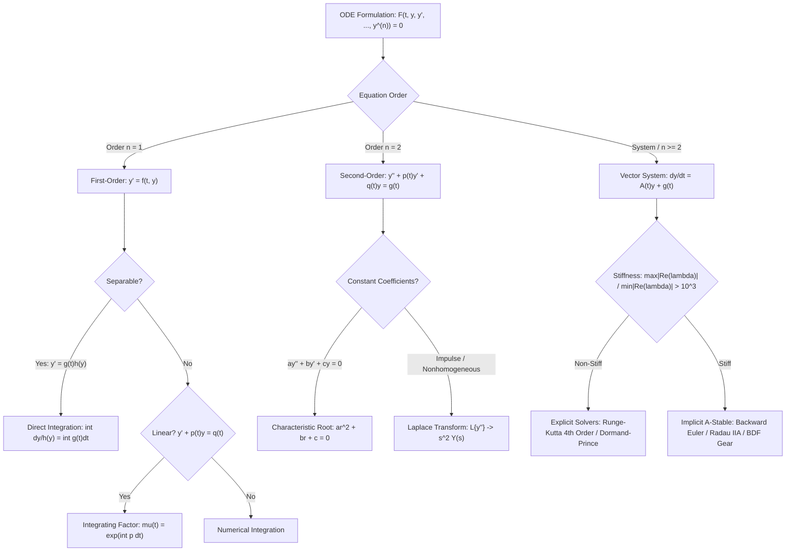

# Ordinary Differential Equations

An Ordinary Differential Equation (ODE) relates a function of a single variable to its derivatives. While algebraic equations ask you to solve for a static number, differential equations ask you to solve for a dynamic function. Because the laws of physics, chemistry, biology, and economics are often most naturally expressed in terms of rates of change, ODEs form the mathematical bedrock of scientific modeling. Solving an ODE allows us to recover the state of a system over time, given the rules governing how that system changes.

This article provides a comprehensive deep dive into the types of ODEs, the analytical tools used to solve them, and their profound real-world applications across various disciplines. We will explore not only the "how" of solving these equations but also the "why"—understanding what these mathematical structures tell us about physical reality.

## Ordinary Differential Equation Taxonomy and Solver Architecture

The analytical and numerical treatment of an ordinary differential equation depends strictly on its order, linearity, and stiffness ratio. The following decision graph outlines the canonical solution paths:

## First-Order Equations and Real-World Modeling

A first-order ODE involves only the first derivative, typically representing the instantaneous rate of change of a quantity. The simplest class is **separable equations**, which can be written in the form $y' = f(x)g(y)$. By moving all $y$ terms to one side and all $x$ terms to the other, we can integrate both sides directly.

$$
\int \frac{dy}{g(y)} = \int f(x) \, dx
$$

The most ubiquitous example of a separable equation is the model of unconstrained exponential growth or decay, $\frac{dy}{dt} = ky$. This equation governs phenomena ranging from radioactive decay to continuously compounded interest. For example, if an individual invests an initial principal of \$50K into a fund that compounds continuously at an annual rate of 5%, the differential equation immediately yields the solution $y(t) = 50000 e^{0.05t}$, predicting an exact future valuation of approximately \$82.4K after 10 years.

However, unconstrained growth is rarely realistic. Real-world populations face resource limitations, leading to the **logistic equation**:

$$
\frac{dy}{dt} = ry \left(1 - \frac{y}{K}\right)
$$

Here, $r$ is the intrinsic growth rate and $K$ is the carrying capacity of the environment. As the population $y$ approaches $K$, the growth rate diminishes to zero. This model is critical in ecology, epidemiology, and even market penetration studies for new products.

Another crucial class is **linear first-order equations**, typically written as $y' + p(x)y = q(x)$. The standard approach involves multiplying the entire equation by an **integrating factor**:

$$
\mu(x) = e^{\int p(x) \, dx}
$$

This ingenious trick transforms the left side into the exact derivative of the product $(\mu y)$, allowing for straightforward integration. This method is the workhorse for solving mixing problems (like predicting the concentration of pollutants in a lake over time) and RC electrical circuits.

### Caveats: Existence and Uniqueness

Before attempting to solve an ODE, one must ask: Does a solution actually exist? And if so, is it unique? The **Picard–Lindelöf Theorem** provides the answer. It guarantees that if a function $f(x,y)$ and its partial derivative $\frac{\partial f}{\partial y}$ are continuous in a region around an initial point $(x_0, y_0)$, then the initial value problem (IVP) $y' = f(x,y)$, $y(x_0) = y_0$ has exactly one local solution. 

Uniqueness is a profoundly important physical constraint. It implies that given a specific initial state, the future behavior of a deterministic system is fixed. In phase space, this means solution curves can never cross. When uniqueness fails—such as in the equation $y' = 3y^{2/3}$ with $y(0)=0$ (where the Lipschitz condition is violated)—the mathematical model loses its predictive power, as infinitely many trajectories could emerge from the origin.

## Second-Order Linear Equations: Oscillators and Resonance

Second-order ODEs involve the second derivative and are intimately connected to Newton's Second Law of Motion ($F = ma$). The quintessential form is the linear, constant-coefficient equation:

$$
ay'' + by' + cy = 0
$$

To solve this, we substitute a trial solution $y = e^{rx}$, leading to the **characteristic equation**:

$$
ar^2 + br + c = 0
$$

The roots of this algebraic quadratic equation completely dictate the system's behavior:
1. **Real, distinct roots ($r_1 \neq r_2$):** The system is overdamped, slowly returning to equilibrium without oscillating.
2. **Repeated real roots ($r_1 = r_2$):** The system is critically damped, returning to equilibrium as fast as possible without oscillating. This is the ideal tuning for car shock absorbers.
3. **Complex conjugate roots ($\alpha \pm i\beta$):** The system is underdamped, exhibiting decaying oscillations. The general solution takes the form:

$$
y(t) = e^{\alpha t} (C_1 \cos \beta t + C_2 \sin \beta t)
$$

### Forced Oscillations and Resonance

When external forces are applied, the equation becomes nonhomogeneous: $ay'' + by' + cy = F(t)$. Solving this requires finding a particular solution. The most dramatic phenomenon here is **resonance**. If the external forcing frequency matches the natural frequency of the undamped system, the particular solution takes the form $t \cos(\omega t)$ or $t \sin(\omega t)$. The presence of the $t$ multiplier means the amplitude of oscillation grows unbounded over time. 

In engineering, ignoring resonance can be catastrophic. The infamous collapse of the Tacoma Narrows Bridge, while technically an aeroelastic flutter, is often taught as a proxy for the destructive power of resonance. Structural engineers must ensure that the natural frequencies of buildings do not align with the frequencies of prevailing winds or seismic waves.

## Systems of ODEs and the Eigenvalue Connection

Real-world phenomena rarely occur in isolation. Predators affect prey, competing businesses affect each other's market share, and interconnected pendulums influence one another's swing. Such scenarios require **systems of ODEs**.

Any higher-order ODE can be converted into a system of first-order equations, typically written in matrix form:

$$
\mathbf{x}' = A\mathbf{x}
$$

The solution to this linear system is deeply tied to the eigenvalues and eigenvectors of the matrix $A$. If $A$ has an eigenvalue $\lambda$ and a corresponding eigenvector $\mathbf{v}$, then $e^{\lambda t}\mathbf{v}$ is a solution. 

The signs of the eigenvalues define the system's stability and phase portrait:
- **Real, same sign:** A node (stable if negative, unstable if positive).
- **Real, opposite signs:** A saddle point, inherently unstable in one direction and stable in another.
- **Complex eigenvalues:** A spiral (stable if the real part is negative, unstable if positive).

This brings us to a fundamental rule of thumb in stability analysis: **A linear system is asymptotically stable if and only if all its eigenvalues lie strictly in the left half of the complex plane.** 

For nonlinear systems, we rely on the **Hartman–Grobman Theorem**, which states that the behavior of a nonlinear system near an equilibrium point is qualitatively identical to its linearization (the Jacobian matrix), provided the equilibrium point has no purely imaginary eigenvalues. This linearization technique is the gateway to [Chaos and Dynamical Systems](ChaosDynamical).

### Epidemiological Application: The SIR Model

A classic nonlinear system is the SIR model in epidemiology, tracking Susceptible ($S$), Infectious ($I$), and Recovered ($R$) populations:

$$
\begin{aligned}
\frac{dS}{dt} &= -\beta \frac{SI}{N} \\
\frac{dI}{dt} &= \beta \frac{SI}{N} - \gamma I \\
\frac{dR}{dt} &= \gamma I
\end{aligned}
$$

Analyzing this system reveals the threshold condition for an epidemic: if the basic reproduction number $R_0 = \beta / \gamma > 1$, the infection will spread. If $R_0 < 1$, the disease dies out. This single mathematical insight drives public health policy, from vaccination drives to social distancing mandates.

## The Laplace Transform: An Engineering Perspective

For engineers, solving ODEs in the time domain can be cumbersome, especially when systems are subjected to discontinuous inputs like sudden shocks (impulses) or switches turning on and off (step functions). Enter the **Laplace Transform**, defined as:

$$
\mathcal{L}\{f(t)\}(s) = \int_0^\infty e^{-st} f(t) \, dt
$$

The Laplace transform converts calculus into algebra. The derivative property, $\mathcal{L}\{y'\} = sY(s) - y(0)$, effectively replaces differentiation with multiplication by $s$. An initial value problem becomes a purely algebraic equation that can be solved for $Y(s)$ using partial fractions. The solution $y(t)$ is then found by applying the inverse Laplace transform.

The true power of the Laplace transform lies in its ability to handle the **Dirac delta function** $\delta(t)$, which models instantaneous impulses like a hammer strike. Furthermore, it gives rise to the concept of the **transfer function**—the ratio of the output's Laplace transform to the input's transform. In control theory, engineers design systems entirely in the $s$-domain, placing the poles (roots of the denominator) of the transfer function in the left half-plane to guarantee stability without ever having to solve the ODE explicitly in the time domain.

## Numerical Reality: When Formulas Run Out

Despite the elegance of the analytical techniques discussed above, the harsh reality is that the vast majority of nonlinear ODEs cannot be solved in closed form. When exact formulas fail, mathematicians and scientists pivot to qualitative analysis and **numerical methods**.

Numerical integration attempts to step through time, approximating the solution curve. The simplest approach is **Euler's Method**, which follows the tangent line:

$$
y_{n+1} = y_n + h f(t_n, y_n)
$$

Where $h$ is the step size. However, Euler's method is notoriously inaccurate and prone to instability. Modern scientific computing relies on higher-order techniques, primarily the **Runge–Kutta (RK4)** method, which takes multiple intermediate samples to compute a highly accurate weighted average of the slope.

### The Problem of Stiffness

### Numerical Solver Stability and Characteristic Comparison

When closed-form analytical solutions are intractable, numerical integration discretizes the continuous trajectory. The choice between explicit and implicit methods is dictated by the stability region and whether the Jacobian matrix exhibits stiff decay modes:

| Solver Method | Formulation Type | Local Order | Stability Boundary | Stiffness Handling | Computational Complexity per Step |
| :--- | :--- | :--- | :--- | :--- | :--- |
| **Forward Euler** | Explicit | $\mathcal{O}(h)$ | Conditional ($|1 + h\lambda| < 1$) | Catastrophic instability | Single vector evaluation $\mathcal{O}(N)$ |
| **Runge–Kutta 4 (RK4)** | Explicit | $\mathcal{O}(h^4)$ | Compact circular boundary | Poor (requires micro-stepping) | 4 intermediate evaluations $\mathcal{O}(4N)$ |
| **Dormand–Prince (RK45)** | Adaptive Explicit | $\mathcal{O}(h^5)$ | Standard explicit boundary | Sub-optimal under stiff decay | 6 evaluations + step-size PID controller |
| **Backward Euler** | Implicit | $\mathcal{O}(h)$ | Unconditionally A-Stable | High (handles extreme stiffness) | Non-linear root solve + Jacobian inversion $\mathcal{O}(N^3)$ |
| **Radau IIA (Order 5)** | Implicit Runge–Kutta | $\mathcal{O}(h^5)$ | L-Stable (decays stiff oscillations) | Exemplary for DAEs and stiff kinetics | Multi-stage Newton–Raphson iteration |
| **BDF / Gear's Method** | Multi-step Implicit | Variable ($1\text{ to }5$) | A-Stable up to Order 2, stiffly stable | Industry standard for chemical kinetics | History polynomial extrapolation + corrector |

A critical caveat in numerical ODE solving is **stiffness**. A stiff equation is one where the solution has components varying at drastically different timescales—for instance, a chemical reaction where one intermediate compound decays in nanoseconds while the overall reaction takes hours. Standard explicit solvers like RK4 will become violently unstable unless the step size $h$ is impractically small.

To combat stiffness, practitioners must use **implicit methods** (like the Backward Euler method). These methods require solving an algebraic equation at every time step (often using Newton-Raphson iteration), which is computationally expensive but mathematically necessary to maintain stability across disparate timescales. Understanding when to use explicit versus implicit solvers is a vital skill for anyone implementing ODEs in software, covered deeply in [Numerical Methods](NumericalMethods).

## See Also

- [[MathematicsHub|Mathematics Hub]] — Foundational mathematical frameworks and curriculum
- [[LinearAlgebra|Linear Algebra]] — Matrix eigenvalues, eigenvectors, and spectral decompositions — eigenvalues drive linear systems
- [[ChaosDynamical|Chaos and Dynamical Systems]] — Nonlinear phase plane dynamics and strange attractors — the qualitative theory at full depth
- [Partial Differential Equations](PartialDifferentialEquations) — derivatives in space and time together
- [Numerical Methods](NumericalMethods) — Runge–Kutta and stiffness

---
**Cluster Hub:** [[MathematicsHub|Mathematics Hub]] (`mathematics`)
