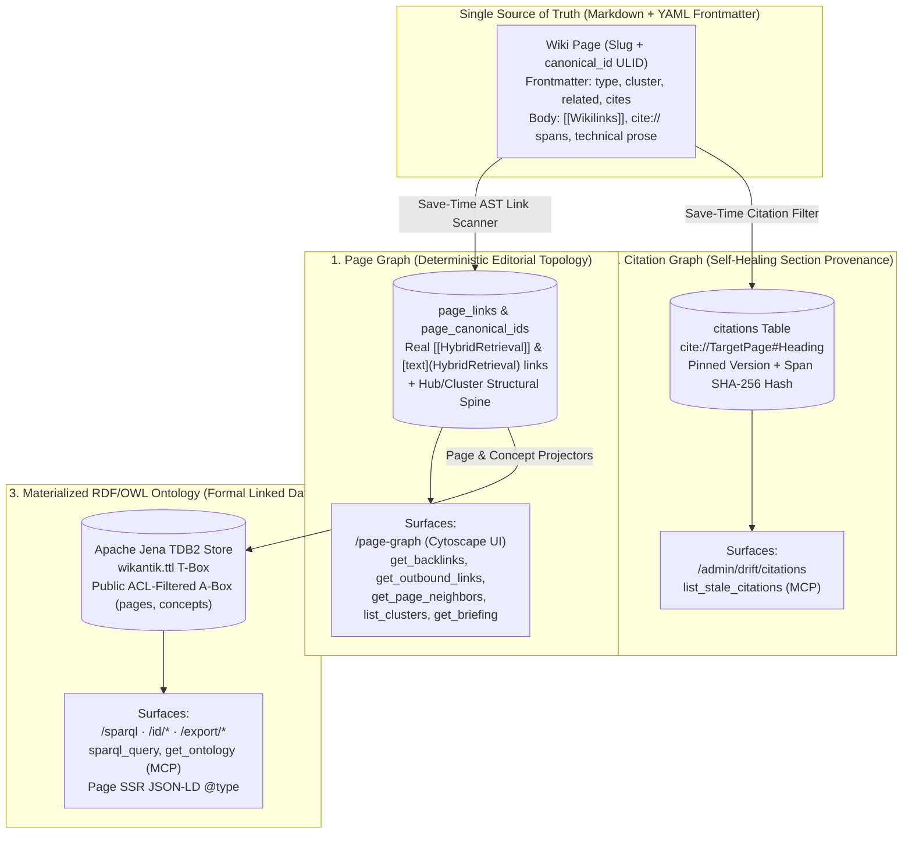

# Page Graph vs. Knowledge Graph (and Citation & Ontology Layers)

> **Retired (November 2026).** Wikantik's Knowledge Graph — LLM-extracted entities and their curation tools — was switched off in 2.5.12 and removed from the code afterwards. **The Page Graph is now the graph.** This page keeps its slug because many older pages link here; it explains what the Page Graph is, what replaced the Knowledge Graph's jobs, and what the Knowledge Graph used to be. Similar pages and agent related-pages now come from page embeddings; see [Hybrid Retrieval](HybridRetrieval).

> **Product Overview:** See [Page Graph on wikantik.com](https://www.wikantik.com/platform/page-graph.html) for the interactive visual walkthrough.

Wikantik maintains these structures over a single Markdown corpus: the **Page Graph** (real wikilinks and cluster membership), the **Citation Graph** (section-pinned `cite://` claims), and a materialized **RDF/OWL ontology** projection of pages and concepts. Until November 2026 there was also a **Knowledge Graph** of LLM-extracted entities (`kg_*` tables); it is retired and described under *What the Knowledge Graph was* below. In Wikantik code, identifiers never use the bare word `graph`: they say `pageGraph` (`page_links`) or name the specific structure.

---

## 1. How the structures fit together

Every Markdown page saved through `PageManager` participates in the **Page Graph** (structural navigation and wikilinks) and the **Citation Graph** (section-pinned provenance), and is projected into the **Apache Jena TDB2 ontology** as page and concept resources.



---

## 2. Side-by-side comparison

| Dimension | Page Graph (`pagegraph`) | Citation Graph (`citations`) | RDF/OWL Ontology (`wikantik-ontology`) |
| :--- | :--- | :--- | :--- |
| **What a node is** | A wiki page identified by its current slug and rename-stable 26-char ULID (`canonical_id`). | A specific section (`Page#Heading`) of a target wiki page at a pinned version. | An RDF resource URI (`/id/page/...`, `/id/concept/...`) typed by `wikantik.ttl`. |
| **What an edge is** | An untyped editorial wikilink (`[text](HybridRetrieval)` or `[[HybridRetrieval]]`) or cluster membership (`cluster:`). | A `cite://` grounding claim linking a source paragraph to a target section's SHA-256 content hash. | Formal RDF triples (`skos:broader`, `schema:isPartOf`, `dct:subject`, `wikantik:*`). |
| **How it is populated** | **100% deterministic** at save time via `MarkdownLinkScanner` and `StructuralSpinePageFilter`. | **100% deterministic** at save time from inline `cite://` syntax and `cites:` frontmatter. | **Event-incrementally projected** from PostgreSQL (`PageProjector`, `ConceptProjector`). |
| **Inclusion** | Every existing page is included (ACL-filtered per viewer). | Every page with `cite://` or `cites:` metadata. | **Public/Guest ACL fail-closed:** only anonymously viewable pages are materialized. |
| **Role in search** | Provides the `cluster:` prefix for embeddings and 1-hop neighbor expansion. | Surfaces staleness warnings when a cited target section changes after the citing page was written. | Powers formal `sparql_query` reasoning and each page's SEO JSON-LD `@type`. |
| **Read tools (`/knowledge-mcp`)** | `get_page_neighbors`, `list_clusters`, `list_pages_by_filter`, `get_briefing` | `list_stale_citations` | `get_ontology`, `sparql_query` |
| **Admin tools (`/wikantik-admin-mcp`)** | `get_backlinks`, `get_outbound_links`, `update_page`, `rename_page`, `rename_cluster`, `verify_pages`, `get_broken_links`, `get_orphaned_pages` | Updated automatically when saving pages via `update_page` / `write_pages`. | Re-projected automatically on page writes and reconciled nightly. |

---

## 3. The Page Graph: editorial navigation and structural spine

The Page Graph answers **"How are documents organized and linked by authors?"**
- **Edges are strictly real wikilinks** parsed from Markdown bodies (`[text](HybridRetrieval)` and `[[HybridRetrieval|Alias]]`).
- **Companion structural spine:** alongside wikilink edges, `StructuralSpinePageFilter` maintains `page_canonical_ids` (26-character ULIDs that survive page renames via `page_slug_history`) and **cluster declarations** ([[ClusterDeclarationDesign|Cluster Declaration Design]]), where a hub page (`type: hub`, `cluster: "distributed-systems"`) declares the cluster and member articles join it via scalar or list-valued `cluster:` frontmatter.
- **UI and API:** visualized in the interactive Cytoscape graph at `/page-graph` (colored by cluster and node degree, with orphan and broken-link overlays) and queried via `/api/page-graph` and `/admin/page-graph/*`.

### Which tool should an agent call?

```json
// 1. Page Graph: "Which pages link to HybridRetrieval?"
{"name": "get_backlinks", "arguments": {"pageName": "HybridRetrieval"}}

// 2. Page Graph: "What is around this page (links in, links out, cluster siblings)?"
{"name": "get_page_neighbors", "arguments": {"slug": "HybridRetrieval"}}

// 3. SPARQL over the ontology: "Find all articles in cluster 'distributed-systems'"
{
  "name": "sparql_query",
  "arguments": {
    "query": "PREFIX wikantik: <https://wiki.wikantik.com/ontology#> PREFIX dct: <http://purl.org/dc/terms/> SELECT ?page ?title WHERE { ?page a wikantik:Article ; dct:title ?title ; dct:subject <https://wiki.wikantik.com/id/concept/distributed-systems> . } LIMIT 20"
  }
}
```

---

## 4. What the Knowledge Graph was (retired November 2026)

The Knowledge Graph answered **"What real-world concepts, technologies, and protocols exist inside the prose, and how do they relate?"** An LLM extractor turned page chunks into typed entities (nine classes) and edges from a closed 21-predicate vocabulary, a judge and human reviewers curated them, and an inclusion policy (`kg_include`) decided which clusters fed it. It was switched off in 2.5.12 and its code, UI and MCP tools (`query_nodes`, `traverse`, `find_similar`, `search_knowledge`, `propose_knowledge`, `curate_nodes`, `curate_edges` and the rest) were then removed. Two measurements shaped the decision: a graph rerank over retrieval results gave zero lift in a 2026-06-16 experiment, and "similar pages" turned out to be better served by page-embedding centroids. The surviving jobs moved as follows:

| Former Knowledge Graph job | Now served by |
| :--- | :--- |
| Related / similar pages | Page embeddings (the related-pages block of `get_page_for_agent`, the reader's Similar pages) |
| Retrieval | Hybrid BM25 + dense retrieval and the context bundle ([Hybrid Retrieval](HybridRetrieval)) |
| Structure and navigation | The Page Graph and structural spine (this page) |
| Formal queries | The ontology's page and concept graphs via `/sparql` |

The historical documentation is kept, marked retired: [WikantikKnowledgeGraph](WikantikKnowledgeGraph), [KnowledgeGraphCore](KnowledgeGraphCore), [KnowledgeProposals](KnowledgeProposals), [ProvenanceModel](ProvenanceModel), [KgInclusionPolicy](KgInclusionPolicy).

---

## 5. Historical cleanup: what else was retired in 2026 (do not resurrect)

1. **`GraphProjector` (retired `2026-04-24`):** a `PageFilter` projected custom YAML frontmatter keys (`depends-on:`, `enables:`, `part-of:`, `uses:`) into `kg_nodes` and `kg_edges`. See [[GraphProjector|Graph Projector (Retired)]].
2. **Typed page `relations:` frontmatter (removed `2026-05-02`):** an early design in [[StructuralSpineDesign|Structural Spine Design]] proposed a `relations:` block for typed page-to-page links, with a `page_relations` table and `traverse_relations` MCP tool. Only 3 of 951 pages ever used it; it was dropped in favor of standard wikilinks and `cites:` citations (`SA-13`).
3. **The `hubs:` frontmatter field and `HubSyncFilter` (retired `2026-08-15`):** consolidated into `cluster:` by [[ClusterDeclarationDesign|Cluster Declaration Design (`ADR-0009`)]]. Never generate `hubs:`, `relations:`, or `depends-on:` in frontmatter; use `cluster:`, `related:`, and `cites:`.

---

**Cluster Hub:** [[WikantikDevelopmentHub|Wikantik Platform Development Hub: Architecture, MCP Protocols, and Agent Briefings]] (`wikantik-development`)
