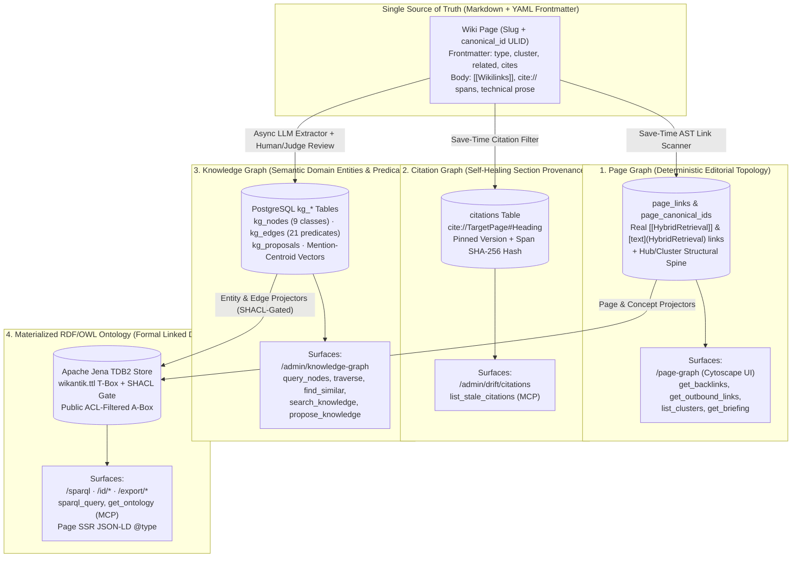

# Page Graph vs. Knowledge Graph (and Citation & Ontology Layers)

> **Product Overview:** See [Page Graph on wikantik.com](https://www.wikantik.com/platform/page-graph.html) for the interactive visual walkthrough.

Wikantik maintains **three distinct graph structures** over a single Markdown corpus—plus a materialized **RDF/OWL Ontology projection**. Confusing the **Page Graph** with the **Knowledge Graph** is the single most common source of architectural bugs, wrong MCP tool selection, and broken queries. In Wikantik code, identifiers never use the bare word `graph`: they always specify `pageGraph` (`page_links`) or `knowledgeGraph` (`kg_*`).

---

## 1. Visual Architecture: How the Three Graphs & Ontology Fit Together

Every Markdown page saved through `PageManager` simultaneously participates in the **Page Graph** (structural navigation & wikilinks), the **Citation Graph** (section-pinned provenance), and—when `kg_include: true`—feeds the **Knowledge Graph** (LLM-extracted domain entities and typed predicates), which in turn projects into the **Apache Jena TDB2 RDF/OWL Ontology**.



---

## 2. Side-by-Side Comparison Matrix

| Dimension | 1. Page Graph (`pagegraph`) | 2. Knowledge Graph (`kg_*`) | 3. Citation Graph (`citations`) | 4. RDF/OWL Ontology (`wikantik-ontology`) |
| :--- | :--- | :--- | :--- | :--- |
| **What a Node Is** | A wiki page identified by its current slug and rename-stable 26-char ULID (`canonical_id`). | A typed domain entity (`person`, `organization`, `place`, `event`, `product`, `technology`, `concept`, `project`, `version`). | A specific section (`Page#Heading`) of a target wiki page at a pinned version. | An RDF resource URI (`/id/page/...`, `/id/entity/...`, `/id/concept/...`) typed by `wikantik.ttl`. |
| **What an Edge Is** | An untyped editorial wikilink (`[text](HybridRetrieval)` or `[[HybridRetrieval]]`) or cluster membership (`cluster:`). | A typed semantic relationship from a closed 21-predicate vocabulary (`uses`, `implements`, `depends_on`, `part_of`, etc.). | A `cite://` grounding claim linking a source paragraph to a target section's SHA-256 content hash. | Formal RDF triples (`skos:broader`, `schema:isPartOf`, `prov:wasDerivedFrom`, `wikantik:*`). |
| **How It Is Populated** | **100% deterministic** at save time via `MarkdownLinkScanner` and `StructuralSpinePageFilter`. | **LLM-extracted** (`kg_proposals`) + human/judge reviewed (`review_proposals`) or curated via `curate_nodes`/`curate_edges`. | **100% deterministic** at save time from inline `cite://` syntax and `cites:` frontmatter. | **Event-incrementally projected** from PostgreSQL (`PageProjector`, `ConceptProjector`, `EntityProjector`, `EdgeProjector`). |
| **Inclusion Policy** | Every existing page is included (ACL-filtered per viewer). | Governed by cluster policy + page `kg_include: true/false` override ([[KgInclusionPolicy|KG Inclusion Policy]]). | Every page with `cite://` or `cites:` metadata. | **Public/Guest ACL fail-closed:** only anonymously viewable pages and sourced entities are materialized. |
| **Role in Search Ranking** | Provides `cluster:` prefix for embeddings and 1-hop `expandNeighbors` in `retrieve_context`. | **Not used in chunk ranking** (page-level KG rerank was deleted in `2026-07` after measuring zero lift). | Surfaces staleness warnings when a cited target section changes after the citing page was written. | Powers formal `sparql_query` reasoning and dynamically drives each page's SEO JSON-LD `@type`. |
| **Read MCP Tools (`/knowledge-mcp`)** | `get_backlinks`, `get_outbound_links`, `list_clusters`, `list_pages_by_filter`, `get_briefing` | `query_nodes`, `search_knowledge`, `traverse`, `find_similar`, `get_node`, `get_schema_summary` | `list_stale_citations` | `get_ontology`, `sparql_query` |
| **Write/Admin MCP Tools (`/wikantik-admin-mcp`)** | `update_page`, `rename_page`, `rename_cluster`, `verify_pages`, `list_broken_links`, `list_orphaned_pages` | `propose_knowledge`, `list_proposals`, `review_proposals`, `curate_nodes`, `curate_edges`, `list_orphaned_kg_nodes` | Updated automatically when saving pages via `update_page` / `write_pages`. | Re-projected automatically on page/KG writes and reconciled nightly. |

---

## 3. Deep Dive: Why Page Graph and Knowledge Graph Must Never Be Conflated

### 3.1 The Page Graph: Editorial Navigation & Structural Spine
The Page Graph answers **"How are documents organized and linked by authors?"**
- **Edges are strictly real wikilinks** parsed from Markdown bodies (`[text](HybridRetrieval)` and `[[HybridRetrieval|Alias]]`).
- **Companion Structural Spine:** Alongside wikilink edges, `StructuralSpinePageFilter` maintains `page_canonical_ids` (26-character ULIDs that survive page renames via `page_slug_history`) and **Cluster Declarations** ([[ClusterDeclarationDesign|Cluster Declaration Design]]), where a hub page (`type: hub`, `cluster: "distributed-systems"`) declares the cluster and member articles join it via scalar or list-valued `cluster:` frontmatter.
- **UI & API:** Visualized in the interactive Cytoscape graph at `/page-graph` (colored by cluster and node degree, with orphan and broken-link overlays) and queried via `/api/page-graph` and `/admin/page-graph/*`.

### 3.2 The Knowledge Graph: Domain Entities, Predicates & Mention-Centroid Embeddings
The Knowledge Graph answers **"What real-world concepts, technologies, and protocols exist inside the prose, and how do they relate?"**
- A single article like [[LlmsSinceTwentyTwenty|Large Language Models Since 2020]] is **one node** in the Page Graph, but it yields **dozens of nodes** in the Knowledge Graph (`DeepSeek-R1`, `Group Relative Policy Optimization`, `Multi-Head Latent Attention`, `Chinchilla Scaling Laws`) connected by typed predicates (`DeepSeek-R1 --uses--> Group Relative Policy Optimization`).
- **Mention-Centroid Entity Embeddings:** Every KG entity node $v \in V_{\text{KG}}$ is embedded into the same vector space as document chunks by averaging the dense vectors $\vec{u}_c$ of all section chunks $M(v)$ that mention $v$:

$$
\vec{e}_v = \frac{1}{|M(v)|} \sum_{c \in M(v)} \vec{u}_c
$$

This enables the `find_similar` MCP tool to discover conceptually analogous entities across completely different clusters (even when no direct wikilink or KG edge connects them yet).

---

## 4. Practical Decision Guide: Which Tool Should an Agent Call?

```json
// 1. Page Graph: "Which pages link to HybridRetrieval?"
{"name": "get_backlinks", "arguments": {"pageName": "HybridRetrieval"}}

// 2. Knowledge Graph Traversal: "What technologies depend on or use pgvector?"
{"name": "traverse", "arguments": {"startNode": "pgvector", "direction": "BOTH", "maxDepth": 2}}

// 3. Cross-Graph SPARQL Query: "Find all articles in cluster 'distributed-systems' and their SKOS broader hierarchy"
{
  "name": "sparql_query",
  "arguments": {
    "query": "PREFIX wikantik: <https://wiki.wikantik.com/ontology#> PREFIX dct: <http://purl.org/dc/terms/> SELECT ?page ?title WHERE { ?page a wikantik:Article ; dct:title ?title ; dct:subject <https://wiki.wikantik.com/id/concept/distributed-systems> . } LIMIT 20"
  }
}
```

---

## 5. Historical Cleanup: What Was Retired in 2026 (Do Not Resurrect)

To eliminate dual-maintenance bugs and schema drift, three legacy mechanisms were permanently removed between April and August 2026:
1. **`GraphProjector` (Retired `2026-04-24`):** Previously, a `PageFilter` projected custom YAML frontmatter keys (`depends-on:`, `enables:`, `part-of:`, `uses:`) directly into `kg_nodes` and `kg_edges`. This polluted the entity graph with page slugs and bypassed the closed 21-predicate vocabulary. See [[GraphProjector|Graph Projector (Retired)]].
2. **Typed Page `relations:` Frontmatter (Removed `2026-05-02`):** An early design in [[StructuralSpineDesign|Structural Spine Design]] proposed a `relations:` block in YAML frontmatter for typed page-to-page links, alongside a `page_relations` table and `traverse_relations` MCP tool. Only 3 of 951 pages ever used it; it was dropped in favor of standard wikilinks + `cites:` contract citations (`SA-13`).
3. **The `hubs:` Frontmatter Field & `HubSyncFilter` (Retired `2026-08-15`):** Consolidated into `cluster:` by [[ClusterDeclarationDesign|Cluster Declaration Design (`ADR-0009`)]]. Never generate `hubs:`, `relations:`, or `depends-on:` in frontmatter; use `cluster:`, `related:`, and `cites:`.

---

**Cluster Hub:** [[WikantikDevelopmentHub|Wikantik Platform Development Hub: Architecture, MCP Protocols, and Agent Briefings]] (`wikantik-development`)
