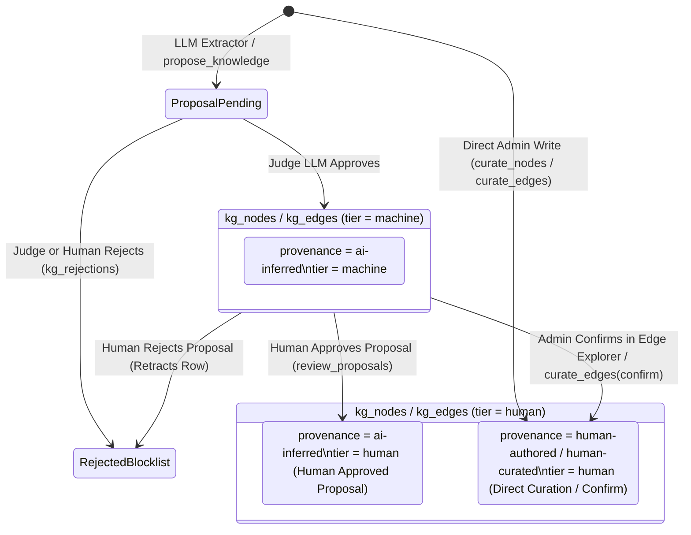

# Knowledge Graph Provenance and Two-Tier Trust Model

Every node (`kg_nodes`) and edge (`kg_edges`) in the [[WikantikKnowledgeGraph|Wikantik Knowledge Graph]] carries **two orthogonal trust dimensions**:
1. **`provenance`** (added in migration `V004`): *How* the entity or relationship originally entered the database (`human-authored`, `human-curated`, `ai-inferred`, or `ai-reviewed`).
2. **`tier`** (added in migration `V024`): *How far* the row has been vetted along the review ladder (`machine` vs. `human`).

Separating **origin (`provenance`)** from **verification state (`tier`)** prevents a classic failure mode of single-column trust models: when an administrator approves an LLM-extracted edge, the system needs to know *both* that the fact is now human-vetted (`tier = 'human'`) *and* that it originally came from the extraction pipeline (`provenance = 'ai-inferred'`) for precision/recall auditing.

---

## 1. State Machine: Provenance & Tier Transitions

A row's review `tier` moves monotonically upward from `machine` to `human` (or is retracted and recorded in `kg_rejections`). Direct curation by an administrator or trusted curation agent starts immediately at `tier = 'human'`.



---

## 2. The Four Provenance Values & Two Review Tiers

### 2.1 `provenance` Column Values (`kg_nodes.provenance`, `kg_edges.provenance`)

| Provenance Value | Applies To | Exact Write Path & Semantics | Initial `tier` |
| :--- | :--- | :--- | :--- |
| **`human-authored`** | `kg_nodes` | Written by direct node upserts from `/admin/knowledge-graph`, `/wikantik-admin-mcp` `curate_nodes`, or confirming an entity in the page editor's Knowledge panel. | `human` |
| **`human-curated`** | `kg_edges` | Written by direct edge upserts or `confirm` actions from `/admin/knowledge-graph`, `/wikantik-admin-mcp` `curate_edges`, or the page editor's Knowledge panel. Every change writes an append-only audit row to `kg_edge_audit`. | `human` |
| **`ai-inferred`** | `kg_nodes`, `kg_edges` | Materialized from `kg_proposals` after extraction by the chunk/page LLM extractor or `propose_knowledge`. Keeps `provenance = 'ai-inferred'` even after human promotion so extraction yield remains measurable. | `machine` (judge-approved) or `human` (human-approved) |
| **`ai-reviewed`** | Legacy / Filter | Historical label describing judge-approved AI content awaiting human curation (the UI badge label). Retained as a valid enum value for `provenance_filter` queries and legacy rows; active review state now lives in `tier`. | `machine` |

### 2.2 `tier` Column Values (`kg_nodes.tier`, `kg_edges.tier`)

| Tier Value | Meaning & Operational Guarantees | RDF/OWL Ontology Projection (`prov:wasAttributedTo`) |
| :--- | :--- | :--- |
| **`machine`** | Materialized after the asynchronous LLM judge approved a proposal in `kg_proposals` (see [[RunningTheJudgeExperimentHarness|Running the Judge Experiment Harness]]), but not yet confirmed by a human reviewer. | Projected with `prov:wasAttributedTo wk:MachineAgent` |
| **`human`** | Authored directly by a curator, promoted by human approval in `review_proposals`, or confirmed via `curate_edges(op="confirm")`. This is also the PostgreSQL column `DEFAULT`. | Projected with `prov:wasAttributedTo wk:HumanAgent` |

---

## 3. Visibility & Filtering Across Consumption Surfaces

When an agent or human queries the Knowledge Graph, three independent gates determine whether a node or edge is returned:

| Gate | Controlling Parameter / Policy | Behavior on `/knowledge-mcp` & Public `/api/knowledge/*` | Behavior on `/wikantik-admin-mcp` & `/admin/knowledge-graph` |
| :--- | :--- | :--- | :--- |
| **1. Review Tier Gate** | `min_tier` (`machine` or `human`; default configured by `wikantik.kg.read.default_min_tier`, defaults to `machine`) | `min_tier="machine"` returns both `machine` and `human` rows; `min_tier="human"` returns **only** `tier = 'human'` rows. | Same `min_tier` filter support; admin UI shows badges distinguishing `machine` vs. `human`. |
| **2. Provenance Filter** | `provenance_filter` array on `query_nodes` and `search_knowledge` | Optional allowlist (e.g., `["human-authored", "human-curated"]`); omitting returns all provenance values. | Same `provenance_filter` support. |
| **3. Cluster Inclusion & ACL Gate** | [[KgInclusionPolicy|KG Inclusion Policy]] (`kg_cluster_policy` + page `kg_include`) and Guest PageViewGate | **Enforced fail-closed:** entities from excluded clusters/pages or ACL-restricted pages are hidden. Sourceless machine-extracted entities are withheld from public RDF/SPARQL. | **Admin-bypass enabled** on `/wikantik-admin-mcp` `query_nodes` and `search_knowledge` so curators can inspect newly created or excluded entities. |

---

## 4. Practical MCP & SQL Examples

### 4.1 Querying Only Human-Vetted Edges over `/knowledge-mcp`
```json
{
  "jsonrpc": "2.0",
  "id": 1,
  "method": "tools/call",
  "params": {
    "name": "traverse",
    "arguments": {
      "startNode": "Wikantik",
      "direction": "OUTBOUND",
      "maxDepth": 2,
      "minTier": "human"
    }
  }
}
```

### 4.2 Promoting an `ai-inferred` Edge to `human-curated` via `/wikantik-admin-mcp`
```json
{
  "jsonrpc": "2.0",
  "id": 2,
  "method": "tools/call",
  "params": {
    "name": "curate_edges",
    "arguments": {
      "op": "confirm",
      "edges": [
        {
          "sourceName": "Wikantik",
          "targetName": "PostgreSQL",
          "relationshipType": "uses"
        }
      ]
    }
  }
}
```


---

## 5. Mathematical Calibration of Judge Thresholds, Audit Trails, and Ontology Attribution

### 5.1 Confidence Thresholds & Judge Promotion Mechanics
When the chunk-level or page-level LLM extractor emits a candidate entity or relationship $p_i$ with raw model confidence $c(p_i) \in [0, 1]$, `KnowledgeProposalService` routes the candidate according to two configurable thresholds (`wikantik.knowledge.extractor.min_confidence` $\tau_{\text{min}}$ and judge promotion rules):

$$
\text{State}(p_i) = \begin{cases}
\text{Discarded} & \text{if } c(p_i) < \tau_{\text{min}} \;\lor\; p_i \in \text{kg\_rejections} \\
\text{Queued in } \text{kg\_proposals} \text{ (status = pending)} & \text{if } c(p_i) \ge \tau_{\text{min}}
\end{cases}
$$

Once queued in `kg_proposals`, the asynchronous LLM judge evaluates the proposal against its grounding source excerpt and records a verdict in `kg_proposal_reviews`. If the judge approves the proposal, the row is materialized into `kg_nodes` / `kg_edges` with:
- `provenance = 'ai-inferred'`
- `tier = 'machine'`

When a human administrator subsequently approves the proposal in `/admin/knowledge-graph` (`Proposals` tab) or via the `review_proposals` MCP tool, the materialized row is promoted in place to `tier = 'human'` while preserving `provenance = 'ai-inferred'`. Conversely, if a human rejects a proposal that the machine judge previously materialized, the row is retracted from `kg_nodes` / `kg_edges` and its signature `(source_name, relationship_type, target_name)` is inserted into `kg_rejections` so future re-extractions of the source page never re-propose the rejected claim.

### 5.2 Append-Only Edge Audit Trail (`kg_edge_audit`)
Every administrative mutation of an edge—whether via `curate_edges(op="add" | "confirm" | "delete" | "update")`, the `/admin/knowledge-graph` Edge Explorer, or the page editor's Knowledge Curation drawer—appends an immutable audit record to `kg_edge_audit` recording:
1. The acting principal (`actor`), timestamp (`created_at`), and operation type (`ADD`, `CONFIRM`, `DELETE`, `PROMOTE`, `RETRACT`).
2. The before-and-after `(provenance, tier)` tuple so administrators can measure agreement rates between the machine judge (`tier = 'machine'`) and human curators (`tier = 'human'`).

### 5.3 W3C PROV-O Mapping in the Public RDF/OWL Ontology
When `EntityProjector` and `EdgeProjector` (`wikantik-ontology`) materialize `kg_nodes` and `kg_edges` into the Apache Jena TDB2 store, the review `tier` and `source_page` are projected into standard W3C PROV-O (`http://www.w3.org/ns/prov#`) triples:
- **Agent Attribution (`prov:wasAttributedTo`):** Rows with `tier = 'machine'` emit `prov:wasAttributedTo wk:MachineAgent`, whereas rows with `tier = 'human'` emit `prov:wasAttributedTo wk:HumanAgent`.
- **Source Derivation (`prov:wasDerivedFrom`):** Every entity and edge links back to its originating wiki page resource (`/id/page/<slug>`). Under the fail-closed public/restricted ACL rule (`2.4.26`), any machine-extracted entity (`provenance = 'ai-inferred'`) whose `source_page` is `NULL` or ACL-restricted is excluded from the public `/sparql` and `/export/*` datasets, whereas a hand-curated entity (`provenance = 'human-authored'`, `tier = 'human'`) without a source page is treated as an intentional public ontology assertion.

[{Relationships}]

---

**Cluster Hub:** [[WikantikDevelopmentHub|Wikantik Platform Development Hub: Architecture, MCP Protocols, and Agent Briefings]] (`wikantik-development`)
