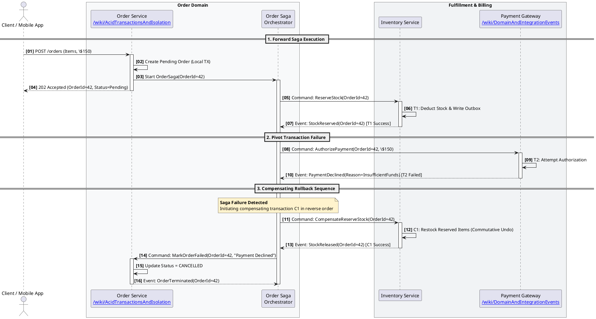

# The Saga Pattern: Orchestrating Distributed Transactions in Microservices

In microservices architectures, data is often partitioned across multiple independent services to ensure loose coupling, independent scalability, and domain autonomy. However, this architectural choice introduces significant challenges when a single business process requires updating data across multiple services. The **Saga Pattern** provides a robust, scalable mechanism for managing distributed transactions without relying on the traditional, blocking Two-Phase Commit (2PC) protocol. 

This guide delves deeply into the mechanics, implications, and implementation strategies of the Saga pattern, exploring why it is a critical component of modern distributed systems, how it handles failure modes, and its nuanced relationship with ACID properties.

## 1. The Challenge of Distributed Transactions and ACID Limitations

Traditional monolithic applications often rely on a single relational database, leveraging ACID (Atomicity, Consistency, Isolation, Durability) properties provided by the database engine. In a microservices environment, the database-per-service pattern is prevalent. A business process, such as processing an e-commerce order, might require updates in the Order Service, Inventory Service, Payment Service, and Shipping Service.

If we attempt to enforce strict ACID properties across these distinct databases, we run into immediate limitations outlined by the CAP Theorem (Consistency, Availability, Partition Tolerance) and the PACELC theorem.

### The Downfall of Two-Phase Commit (2PC)
Historically, distributed systems used the Two-Phase Commit protocol. In 2PC, a central coordinator asks all participating databases to "prepare" to commit. If all agree, the coordinator issues a "commit" command. 

While 2PC provides strict consistency and atomicity, it has critical limitations:
- **Blocking Nature:** Locks are held across all participating databases during the prepare phase until the commit or rollback is complete.
- **Single Point of Failure:** If the coordinator fails during the protocol, participants can be left in a blocked state, indefinitely holding locks.
- **Poor Scalability:** As the number of services increases, the likelihood of a participant being unavailable increases, severely degrading the overall system's throughput and availability.

### Relaxing ACID for Eventual Consistency
The Saga Pattern eschews the strict ACID model in favor of the BASE (Basically Available, Soft state, Eventual consistency) model. 

- **Atomicity:** Instead of a single atomic transaction, a Saga is a sequence of local, atomic transactions. Atomicity across the saga is simulated by ensuring either all transactions succeed or all executed transactions are explicitly rolled back via compensations.
- **Consistency:** Sagas sacrifice immediate, strong consistency for eventual consistency. There is a window where the system is partially updated.
- **Isolation:** The most significant ACID compromise in a Saga is the lack of Isolation. Since local transactions commit immediately, other processes can read intermediate states. This is known as an anomaly (e.g., dirty reads, lost updates). We handle isolation through design techniques like semantic locks, pessimistic views, or commutative updates.
- **Durability:** Standard durability remains intact, as each local transaction commits to persistent storage.

## 2. Core Mechanics of the Saga Pattern

A Saga is defined as a sequence of local transactions $T_1, T_2, ..., T_n$. Each local transaction $T_i$ updates the local database of its respective service and publishes an event or message to trigger the next transaction $T_{i+1}$ in the sequence.

### Mathematical Representation of a Saga Sequence
The execution of a saga can be mathematically modeled. Let a saga $S$ consist of a set of transactions $T$.

$$
S = \{T_1, T_2, T_3, \dots, T_n\}
$$

For every transaction $T_i$ (except potentially the final ones in some edge cases), there must exist a corresponding **compensating transaction** $C_i$ that semantically undoes the effect of $T_i$.

$$
C = \{C_1, C_2, C_3, \dots, C_{n-1}\}
$$

When a saga is triggered, the system attempts to execute the sequence of local transactions:

*   **Success Path:** If all $T_i$ succeed, the business process is complete. The state of the system is the combination of all applied transactions.
*   **Failure Path:** If transaction $T_k$ fails (where $1 \le k \le n$), the system must execute the compensating transactions $C_{k-1}, C_{k-2}, \dots, C_1$ in reverse order.

$$
\text{Failure Execution Path} = T_1, T_2, \dots, T_{k-1}, T_k (\text{fails}), C_{k-1}, \dots, C_1
$$

This ensures that the system returns to a semantically consistent state, equivalent to the state before the saga began.

## 3. Compensating Transactions: The Undo Mechanism

A compensating transaction ($C_i$) is the cornerstone of a Saga's rollback strategy. Unlike a traditional database rollback, which physically restores the previous state using transaction logs, a compensating transaction is a separate, semantic business operation.

### Challenges in Designing Compensations
1. **Semantic Undo:** You cannot always simply revert a database row to its previous state. If $T_1$ adds \$100 to an account, $C_1$ must deduct \$100. However, if another transaction occurred in between (due to the lack of isolation), a simple physical rollback would overwrite the intermediate transaction.
2. **Irrevocable Actions:** Some actions cannot be undone. Sending an email, triggering a physical machine, or launching a missile are irrevocable. In a Saga, steps are categorized to handle this:
    - **Compensatable Steps:** Steps that have a defined $C_i$ (e.g., reserving inventory).
    - **Pivot Step:** The point of no return. Once the pivot step succeeds, the saga *must* run to completion. Often, the pivot step is the irrevocable action (e.g., charging a credit card for \$50K).
    - **Retriable Steps:** Steps following the pivot step. These steps are guaranteed to succeed eventually through infinite retries. They do not need compensating transactions.
3. **Failure of Compensations:** What if a compensating transaction fails? Compensations must be designed to be idempotent and retriable until success.

### Cost Implications
Designing and maintaining compensating transactions introduces significant development overhead. Each business operation effectively requires two pieces of logic: the forward action and the reverse action. If an order totals \$1.3M and involves specialized vendor services, the compensation logic to refund the \$1.3M and restock custom items might be more complex than the purchase itself.

## 4. Architectural Patterns: Orchestration vs. Choreography

There are two primary ways to coordinate the sequence of transactions in a Saga: Choreography and Orchestration.

### A. Choreography (Event-Based Coordination)

In Choreography, there is no central controller. Services are highly autonomous. A service completes its local transaction and emits an integration event. Other services listen to these events, react by executing their local transactions, and emit their own events.

#### Mechanics
1. **Order Service** creates an `Order (Pending)` and emits `OrderCreated` event.
2. **Inventory Service** listens to `OrderCreated`, reserves stock, and emits `InventoryReserved`.
3. **Payment Service** listens to `InventoryReserved`, processes payment, and emits `PaymentProcessed`.
4. **Order Service** listens to `PaymentProcessed` and updates the order status to `Approved`.

If **Payment Service** fails, it emits `PaymentFailed`. **Inventory Service** listens to this and executes its compensating transaction (`ReleaseInventory`).

#### Advantages
- **Decoupling:** Services only need to know about the events they care about. There is no central dependency.
- **Agility:** Adding a new step (e.g., a Loyalty Point Service) simply involves having it listen to an existing event.
- **No Single Point of Failure:** Coordination logic is distributed.

#### Disadvantages
- **Complexity and Traceability:** The flow of the business process is implicit and hidden in the event subscriptions of various services. It can quickly become "event spaghetti."
- **Cyclic Dependencies:** Services might inadvertently trigger each other in a loop.
- **Difficult Debugging:** Understanding the current state of a distributed transaction requires aggregating logs across multiple services.

### B. Orchestration (Command-Based Coordination)

In Orchestration, a central coordinator (the Orchestrator) explicitly manages the Saga. The Orchestrator acts as a state machine. It tells the participants what to do via commands and waits for their replies (events or direct responses).

#### Mechanics
1. **Order Service** creates an `Order (Pending)` and instantiates an **Order Saga Orchestrator**.
2. Orchestrator sends a `ReserveInventory` command to **Inventory Service**.
3. **Inventory Service** replies with `InventoryReserved`.
4. Orchestrator sends a `ProcessPayment` command to **Payment Service**.
5. **Payment Service** replies with `PaymentProcessed`.
6. Orchestrator sends an `ApproveOrder` command to **Order Service**.

If **Payment Service** replies with `PaymentFailed`, the Orchestrator explicitly sends a `ReleaseInventory` command to the **Inventory Service**.

#### Advantages
- **Centralized Logic:** The entire business flow is visible in one place (the orchestrator's code or state machine definition).
- **Easier Debugging:** The orchestrator knows the exact state of the Saga.
- **Simplified Participants:** Participating services don't need to know about the Saga context; they just respond to commands.

#### Disadvantages
- **Coupling:** The Orchestrator depends on all participating services.
- **Risk of Smart Orchestrator / Dumb Services:** There's a tendency to put too much business logic into the orchestrator, turning it into a distributed monolith, while the services become mere CRUD wrappers.
- **Single Point of Failure/Bottleneck:** The Orchestrator must be highly available and scalable.

### Which to Choose?
In modern architecture (e.g., 2026 standards), **Choreography** is suitable for simple sagas with 2-3 participants where the flow is straightforward. **Orchestration** is highly recommended for complex workflows with 4 or more participants, conditional branching, or strict compliance/audit requirements. Dedicated workflow engines like AWS Step Functions or Temporal are often utilized to manage orchestration robustly.

## 5. Handling Failure Modes and Edge Cases

Sagas are inherently complex state machines operating over unreliable networks. Several failure modes must be explicitly addressed.

### The Problem of Lost Updates and Lack of Isolation
Because sagas lack isolation, an intermediate state is visible to other concurrent transactions. 
Consider an account balance of \$1,000. 
1. Saga A deducts \$500 (Balance = \$500).
2. Saga B reads the balance (\$500) and deducts \$300 (Balance = \$200).
3. Saga A fails and executes its compensation, adding \$500 back. 

What should the balance be? If the compensation simply sets the state back to \$1,000, Saga B's update is lost. 

**Solution: Commutative Updates and Semantic Locks**
Compensations must be designed to be commutative (order-independent). Instead of setting a specific value, they should apply an inverse delta (e.g., `UPDATE accounts SET balance = balance + 500`). 
Alternatively, use semantic locks (e.g., setting a record's state to `PENDING_UPDATE`) to prevent other sagas from interfering until the current saga completes.

### The Transactional Outbox Pattern
A critical failure point is the dual-write problem: updating the local database and publishing an event to a message broker. If the database commits but the event broker is down, the saga halts indefinitely.

The **Transactional Outbox** pattern solves this. The local transaction updates the business entity and simultaneously inserts an event record into an `Outbox` table within the *same* database transaction. A separate, asynchronous process (like Debezium for CDC or a polling worker) reads the outbox table and guarantees delivery of the event to the broker.

### Idempotency
Because network failures can cause retries, events and commands might be delivered multiple times. Every participant in a Saga *must* implement **Idempotent Receivers**. This ensures that processing the same message `ReserveInventory(OrderId=123)` twice results in only one reservation. This is typically achieved by maintaining an `ProcessedMessages` table in the participant's local database.

## Conclusion

The Saga Pattern is not a silver bullet; it trades the immediate consistency of ACID for the scalability and availability required by distributed microservices. Implementing sagas requires a profound shift in mindset from traditional database transactions. Development teams must explicitly design for failure, manage eventual consistency, architect robust compensations, and leverage patterns like the Transactional Outbox and Idempotent Consumers. Despite its complexity, mastering the Saga pattern is indispensable for building resilient, enterprise-grade distributed systems capable of handling high-throughput, cross-boundary workflows.

---

**Cluster Hub:** [[DistributedSystemsHub|Distributed Systems Hub]] (`distributed-systems`)
