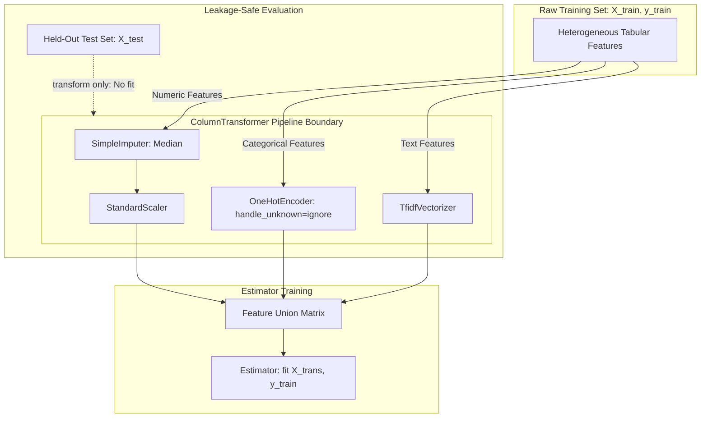

# Scikit-Learn Pipelines and Leakage-Safe Preprocessing: A Deep Dive into Production Machine Learning Architecture

The most common way a machine-learning result turns out to be fiction is not a fundamentally flawed algorithm or an incorrect choice of hyperparameters — it is **data leakage** in preprocessing. Data leakage occurs when information from the validation or test datasets subtly contaminates the steps that were mathematically formulated and fitted before the train-test split. Scikit-learn's `Pipeline` object exists to make that precise mistake structurally impossible. 

In this comprehensive deep dive, we will explore the pipeline idiom, the usage of `ColumnTransformer` for mixed-type data, the internal mechanics of custom transformers, the mathematical implications of leakage, and the persistence story. These are the critical architectural components that bridge the gap between a fragile Jupyter Notebook prototype and dependable, production-grade serving code that operates safely in the real world.



## The Mathematics and Architecture of Data Leakage

| Preprocessing Step | Fitted Internal State | Contamination Vector if Fitted Globally | Pipeline Remediation |
| :--- | :--- | :--- | :--- |
| **`StandardScaler`** | Mean ($\mu$) and variance ($\sigma^2$) | Shifts test z-scores toward test distribution | Fit strictly on training fold; apply transform to test fold |
| **`SimpleImputer`** | Median / mean feature values | Test distribution informs imputed missing values | Calculate imputation statistics solely from train split |
| **`TargetEncoder`** | Class conditional probabilities $P(Y \mid X)$ | Severe target leakage; yields artificially high AUC | Use internal out-of-fold target encoding within CV |
| **`OneHotEncoder`** | Vocabulary / category levels | Encodes test categories unseen in training | Set `handle_unknown='ignore'` inside pipeline step |
| **`SelectKBest`** | ANOVA F-statistic or mutual information | Selects features correlated with test labels | Feature selection must execute exclusively inside CV loop |

To truly understand why scikit-learn pipelines are indispensable, we must examine what happens when preprocessing is applied outside of a cross-validation loop. Consider a standard scaling operation applied to a dataset $X \in \mathbb{R}^{N \times D}$ before a split is made. 

If we compute the mean and standard deviation over the entire dataset (which includes both the training subset $X_{train}$ and the testing subset $X_{test}$), the global mean $\mu_{global}$ and variance $\sigma^2_{global}$ are given by:

$$
\mu_{global} = \frac{1}{N} \sum_{i=1}^{N} x_i
$$

$$
\sigma^2_{global} = \frac{1}{N} \sum_{i=1}^{N} (x_i - \mu_{global})^2
$$

When you scale your data using these global statistics:

$$
x_{scaled} = \frac{x_i - \mu_{global}}{\sigma_{global}}
$$

Every single instance in your "unseen" validation fold now implicitly contains information about the entire dataset's distribution. The scaler's mean and variance were computed using the very rows that each cross-validation fold is supposed to treat as strictly unseen. While standard scaling leaks mildly, other techniques—such as target encoding, imputation with column statistics, feature selection by correlation with the target, and SMOTE-style resampling—leak disastrously. 

In real-world applications, this subtle mathematical overlap can lead to catastrophic financial outcomes. A model predicting loan defaults that artificially inflates its precision through leakage might cause a business to greenlight risky loans, resulting in a \$1.5M loss in a single quarter. Similarly, an algorithmic trading model evaluated on a leaked test set might project a \$50K daily profit but fail instantly upon deployment. 

The inflexible rule with no exceptions is: **anything that learns from data must be fitted inside the training fold exclusively.** Pipelines mechanically enforce this rule by binding the preprocessing steps to the estimator, ensuring that the `fit` method is only called on the training subset during cross-validation.

## Real-World Application: The `ColumnTransformer` for Heterogeneous Data

Real-world data is almost never a clean, homogeneous matrix of continuous variables. It is a messy combination of categorical identifiers, numerical continuous fields, missing values, and skewed distributions. The `ColumnTransformer` is designed to route different subsets of columns through distinct preprocessing pipelines, converging them back into a single matrix just before they hit the final estimator.

Consider a sophisticated, production-ready pipeline that processes both numeric and categorical data while safeguarding against unseen categories:

```python
from sklearn.pipeline import Pipeline
from sklearn.compose import ColumnTransformer
from sklearn.preprocessing import StandardScaler, OneHotEncoder
from sklearn.impute import SimpleImputer
from sklearn.ensemble import HistGradientBoostingClassifier

numeric_features = ["age", "account_balance", "tenure"]
categorical_features = ["subscription_plan", "geographic_region"]

# The numeric pipeline handles missing values before scaling
numeric_transformer = Pipeline(steps=[
    ("imputer", SimpleImputer(strategy="median")),
    ("scaler", StandardScaler())
])

# The categorical pipeline handles missing values, then one-hot encodes,
# explicitly ignoring unknown categories during inference.
categorical_transformer = Pipeline(steps=[
    ("imputer", SimpleImputer(strategy="constant", fill_value="missing")),
    ("encoder", OneHotEncoder(handle_unknown="ignore", sparse_output=False))
])

preprocessor = ColumnTransformer(
    transformers=[
        ("num", numeric_transformer, numeric_features),
        ("cat", categorical_transformer, categorical_features),
    ],
    remainder="drop" # Drops columns not explicitly specified
)

clf = Pipeline(steps=[
    ("preprocessor", preprocessor),
    ("classifier", HistGradientBoostingClassifier(learning_rate=0.05, max_iter=500))
])
```

Setting `handle_unknown="ignore"` (or `"infrequent_if_exist"` in newer scikit-learn versions) on the `OneHotEncoder` is critical in production architectures. Without it, a newly introduced categorical value in production (for example, a new `geographic_region`) will crash the inference service completely. Furthermore, utilizing `set_output(transform="pandas")` allows the pipeline to maintain Pandas DataFrames throughout the transformation process. This preserves feature names, a capability that becomes invaluable during the interpretability phase when tools like SHAP are used to explain the model's decisions to stakeholders.

## The `fit` vs `transform` Contract and Custom Transformers

Every scikit-learn transformer adheres to a strict contract defined by two fundamental verbs: `fit` and `transform`. 
- **`fit`**: This method learns the state or statistics from the data (e.g., means, variances, class frequencies, vocabulary).
- **`transform`**: This method applies the learned state to mutate the data.

The entire discipline of avoiding data leakage boils down to ensuring that `fit` is executed exclusively on training data, whereas `transform` is executed on both training data and testing/inference data. When you call `Pipeline.fit(X_train, y_train)`, the pipeline recursively calls `fit_transform` down the chain, passing the mutated data to the next step until the final estimator calls `fit`. When you call `Pipeline.predict(X_test)`, it simply calls `transform` down the chain.

Often, domain-specific logic must be incorporated into a pipeline. To maintain this `fit`/`transform` boundary, you must write custom transformers. Any operation that requires learning a state belongs in a custom class inheriting from `BaseEstimator` and `TransformerMixin`.

Consider a custom target encoder that calculates the conditional probability of the target variable given a categorical feature:

$$
\mathbb{P}(Y=1 | X_{cat} = c) = \frac{\sum_{i=1}^{N} \mathbb{I}(y_i = 1 \text{ and } x_{i, cat} = c)}{\sum_{i=1}^{N} \mathbb{I}(x_{i, cat} = c)}
$$

```python
import numpy as np
import pandas as pd
from sklearn.base import BaseEstimator, TransformerMixin

class TargetProbabilityEncoder(BaseEstimator, TransformerMixin):
    def __init__(self, smoothing=1.0):
        self.smoothing = smoothing
        
    def fit(self, X, y):
        # We must learn the target probability for each category in X
        self.category_probs_ = {}
        self.global_mean_ = np.mean(y)
        
        for col in X.columns:
            # Calculate smoothed probabilities to prevent overfitting on rare categories
            counts = X[col].value_counts()
            sums = pd.Series(y).groupby(X[col]).sum()
            
            smoothed_prob = (sums + self.smoothing * self.global_mean_) / (counts + self.smoothing)
            self.category_probs_[col] = smoothed_prob.to_dict()
            
        return self
        
    def transform(self, X):
        X_transformed = X.copy()
        for col in X.columns:
            # Apply learned probabilities, falling back to global mean for unseen categories
            X_transformed[col] = X[col].map(self.category_probs_.get(col, {})).fillna(self.global_mean_)
        return X_transformed
```

Notice the conventions that keep custom transformers well-behaved within the pipeline ecosystem:
1. Learned state variables always end with a trailing underscore (e.g., `self.category_probs_`). This is a scikit-learn standard indicating that an attribute was estimated from data during `fit`.
2. `fit` strictly returns `self`, enabling method chaining.
3. `transform` never mutates its input in place; it operates on a copy.
4. Constructor arguments (`__init__`) are stored exactly as passed, without any alteration. This ensures that methods like `clone()` and `GridSearchCV` function correctly.

## Hyperparameter Search Topologies

The realization that preprocessing is an integral part of the model leads to a powerful architectural paradigm: preprocessing choices are tunable hyperparameters. When utilizing `GridSearchCV` or `RandomizedSearchCV`, you evaluate the entire pipeline. 

Because nested parameters can be accessed via the double-underscore (`__`) syntax, you can tune the imputer's strategy simultaneously with the classifier's depth.

```python
from sklearn.model_selection import GridSearchCV

param_grid = {
    "preprocessor__num__imputer__strategy": ["mean", "median"],
    "classifier__learning_rate": [0.01, 0.1, 0.2],
    "classifier__max_iter": [100, 500, 1000]
}

grid_search = GridSearchCV(clf, param_grid, cv=5, scoring="roc_auc", n_jobs=-1)
grid_search.fit(X_train, y_train)
```

This prevents optimization leakage. If you were to impute and scale the data prior to the cross-validation loop, your evaluation metrics would be overly optimistic, misleading your hyperparameter selection toward a model that fails to generalize. When tuning a model that dictates the allocation of a \$2.5M marketing budget, this false confidence translates directly into squandered capital.

## Persisting Fitted Pipelines and Avoiding Train/Serve Skew

The deployment artifact of a machine learning workflow is never just the predictive estimator; it is the entire fitted pipeline. A secondary but equally dangerous form of data leakage occurs between the training environment and the production serving environment, known as **train/serve skew**. 

If a data science team hands over a serialized model to software engineers, and the engineers reimplement the scaling and imputation logic in Java or Go, subtle discrepancies will inevitably emerge. Perhaps the production system handles a missing categorical string slightly differently, or there is a floating-point precision difference in the scaling logic. This skew silently degrades model performance over time.

By persisting the entire pipeline, the exact preprocessing logic that was validated during training is guaranteed to execute identically in production. There are several persistence strategies:

- **joblib**: The default, pickle-based approach. It is fast and natively supports large NumPy arrays. However, it requires pinning the exact scikit-learn, NumPy, and Pandas versions between training and serving. Crucially, unpickling untrusted files can execute arbitrary code, making it a security risk if artifacts cross trust boundaries.
- **skops**: A security-audited persistence format designed explicitly for scikit-learn objects. It allows you to inspect the object graph before loading it, providing a robust defense mechanism when dealing with models obtained from external sources.
- **ONNX (`skl2onnx`)**: This approach compiles both the pipeline and the model into a unified, portable computational graph. ONNX is framework-agnostic, allowing you to serve the pipeline in low-latency environments using runtimes like C++ or Rust. While it supports most standard transformers, custom Python logic (like our custom target encoder above) requires writing custom ONNX converters, which significantly increases engineering overhead.

## Actionable Good Practices for Pipeline Architecture

To ensure your machine learning codebase remains resilient, scalable, and mathematically sound, enforce the following architectural patterns:

1. **Never mutate data outside a pipeline**: From the moment data is loaded from the data warehouse, every imputation, scaling, encoding, and feature engineering step must occur inside a `Pipeline` or `ColumnTransformer`. If you find yourself writing `X.fillna()` or `X.apply()` in the global scope of your notebook, you are introducing a vulnerability.
2. **Utilize `imblearn` for Resampling**: Standard scikit-learn pipelines cannot safely handle resampling techniques like SMOTE, because standard pipelines pass the resampled data to the validation fold. Instead, import `Pipeline` from `imblearn.pipeline`, which ensures that resampling occurs exclusively on the training fold during cross-validation.
3. **Cache Intermediate Pipeline Steps**: If your pipeline involves computationally expensive preprocessing (e.g., extracting embeddings from text), leverage the `memory` parameter in the `Pipeline` constructor. By passing a `joblib.Memory` object or a temporary directory, scikit-learn will cache the transformed data after the expensive step, significantly accelerating iterative hyperparameter tuning.
4. **Log the Full Artifact in Experiment Trackers**: When utilizing tools like MLflow or Weights & Biases, log the entire fitted pipeline as the core artifact. Tag it with the exact git commit hash of the codebase and the cryptographic hash of the training dataset. This ensures absolute reproducibility when auditing why a model made a specific prediction in production six months later.
5. **Escape Currencies Correctly**: In documentation and reporting, ensure proper representation of business metrics. If a model mitigates a \$120K fraud risk, accuracy in reporting matches the accuracy demanded in your code.

By structurally coupling preprocessing with the estimator, scikit-learn pipelines eradicate one of the most insidious bugs in applied data science. They enforce mathematical rigor, ensure reproducibility, and provide a unified artifact that is safe for production deployment.
