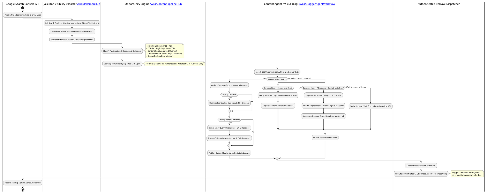

# Search Console Feedback Loop: Indexing Diagnostics, Search Analytics, and Autonomous Content Optimization

Publishing technical content without real search telemetry creates an open-loop system: engineering teams and authoring agents generate documentation into an informational void, completely blind to whether search engines have indexed the content, what queries are driving search impressions, or where real users are abandoning SERP snippets.

The **Search Console Feedback Loop** closes this operational gap. By integrating search analytics and real-time URL inspection telemetry from Google Search Console (via the [[JakemonHub|JakeMon observability stack]]) directly into autonomous authoring agents (such as `wiki-content-agent` and [[BloggerAgentWorkflow|Blogger Agent]]), the publishing pipeline transforms into a self-healing, self-optimizing engine. 

This architectural guide details the end-to-end telemetry lifecycle: live URL inspection diagnosis, opportunity classification, query-intent content elevation, authenticated recrawl orchestration, and adaptation patterns for both Markdown knowledge graphs and Google Blogger sites.

---

## 1. Quick-Reference: The Closed-Loop Optimization Lifecycle

The closed-loop architecture operates across five synchronized stages, transitioning from search telemetry ingestion to content remediation and authenticated recrawl dispatch:



---

## 2. Telemetry Ingestion and the URL Inspection Protocol

Search engine monitoring traditionally relied on scrape-and-guess metrics or third-party rank-tracking APIs that infer ranking from synthetic proxies. The JakeMon architecture grounds all decisions in first-party Search Console APIs using an offline OAuth 2.0 refresh token with `https://www.googleapis.com/auth/webmasters` scope.

### The Index Coverage Dilemma: Sitemaps API vs. URL Inspection API

A common architectural trap in search monitoring is attempting to read indexing coverage from the Google Search Console Sitemaps API. Google deprecated the `contents[].indexed` field in the Sitemaps API, hardcoding its return value to `0` across all domains. Furthermore, Google provides no bulk index-coverage REST endpoint.

To solve this, JakeMon employs a dual-channel telemetry protocol:

1. **Search Analytics API (`/searchAnalytics/query`)**:
   * Polls trailing lookback windows (28 days and 90 days) with a 2-day reporting lag.
   * Pulls aggregate metrics: clicks, impressions, average position, and CTR.
   * Captures the **Query $\times$ Page join dimension** (`dimensions: ["query", "page"]`). Google is the only search provider that exposes this joined relationship; Bing and Yandex report query and page rollups separately.
2. **URL Inspection API (`/v1/urlInspection/index:inspect`)**:
   * Evaluates the exact indexing status of individual URLs in real time.
   * *Critical Architectural Note:* URL Inspection resides on a dedicated API host (`searchconsole.googleapis.com`) with a distinct endpoint path, completely separate from the standard Webmasters API base (`www.googleapis.com/webmasters/v3`).
   * Emits three core diagnostic attributes: `verdict` (`PASS`, `NEUTRAL`, `FAIL`), `coverageState` (e.g., `Submitted and indexed`, `Crawled - currently not indexed`), and `lastCrawlTime`.

```
+-----------------------------------+-------------------------------------------+-----------------------------------+
| Diagnostic Attribute              | Output Values                             | Operational Meaning               |
+-----------------------------------+-------------------------------------------+-----------------------------------+
| verdict                           | PASS, NEUTRAL, FAIL                       | Overarching index eligibility     |
| coverageState                     | Submitted and indexed                     | Healthy; actively served in SERPs |
|                                   | Server error (5xx)                        | Outage artifact or backend fault  |
|                                   | Crawled - currently not indexed           | Quality or substance filter hit   |
|                                   | Discovered - currently not indexed        | Crawl queue budget / priority lag |
|                                   | URL is unknown to Google                  | Sitemap omitted or discovery fail |
| lastCrawlTime                     | ISO 8601 Timestamp (e.g. 2026-09-20...)   | Freshness of Googlebot evaluation |
+-----------------------------------+-------------------------------------------+-----------------------------------+
```

---

## 3. The Five SEO Opportunity Detectors and Expected Click Uplift

Raw search logs contain thousands of query variations. The **Opportunity Engine** (`visibility/opportunities.py`) processes these rows through five distinct classification detectors, ranking each finding by **expected incremental click uplift**.

### Mathematical Model of Click Uplift

Rather than ranking solely by raw impression volume or raw position, the engine evaluates the mathematical delta between the current click-through rate and the expected organic CTR at a target benchmark position ($P_{\text{target}} = 3$):

$$
\Delta \text{Clicks} = \text{Impressions} \times \max\left(0.0, \; \text{CTR}(P_{\text{target}}) - \text{CTR}(P_{\text{current}})\right)
$$

The organic CTR curve is calibrated against empirical SERP distributions:

| SERP Rank ($P$) | 1 | 2 | 3 | 4 | 5 | 6 | 7 | 8 | 9 | 10 | 11–20 |
| :--- | :--- | :--- | :--- | :--- | :--- | :--- | :--- | :--- | :--- | :--- | :--- |
| **Expected CTR** | 28.0% | 15.0% | 11.0% | 8.0% | 6.0% | 5.0% | 4.0% | 3.2% | 2.8% | 2.5% | 0.8% |

### Opportunity Classification Taxonomy

```
+-------------------+-------------------------------------------------------+---------------------------------------+
| Detector Type     | Trigger Conditions                                    | Prescribed Content Action             |
+-------------------+-------------------------------------------------------+---------------------------------------+
| striking_distance | Position in [4.0, 15.0], Impressions >= 50            | Infuse exact query into H2/H3 headings|
| ctr_gap           | Position <= 5.0, Actual CTR < 0.5 * Expected CTR       | Rewrite meta summary & title snippet  |
| content_gap       | Impressions >= 50, Position >= 25.0                   | Draft dedicated article or deep dive  |
| cannibalization   | >= 2 pages competing for query with >= 20% impr split | Consolidate or cross-canonicalize     |
| decay             | Avg Position worsened by >= 3.0 spots vs. prior cycle | Refresh references, math, and recrawl |
+-------------------+-------------------------------------------------------+---------------------------------------+
```

---

## 4. Diagnostic Remediation Matrix for Indexing Failures

When Google's URL Inspection indicates a non-`PASS` verdict, authoring agents must not blindly edit prose. The defect must be matched against the root cause:

### 1. Transient Server Errors (`Server error (5xx)`)
* **Root Cause:** Often caused by historical edge routing or gateway transit outages. Because Google's crawler backs off exponentially after experiencing 5xx responses, an article that is completely healthy today can remain marked as unindexed for months if Google has not attempted a recrawl.
* **Verification:** Probe the live origin server directly (`curl -I https://wiki.wikantik.com/wiki/<slug>`) to ensure it returns HTTP 200 with clean `<title>` and HTML structure.
* **Remediation:** Trigger an authenticated sitemap resubmission via the Google Search Console API.

### 2. Discovered or Crawled – Currently Not Indexed
* **Root Cause:** The page was visited by Googlebot, but its content fell below the quality/uniqueness threshold, or the site's internal link graph failed to signal sufficient domain importance.
* **Remediation:**
  * Ensure the article exceeds the **1,200 to 2,500+ word** substantive threshold.
  * Eliminate abstract bullet lists and replace them with concrete systems architecture and code.
  * Add at least one architectural diagram (Mermaid or PlantUML).
  * Ensure explicit incoming backlinks from the primary cluster Hub page and at least two sibling articles.

### 3. URL is Unknown to Google
* **Root Cause:** The URL has never been seen in a sitemap and has no external or internal links leading to it.
* **Remediation:** Verify that the page generation scripts include the canonical URL in `sitemap.xml`, ensure `robots.txt` points to the sitemap index, and resubmit the sitemap to GSC.

---

## 5. Authenticated Recrawl Dispatch: Replacing Deprecated Pings

Historically, webmasters notified search engines of new content by sending a simple HTTP GET to:
`https://www.google.com/ping?sitemap=...`

Google officially deprecated and permanently shut down this anonymous ping endpoint in December 2023. Sending unauthenticated pings to Google now returns **HTTP 404 Not Found**.

In the modern architecture, recrawl signals are dispatched through two dedicated, authenticated protocols:

1. **Google Search Console Authenticated Sitemaps API**:
   * Endpoint: `PUT https://www.googleapis.com/webmasters/v3/sites/{siteUrl}/sitemaps/{feedpath}`
   * Authentication: OAuth 2.0 Bearer token derived from offline refresh credentials.
   * Idempotency: Resubmitting an already-listed sitemap is a non-destructive refresh operation that informs Google's scheduler to prioritize a recrawl of the declared URLs.
2. **IndexNow Protocol (Bing, Yandex, Seznam)**:
   * Endpoint: `POST https://api.indexnow.org/indexnow`
   * Authentication: Root key verification file hosted at `https://<origin>/<key>.txt`.
   * Latency: Submits up to 10,000 URLs per batch for immediate, near-real-time indexation.

---

## 6. Adapting the Closed-Loop Pattern for Google Blogger Optimization

While Wikantik runs on a self-hosted engine with Markdown files and local Git tracking, the exact same feedback principles apply directly to automated blog publishing systems, such as [[BloggerAgentWorkflow|Blogger Agent]]:

```
+-----------------------------------+-----------------------------------+-----------------------------------+
| Optimization Vector               | Wikantik Knowledge Engine         | Google Blogger Publications       |
+-----------------------------------+-----------------------------------+-----------------------------------+
| Ingestion Target                  | `wiki.wikantik.com`               | `sandiego.thelocalwiki.com`       |
| Search Engine Property            | `sc-domain:wiki.wikantik.com`     | `sc-domain:thelocalwiki.com`      |
| Storage & Content Model           | Git-backed Markdown (`.md`)       | Google Blogger API v3 (HTML posts)|
| Actuator Tooling                  | `bin/wikantik` CLI + MCP          | `blogger-agent` Python scripts    |
| CTR Snippet Tuning                | YAML frontmatter `summary:` field | Blogger `<snippet>` & Search Desc |
| Keyword Intent Infusion           | Markdown `## Section` Headings    | HTML `<h2>` Headings & Post Title |
| Sitemaps & Recrawl Channel        | Standard `/sitemap.xml` via GSC   | Blogger `/sitemap.xml` via GSC    |
+-----------------------------------+-----------------------------------+-----------------------------------+
```

### Operational Steps for Blog Optimization:
1. **Target Identification:** In `jakemon`, run `./bin/visibility report --site thelocalwiki.com --engine google` to extract query performance for Blogger posts.
2. **Snippet Rewriting:** Where CTR is depressed, rewrite the post's meta search description to lead with the primary user question and value proposition.
3. **Internal Linking:** Insert contextual links from established, high-ranking blog posts to newly published articles.
4. **Recrawl Request:** Execute the sitemap resubmission via `GoogleProvider.submit_sitemap("thelocalwiki.com", "https://sandiego.thelocalwiki.com/sitemap.xml")`.

---

## 7. Command-Line Reference: Operating with `bin/wikantik`

The `bin/wikantik` CLI toolkit integrates Search Console administration directly into the developer and agent workflows:

```bash
# 1. Perform 360-degree quality audit including live GSC URL Inspection:
./bin/wikantik inspect BendLanguage

# 2. Inspect live indexing status, verdict, and crawl timestamp for any slug:
./bin/wikantik gsc inspect DatabasePartitioning

# 3. Pull Google Search Console performance and driving queries (28d or 90d window):
./bin/wikantik gsc performance DatabasePartitioning --days 90

# 4. Preview sitemaps to be submitted to Google Search Console (Dry-Run):
./bin/wikantik gsc submit-sitemap

# 5. Commit authenticated sitemap submission to Google Search Console:
./bin/wikantik gsc submit-sitemap --commit

# 6. List top ranking and CTR opportunities across Google and Bing:
./bin/wikantik opportunities --limit 10
```

---

## References & Related Documentation

- [[ContentPipelineHub|Content Pipeline Hub: Multi-Agent Workflows, Fact Verification, and Automated Publishing]]
- [[JakemonHub|JakeMon Hub: Systems Monitoring, Log Aggregation, and Search Visibility Telemetry]]
- [[BloggerAgentWorkflow|Blogger Agent Workflow: Skill-Driven Drafting, SEO Metadata, and Publishing]]
- [[TheLocalWikiBloggerSites|The Local Wiki Blogger Sites: Regional Multi-Blog Publishing]]
- [[AgenticWorkflowDesign|Agentic Workflow Design: Architectural Patterns for Autonomous Systems]]

---

**Cluster Hub:** [[ContentPipelineHub|Content Pipeline Hub]] (`content-pipeline`)
