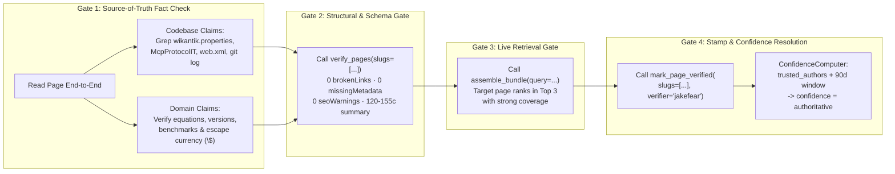

# Verifying an Agent-Generated Page: Quality Gates, `ConfidenceComputer`, and `mark_page_verified`

Verification metadata (`verified_at`, `verified_by`, and effective `confidence`) is the trust contract that tells both human engineers and downstream AI agents whether a wiki page has been rigorously checked against primary sources. In Wikantik, verification is **never** a mechanical rubber-stamp: a page is stamped with `mark_page_verified` only after passing **four mandatory verification gates** (Factual Grounding, Structural/Schema Lint, KaTeX/Mermaid Integrity, and Live `assemble_bundle` Retrieval Verification).

---

## 1. End-to-End Page Verification Pipeline & Confidence State Machine



---

## 2. How `ConfidenceComputer` Calculates Effective Page Confidence

When `mark_page_verified` writes `verified_at = NOW()` and `verified_by = <verifier>` into a page's YAML frontmatter, the post-save structural spine listener syncs those fields into the PostgreSQL `page_verification` table. At read time (`get_page_for_agent`, `assemble_bundle`, and `/admin/verification`), `ConfidenceComputer` evaluates the effective confidence tier using a deterministic precedence rule over the staleness window $W_{\text{stale}}$ (configured by `wikantik.verification.stale_days`, default `90` days) and the `trusted_authors` table:

$$
\text{confidence}(P) = \begin{cases}
P.\text{confidence\_override} & \text{if explicit } \text{confidence:} \text{ is set in frontmatter} \\
\text{stale} & \text{if } P.\text{verified\_at} = \varnothing \;\lor\; (\text{now} - P.\text{verified\_at}) > W_{\text{stale}} \\
\text{authoritative} & \text{if } (\text{now} - P.\text{verified\_at}) \le W_{\text{stale}} \;\land\; P.\text{verified\_by} \in \text{trusted\_authors} \\
\text{provisional} & \text{if } (\text{now} - P.\text{verified\_at}) \le W_{\text{stale}} \;\land\; P.\text{verified\_by} \notin \text{trusted\_authors}
\end{cases}
$$

> **Critical Distinction (`trusted_authors` Table vs. `wikantik.frontmatter.trustedAuthors` Property):**
> - The PostgreSQL **`trusted_authors` table** (keyed by `login_name`) is what `ConfidenceComputer` reads to grant `authoritative` status.
> - The `wikantik.frontmatter.trustedAuthors` property only controls whether saving a page emits an advisory `verified_by.untrusted` lint warning—it never elevates `provisional` to `authoritative`.
> - If you omit `verifier` (or `verifiedBy`) when calling `mark_page_verified`, the server defaults to the MCP client's `clientInfo.name` (e.g., `claude-code` or `wikantik-cli`), which is **not** in `trusted_authors` and therefore yields `provisional`. Always pass the trusted human login explicitly when executing an authorized verification pass.

---

## 3. The Four Mandatory Pre-Stamp Quality Gates

Before calling `mark_page_verified`, verify all four gates:

| Gate | Verification Command / Tool | Pass Criteria |
| :--- | :--- | :--- |
| **1. Factual & Codebase Grounding** | `grep -rn`, `CHANGELOG.md`, web search (see [[WhatToDoWhenANonExistentFunctionIsCited|Non-Existent Function Runbook]]) | Every cited Java class, config property, MCP tool name, CLI flag, or external benchmark is confirmed to exist. |
| **2. Frontmatter, Link & Math Integrity** | `verify_pages(slugs=[...], checks=["broken_links", "metadata_completeness", "seo_readiness", "heading_structure"])` | `totalBrokenLinks: 0`, `missingMetadata: []`, `seoWarnings: []`, summary is **120–155 chars**, all currency is escaped (`\$100`), display math `$$` delimiters sit on dedicated lines, and `**Cluster Hub:**` link is present. |
| **3. Visual & Structural Depth** | `./bin/wikantik inspect <Slug>` and `./bin/wikantik lint <Slug>` | Deep-dive articles contain `1,200–2,500+ words` (Hubs: `500–800+ words`), at least one `mermaid` diagram, comparative Markdown tables, and topic-specific `##` headings. |
| **4. Live `assemble_bundle` Retrieval Rank** | `./bin/wikantik test-retrieval --slug <Slug> "<target query>"` or `assemble_bundle` | The page's primary sections surface in the top results with `coverage.confidence = "strong"`. |

---

## 4. Worked JSON-RPC Sequence

### Step 1: Run `verify_pages` on `/wikantik-admin-mcp`
```json
{
  "jsonrpc": "2.0",
  "id": 1,
  "method": "tools/call",
  "params": {
    "name": "verify_pages",
    "arguments": {
      "slugs": ["WikantikSearchAndRetrieval", "PageGraphVsKnowledgeGraph"],
      "checks": [
        "broken_links",
        "metadata_completeness",
        "seo_readiness",
        "heading_structure"
      ]
    }
  }
}
```

### Step 2: Stamp `mark_page_verified` on `/wikantik-admin-mcp`
```json
{
  "jsonrpc": "2.0",
  "id": 2,
  "method": "tools/call",
  "params": {
    "name": "mark_page_verified",
    "arguments": {
      "slugs": ["WikantikSearchAndRetrieval", "PageGraphVsKnowledgeGraph"],
      "verifier": "jakefear"
    }
  }
}
```

> **Note on System Pages:** System pages such as `About` or `Main` refuse `mark_page_verified` stamps over MCP (`"system page — refusing to stamp via MCP"`). That is expected behavior enforced by `SystemPageRegistry`.

---

## 5. Pitfalls & Anti-Patterns

- **Mass-Verifying Unread Pages:** Never pass 100 slugs to `mark_page_verified` without reading and checking each page. Poisoning the `authoritative` signal destroys agent trust across the entire cluster.
- **Passing `pageNames` Instead of `slugs`:** Both `verify_pages` and `mark_page_verified` require the JSON property `"slugs": [...]`. Passing `"pageNames"` or `"pages"` fails JSON schema validation.
- **Misusing `confidence: stale`:** Only pin `confidence: stale` when a trusted reviewer has confirmed a page contains outdated claims that cannot be fixed immediately—never use it to mean "unreviewed".

---

**Cluster Hub:** [[AgentCookbook|Agent Cookbook]] (`agent-cookbook`)
