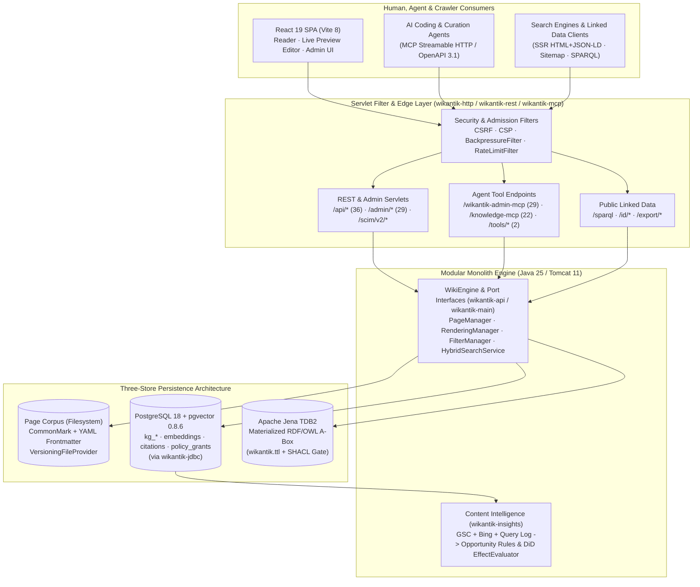

# Wikantik System Architecture

Wikantik began as a fork of Apache JSPWiki and has been re-architected into something its ancestor never was: an **agent-grade knowledge platform** where every page is simultaneously a human-readable document, a retrieval target, a node in two distinct graphs, and a set of machine-callable tools. This page is the deep, current (2.4.x) reference for how the system is built — the modules, the data model, the retrieval and knowledge layers, the agent surface, the rendering and security pipelines — followed by an honest assessment of where it is strong, where it is weak, and where it should go next.

The guiding principle, repeated throughout the design, is **human–machine parity**: a human editing in the browser and an AI agent calling an MCP tool go through the *same* save pipeline, the *same* validation, the *same* permission checks, and read from the *same* retrieval index. There is no separate "API content." That single decision shapes almost everything below.

## 1. System at a Glance

```
                         ┌──────────────────────────────────────────┐
   Humans  ──browser──▶  │  React SPA (Vite/JSX) +  SSR head/meta   │
                         └───────────────┬──────────────────────────┘
                                         │  HTTP
   Agents  ──MCP/HTTP──▶ ┌──────────────▼──────────────────────────┐
   Crawlers ─REST/RDF──▶ │      Servlet filter pipeline            │
                         │  CSRF · CORS · CSP · auth · SPA routing │
                         └──────────────┬──────────────────────────┘
            ┌───────────────────────────┼───────────────────────────────┐
            ▼               ▼            ▼             ▼                  ▼
      /api/* REST     /wikantik-     /knowledge-   /scim/v2/*     /sparql · /id/*
      /admin/*        admin-mcp        mcp                         /export/*  (RDF)
            │          (29 tools)     (22 tools)     │                  │
            └───────────────────────────┬────────────┴──────────────────┘
                                         ▼
                         ┌───────────────────────────────────────────┐
                         │            WikiEngine (orchestrator)      │
                         │  PageManager · RenderingManager · Search  │
                         │  FilterManager · PluginManager · Attach…  │
                         └───────────────┬───────────────────────────┘
                  ┌──────────────────────┼───────────────────────────┐
                  ▼                      ▼                            ▼
        ┌──────────────────┐  ┌────────────────────┐    ┌──────────────────────┐
        │  Page corpus     │  │   PostgreSQL       │    │  Ontology (Jena TDB2) │
        │  Markdown + YAML │  │  users · policy ·  │    │  RDF/OWL T-Box +      │
        │  (file provider, │  │  KG (kg_*) ·       │    │  projected A-Box      │
        │   versioned)     │  │  pgvector embeds · │    │  (SPARQL/SHACL)       │
        │                  │  │  citations         │    │                       │
        └──────────────────┘  └────────────────────┘    └──────────────────────┘
```



The wiki deploys as a single WAR into Tomcat 11. It is a **modular monolith**: 24 Maven modules in the default reactor (a 25th, `wikantik-coverage-report`, joins under `-Pcoverage`) with strict dependency boundaries enforced by ArchUnit tests, not a microservice fleet. Heavy AI work (embedding, entity extraction, LLM judging) is delegated to external services (Ollama / an OpenAI-compatible endpoint) and to a companion CLI, so the engine itself stays a normal JEE application.

## 2. The Module Reactor

Modules are layered: `wikantik-api` defines the contracts (ports); everything else depends inward toward it. The ArchUnit `DecompositionArchTest` freezes the allowed `getManager()` call sites and the dependency direction so the decoupling cannot silently rot. The authoritative list is the `<modules>` block of the root `pom.xml`; `docs/developer/Architecture.md` in the repository carries the same map.

| Module | Layer | Responsibility |
|--------|-------|----------------|
| `wikantik-bom` | build | Bill-of-materials pinning shared dependency versions. |
| `wikantik-api` | **ports/domain** | Manager interfaces, frontmatter + schema model, Page Graph + Knowledge Graph + bundle contracts, `ClusterPath`. No implementations. |
| `wikantik-main` | **engine** | `WikiEngine`, rendering, providers, auth, search, references, entity extraction, math parser, derived-page reflow, Obsidian import/export. |
| `wikantik-event` | core | Decoupled `WikiEvent` bus. |
| `wikantik-util` | core | Helpers, crypto utilities. |
| `wikantik-jdbc` | core | **The one way to touch the database:** `com.wikantik.jdbc.Jdbc` (`query`, `update`, `batch`, `inTransaction`, …). Depends on JDBC + `log4j-api` only; `JdbcAccessArchTest` forbids raw JDBC outside it (ADR-0010). Its test-jar ships `PostgresTestDb`, `@RequiresPostgres` and `FaultInjectingDataSource`. |
| `wikantik-cache` / `-cache-memcached` | core | EhCache render/object caches (render caches: 1-hour TTL, 10K entries); an opt-in Memcached adapter for distributed deploys, not wired into the WAR. |
| `wikantik-http` | edge | Servlet filters: CSRF, CSP, cross-origin and other security headers, session-cookie policy, cache headers, plus the `SlidingWindowRateLimiter` primitive. |
| `wikantik-rest` | edge | REST `/api/*` (36 servlets, incl. `POST /api/ingest`, `GET /api/bundle`, `GET /api/briefing`, Obsidian import/export) and admin `/admin/*` (29 servlets: audit, drift, ontology, derived, kg-policy, connectors, insights, cluster rename). Public RDF servlets, `SpaRoutingFilter`, and the `/wiki/{slug}?format=md\|json` content filter. |
| `wikantik-mcp-core` | agent | Shared MCP substrate — `McpTool`, endpoint bootstrap, access filter, and the two tools both MCP servers register. Extracted to break the `wikantik-knowledge` → `wikantik-admin-mcp` module cycle. |
| `wikantik-admin-mcp` | agent | MCP server at `/wikantik-admin-mcp` — 29 write/analytics/KG-curation tools. |
| `wikantik-knowledge` | agent + brain | MCP server at `/knowledge-mcp` (22 read-only tools when fully wired) **and** the KG service: pgvector embeddings, co-mention graph, hybrid retriever, the context-bundle assembler. |
| `wikantik-tools` | agent | OpenAPI 3.1 tool server `/tools/*` (2 tools) for non-MCP clients. |
| `wikantik-scim` | agent | SCIM 2.0 provisioning `/scim/v2/*` — IdP-driven Users + Groups. |
| `wikantik-ontology` | knowledge | Apache Jena: the `wikantik:` T-Box (`wikantik.ttl`), SHACL shapes, Postgres→RDF projectors, TDB2 store. |
| `wikantik-insights` | feedback loop | Content Intelligence: search-visibility fact store, content-opportunity rules, effect measurement. Depends only on `wikantik-jdbc` (not `wikantik-api` or `wikantik-main`); page state arrives through a `PageFacts` port. |
| `wikantik-ingest` | ingestion | Pure Tika/flexmark document extraction for derived pages (isolates PDFBox/POI from the engine). |
| `wikantik-connectors` | ingestion | External-source connector runtime — seven connector types syncing into derived pages via a shared `SyncOrchestrator`, with DB-backed configs and an encrypted credential store. |
| `wikantik-extract-cli` | tooling | Offline entity-extractor, the derived-page batch ingester, and `CorpusDivergenceCli`. |
| `wikantik-observability` | ops | In-app health checks, Prometheus metrics, request correlation, and the `BackpressureFilter` / `RateLimitFilter` admission filters (the *deployment* monitoring stack lives in a separate `jakemon` repo). |
| `wikantik-war` | bundle | Packages the React build + wires every servlet/filter into one deployable; hosts the ArchUnit and config-drift tests. |
| `wikantik-wikipages` | content | Default pages shipped with a fresh install. |
| `wikantik-it-tests` | test | Cargo-launched integration suites, each with its own Tomcat and pgvector container: `rest` (REST + SCIM), `sso` (Keycloak OIDC/SAML), `knowledge-disabled`, `custom-jdbc` (Selenide browser) and `dense` (embeddings on), plus the opt-in `scim-fullloop`. `wikantik-selenide-tests` is the shared support module. |

`wikantik-frontend` (React SPA on Vite — reader, editor, admin panel, KG + Page Graph viewers) is **not** a Maven module: `wikantik-war` drives the npm build and bundles the output.

```
   wikantik-api  ◀───────────  (everyone depends inward on the ports)
        ▲
        │  implements
   wikantik-main  ◀──  http · rest · mcp-core · admin-mcp · knowledge · tools · scim · ontology
        ▲
        └──  war  ──packages──▶  frontend + all servlets/filters
```

A few dependency rules are enforced by the build rather than by convention:

- `wikantik-jdbc` depends on no other Wikantik module, and `wikantik-insights` depends only on `wikantik-jdbc`, so the opportunity rule engine is a pure function of rows, page facts and config.
- `wikantik-ontology` depends only on `wikantik-api` plus Jena; its runtime wiring lives in `wikantik-main` (`com.wikantik.ontology.runtime`).
- `wikantik-ingest` depends on no Wikantik module, which keeps PDFBox and POI out of `wikantik-main`.
- `wikantik-main` may not grow new `WikiEngine#getManager` callers; services register through `engine.setManager(Type.class, impl)` from the owning `*WiringHelper` (ADR-0008).

## 3. Three Graphs Over One Corpus

A recurring source of confusion — deliberately disambiguated in the codebase — is that Wikantik maintains **three distinct edge types**. Conflating them is treated as a code smell.

- **Page Graph** — edges are real page-to-page wikilinks parsed from page bodies. Co-resident companions: `canonical_id` (rename-stable identity in frontmatter) and `cluster:` (hub membership). Surfaces: `/page-graph`, `/admin/page-graph/*`.
- **Knowledge Graph** — nodes are LLM-extracted entities (9 canonical classes: person/organization/place/event/product/technology/concept/project/version); edges are co-mention or typed-relation predicates (21 of them). Storage: `kg_*` tables. Surfaces: `/admin/knowledge-graph/*`, `/knowledge-mcp`.
- **Citation edges** — a derived, self-healing edge type: a source page's claim grounded in a target page's *section*, written inline as `cite://` markup, parsed at save into the `citations` table, version-pinned and span-hashed so staleness can be detected and surfaced (`/admin/drift/citations`, `list_stale_citations`).

The bare word "graph" is avoided in identifiers; code always says Page Graph, Knowledge Graph, or `kg_*`/`pagegraph`.

## 3a. Cluster Taxonomy

Cluster membership is a **projection of frontmatter, not a filesystem hierarchy** (ADR-0009). A cluster exists if and only if exactly one page carries `type: hub` plus a `cluster:` value — the hub page is the authoritative *declaration*. Non-hub pages may hold several memberships (`cluster:` is scalar-or-list; the first entry is *primary* and drives breadcrumbs, JSON-LD `articleSection`, sidebar placement and the embedding prefix). Sub-clusters are `parent/child`, one level deep, permanently.

Comparison is segment-aware through a single `ClusterPath` class — a bare `startsWith` would report `machine-learning-ops` as a descendant of `machine-learning` and silently merge two unrelated clusters. Membership is transitive and resolved at query time, so re-parenting needs no reindex. Structural conflicts (duplicate declaration, headless cluster, undeclared cluster, clusterless hub, multi-cluster hub) surface on the `/admin/drift` burn-down rather than blocking saves; `rename_cluster` rewrites a cluster across every member plan-first.

The rejected alternative is recorded deliberately: a path in frontmatter is data — validatable, re-projectable, multi-valued, revertable per page — while a path in the filesystem would bind page identity, slug history, `OLD/`, attachments, URLs and wikilinks to one axis.

## 4. The Retrieval Stack

Retrieval is **hybrid**: lexical BM25 (Apache Lucene, full-page index) fused with dense vector search (pgvector / Lucene-HNSW) via reciprocal rank fusion, with a fail-closed fallback to BM25 if the dense side is unavailable.

```
 query
   │
   ├─▶ BM25 (Lucene)        ┐
   │                         ├─ reciprocal rank fusion ─▶ candidates
   └─▶ dense ANN (pgvector / ┘                                │
         lucene-hnsw)                                          ▼
                                              de-dup · version-pin · cite
                                                                │
                                                                ▼
                                          context bundle  (GET /api/bundle,
                                          assemble_bundle MCP) — ranked,
                                          cited sections, NO answer synthesis
```

Mathematically, for each section chunk $c_i$ of page $P$ with heading path $H_i$ and body $B_i$, `EmbeddingTextBuilder.forDocument` constructs a context-prefixed input before computing the dense vector $\vec{u}_i \in \mathbb{R}^d$:

$$
\vec{u}_i = \text{Embed}\!\left(\text{``Page: ''} \mathbin{\|} P.\text{title} \mathbin{\|} \text{`` | Cluster: ''} \mathbin{\|} P.\text{cluster}_1 \mathbin{\|} \text{`` | Section: ''} \mathbin{\|} H_i \mathbin{\|} \text{`` — ''} \mathbin{\|} P.\text{summary} \mathbin{\|} \text{`` — ''} \mathbin{\|} B_i\right)
$$

Given a query $q$, the lexical rank $r_{\text{BM25}}(c_i, q)$ from Apache Lucene and the dense cosine-similarity rank $r_{\text{dense}}(c_i, q)$ from `pgvector` HNSW are fused via **Reciprocal Rank Fusion (RRF)** with smoothing constant $k = 60$:

$$
\text{RRF}(c_i, q) = \frac{w_{\text{lex}}}{k + r_{\text{BM25}}(c_i, q)} + \frac{w_{\text{dense}}}{k + r_{\text{dense}}(c_i, q)}
$$

Two measured levers, not guesses, moved global section recall@12 from ~0.60 to ~0.74:

1. **Chunker heading-fidelity fix** — `ContentChunker` force-emits its merge-forward buffer at every heading boundary so early/first-H2 sections keep their own `heading_path` (they were previously mis-attributed and mis-cited); plus a sub-floor fragment merge and small overlap.
2. **Contextual document embeddings** — `EmbeddingTextBuilder.forDocument` prepends `Page: {title} | Cluster: {cluster} | Section: {heading}` + the frontmatter `summary` before embedding. This is *the* reason title/cluster/summary are first-class retrieval levers and not just SEO metadata.

The **context bundle** is RAG-as-a-Service done deliberately: it returns a ranked, de-duplicated, version-pinned, citation-bearing set of sections — and *never* synthesizes an answer (ADR-0001). Its default source is a global dense+BM25 chunk hybrid, not a page-gated retrieve, because page-gating drops relevant sections whose page ranks outside the top-N.

Levers that were **measured and rejected**: the LLM listwise reranker, HyDE, doc2query (all left off by default), and the KG graph rerank — which was deleted outright in 2026-07. None moved recall; some actively hurt it.

## 5. The Knowledge & Ontology Layer

The Knowledge Graph is a property graph over wiki content stored in PostgreSQL: entities and edges extracted by an LLM (a reasoning model run with thinking disabled for clean structured JSON), embedded with pgvector, with a human-in-the-loop proposal workflow before anything is written back. Cluster-primary inclusion policy keeps it default-exclude with a `kg_include:` frontmatter override; policy lookup walks cluster ancestors (most specific wins) and resolves fail-closed across multiple memberships — an explicit EXCLUDE on any membership wins outright.

Above the KG sits a formal **RDF/OWL ontology** (`wikantik-ontology`, Apache Jena):

- A hand-authored T-Box (`wikantik.ttl`): 9 entity + 5 content classes, the 21 KG predicates with domain/range, public mappings to schema.org / SKOS / Dublin Core / PROV-O, and a SKOS concept scheme — plus SHACL shapes.
- Postgres→RDF **projectors** (Entity / Edge / Page / Concept) materialize an A-Box into a TDB2 store, kept fresh by an event-incremental sync (re-project a page's graph on save/rename, remove on a true delete, reconcile entity graphs nightly).
- A **write-time SHACL gate** refuses or skips non-conformant KG edges at the two write chokepoints (narrow: only the shaped predicates today).
- A **public/restricted ACL split** ensures only anonymously-viewable pages/entities are ever materialized — and a *machine-extracted* entity that records no source page **fails closed**, since it came from a page that can no longer be identified — so the public SPARQL/JSON-LD/dump endpoints cannot leak restricted content. A hand-curated entity without a source page is an explicit act of publication and stays public.

The ontology is, in effect, a *projection* of the same knowledge the KG holds — the SEO JSON-LD `@type` on each page is even re-sourced from the ontology's inferred schema.org type, with a test asserting the two faces can't silently drift.

## 6. The Agent Surface

Agents are first-class clients, not an afterthought. Every surface enforces the same ACLs as the human UI.

| Endpoint | Protocol | What |
|----------|----------|------|
| `/wikantik-admin-mcp` | MCP (Streamable HTTP) | 29 write/analytics/KG-curation tools (incl. admin-bypass reads, orphan listing, real-traffic query log, bulk cluster rename, and the Content Intelligence pair `list_content_opportunities` / `snooze_opportunity`). The count is the `EXPECTED_TOOLS` set in `McpProtocolIT`. |
| `/knowledge-mcp` | MCP | 22 read-only tools when fully wired: hybrid retrieval, KG traversal, schema discovery, structural-spine nav, agent-grade page projection, batched reads, `get_ontology`, `sparql_query`, `list_stale_citations`, `get_briefing`, and `assemble_bundle`. Several register conditionally on what a deployment has wired. |
| `/tools/*` | OpenAPI 3.1 | 2 tools (`search_wiki`, `get_page`) for OpenWebUI-style non-MCP clients. |
| `/scim/v2/*` | SCIM 2.0 | IdP-driven Users + Groups provisioning (SCIM Groups never grant Admin). |
| `/api/*`, `/admin/*` | REST/JSON | 36 + 29 distinct servlets (38 + 37 url-patterns in `web.xml`); `GET /api/bundle`, `GET /api/briefing`, `POST /api/ingest`, `GET /api/export`, `POST /api/import/obsidian/{plan,apply}`, `/api/changes?since=` feed. |
| `/sparql`, `/id/{type}/{id}`, `/export/*` | RDF | Public read-only ontology: SPARQL, per-resource JSON-LD/Turtle dereferencing, full dumps. |

MCP API keys carry a scope: `mcp_read` (read-only, confined to `/knowledge-mcp`) or `mcp_admin` (the full admin surface); the older name `mcp` remains an accepted alias for `mcp_admin`.

## 7. Storage Model — The Hybrid

Wikantik deliberately splits its state across three stores so each does what it is good at:

1. **Page corpus** — CommonMark Markdown with mandatory YAML frontmatter, behind a `PageProvider` (file-system + versioning provider; `wikantik.pageProvider` defaults to `VersioningFileProvider`). This is the source of truth for *content* and gives free version history. Production keeps its corpus independent of deploys (content edits go through MCP/REST, not a redeploy).
2. **PostgreSQL** — the structured backbone: users, database-backed policy grants and groups, the `kg_*` Knowledge Graph, pgvector embeddings, the `citations` table, connector configs, the audit log and the Content Intelligence fact store. All access goes through the `wikantik-jdbc` primitive, and the schema exists only as numbered idempotent migrations in `bin/db/migrations/` (currently V001–V061; there is no other schema definition, not even in tests).
3. **Jena TDB2** — the materialized RDF A-Box for the ontology endpoints, rebuilt incrementally from Postgres.

The frontmatter is the contract that ties these together: a server-authoritative `FrontmatterSchema` validates every save (malformed YAML 422s; field-value issues are advisory warnings so the existing corpus still saves), and those same fields drive retrieval embeddings, JSON-LD, feeds, and the News Sitemap.

## 8. Rendering Pipeline

```
 Markdown source
   │  MarkdownParser → Flexmark AST
   ├─ pre/post filters (FilterManager): structural spine (canonical_id/cluster),
   │   FrontmatterSchema validation, math validation, citation parsing, Postgres → RDF ontology sync
   ├─ plugins  [{Plugin}]  (auto-normalized to [{Plugin}]() for Flexmark)
   ▼
 MarkdownRenderer → HTML  ──▶  SSR (title/meta/JSON-LD head) + React SPA hydrate
```

The same content is served three ways: rendered HTML for browsers (with an SSR head carrying `<title>`, meta, and JSON-LD so crawlers and the React app agree), raw `?format=md|json` for RAG ingestion, and projected for-agent views via MCP. SSR + the SPA must agree on the head, which is why a soft-404 class of bug (SPA refetch wiping the SSR body) is guarded explicitly. Native Obsidian-style `[[Page]]` links and `![[Page]]` embeds render alongside ordinary Markdown links.

## 9. Security Model

- **JAAS** authentication with pluggable login modules (database, LDAP, container, SSO via pac4j — Google OIDC is live in production).
- **Database-backed policy grants** (the `policy_grants` table, admin-managed) as the default authorization source, with a file-policy fallback and a bootstrap-admin override for first setup (the override requires an authenticated login session). Grants match by principal type, and page-ACL user entries resolve by login name only.
- **Scoped admin grants:** `/admin/*` passes `AllPermission` or a narrower `AdminPermission` per functional area (derived from the first path segment), so an integration that only posts visibility rows need not hold the whole admin surface.
- Fine-grained page permissions (`view`/`comment`/`edit`/`modify`/`upload`/`rename`/`delete`) and wiki permissions (`createPages`/`createGroups`/`editPreferences`/…), enforced uniformly across REST, MCP, and the UI; inline `[{ALLOW view Admin}]` ACLs in page bodies.
- **Deserialization filtering** (`ObjectInputFilter` allowlists), NIST 800-63B password rules with a common-password blocklist (bcrypt hashes; the SHA-1 formats were removed), SameSite=Lax auth cookies with a remember-me re-auth filter, and session rotation on SSO login (fixation defense).
- **Two-tier per-IP rate limiting** on the public surface (`RateLimitFilter`), plus a backpressure gate (`BackpressureFilter`, `WIKANTIK_MAX_INFLIGHT_REQUESTS`) that fast-fails excess concurrency with `503` + `Retry-After` rather than letting it queue.
- **SSRF egress policy** on connector fetches (`EgressGuard`), and `JDBCPlugin` (page-authored SQL) ships disabled behind `wikantik.plugin.jdbc.enabled`.
- The **public/restricted ACL split** on the RDF surface: a request-free guest-session view check keeps restricted pages/entities/edges out of the materialized public dataset entirely, and a machine-extracted entity carrying no source page is withheld on the same fail-closed rule.

## 10. Strengths

- **Genuine human–machine parity.** One save pipeline, one permission model, one index. Agents and humans cannot drift apart because they share the substrate.
- **Decoupled, test-frozen modularity.** The api/impl split plus the ArchUnit freezes (`DecompositionArchTest`, `JdbcAccessArchTest`, `ConfigSurfaceDriftTest`) make the monolith refactorable without microservice operational cost. Unit tests use in-memory engine stubs; database-backed unit tests run against a real pgvector container through `PostgresTestDb` (there is no H2); and the integration modules under `wikantik-it-tests` run via `bin/run-tests.sh --parallel 4`.
- **Retrieval changes are measured, not asserted.** A frozen section-level eval corpus (`eval/bundle-corpus`, with recall floors in `thresholds.properties`) and a nightly in-app retrieval-quality run (`/admin/retrieval-quality`) make quality visible; the levers that shipped (chunker fix, contextual embeddings) moved a real metric, and several plausible levers were rejected on evidence.
- **Self-healing grounding.** Version-pinned, span-hashed citations turn "is this still true?" into a queryable, gradeable signal rather than rot.
- **One knowledge model, three faces.** The KG, the RDF ontology, and the page JSON-LD are the same knowledge projected differently, with tests asserting they can't silently diverge.
- **Cost-governed AI.** Model choice is swappable and never defaults to a premium model; heavy work is offloaded so the engine stays a normal JEE app.

## 11. Critique — Where It Is Weak

An honest architecture page names its own debts.

- **The math/currency validator has blind spots.** The save-time validator flags `$…$` prose-pairs but misses currency inside tables or long spans that don't form a stopword pair (e.g. `\$3,150 … \$10,000`). While the 1,462-page production corpus was swept to 100% currency-escaped compliance in October 2026, enforcing table/span currency escaping inside the save-time parser itself remains an open engineering item.
- **KG-as-a-retrieval-signal is a closed question.** A ceiling experiment with a Claude-quality KG measured *zero* net rerank lift — relational section relevance is not entity proximity — so the page-level graph reranker was deleted in 2026-07. The KG earns its keep as a human KB / ontology / MCP surface, not as a ranking signal. Only a section-level redesign could revisit this.
- **Dual content/derived stores create sync surface.** Page corpus (files) + Postgres (KG/embeddings/citations) + TDB2 (RDF) must stay coherent through event-incremental sync; a dropped re-embed or a missed projection is a real (if monitored) failure mode, mitigated by startup reconciliation.
- **In-process coupling.** The bundle assembler and KG service live inside the engine (wired at post-startup seams). This keeps latency low and deployment simple but means the "RAG service" cannot scale independently of the wiki.
- **Operational complexity.** Three stores, external Ollama, an embedding queue, an ontology rebuild scheduler, and a separate monitoring repo are a lot of moving parts for a self-hosted wiki — the price of the agent-grade ambition.
- **Curation requires continuous verification.** Even with 100% frontmatter schema compliance across the corpus (summaries, clusters, tags, ISO dates, and hub backlinks normalized in October 2026), clean frontmatter is necessary but not sufficient for retrievability: the live `assemble_bundle` section-rank check and `ContentIntelligenceDesign` `agent_gap` backlog remain essential ongoing gates.

## 12. Areas for Future Growth

- **Section-level knowledge rerank.** The page-level KG rerank is a dead end; a redesign that scores *sections* by relational evidence is the open research path to make the KG move recall.
- **Extracting the RAG/KG service.** Giving the context-bundle assembler and embedding pipeline their own process would let retrieval scale (and be reused) independently of the wiki engine.
- **Closing the validator blind spots.** Promote the currency/display-math detection to cover table and span cases so rendering correctness is enforced, not curated.
- **Deeper ontology inference.** The SHACL gate is narrow (2 shaped predicates) and inference is RDFS-level; OWL-RL/full SHACL coverage would make the formal layer load-bearing rather than advisory.
- **Multi-tenancy and horizontal scale.** Embeddings, the ontology TDB2, and the page corpus each have a scaling story that is currently single-instance-shaped.
- **Curation automation.** The metadata-quality passes that keep retrieval healthy are still partly manual; folding measured curation into the save pipeline would make quality self-sustaining.

## See Also

- [Wikantik Platform Hub](WikantikPlatformHub) — index of platform documentation
- [Wikantik Development](WikantikDevelopment) — module overview, test strategy and the feature timeline
- [Page Graph vs Knowledge Graph](PageGraphVsKnowledgeGraph) — the two-graphs distinction, in depth
- [Hybrid Retrieval](HybridRetrieval) — the BM25 + dense fusion and its operator reference
- [Frontmatter Conventions](FrontmatterConventions) and [Markdown Links](MarkdownLinks) — the content contract
- [Hexagonal Architecture](HexagonalArchitecture) — the ports-and-adapters pattern the modules follow
- [ADR-001](ADR-001) — the decision that decoupled the manager interfaces
