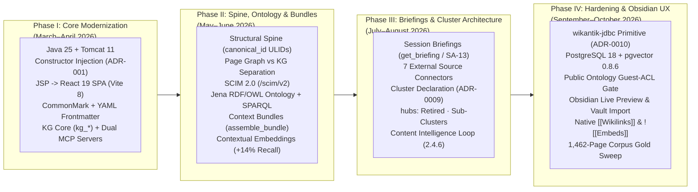

# History and Evolution: From Apache JSPWiki to Wikantik (2026)

**Wikantik** began in March 2026 as an ambitious architectural experiment: could **Apache JSPWiki**—one of the oldest, most battle-tested Java wiki engines, originally created by Janne Jalkanen in 2001—be systematically refactored into an **agent-grade semantic knowledge platform** where human engineers and autonomous AI agents share a single source of truth?

Over a compressed eight-month engineering arc (March–October 2026, culminating in release `2.4.56`), the platform replaced JSPWiki's 2000s-era JSP templates, custom `{{{...}}}` wiki markup, and flat filesystem assumptions with a **Java 25 / Tomcat 11 modular monolith**, a **React 19 SPA**, **PostgreSQL 18 + `pgvector 0.8.6` hybrid retrieval**, a **dual Page Graph + Knowledge Graph + Jena RDF/OWL ontology**, **51 Model Context Protocol (MCP) tools**, and a **closed-loop Content Intelligence engine**.

---

## 1. Chronological Evolution & Architectural Phases (March–October 2026)

---

## 2. Phase I: The Fork and Core Substrate Overhaul (March–April 2026)

In March 2026, the fork tackled the four foundational blockers preventing Apache JSPWiki from serving modern web users and AI agents:
1. **Decoupling the Engine (`ADR-001` & Constructor Injection, March 2026):** Extracted manager interfaces into `wikantik-api` ([[ADR-001|ADR-001]]) and refactored service-locator patterns into constructor injection ([[ConstructorInjection|Constructor Injection]]) and decoupled test stubs ([[TestStubConversion|Test Stub Conversion]]).
2. **Eliminating JSP Templates for a Single React 19 SPA (`2026-03-28`):** Removed all legacy `.jsp` templates (`Haddock`, `default`) and the transitional `/app/` prefix ([[RemoveJspAndAppPrefix|Remove JSP and /app/ Prefix]]). A single Vite 8 + React 19 + React Router 7 application now serves reading, editing, graph exploration, and administration from `/`, paired with Server-Side Rendered (SSR) `<head>` metadata and JSON-LD so search crawlers and the SPA never diverge.
3. **JSPWiki Syntax $\to$ CommonMark Markdown + YAML Frontmatter:** Built [[WikiToMarkdownConverter|WikiToMarkdownConverter]] to translate legacy JSPWiki markup (`!!!Heading`, `[alias|Page]`, `{{{code}}}`) into CommonMark Markdown with server-validated YAML frontmatter ([[FrontmatterConventions|Frontmatter Conventions]]).
4. **Knowledge Graph Core & Dual MCP Servers (April 2026):** Introduced PostgreSQL `kg_*` tables (`2026-04-04`), `type: runbook` pages, page verification stamps (`mark_page_verified`), and the two dedicated MCP endpoints: `/wikantik-admin-mcp` and `/knowledge-mcp` (`2026-04-25`).

---

## 3. Phase II: Structural Spine, Formal Ontology, and RAG Bundles (May–June 2026)

As agents began reading and writing hundreds of pages, early experiments revealed that raw vector search and ad-hoc frontmatter relationships were insufficient:
- **Strict Separation of Page Graph and Knowledge Graph (`2026-05-02`):** Retired `GraphProjector` (which had projected frontmatter keys into `kg_edges`) and cancelled typed frontmatter `relations:` in favor of a clean boundary between the **Page Graph** (`page_links`) and **Knowledge Graph** (`kg_*`), documented in [[PageGraphVsKnowledgeGraph|Page Graph vs. Knowledge Graph]].
- **The Structural Spine (`2026-05-02`):** Added rename-stable 26-character ULIDs (`canonical_id` in `page_canonical_ids` and `page_slug_history`) and the structural spine MCP tools (`list_clusters`, `list_tags`, `list_pages_by_filter`, `get_page_by_id`).
- **SCIM 2.0 Enterprise Provisioning (`2026-05`):** Added `wikantik-scim` (`/scim/v2/Users`, `/scim/v2/Groups`) alongside OIDC/SAML SSO via `pac4j` ([[WikantikScimProvisioning|Wikantik SCIM Provisioning]], [[WikantikSingleSignOn|Wikantik Single Sign-On]]).
- **RDF/OWL Ontology & SHACL Gate (`2026-06-08`):** Shipped `wikantik-ontology` backed by Apache Jena TDB2 (`wikantik.ttl` T-Box, write-time `OntologyShaclValidator`, public `/sparql` endpoint, `/id/*` Linked Data dereferencing, and ontology-inferred Schema.org JSON-LD `@type`).
- **RAG Context Bundles & +14% Recall Lift (`2026-06-14` to `2026-06-19`):** Launched `GET /api/bundle` and `assemble_bundle` (returning ranked, version-pinned, cited section spans without hallucinated LLM synthesis), switched to global chunk-level BM25 + dense RRF fusion, and shipped heading-faithful chunking + contextual embedding prefixes (`Page | Cluster | Section + Summary`), lifting global section `Recall@12` from `0.60` to `0.74`.

---

## 4. Phase III: Session Briefings, Cluster Declarations, and Closed-Loop Intelligence (July–August 2026)

- **Project-Scoped Agent Briefings (`get_briefing` & `SA-13`, `2026-07-05`):** Added `/api/briefing` and `get_briefing` ([[ProjectContextSeparationDesign|Project Context Separation Design]]) so coding agents starting a session in any repository receive their cluster's hub spine, member summaries, and cross-cluster `cites:` contracts in a single call.
- **External Connector Runtime (`2026-07-15`):** Shipped `wikantik-connectors` and `wikantik-ingest` (Apache Tika + Flexmark isolation) supporting 7 connector types with encrypted DB-backed credentials and SSRF egress guards ([[WikantikConnectors|Wikantik Connectors]]).
- **Deletion of Page-Level KG Rerank (`2026-07`):** Following the `2026-06-16` ceiling experiment showing zero net recall lift from page-level co-mention BFS reranking, the dead stage was cleanly removed ([[GraphRerankStep|Graph Rerank Step]]).
- **Cluster Declaration Architecture (`ADR-0009`, `2026-08-15`):** Consolidated three rival membership mechanisms (`cluster:`, `hubs:`, and hub `related:`) into a single server-enforced rule: a hub page (`type: hub`) declares its cluster (`cluster: "parent/sub"`), member pages support scalar or list multi-membership, `hubs:` and `HubSyncFilter` were retired, and `rename_cluster` was added to `/wikantik-admin-mcp` ([[ClusterDeclarationDesign|Cluster Declaration Design]]).
- **Closed-Loop Content Intelligence (`2.4.6`, `2026-08-17`):** Shipped `wikantik-insights` ([[ContentIntelligenceDesign|Content Intelligence Design]]), joining Google Search Console, Bing Webmaster Tools, and `retrieval_query_log` telemetry into a scored opportunity backlog (`list_content_opportunities`) with automated 28-day Difference-in-Differences causal effect evaluation (`EffectEvaluator`).

---

## 5. Phase IV: JDBC Consolidation, PostgreSQL 18, and Obsidian-Grade UX (September–October 2026)

- **Single Data-Access Primitive (`wikantik-jdbc`, `ADR-0010`, `2026-09-07`):** Consolidated all database access behind `com.wikantik.jdbc.Jdbc`, enforced by `JdbcAccessArchTest`, with `bin/db/migrations/V001..V061.sql` as the sole schema definition across production and Testcontainers (`PostgresTestDb`).
- **PostgreSQL 18 & `pgvector 0.8.6` (`2.4.25`, `2026-09-18`):** Upgraded production and integration test containers to `pgvector/pgvector:pg18` and removed legacy SHA-1 password formats in favor of NIST 800-63B bcrypt (`2.4.24`).
- **Public Ontology ACL Hardening (`2.4.26`, `2026-09-20`):** Ensured KG entities from ACL-restricted pages and sourceless machine-extracted entities are withheld fail-closed from the public RDF/SPARQL dataset.
- **Obsidian-Style Editor Workspace & Native Wikilinks (`2.4.30+`, `2026-10-01` to `2026-10-03`):** Shipped the CodeMirror 6 Live Preview editor, command palette, quick switcher, live `[[Page|Alias]]` completion, `![[Page]]` transclusion embeds, daily notes, and zipped Obsidian vault import/export ([[EditorWorkspaceDesign|Editor Workspace Design]], [[LivePreviewDailyNotesDesign|Live Preview & Daily Notes Design]], [[NativeWikilinksDesign|Native Wikilinks Design]]).
- **Login-Only Bootstrap Auth & SCIM Hardening (`2.4.56`, `2026-10-05` to `2026-10-13`):** Enforced authenticated sessions on bootstrap admin overrides, principal-type matching on `policy_grants`, and refusal of SCIM writes to the `Admin` group.

---

## 6. Architectural Comparison: Apache JSPWiki vs. Wikantik 2.4.56

| Architectural Dimension | Legacy Apache JSPWiki (Pre-Fork) | Wikantik 2.4.56 (October 2026) |
| :--- | :--- | :--- |
| **Runtime & Build Baseline** | Java 11/17, legacy monolithic JARs | **Java 25 LTS**, **Apache Tomcat 11**, 24-module Maven reactor with ArchUnit boundary tests |
| **Frontend & Authoring UI** | Server-rendered JSP templates (`Haddock`), plain textarea | **React 19 SPA (Vite 8)** + CodeMirror 6 **Obsidian-style Live Preview**, command palette, Cytoscape graph viewers |
| **Markup & Metadata Contract** | Proprietary JSPWiki markup (`!!!`, `{{{...}}}`), no frontmatter | **CommonMark Markdown** + native `[[wikilinks]]`/`![[embeds]]`, KaTeX, Mermaid, and **validated YAML Frontmatter** (`FrontmatterSchema`) |
| **Identity & Taxonomy** | Fragile CamelCase filename only | **26-char ULID (`canonical_id`)** with `page_slug_history` + **Server-enforced Cluster Declarations (`ADR-0009`)** |
| **Search & RAG Retrieval** | Keyword-only Lucene page search | **Hybrid BM25 + `pgvector` HNSW (RRF)** with context-prefixed chunk embeddings and cited RAG bundles (`assemble_bundle`) |
| **Semantic Layer** | None (flat page references only) | **Three Graphs** (Page Graph, LLM-extracted Knowledge Graph `kg_*`, Citation Graph) + **Apache Jena TDB2 RDF/OWL Ontology (`/sparql`)** |
| **AI Agent Surface** | None | **51 MCP Tools** (`/knowledge-mcp` [22], `/wikantik-admin-mcp` [29]) + **OpenAPI 3.1** (`/tools/*` [2]) + **`SA-13` Session Briefings** |
| **Content Optimization Loop** | None | **Closed-Loop Content Intelligence (`wikantik-insights`)** joining GSC + Bing + agent query logs with 28-day DiD `EffectEvaluator` |

---

## 7. What Load-Bearing Foundations Remain from JSPWiki

While the presentation, search, database, and AI layers are entirely new, four proven JSPWiki patterns remain load-bearing inside `wikantik-main`:
1. **`VersioningFileProvider` & Filesystem Page Store:** Storing pages as plain-text `.md` files on disk with `OLD/` version history keeps content human-inspectable, git/rsync-friendly, and decoupled from container image deploys ([[WikantikContentVsCodeDeployment|Content vs. Code Deployment]]).
2. **`FilterManager` Save/Render Lifecycle:** Pre-save, post-save, and pre-translate filter hooks cleanly orchestrate `FrontmatterSchema` validation, `StructuralSpinePageFilter`, citation extraction, and incremental ontology projection.
3. **`PluginManager` Extension Seam:** Supporting inline `[{Plugin}]` execution (auto-normalized for Flexmark) for dynamic tables of contents, referrers, and relationship views.
4. **JAAS Security Primitives:** The foundational `Permission` classes (`PagePermission`, `WikiPermission`, `AllPermission`), now backed by PostgreSQL `policy_grants`, scoped `admin:<area>` permissions, pac4j OIDC/SAML, and SCIM 2.0.

---

**Cluster Hub:** [[WikantikPlatformHub|Wikantik Platform Hub: Knowledge Systems, Hybrid Search, and AI Agent Integrations]] (`wikantik-platform`)
