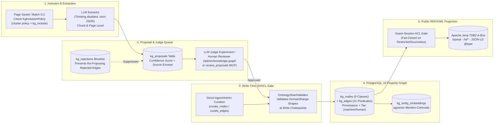

# The Wikantik Knowledge Graph: Extraction, Curation, SHACL Gates, and Ontology Projection

The **Wikantik Knowledge Graph (KG)** is a human-curated, LLM-accelerated semantic property graph stored in PostgreSQL 18 (`kg_*` tables) and projected into an **Apache Jena TDB2 RDF/OWL ontology**. It transforms unstructured Markdown prose into a strongly typed network of **9 canonical entity classes** and **21 closed relationship predicates**, equipped with **two-dimensional provenance tracking**, **mention-centroid vector embeddings**, and **14 dedicated Model Context Protocol (MCP) tools**.

> **Page Graph vs. Knowledge Graph:** The Page Graph tracks editorial wikilinks between documents (`page_links`). The Knowledge Graph tracks domain entities and typed semantic predicates (`kg_nodes`, `kg_edges`). Never conflate them—see [[PageGraphVsKnowledgeGraph|Page Graph vs. Knowledge Graph]] for the full architectural boundary.

---

## 1. End-to-End Knowledge Graph Lifecycle

Entities and relationships never enter the production graph unchecked from raw LLM output without provenance recording and shape validation. Every extraction, proposal, review, and ontology projection follows a strict five-stage pipeline:



---

## 2. Closed Schema: The 9 Entity Classes and 21 Predicates

To prevent predicate explosion (where an unconstrained LLM invents hundreds of near-synonymous edge labels like `utilizes`, `leverages`, `is_built_with`, `relies_upon`), Wikantik enforces a **closed schema** via PostgreSQL `CHECK` constraints (`bin/db/migrations/V*.sql`) and the formal `wikantik.ttl` OWL T-Box.

### 2.1 The 9 Canonical Entity Classes (`kg_nodes.node_type`)

| Class (`node_type`) | Owl / Schema.org Mapping | Canonical Examples in Corpus |
| :--- | :--- | :--- |
| **`technology`** | `wikantik:Technology` / `schema:SoftwareApplication` | `PostgreSQL`, `Apache Lucene`, `pgvector`, `Docker Compose`, `Flexmark` |
| **`concept`** | `wikantik:Concept` / `skos:Concept` | `Reciprocal Rank Fusion`, `Two-Phase Commit`, `Multi-Head Latent Attention` |
| **`product`** | `wikantik:Product` / `schema:Product` | `Wikantik`, `Claude Code`, `DeepSeek-R1`, `Keycloak` |
| **`project`** | `wikantik:Project` / `schema:SoftwareSourceCode` | `Apache JSPWiki`, `Simple Agility Stack`, `JakeMon`, `Stockroom` |
| **`organization`** | `wikantik:Organization` / `schema:Organization` | `Apache Software Foundation`, `Anthropic`, `DeepSeek`, `W3C` |
| **`person`** | `wikantik:Person` / `schema:Person` | `Leslie Lamport`, `Edsger Dijkstra`, `Claude Shannon` |
| **`event`** | `wikantik:Event` / `schema:Event` | `Bretton Woods Conference`, `1973 Oil Crisis`, `Chinchilla Scaling Paper` |
| **`place`** | `wikantik:Place` / `schema:Place` | `Philadelphia Mint`, `Berlin`, `US-East-1` |
| **`version`** | `wikantik:Version` / `schema:SoftwareVersion` | `Java 25`, `Tomcat 11`, `Wikantik 2.4.56`, `SCIM 2.0` |

### 2.2 The 21 Closed Relationship Predicates (`kg_edges.relationship_type`)

| Category | Allowed Predicate Names (`relationship_type`) | Typical Domain $\to$ Range |
| :--- | :--- | :--- |
| **Architectural & Dependency** | `uses`, `depends_on`, `implements`, `extends`, `part_of`, `contains`, `integrates_with` | `product`/`technology` $\to$ `technology`/`concept` |
| **Causal & Operational** | `produces`, `consumes`, `enables`, `mitigates`, `causes`, `prevents` | `technology`/`concept` $\to$ `concept`/`event` |
| **Comparative & Taxonomic** | `is_a`, `alternative_to`, `supersedes`, ` precedes`, `contrasts_with`, `related_to` | `concept`/`technology` $\leftrightarrow$ `concept`/`technology` |
| **Attribution & Ownership** | `created_by`, `maintained_by` | `product`/`project`/`technology` $\to$ `organization`/`person` |

---

## 3. Mention-Centroid Entity Embeddings & Cross-Cluster Discovery

Every entity node $v \in V_{\text{KG}}$ is projected into the dense embedding space (`kg_entity_embeddings`) without requiring a separate dictionary definition prompt. Instead, Wikantik computes the **mention-centroid vector** $\vec{e}_v \in \mathbb{R}^d$ over the context-prefixed chunk embeddings $\vec{u}_c$ of all wiki sections $M(v)$ in which entity $v$ is mentioned:

$$
\vec{e}_v = \frac{\sum_{c \in M(v)} \vec{u}_c}{\left\|\sum_{c \in M(v)} \vec{u}_c\right\|_2}
$$

**Why Mention-Centroids Work:** Because each chunk vector $\vec{u}_c$ encodes its page title, primary cluster, section heading, and technical body, the normalized centroid $\vec{e}_v$ captures the **distributional operational role** of entity $v$ across the entire wiki. When an agent invokes `find_similar(node="Reciprocal Rank Fusion", topK=5)`, `pgvector` computes cosine similarity over `kg_entity_embeddings` and surfaces structurally analogous fusion/ranking concepts across `machine-learning`, `quantitative-finance`, and `wikantik-development`.

---

## 4. Provenance, Trust Tiers, and Inclusion Governance

### 4.1 Cluster-Inherited Inclusion Policy (`KgInclusionPolicy`)
Not every page should populate the Knowledge Graph (for example, scratch pages, legal terms of service, or personal hobby notes). As documented in [[KgInclusionPolicy|KG Inclusion Policy]], inclusion is governed by two rules:
1. **Cluster Hierarchy Policy:** Configured at `/admin/knowledge-graph` (`Policy` tab). Sub-clusters (`generative-ai/ai-infrastructure`) inherit their parent cluster's policy unless overridden, and multi-cluster pages resolve **fail-closed** (an explicit `EXCLUDE` on any membership wins).
2. **Page-Level Frontmatter Override (`kg_include: true | false`):** Explicitly includes or excludes a page. All **91 Hub pages** across Wikantik carry `kg_include: true`.

### 4.2 Provenance & Two-Tier Trust (`ProvenanceModel`)
Every row in `kg_nodes` and `kg_edges` records two orthogonal trust columns (see [[ProvenanceModel|Provenance Model]]):
- **`provenance`:** `human_authored` (entered via UI or `curate_nodes`/`curate_edges`), `ai_inferred` (auto-promoted above confidence threshold), `ai_reviewed` (LLM-extracted and approved via `review_proposals`), or `auto_projected`.
- **`tier`:** `machine` (default unreviewed extraction) vs. `human` (vetted by an administrator or trusted curation agent). Read tools (`query_nodes`, `traverse`, `search_knowledge`) accept `min_tier="human"` when an agent requires zero-noise, human-verified graph edges.

---

## 5. RDF/OWL Ontology & Write-Time SHACL Gate (`wikantik-ontology`)

Above the PostgreSQL `kg_*` tables sits the `wikantik-ontology` module powered by **Apache Jena TDB2** (see [[WikantikOntologyManagement|Wikantik Ontology Management]]):
1. **Write-Time SHACL Validation (`OntologyShaclValidator`):** Before an edge is committed (either via proposal approval or `curate_edges`), the validator checks the edge against SHACL shapes defined in `wikantik.ttl`, rejecting domain/range violations before they can corrupt the graph.
2. **Incremental Postgres $\to$ RDF Projectors:** Four projectors (`EntityProjector`, `EdgeProjector`, `PageProjector`, `ConceptProjector`) materialize RDF triples into TDB2 on page save, rename, or KG curation.
3. **Fail-Closed Public/Restricted ACL Split:** The public ontology endpoints (`GET /sparql`, `GET /id/{type}/{id}`, `GET /export/ontology.ttl`, and `/knowledge-mcp` `sparql_query`) only materialize entities whose source page is readable by an anonymous guest session. Any machine-extracted entity lacking a valid `source_page` is withheld **fail-closed** so restricted knowledge can never leak through SPARQL.

---

## 6. Agent MCP Curation & Traversal Examples

```json
// 1. Traverse 2 hops from 'Wikantik' on /knowledge-mcp
{
  "name": "traverse",
  "arguments": {
    "startNode": "Wikantik",
    "direction": "OUTBOUND",
    "relationshipTypes": ["uses", "implements", "contains"],
    "maxDepth": 2,
    "minTier": "machine"
  }
}

// 2. Curate a verified node and edge directly on /wikantik-admin-mcp
{
  "name": "curate_edges",
  "arguments": {
    "op": "add",
    "edges": [
      {
        "sourceName": "Wikantik",
        "targetName": "Apache Jena TDB2",
        "relationshipType": "uses",
        "sourcePage": "WikantikKnowledgeGraph"
      }
    ]
  }
}
```

---

**Cluster Hub:** [[WikantikPlatformHub|Wikantik Platform Hub: Knowledge Systems, Hybrid Search, and AI Agent Integrations]] (`wikantik-platform`)
