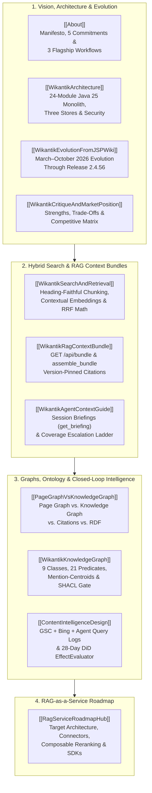

# Wikantik Platform Hub: Knowledge Systems, Hybrid Search, and AI Agent Integrations

> **Part of the [[SimpleAgilityStackHub|Simple Agility Stack]].** Wikantik is the stack's **semantic knowledge and content engine**—an agent-grade wiki serving software architecture, operational runbooks, and domain research while doubling as the external memory and contract registry (`SA-13`) for autonomous coding and publishing agents. It optimizes its own corpus through [[ContentIntelligenceDesign|Closed-Loop Content Intelligence]] (following [[SimpleAgilityFeedbackLoopPattern|Simple Agility Feedback Loop Pattern]]) and emits Elastic Common Schema (ECS) JSON telemetry to `jakemon` per [[SimpleAgilityTelemetryContract|Simple Agility Telemetry Contract]].
>
> **New to Wikantik?** Start with the **[[About|About Wikantik: Manifesto & System Blueprint]]** for the core design philosophy and three end-to-end engineering and publishing workflows.

Wikantik bridges human technical authoring and machine reasoning. Every page is stored as human-readable CommonMark Markdown with validated YAML frontmatter (`FrontmatterSchema`), indexed into a dual **Apache Lucene BM25 + PostgreSQL 18 `pgvector` HNSW** retrieval pipeline, mapped across **Three Graphs** (Page Graph, Knowledge Graph, Citation Graph) plus an **Apache Jena TDB2 RDF/OWL ontology**, and exposed through **51 Model Context Protocol (MCP) tools**.

---

## 1. Platform Topology & Subsystem Map

---

## 2. Quick-Reference: Core Platform Capabilities

| Capability Layer | Underlying Technologies | Primary Human & Agent Interfaces |
| :--- | :--- | :--- |
| **Authoring & Structural Spine** | CommonMark Markdown, YAML frontmatter (`FrontmatterSchema`), 26-char ULID `canonical_id`, `ADR-0009` Cluster Declarations, React 19 SPA with CodeMirror 6 Live Preview | Browser Reader/Editor (`/`), `[[WikiLinks]]`, `![[Embeds]]`, Obsidian Vault Import/Export, `/wikantik-admin-mcp` (`update_page`, `write_pages`, `verify_pages`, `rename_cluster`) |
| **Hybrid Search & RAG Bundles** | Apache Lucene BM25 + PostgreSQL 18 `pgvector 0.8.6` HNSW fused via Reciprocal Rank Fusion ($k=60$); context-prefixed chunk embeddings (`+14%` `Recall@12`) | Browser Search (`GET /api/search`), Cited Context Bundles (`GET /api/bundle`, `assemble_bundle`), Session Briefings (`GET /api/briefing`, `get_briefing`) |
| **Three Graphs & RDF Ontology** | Page Graph (`page_links`), Knowledge Graph (`kg_nodes`/`kg_edges` + mention-centroids), Citation Graph (`citations`), Apache Jena TDB2 (`wikantik.ttl` + write-time SHACL gate) | Interactive Cytoscape UI (`/page-graph`, `/admin/knowledge-graph`), Public Linked Data (`/sparql`, `/id/*`, `/export/*`), MCP (`traverse`, `find_similar`, `sparql_query`) |
| **Agent Tool Surfaces (53 Tools)** | Streamable HTTP MCP servers with database-backed API keys (`mcp_read`, `mcp_admin`, `tools`) and sliding-window rate limiters | `/knowledge-mcp` (**22 read-only tools**), `/wikantik-admin-mcp` (**29 authoring/curation/telemetry tools**), `/tools/*` (**2 OpenAPI 3.1 tools**) |
| **Closed-Loop Content Intelligence** | `wikantik-insights` fact store joining Google Search Console, Bing Webmaster Tools, and `retrieval_query_log` with a 28-day Difference-in-Differences `EffectEvaluator` | Admin UI (`/admin/insights`), MCP (`list_content_opportunities`, `snooze_opportunity`, `list_retrieval_queries`, `ping_search_engines`) |
| **Enterprise Security & Ops** | JAAS auth, PostgreSQL `policy_grants`, scoped `admin:<area>` grants, pac4j OIDC/SAML SSO, SCIM 2.0 (`/scim/v2`), tamper-evident hash-chained audit log | `/admin/security` ([[AdminSecurityUi|Admin Security UI]]), `/admin/apikeys`, `/admin/audit`, Prometheus `/metrics` + ECS JSON logs |

---

## 3. Core Platform Articles & Architecture Guides

### I. Manifesto, System Architecture & Market Position
- **[[About|About Wikantik: Manifesto and Architecture of the Agent-Grade Knowledge Platform]]** — The flagship manifesto, five architectural commitments, mathematical retrieval foundations, 51-tool MCP inventory, and three end-to-end workflows (cross-repo `SA-13` briefings, self-healing runbooks, and ontology-driven publishing).
- **[[WikantikArchitecture|Wikantik System Architecture]]** — Deep reference for the 24-module Java 25 reactor, three-store persistence model (filesystem + PostgreSQL 18 + Jena TDB2), rendering pipeline, security model, and architectural critique.
- **[[WikantikEvolutionFromJSPWiki|History and Evolution: From Apache JSPWiki to Wikantik 2.4.56]]** — How the March–October 2026 modernization transformed Apache JSPWiki across four engineering phases.
- **[[WikantikCritiqueAndMarketPosition|Wikantik: Critique and Market Position]]** — Candid assessment of strengths, operational trade-offs, and feature comparison against BookStack, Outline, Wiki.js, MediaWiki, Confluence, and Notion.

### II. Hybrid Retrieval, Context Bundles & Knowledge Graph
- **[[WikantikSearchAndRetrieval|Wikantik Hybrid Search Architecture]]** — Heading-faithful chunking (`ContentChunker`), contextual document embeddings (`EmbeddingTextBuilder`), BM25 + `pgvector` RRF equations, and retrieval mode selection.
- **[[WikantikKnowledgeGraph|The Wikantik Knowledge Graph]]** — The 9 entity classes, 21 relationship predicates, mention-centroid vector math, human/judge proposal workflow, write-time SHACL gate, and SPARQL projection.
- **[[PageGraphVsKnowledgeGraph|Page Graph vs. Knowledge Graph]]** — Canonical boundary between editorial wikilinks (`page_links`), semantic entities (`kg_*`), section-pinned citations (`citations`), and the RDF ontology.
- **[[GraphRerankStep|Graph Rerank Step (Historical)]]** — Why page-level co-mention BFS reranking measured zero net recall lift in the `2026-06-16` ceiling experiment and was deleted in `2026-07`.

### III. Companion Hubs & RAG-as-a-Service Roadmap
- **[[WikantikDevelopmentHub|Wikantik Platform Development Hub]]** (`wikantik-development`) — Developer internals, MCP protocol specifications ([[McpIntegration|MCP Integration]]), operator runbooks ([[WikantikOperations|Wikantik Operations]]), and feature design records.
- **[[AgentCookbook|Agent Cookbook]]** (`agent-cookbook`) — Scenario-keyed runbooks for coding and curation agents working with Wikantik MCP tools and the codebase.
- **[[RagServiceRoadmapHub|RAG-as-a-Service Roadmap Hub]]** — Target architecture ([[RoadmapTargetArchitecture|Target Architecture]]) and capability briefs covering [[RoadmapAgenticRetrieval|Agentic Retrieval]], [[RoadmapComposableReranking|Composable Reranking]], [[RoadmapConnectorFramework|Connector Framework]], [[RoadmapExternalAclInheritance|External ACL Inheritance]], [[RoadmapMultimodalIngestion|Multimodal Ingestion]], [[RoadmapRetrievalEvaluationObservability|Retrieval Evaluation & Observability]], [[RoadmapClientSdkDeveloperExperience|Client SDK & DX]], [[RoadmapMultiTenancyPosture|Multi-Tenancy Posture]], [[RoadmapCompliancePosture|Compliance Posture]], and [[RoadmapPackagingAndPricing|Open-Core Packaging & Pricing]].
