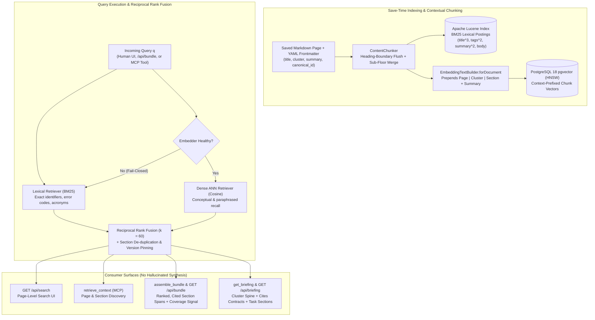

# Wikantik Hybrid Search and Context Bundle Architecture

Wikantik implements a dual-path **lexical + dense hybrid retrieval architecture** engineered to serve both human readers browsing in the React SPA and autonomous AI agents grounding complex software and research tasks over the Model Context Protocol (`assemble_bundle`, `retrieve_context`, `get_briefing`). Rather than relying on naive fixed-window chunking or single-mode vector similarity, Wikantik combines **heading-faithful Markdown chunking**, **context-prefixed dense embeddings**, **Apache Lucene BM25 lexical scoring**, and **Reciprocal Rank Fusion (RRF)**—with a deterministic fail-closed fallback to BM25 whenever the external embedding service is unreachable.

> **Operator Reference:** For runtime property keys (`wikantik.search.*`), Prometheus metrics (`wikantik_search_*`), and embedding outage runbooks, see [[HybridRetrieval|Hybrid Retrieval Operator Reference]] and [[HandlingEmbeddingServiceOutages|Handling Embedding Service Outages]].

---

## 1. End-to-End Hybrid Retrieval & Bundle Pipeline

When a page is saved or reindexed, `ContentChunker` splits the CommonMark AST along structural heading boundaries (`#`, `##`, `###`) and feeds two parallel indices: the **Apache Lucene full-page/section lexical index** and the **PostgreSQL 18 `pgvector` HNSW dense chunk index**. At query time, both indices execute in parallel and fuse their ranked lists before assembling version-pinned, citation-bearing sections.



---

## 2. Two Measured Architectural Levers (+14 Points Recall@12)

Every change to Wikantik's retrieval pipeline is gated by an offline evaluation harness ([[RetrievalExperimentHarness|Retrieval Experiment Harness]] and [[EvaluatingRetrievalQuality|Evaluating Retrieval Quality]]) over a frozen section-level benchmark (`eval/bundle-corpus`). Two concrete engineering levers moved global section `Recall@12` from **`0.60` to `0.74`**:

### 2.1 Heading-Fidelity Chunking (`ContentChunker`)
Naive token-window chunkers merge early paragraphs across `##` heading boundaries whenever an introduction is shorter than the target chunk size (e.g., 512 tokens). In early benchmarks, this caused the first `##` section of a page to inherit the root `#` heading path, mis-attributing citations and diluting section specificity.
- **The Fix:** `ContentChunker` force-flushes its merge-forward buffer at every Markdown heading boundary so every `##` and `###` section preserves its exact `heading_path` (`["# Page Title", "## 2. Section Heading"]`).
- **Sub-Floor Fragment Merge:** Ultra-short sibling fragments under the same parent heading are merged only when they share a common parent section, preserving structural boundaries while avoiding 15-token orphan vectors.

### 2.2 Contextual Document Embeddings (`EmbeddingTextBuilder.forDocument`)
A chunk body $B_i$ extracted from the middle of a deep technical article often uses pronouns or shorthand ("This protocol avoids the blocking window by...") without repeating the page subject or domain cluster. Embedding $B_i$ in isolation produces an ambiguous vector that collides across unrelated clusters (for example, "replication lag" in PostgreSQL vs. Kafka vs. DNS).

Before calling the embedding model (Ollama `qwen3-embedding` / `nomic-embed-text`), `EmbeddingTextBuilder.forDocument` prepends a deterministic structural header derived from the page's validated frontmatter and heading path:

$$
\vec{u}_i = \text{Embed}\!\left(\text{``Page: ''} \mathbin{\|} P.\text{title} \mathbin{\|} \text{`` | Cluster: ''} \mathbin{\|} P.\text{cluster}_1 \mathbin{\|} \text{`` | Section: ''} \mathbin{\|} H_i \mathbin{\|} \text{`` — ''} \mathbin{\|} P.\text{summary} \mathbin{\|} \text{`` — ''} \mathbin{\|} B_i\right)
$$

Where:
- $P.\text{title}$ is the page's frontmatter `title` (up to 90 characters).
- $P.\text{cluster}_1$ is the primary cluster declaration (the first entry in `cluster:`, driving domain disambiguation).
- $H_i$ is the full hierarchical heading path of chunk $c_i$.
- $P.\text{summary}$ is the 50–160 character discriminating summary from YAML frontmatter.

> **Why Frontmatter Quality Directly Governs Retrieval:** Because `title`, `cluster`, `summary`, and section headings are baked directly into every chunk's dense vector $\vec{u}_i$, vague headings (`## Overview`, `## Details`) or missing summaries directly degrade cosine similarity. This is why [[AgentGradeContentDesign|Agent-Grade Content Design]] enforces topic-specific `##` headings and 120–155 character summaries.

---

## 3. Mathematical Formulation: BM25, Cosine ANN, and Reciprocal Rank Fusion

### 3.1 Lexical Scoring (Apache Lucene BM25)
For a query $q = \{t_1, t_2, \dots, t_m\}$, Apache Lucene scores each document/section $d$ using field-boosted Okapi BM25 ($k_1 = 1.2$, $b = 0.75$), with boosts applied to `title` ($\times 3.0$), `tags` and `summary` ($\times 2.0$), and `contents` ($\times 1.0$):

$$
\text{BM25}(d, q) = \sum_{j=1}^{m} \text{IDF}(t_j) \cdot \frac{f(t_j, d) \cdot (k_1 + 1)}{f(t_j, d) + k_1 \cdot \left(1 - b + b \cdot \frac{|d|}{\text{avgdl}}\right)}
$$

BM25 excels at exact lexical anchors: Java class names (`OntologyShaclValidator`), configuration keys (`wikantik.search.hybrid.enabled`), CVE identifiers, and mathematical symbols.

### 3.2 Dense Vector Similarity (`pgvector` HNSW)
In parallel, the query $q$ is embedded into $\vec{v}_q \in \mathbb{R}^d$ and compared against chunk vectors $\vec{u}_i$ via cosine similarity over an HNSW index in PostgreSQL:

$$
\text{sim}(\vec{u}_i, \vec{v}_q) = \frac{\vec{u}_i \cdot \vec{v}_q}{\|\vec{u}_i\|_2 \, \|\vec{v}_q\|_2}
$$

### 3.3 Reciprocal Rank Fusion (RRF) & Worked Calculation
Because raw BM25 scores ($\in [0, \infty)$) and cosine similarities ($\in [-1, 1]$) are incommensurable and shift distribution across queries, Wikantik fuses the **ordinal ranks** $r_{\text{BM25}}(c_i, q) \in \{1, 2, \dots\}$ and $r_{\text{dense}}(c_i, q) \in \{1, 2, \dots\}$ using **Reciprocal Rank Fusion** with smoothing constant $k = 60$:

$$
\text{RRF}(c_i, q) = \frac{w_{\text{lex}}}{k + r_{\text{BM25}}(c_i, q)} + \frac{w_{\text{dense}}}{k + r_{\text{dense}}(c_i, q)}
$$

**Worked Numerical Example:** Suppose an agent queries $q =$ `"SHACL gate write chokepoints for KG edges"` with equal weights $w_{\text{lex}} = w_{\text{dense}} = 1.0$ and $k = 60$:
- **Candidate A (`WikantikKnowledgeGraph > Write-Time SHACL Gate`):** Ranks **#1** in BM25 ($r_{\text{BM25}} = 1$) because it contains the exact phrase `"write-time SHACL gate"`, and ranks **#2** in dense search ($r_{\text{dense}} = 2$):

$$
\text{RRF}(A, q) = \frac{1}{60 + 1} + \frac{1}{60 + 2} = 0.01639 + 0.01613 = 0.03252
$$

- **Candidate B (`WikantikOntologyManagement > Validating Predicates`):** Uses different wording (`"shape constraints on RDF triples"`), so it misses top lexical hits ($r_{\text{BM25}} = 40$) but ranks **#1** in dense search ($r_{\text{dense}} = 1$):

$$
\text{RRF}(B, q) = \frac{1}{60 + 40} + \frac{1}{60 + 1} = 0.01000 + 0.01639 = 0.02639
$$

Candidate A wins the top slot (`0.03252`) because it satisfies both exact terminology and semantic intent, while Candidate B still surfaces cleanly at #2 (`0.02639`) despite zero keyword overlap on `"chokepoints"`.

---

## 4. Choosing the Right Retrieval Surface (`assemble_bundle` vs. `retrieve_context` vs. `get_briefing`)

Wikantik exposes four retrieval entry points tailored to distinct human and agent access patterns (see [[ChoosingARetrievalMode|Choosing a Retrieval Mode]]):

| Surface / Tool | Granularity | Default Source | Key Capabilities & Output Contract | Primary Use Case |
| :--- | :--- | :--- | :--- | :--- |
| **`assemble_bundle`** (`/knowledge-mcp`, `GET /api/bundle`) | Section chunks (global hybrid) | Chunk-level BM25 + Dense RRF | De-duplicates sibling sections, pins page version + `canonical_id`, computes `coverage` signal (`high`/`medium`/`low`), enforces `maxTokens` budget. **Never synthesizes an LLM answer (`ADR-0001`).** | **Primary mid-session RAG grounding** for coding and content agents answering technical questions. |
| **`get_briefing`** (`/knowledge-mcp`, `GET /api/briefing`) | Cluster spine + Cited contracts + Task sections | Structural Index + `cites:` graph + Hybrid RRF | Returns cluster hub map, member summaries, cross-cluster `cites:` contracts (`SA-13`), and prompt-relevant sections. | **Session-start project initialization** (`SA-13`) before modifying code or architecture. |
| **`retrieve_context`** (`/knowledge-mcp`) | Page + Section discovery | Page/Section Hybrid RRF + Optional Neighbor Expansion | Returns top matching pages, matched section excerpts, and optional 1-hop Page Graph neighbors (`expandNeighbors: true`). | **Exploratory corpus discovery** when an agent is mapping which pages cover a topic. |
| **`GET /api/search`** (React SPA Search UI) | Page-level | Page BM25 + Dense RRF | Fast interactive page results with highlighted snippets and cluster/tag facets. | **Human interactive search** in the browser (`Cmd/Ctrl+K` or `/search`). |

### Example: Calling `assemble_bundle` over MCP
```json
{
  "jsonrpc": "2.0",
  "id": 10,
  "method": "tools/call",
  "params": {
    "name": "assemble_bundle",
    "arguments": {
      "query": "optimistic locking expectedContentHash FrontmatterSchema save validation",
      "cluster": "wikantik-development",
      "maxTokens": 4000
    }
  }
}
```

---

## 5. What Was Measured and Rejected (Evidence-Driven Simplicity)

A core discipline of Wikantik's search engineering is **deleting complexity that does not move measured recall** on `eval/bundle-corpus`:
- **Knowledge Graph Page-Level Reranking (Removed July 2026):** As documented in [[GraphRerankStep|Graph Rerank Step (Historical)]] and [[KnowledgeGraphRerank|Knowledge Graph Rerank]], a multi-source BFS co-mention reranker was tested in a ceiling experiment using a gold-standard Claude-extracted KG on `2026-06-16`. It produced **zero net lift** in `Recall@K` and `nDCG` because entity co-mention proximity at the page level does not equate to section-level answer relevance. The stage was deleted in `2026-07`.
- **HyDE (Hypothetical Document Embeddings) & `doc2query`:** Left disabled by default after offline runs showed increased tail latency without improving section recall over context-prefixed chunk embeddings.
- **LLM Listwise Reranking:** Disabled by default in the hot path to keep `assemble_bundle` p95 latency sub-100ms and deterministic.

---

**Cluster Hub:** [[WikantikPlatformHub|Wikantik Platform Hub: Knowledge Systems, Hybrid Search, and AI Agent Integrations]] (`wikantik-platform`)
