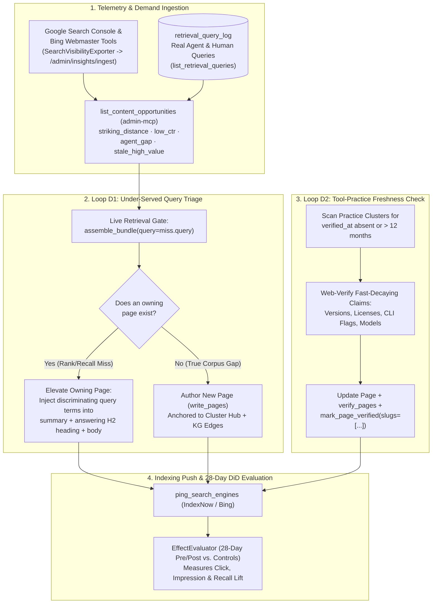

# Wiki Audit Demand and Freshness Loop: Closed-Loop Retrieval & SEO Maintenance

The **Wiki Audit Demand and Freshness Loop** is the recurring, evidence-driven maintenance workflow defined by the [[ContentProgramPolicy|Content Program Policy]] and powered by [[ContentIntelligenceDesign|Content Intelligence (`wikantik-insights`)]]. Rather than guessing which wiki pages to edit or mechanically rewriting frontmatter in bulk, content agents execute two empirical loops—**D1 (Under-Served Query Demand)** and **D2 (Tool-Practice Freshness Verification)**—and measure causal impact over a 28-day Difference-in-Differences window.

---

## 1. End-to-End Demand & Freshness Workflow



---

## 2. Loop D1: Sweeping Under-Served Real Queries (`list_retrieval_queries` & `list_content_opportunities`)

### Step 1: Pull Real Misses and Ranked Content Opportunities
Start by querying `/wikantik-admin-mcp` for queries where real callers received zero or one result (`max_avg_results=1`) alongside the scored opportunity backlog:

```json
// 1A. Real zero/low-hit agent & user queries from retrieval_query_log
{
  "name": "list_retrieval_queries",
  "arguments": {
    "max_avg_results": 1,
    "since_days": 14,
    "limit": 50
  }
}

// 1B. Scored multi-engine SEO & agent-gap opportunities from wikantik-insights
{
  "name": "list_content_opportunities",
  "arguments": {
    "opportunity_type": "striking_distance",
    "limit": 25
  }
}
```

### Step 2: Confirm Every Candidate Against the Live `assemble_bundle` Gate
A historical miss in `retrieval_query_log` may already have been fixed, and a clean `verify_pages` lint check **never** proves retrievability. Always run the live retrieval gate on `/knowledge-mcp`:

```json
{
  "name": "assemble_bundle",
  "arguments": {
    "query": "<exact under-served query>",
    "mode": "hybrid",
    "maxTokens": 3000
  }
}
```

### Step 3: Remediate Confirmed Misses via Discriminating Vocabulary (Not Generic Fluff)
Recall how `EmbeddingTextBuilder.forDocument` embeds every section chunk $c_i$ of page $P$:

$$
\vec{u}_i = \text{Embed}\!\left(\text{``Page: ''} \mathbin{\|} P.\text{title} \mathbin{\|} \text{`` | Cluster: ''} \mathbin{\|} P.\text{cluster}_1 \mathbin{\|} \text{`` | Section: ''} \mathbin{\|} H_i \mathbin{\|} \text{`` — ''} \mathbin{\|} P.\text{summary} \mathbin{\\|} \text{`` — ''} \mathbin{\\|} B_i\right)
$$

- **Case A — An Owning Page Exists, But Failed to Surface in the Top 3:**
  1. Place the query's **exact discriminating vocabulary** into the page's frontmatter `summary` (120–155 chars)—this lifts **every** chunk of that page in dense similarity and adds a $\times 2.0$ BM25 boost.
  2. Rename the answering section's `##` heading ($H_i$) from a generic label (`## Configuration`, `## Overview`) to a topic-specific heading containing the target terms—this lifts that specific chunk into `assemble_bundle` rank #1.
  3. Re-run `assemble_bundle(query)` after the asynchronous re-embed completes (typically 2–5 seconds) to confirm the target section now surfaces in the top 3.
- **Case B — No Owning Page Exists (True Content Gap):**
  - Draft a comprehensive Gold Standard article (`1,200–2,500+ words`) or runbook anchored to an existing cluster Hub (`**Cluster Hub:** [[HubSlug]]`), link it bidirectionally from the Hub, and curate its core Knowledge Graph edges.

---

## 3. Loop D2: Tool-Practice Freshness & External Fact Verification

Knowledge decays at two very different speeds across the corpus:
- **Slow-Decaying Foundational Content:** Mathematical proofs, classical distributed-systems algorithms (`TwoPhaseCommit`, `Paxos`), and historical analyses remain valid for years.
- **Fast-Decaying Tool & Model Practice Content:** Articles in `generative-ai`, `agentic-coding`, `devops-sre`, `data-science-practice`, and `wikantik-development` that cite model versions (`DeepSeek-R1`, `Claude 4.6`, `Gemini 2.5`), CLI flags, licensing tiers, or library APIs decay within **6 to 12 months**.

### Execution Procedure for Loop D2:
1. Filter tool-practice clusters for pages where `verified_at` is missing or older than the freshness threshold (`wikantik.verification.stale_days`, or 12 months for external tool guides).
2. **Verify against the external world (or repository source of truth)—never just re-read the prose:**
   - For Wikantik codebase pages: grep `wikantik.properties`, `McpProtocolIT.EXPECTED_TOOLS`, `web.xml`, and `CHANGELOG.md` (see [[WhatToDoWhenANonExistentFunctionIsCited|What To Do When a Non-Existent Function Is Cited]]).
   - For external technology/model pages: perform live web research to verify current release numbers, deprecations, benchmarks, and pricing (escaping all currency with `\$`).
3. Apply updates via `update_page`, validate with `verify_pages`, and stamp verification via `mark_page_verified(slugs=[...], verifier="jakefear")` (see [[VerifyingAnAgentGeneratedPage|Verifying an Agent-Generated Page]]).
4. Notify search engines immediately via `ping_search_engines` (`IndexNow`).

---

## 4. Measuring Causal Lift: The 28-Day Difference-in-Differences Evaluator

When a page $p$ is updated at time $t_0$ to resolve an opportunity from `list_content_opportunities`, `wikantik-insights` automatically tracks the intervention over a 28-day post-treatment window against a matched control group $C$ of untouched pages in the same cluster:

$$
\Delta_{\text{DiD}}(p) = \left(\bar{Y}_{p,\text{post}} - \bar{Y}_{p,\text{pre}}\right) - \frac{1}{|C|} \sum_{c \in C} \left(\bar{Y}_{c,\text{post}} - \bar{Y}_{c,\text{pre}}\right)
$$

Where $\bar{Y}$ measures daily organic clicks, SERP position, or agent retrieval hit rate. This prevents seasonal traffic shifts from being misread as editorial wins and closes the [[SimpleAgilityFeedbackLoopPattern|Simple Agility Feedback Loop]].

---

**Cluster Hub:** [[AgentCookbook|Agent Cookbook]] (`agent-cookbook`)
