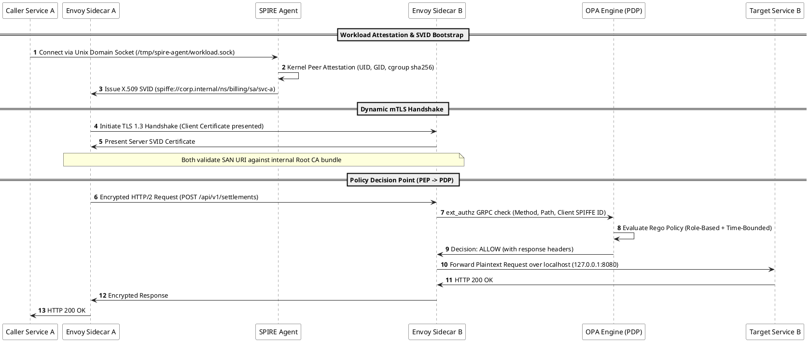

# Zero Trust Architecture: Cryptographic Workload Identity, Service Mesh mTLS, and Microsegmentation

Zero Trust Architecture (ZTA) is an enterprise cybersecurity paradigm founded on the axiom that perimeter-based network defense is fundamentally obsolete. Traditional "castle-and-moat" security architectures assumed that any user, host, or service operating within an internal corporate subnet or virtual private cloud (VPC) was inherently trustworthy. Modern attack vectors—including lateral movement, compromised credentials, software supply chain tampering, and insider threats—render network locality meaningless as a security primitive.

Zero Trust replaces implicit perimeter trust with an uncompromising operational mandate: **Never Trust, Always Verify**. As codified in NIST Special Publication 800-207, every access request—regardless of whether originating from an external client or an internal microservice running on the same Kubernetes worker node—must undergo explicit cryptographic authentication, least-privilege authorization, and continuous behavioral risk evaluation prior to granting access to sensitive assets.

## NIST SP 800-207 Core Tenets & Structural Model

The United States National Institute of Standards and Technology (NIST) establishes the definitive structural framework for Zero Trust across seven fundamental tenets:

1. **All Data Sources and Compute Services are Resources:** Any internal endpoint, database, cache, or object store is a discrete resource requiring individual protection.
2. **All Communication is Secured Regardless of Network Location:** Network location implies zero trust; internal traffic must be encrypted, authenticated, and integrity-protected identically to public Internet traffic.
3. **Access to Enterprise Resources is Granted on a Per-Session Basis:** Trust is ephemeral; authentication evaluates the current transaction rather than granting open-ended network access.
4. **Access is Determined by Dynamic Policy:** Authorization incorporates client identity, workload attributes, device posture, geographic anomaly, and behavioral telemetry.
5. **Continuous Asset State and Posture Monitoring:** The enterprise monitors and verifies the patch level, integrity, and compliance state of all computing assets.
6. **Dynamic Resource Authentication and Strict Enforcement:** Credentials and identity assertions must be short-lived, rotated automatically, and enforced through hardware-backed roots of trust.
7. **Comprehensive Telemetry and Continuous Diagnostic Logging:** The system aggregates granular access logs across control and data planes to feed automated Security Information and Event Management (SIEM) analytics.



## Workload Identity: The SPIFFE and SPIRE Standards

In containerized, ephemerally scheduled microservices (such as Kubernetes clusters and serverless runners), IP addresses churn continuously and cannot serve as immutable identifiers. Zero Trust anchors identity to the **Workload** using the CNCF **SPIFFE** (Secure Production Identity Framework for Everyone) specification.

### 1. SPIFFE IDs and SVID Formats

A **SPIFFE ID** is a standardized, URI-formatted identifier that uniquely names a workload within a specific cryptographic trust domain:

$$
\text{spiffe://}\underbrace{\text{corp.internal}}_{\text{Trust Domain}}/\underbrace{\text{ns/billing/sa/payment-service}}_{\text{Workload Path}}
$$

A **SPIFFE Verifiable Identity Document (SVID)** is the cryptographically verifiable assertion proving ownership of a SPIFFE ID. SVIDs are materialized primarily in two forms:
- **X.509-SVID:** An X.509 certificate containing the SPIFFE ID encoded inside the `Subject Alternative Name` (SAN) extension as a `UniformResourceIdentifier`. Used for establishing Mutual TLS (mTLS) tunnels.
- **JWT-SVID:** A cryptographically signed JSON Web Token carrying the SPIFFE ID in the `sub` claim. Used across Layer 7 HTTP proxies where intermediate layer-4 termination occurs.

### 2. SPIRE Architecture: Attestation and Minting

**SPIRE** (the SPIFFE Runtime Environment) implements production identity minting through a split architecture:

1. **The SPIRE Server:**
   - Functions as the intermediate Certificate Authority (CA) for the trust domain.
   - Stores registration entries mapping node selectors and workload selectors to designated SPIFFE IDs.
   - Attests worker nodes during bootstrapping using hardware or cloud primitives (e.g., TPM 2.0 endorsement keys, AWS Instance Identity Documents, or GCP Compute Engine service tokens).

2. **The SPIRE Agent:**
   - Runs as a localized daemon (Kubernetes DaemonSet) on each compute node.
   - Exposes the local **SPIFFE Workload API** over a Unix Domain Socket (`/tmp/spire-agent/workload.sock`).
   - Performs **Kernel Workload Attestation**: When a container requests an identity, the SPIRE agent inspects the calling process via Linux `/proc` filesystem and kernel syscalls (`SO_PEERCRED`), validating its container runtime cgroups, SELinux security context, namespace UUID, UID/GID, and cryptographic container image hash before minting an ephemeral SVID.

SVIDs are issued with aggressive lifetimes (e.g., 1 hour) and rotated continuously by the agent when reaching 50% validity, eliminating the operational liability of static, long-lived API keys or credentials.

## Mutual TLS (mTLS) in Service Mesh Infrastructure

To satisfy NIST Tenet #2, all inter-service communications must be mutually authenticated and wire-encrypted. In standard TLS, only the server provides a certificate to authenticate itself to the client. In **Mutual TLS (mTLS)**, both parties exchange and cryptographically validate certificates during the handshake.

### The TLS 1.3 Cryptographic Handshake Pipeline

In modern cloud environments, mTLS is terminated transparently by sidecar proxies (such as Envoy) or eBPF kernel sockets:

1. **Certificate Exchange:** During the TLS 1.3 handshake, the initiating proxy (Envoy A) presents its X.509 SVID. The receiving proxy (Envoy B) presents its server X.509 SVID.
2. **Trust Chain Validation:** Both proxies verify that the peer certificate was signed by an authorized CA within the shared SPIFFE trust bundle.
3. **SPIFFE ID SAN Extraction:** Upon cryptographic verification, Envoy B extracts the client's SPIFFE ID from the client certificate's SAN URI extension and injects it into internal proxy metadata (`downstream_peer_cert`).
4. **Cipher Suite Enforcement:** Traffic is encrypted using modern Authenticated Encryption with Associated Data (AEAD) ciphers (e.g., `TLS_AES_256_GCM_SHA384` or `TLS_CHACHA20_POLY1305_SHA256`) guaranteeing Forward Secrecy.

## Policy-Driven Microsegmentation with Open Policy Agent (OPA)

Network-layer firewalls operating at Layer 3/4 (IP and TCP port) lack application context. In a Zero Trust architecture, authorization is decoupled from application code and delegated to an external **Policy Decision Point (PDP)** such as **Open Policy Agent (OPA)**.

### Policy Enforcement Architecture: PEP and PDP Separation

- **Policy Enforcement Point (PEP):** The Envoy sidecar proxy intercepting inbound traffic. It extracts request attributes (HTTP method, path, headers, client SPIFFE ID) and queries the local PDP via high-speed gRPC (`envoy.filters.http.ext_authz`).
- **Policy Decision Point (PDP):** The OPA daemon evaluating declarative **Rego** policies against the incoming request context and localized data stores.

### Declarative Authorization Policy (Rego)

The following production Rego policy enforces least-privilege access, ensuring only attested workloads from the billing domain can access payment settlement APIs, while enforcing cryptographic expiration bounds:

```rego
package envoy.authz

import rego.v1

default allow := false

# Allow settlement execution only under strict identity and method constraints
allow if {
    is_authorized_spiffe_workload
    is_valid_http_method
    is_unexpired_svid
}

# 1. Enforce SPIFFE ID matching authorized caller
is_authorized_spiffe_workload if {
    some uri in input.attributes.source.certificate.sans
    regex.match("^spiffe://corp.internal/ns/billing/sa/settlement-engine$", uri)
}

# 2. Restrict to idempotent POST on target API path
is_valid_http_method if {
    input.attributes.request.http.method == "POST"
    input.attributes.request.http.path == "/api/v1/settlements"
}

# 3. Verify SVID is not expired using nanosecond epoch comparison
is_unexpired_svid if {
    time.now_ns() < input.attributes.source.certificate.not_after_ns
}
```

## Comparative Evaluation of Zero Trust Enforcement Planes

Enterprises evaluate multiple technical layers when implementing microsegmentation, balancing inspection depth against latency overhead:

| Enforcement Layer | Reference Technology | Primary Inspection Scope | Latency Impact | Key Security Strengths | Operational Vulnerabilities |
| :--- | :--- | :--- | :--- | :--- | :--- |
| **Kernel / eBPF** | Cilium / Tetragon | L3/L4 packets + socket-level identities | Ultra-Low ($< 50\mu\text{s}$) | Bypasses TCP stack overhead; kernel-level tamper resistance | Coarse L7 HTTP inspection; limited body parsing |
| **Sidecar Proxy** | Envoy / Istio | Full L7 HTTP/gRPC methods, headers, payloads | Low ($0.3\text{--}1.0\text{ms}$) | Fine-grained path routing, mTLS termination, ext_authz PDP hooks | Resource overhead per pod (CPU/memory); sidecar lifecycle management |
| **API Gateway** | Kong / Traefik | Edge ingress L7 authentication & rate limiting | Moderate ($1\text{--}3\text{ms}$) | Centralized ingress boundary; WAF and OAuth/OIDC token exchange | Single point of ingress failure; blind to internal lateral east-west traffic |
| **Cloud Security Groups** | AWS SG / GCP VPC Firewall | IP tuples, CIDR blocks, TCP/UDP ports | Negligible ($0\mu\text{s}$) | Cloud-native hypervisor isolation | Fragile with ephemeral pods; cannot inspect SPIFFE identity or L7 paths |

## Hardware Root of Trust and Continuous Adaptive Risk (CARTA)

To prevent identity compromise, Zero Trust architectures link workload identity directly to physical hardware roots of trust:

1. **TPM 2.0 Node Attestation:** Compute nodes feature a discrete **Trusted Platform Module (TPM)** containing an immutable Endorsement Key (EK) burned into silicon. During node boot, the TPM measures the bootloader, kernel, and initial ramdisk into Platform Configuration Registers (PCRs). The SPIRE Server validates these PCR quotes before issuing node credentials, ensuring compromised host operating systems cannot register workloads.
2. **Hardware Security Modules (HSM):** The Root Certificate Authority and intermediate SPIRE Server signing keys reside inside FIPS 140-2 Level 3 HSMs, guaranteeing private keys are never exposed in system memory or storage.
3. **Continuous Adaptive Risk and Trust Assessment (CARTA):** Rather than treating authentication as a static checkpoint, the architecture continuously assesses risk. If an identity emits abnormal telemetry (such as unexpected data exfiltration volume or anomalous access timings), risk scoring engines signal the PDP to revoke SVID tokens or trip circuit breakers immediately.

## Operational Implementation Checklist for Production Zero Trust

When rolling out Zero Trust across cloud and hybrid infrastructure, follow this verified engineering checklist:

1. **Decommission Static Long-Lived Credentials:** Eliminate static API keys, service account tokens stored in Kubernetes secrets, and hardcoded database passwords in favor of SPIFFE-issued dynamic X.509/JWT SVIDs.
2. **Enforce Strict mTLS Mode (`STRICT`):** Never leave service meshes in `PERMISSIVE` mode in production. Permissive mode accepts plaintext traffic if client certificates are omitted, leaving the system vulnerable to man-in-the-middle attacks.
3. **Configure Aggressive SVID Expiration:** Set maximum certificate lifetimes between 1 and 4 hours. Automated rotation prevents stolen certificates from being leveraged by adversaries.
4. **Audit and Unit-Test Rego Policies:** Treat security policy as versioned code. Write automated unit tests (`opa test`) verifying that unauthorized SPIFFE IDs, unexpected HTTP methods, and invalid query parameters return deterministic `403 Forbidden` responses.
5. **Centralize ExtAuthz Audit Telemetry:** Export every access decision (`ALLOW` and `DENY`) from the PEP/PDP into distributed logging pipelines (such as Elasticsearch or OpenSearch) with full tracing headers (`x-request-id`, traceparent) for real-time threat detection.

---

## References & Related Documentation

- [[AuthenticationAndAuthorizationHub|Authentication and Authorization Hub]] — Architectural foundations of identity, authn/authz, and access control.
- [[PkiAndCertificates|PKI and Certificates]] — Public key infrastructure, certificate authorities, revocation mechanisms, and X.509 standards.
- [[DistributedSystemsHub|Distributed Systems Hub]] — Resilience, fault tolerance, and secure communication across distributed services.
- [[JavaSecurityModel|Java Security Model]] — JVM classloader sandboxing, cryptographic providers, and secure coding practices.
- [[NetworkSecurityFundamentals|Network Security Fundamentals]] — Firewalls, packet filtering, VPNs, and defense-in-depth network topologies.

---

**Cluster Hub:** [[AuthenticationAndAuthorizationHub|Authentication and Authorization Hub]] (`security`)
