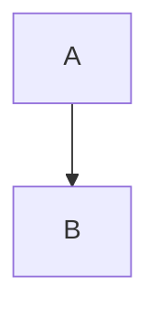

# Kitchen sink

Setext heading
==============

Second setext
-------------

## Inline text

Plain with **bold**, *emphasis*, ~~struck~~, `code`, and an escaped \* star and \[bracket\].

Links: [site](https://example.com/a), <https://example.com/auto>, bare https://example.com/bare here,
a [[Page]], [[Page|an alias]], [[Page#Intro]] and an image .

Reference [link text][ref1] and a shortcut [ref1] plus a footnote[^1] and another[^note].

[ref1]: https://example.com/ref "Ref title"

[^1]: The first footnote.
[^note]: A named footnote with `code`.

Inline math $x^2 + y_1$ and cost \$5 literal.

Plugin chip [{TableOfContents}] and one with args [{Image src='a.png' width='20'}] inline.

[{INSERT Foo}]

## Blocks

- item one
- [ ] open task
- [x] done task
  - nested item

1. first
2. second

> a quote
> continues

> [!NOTE] Heads up
> callout body with **bold**

> [!WARNING]
> bare callout

---

$$
\int_0^1 x\,dx = \frac{1}{2}
$$

```js
const a = 1; // code $$ [[NotALink]]
```



![[Other]]

![[Other#Intro]]

![[pic.png]]

<div class="raw">html block</div>

| Name | Value | Notes |
|------|:-----:|------:|
| a | **b** | [[Page]] |
| `c` | $d$ | e \| f |

Block with an id paragraph ^para1

Another one ^para2

Final line
